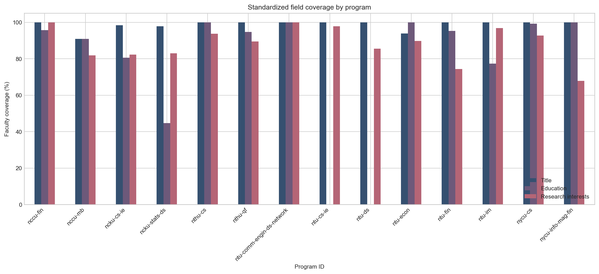
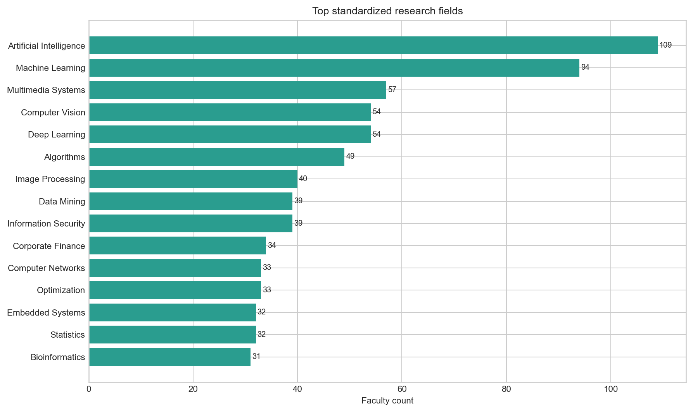
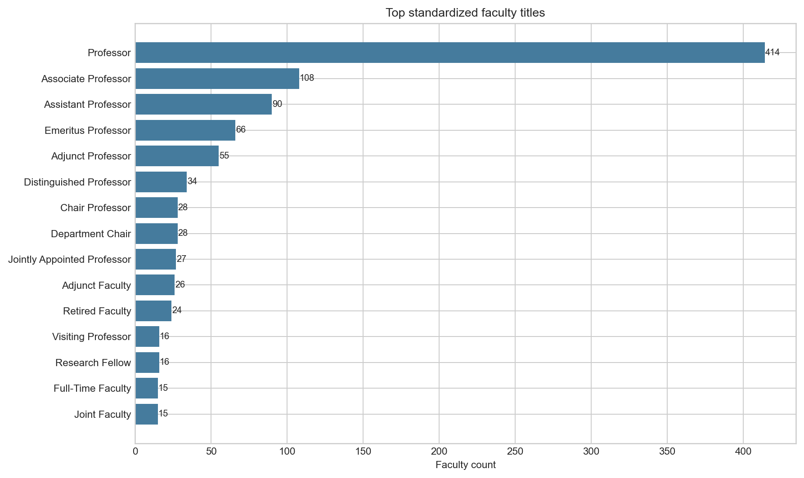
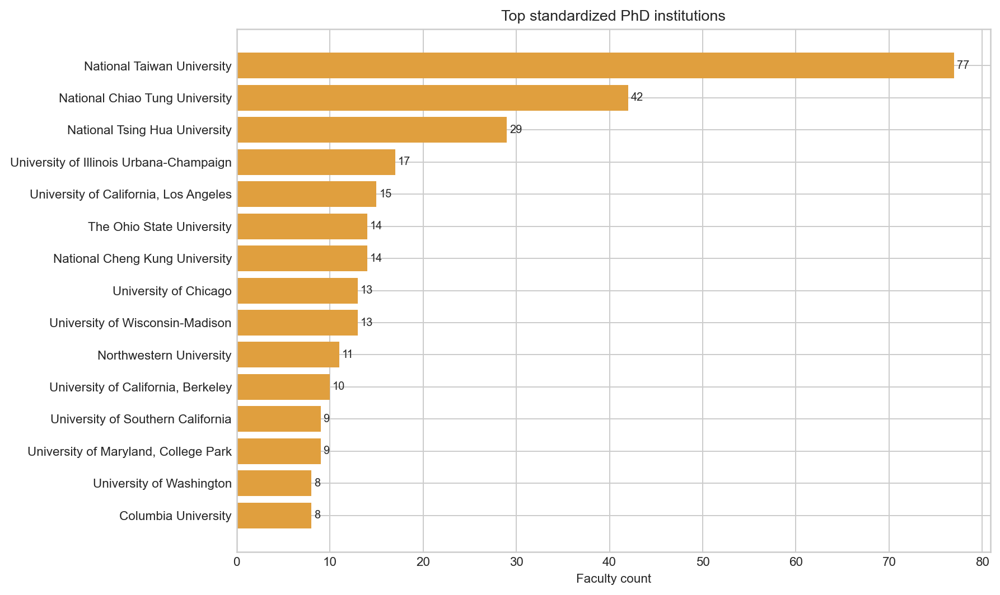
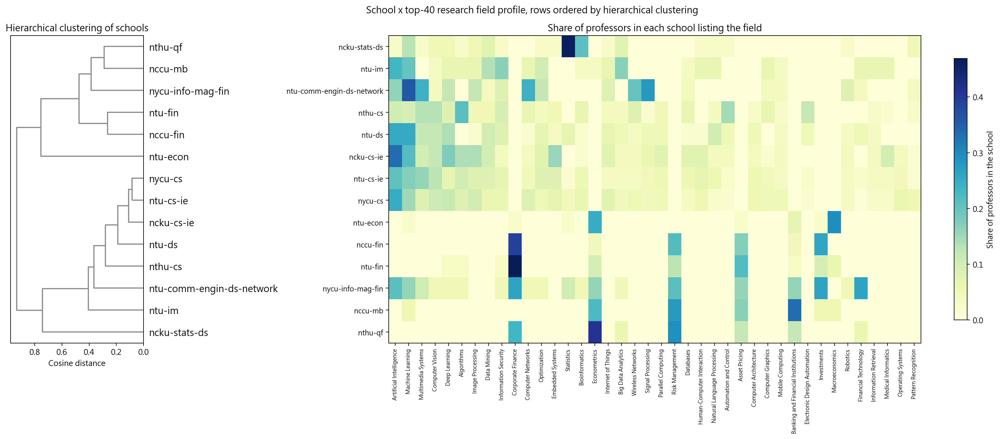
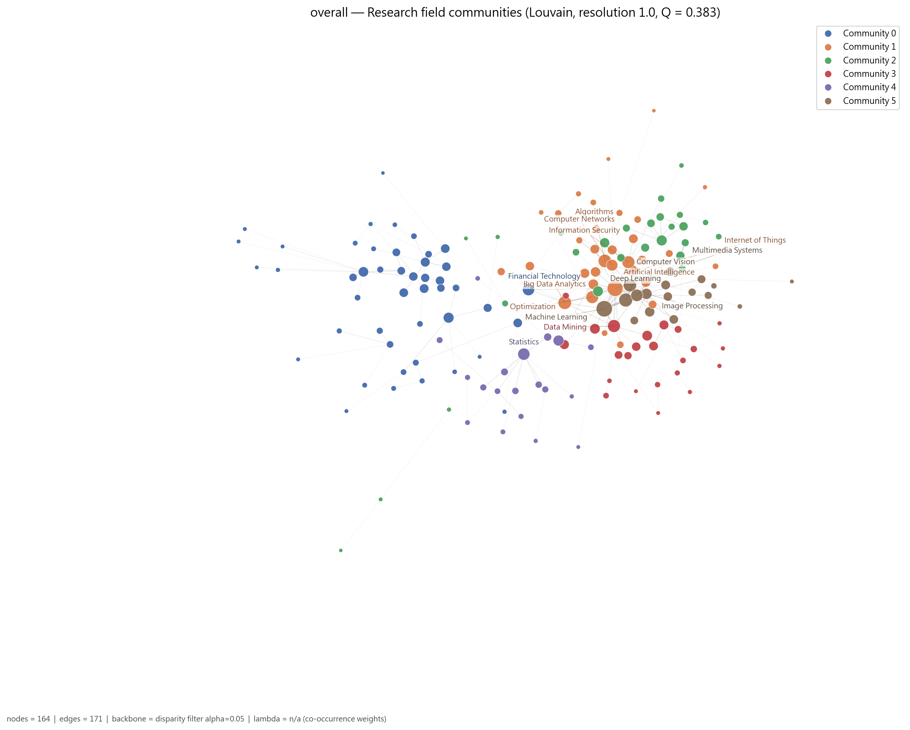
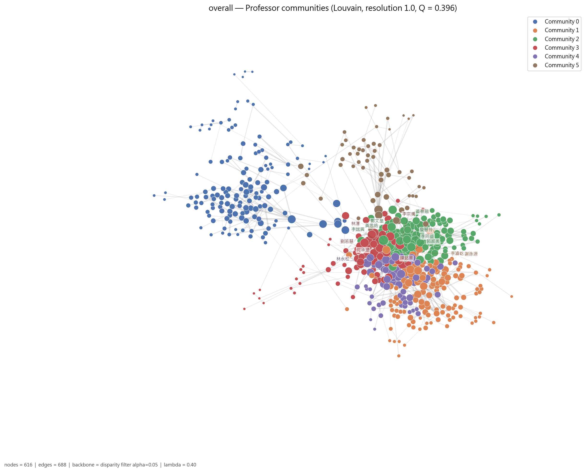
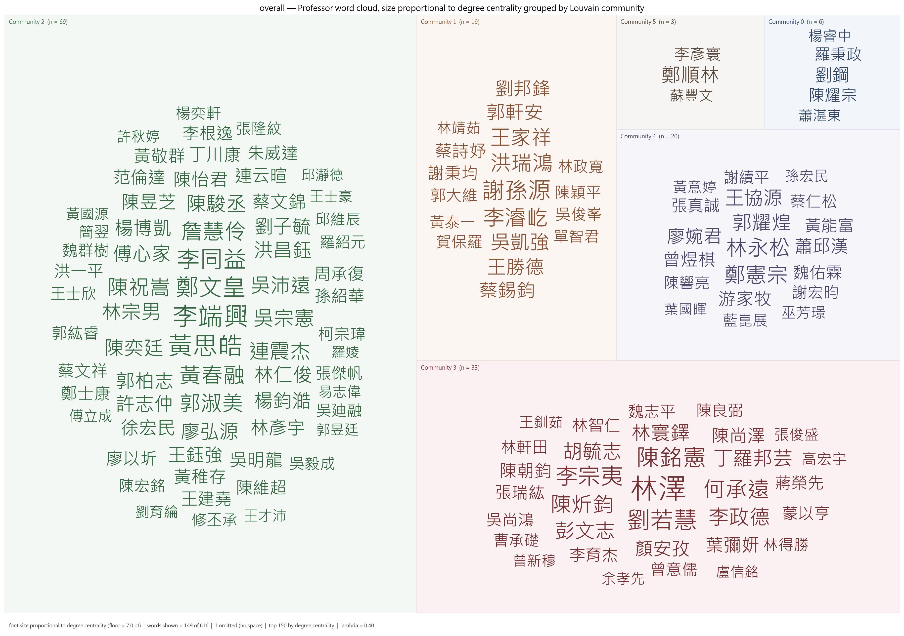
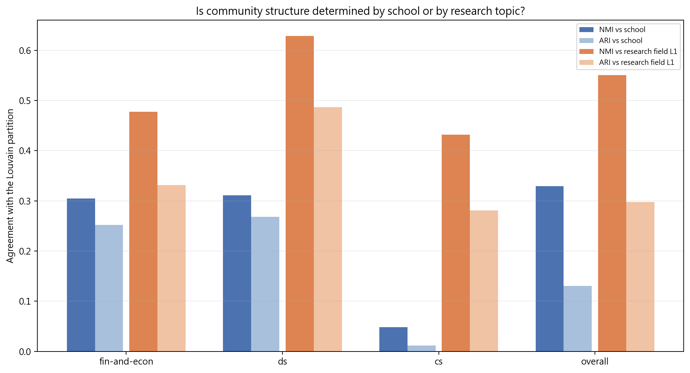
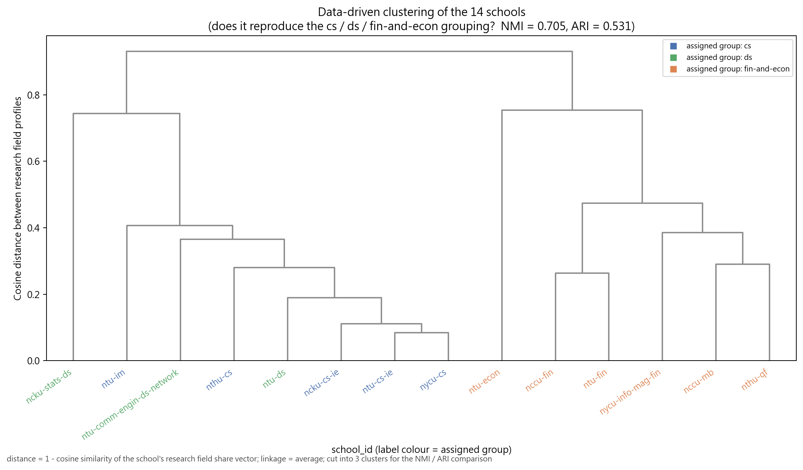

# 研究所師資社會網路分析（grad-school-social-network）

[English version →](README.en.md)

用爬蟲蒐集我有興趣推甄的 14 個台灣研究所系所的教授資料，整理後做社會網路分析（Social Network Analysis），目標是：

1. **認識各個系所**：每個系所的教授在研究什麼？主題怎麼分群？誰是核心人物？
2. **選擇申請目標**：哪些系所的研究方向與我的興趣最接近？系所之間有什麼差異？
3. **準備備審資料**：寫研究計畫或自傳時，知道該系所的主要研究集群與重要老師，才能對準方向。

所有資料都來自各系所官網公開的師資頁面，不使用外部網站補資料，也不自行推測。

> **使用前請先看**：這是學生的個人研究專案，**不是任何學校的官方資料**，覆蓋率與網路指標**不可**當成系所或教師的排名。
> 資料集中的 email 已全部不可逆假名化。完整聲明見 [LICENSE-data](LICENSE-data)。
> 程式碼 [MIT](LICENSE) ｜ 資料與分析成果 [CC BY 4.0](LICENSE-data) ｜ 資料蒐集日 2026-09-09

---

## 1. 這個專案在做什麼

我把 14 個系所分成三組：

| 組別 | 系所 |
| --- | --- |
| 資工組（cs） | 台大資工、台大資管、清大資工、陽明交大資工（資訊學院）、成大資工 |
| 資料科學組（ds） | 台大資料科學學程、台大電信所資料科學與網路組、成大統計（統計與資料科學） |
| 財金與經濟組（fin-and-econ） | 台大財金、台大經濟、政大財管、政大金融、清大計財、陽明交大資財 |

從官網抓下每位教授的姓名、職稱、學歷、研究領域，共 741 筆教授紀錄。接著把每位教授和他的研究領域連成一張「教授–研究領域」網路，用這張網路回答：

- 每個系所的教授研究哪些主題？
- 研究主題之間怎麼聚成集群？
- 教授之間依研究主題怎麼分群？每個集群的核心老師是誰？
- 把不同學校放在一起看，集群是被學校決定，還是被研究主題決定？

---

## 2. 流程與架構

### 2.1 三個階段

```
官網師資頁面
   │
   ▼
[1] 資料蒐集  scripts/data-collection/
   │   每個系所一支 collector.py 描述網站規則，共用邏輯在 collector_core.py
   │   中文與英文頁面分開抓，再依 ID / email / 姓名配對成一筆雙語紀錄
   │   輸出 data/data-collection/<school>/faculty.json
   ▼
[2] 資料預處理  scripts/data-preprocessing/
   │   把「AI / 人工智慧」統一成 Artificial Intelligence、「國立台灣大學 / NTU」統一成 National Taiwan University
   │   學歷拆成「學位、科系、學校」；無法確定的進人工覆核佇列
   │   輸出 data/data-preprocessing/faculty_standardized.json 與描述統計
   ▼
[3] 網路分析  scripts/network-analysis/current-version/
        1_build_taxonomy.ipynb          手工編定研究領域三層分類（170 個領域 → 46 個 L2 → 16 個 L1）
        2_build_network_data.ipynb      建立教授–研究領域二分網路的節點表與邊表，處理跨校合聘教授去重
        3_network_analysis.ipynb        對 18 個單位（14 系所 + 3 組 + 全體）做社群偵測、中心性、虛無模型、敏感度分析
        4_group_and_cross_comparison.ipynb  跨校與跨組比較
```

### 2.2 網路怎麼建

- **二分網路**：教授與研究領域各是一類節點，教授的研究領域包含某領域就連一條邊。
- **研究領域網路**：把二分網路投影到領域這一側，兩個領域被同一位教授研究就相連，邊的權重是共同研究的教授人數。
- **教授網路**：投影到教授這一側，兩位教授共享研究領域就相連。邊的權重考慮領域的稀有度（IDF 加權），並加入一小部分「同屬上層分類」的推論相似度（λ = 0.4）。
- **集群**：用 Louvain 演算法偵測社群（seed = 42）。
- **重要老師**：看教授在網路中的 degree（與多少同儕共享領域）與 betweenness（是否位於集群之間的橋梁位置）。這是網路位置，不是學術成就排名。
- **穩健性**：用 1,000 次隨機重排的虛無模型檢定結構是否非隨機；掃 λ ∈ {0, 0.3, 0.4, 0.5} 確認集群不受參數影響。

### 2.3 目錄結構

```
grad-school-social-network/
├── data/                       各階段的原始與處理後資料
│   ├── data-collection/        每校 faculty.json / faculty.csv / raw / run.json
│   ├── data-preprocessing/     faculty_standardized.json、標準化對照表、人工覆核佇列
│   └── network-analysis/       taxonomy、IDF、節點表與邊表
├── analysis/                   所有分析輸出（品質報告、描述統計、網路指標、474 張圖）
│   ├── data-collection/        每校蒐集品質報告與缺漏清單
│   ├── descriptive-stats-after-preprocessing/   覆蓋率、熱門研究領域、職稱、博士畢業學校
│   ├── network-analysis/       每個單位一個目錄，含 GraphML、中心性、社群、虛無模型與 figures/
│   │   └── comparison/         跨校與跨組比較
│   └── final-summarized-reports/   14 份系所總結報告 + 1 份跨科系比較報告（markdown）★ 想認識各系所請從這裡開始
├── scripts/                    爬蟲程式與六本分析 notebook
└── docs/                       四份階段報告與一份分析計畫
```

15 份總結報告的 **PDF 版**不放在 repo 裡（約 47 MB，內容與 markdown 相同），
改掛在 [Releases](https://github.com/brianwen818/grad-school-network-analysis/releases/latest)：想線上讀直接點 markdown，GitHub 會渲染；想下載列印再抓 PDF。

`analysis/network-analysis/by-figures/`（依圖號重新編排的 462 張圖）是各單位 `figures/` 的完整副本，
由 `4_group_and_cross_comparison.ipynb` 每次執行重建，因此不納入版本控制；重跑第 4 本 notebook 就會出現。

### 2.4 重跑方式

```powershell
# 1. 資料蒐集（全部或單一系所）
python -m pip install -r scripts/data-collection/requirements.txt
python scripts/data-collection/collect.py --school all

# 2. 資料預處理（分析階段的套件與爬蟲不同，要另外裝）
python -m pip install -r requirements-analysis.txt
python -m jupyter nbconvert --to notebook --execute --inplace scripts/data-preprocessing/1_faculty_data_preprocessing.ipynb
python -m jupyter nbconvert --to notebook --execute --inplace scripts/data-preprocessing/2_rf_and_phd_inst_comparison.ipynb

# 3. 網路分析（依序執行 1 → 4；第 3 本的虛無模型較耗時）
python -m jupyter nbconvert --to notebook --execute --inplace --ExecutePreprocessor.timeout=3600 scripts/network-analysis/current-version/1_build_taxonomy.ipynb
# ...同樣方式執行 2、3、4
```

詳細說明見 [docs/data-collection-report.md](docs/data-collection-report.md)、[docs/data-preprocessing-report.md](docs/data-preprocessing-report.md)、[docs/network-analysis-report.md](docs/network-analysis-report.md)。

---

## 3. 結果簡述

> 以下每張圖表都標明出處與建構方式。更完整的內容請看 [analysis/final-summarized-reports/](analysis/final-summarized-reports/)：每個系所一份報告，加上一份 [跨科系比較報告](analysis/final-summarized-reports/00-cross-school-comparison.md)。

### 3.1 描述統計

蒐集 14 個系所、741 筆教授紀錄。標準化後的覆蓋率：職稱 99.1%、學歷 71.5%、研究領域 89.3%。台大資工與台大資料科學學程的官網不提供學歷，所以學歷覆蓋率為 0；陽明交大資財（67.9%）與台大財金（74.4%）的研究領域覆蓋率最低，缺漏集中在兼任與合聘名單。



*出處：`analysis/descriptive-stats-after-preprocessing/field_coverage_by_school.png`。建構方式：由 `1_faculty_data_preprocessing.ipynb` 計算每個系所在職稱、學歷、研究領域三個欄位有標準化值的教師比例。*

全體最常見的研究領域是 Artificial Intelligence（109 人）與 Machine Learning（94 人），其次是 Multimedia Systems、Deep Learning、Computer Vision。財金側最多的是 Corporate Finance（34 人）與 Econometrics（30 人）。



*出處：`analysis/descriptive-stats-after-preprocessing/top_research_fields.png`。建構方式：研究領域為官網「主要研究領域」與「研究領域摘要」分別清洗、用雙語詞典標準化成英文後取聯集，計數為具有該領域的不重複教師人數。*

職稱以 Professor（414 人）最多，其次 Associate Professor（108）、Assistant Professor（90）、Emeritus Professor（66）。



*出處：`analysis/descriptive-stats-after-preprocessing/top_titles.png`。建構方式：官網職稱（如「專任副教授」、「Associate Professor」）以詞典統一成 31 個英文 canonical 職稱後計數。*

### 3.2 教授學歷分析

成功辨識的博士學歷中，台大（77 人）最多，其次交大（42）、清大（29），海外以 UIUC（17）、UCLA（15）、Ohio State（14）、Wisconsin（13）、Chicago（13）為主。



*出處：`analysis/descriptive-stats-after-preprocessing/top_phd_institutions.png`。建構方式：學歷先解析成「學位、科系、學校」，取學位為博士者，學校名稱以別名表對應為英文 canonical 值後計算不重複教師人數。*

各系所差異很大：

- **本校博士比例最高**：陽明交大資工（交大 29、台大 21）、清大資工（台大 11、清大 10）、成大資工（台大 10、成大 6）。
- **海外博士為主**：台大經濟前十名沒有任何台灣學校（Chicago 7、UCLA 6、Wisconsin 6）。
- **反映領域傳統**：台大資管有 University of Arizona 3 人（資管領域重鎮）；台大電信所資料科學組以 Michigan、UIUC、USC 為主。

分組圖：[資工組](analysis/descriptive-stats-after-preprocessing/group_comparison/phd_institutions/cs.png)、[資料科學組](analysis/descriptive-stats-after-preprocessing/group_comparison/phd_institutions/ds.png)、[財金與經濟組](analysis/descriptive-stats-after-preprocessing/group_comparison/phd_institutions/fin-and-econ.png)。

### 3.3 各系所特色與主要研究方向

下表整合每個系所的前三大研究領域、博士主要來源、教授網路的研究集群（括號為人數）與橋接者（betweenness 最高的三位）。每個系所的完整說明請點檔名。

| 系所 | 報告 | 前三大研究領域 | 博士主要來源 | 研究集群（人數） | 橋接教授 |
| --- | --- | --- | --- | --- | --- |
| 成大資工 | [ncku-cs-ie](analysis/final-summarized-reports/ncku-cs-ie.md) | Artificial Intelligence、Machine Learning、Deep Learning | 台大（10）、成大（6） | 深度學習、影像與電腦視覺（16）、嵌入式系統與智慧製造（13）、人工智慧、網路與行動運算（10）、資料探勘、資料庫與醫學資訊（6）、演算法與分散式／平行運算（5） | 連震杰、詹慧伶、謝孫源 |
| 清大資工 | [nthu-cs](analysis/final-summarized-reports/nthu-cs.md) | Algorithms、Automation and Control（EDA）、Computer Vision | 台大（11）、清大（10） | 人工智慧、視覺、多媒體與資安（31）、網路、雲端與系統（16）、演算法與生物資訊（15）、電子設計自動化與計算機架構（12） | 李端興、黃稚存、張隆紋 |
| 台大資工 | [ntu-cs-ie](analysis/final-summarized-reports/ntu-cs-ie.md) | Artificial Intelligence、Machine Learning、Multimedia Systems | 官網未提供 | 多媒體、電腦視覺與人機互動（22）、嵌入式系統、架構與作業系統（21）、機器學習核心（12）、自然語言、語音與資訊檢索（10）、演算法與圖論（9）、人工智慧、網路與物聯網（9） | 陳祝嵩、洪一平、李濬屹 |
| 台大資管 | [ntu-im](analysis/final-summarized-reports/ntu-im.md) | Artificial Intelligence、Machine Learning、Big Data Analytics | 台大（4）、Arizona（3） | 資料探勘與商業分析（8）、創新創業與資訊管理（7）、人工智慧、資安與網路（6）、知識管理與作業研究（5） | 劉若慧、何承遠、林永松 |
| 陽明交大資工 | [nycu-cs](analysis/final-summarized-reports/nycu-cs.md) | Artificial Intelligence、Machine Learning、Deep Learning | 交大（29）、台大（21） | 網路、系統與嵌入式（51）、人工智慧與資料探勘（36）、電腦視覺、影像與人機互動（31）、生物資訊與統計（12）、理論、演算法與密碼學（10） | 黃春融、洪瑞鴻、李宗夷 |
| 成大統計 | [ncku-stats-ds](analysis/final-summarized-reports/ncku-stats-ds.md) | Statistics、Bioinformatics、Biostatistics | 清大（4）、成大（3） | 統計方法、工業統計與可靠度（18）、生物統計與生物資訊（10）、機器學習與資料科學（6）、時間序列與多變量分析（5） | 鄭順林、馬瀰嘉、溫敏杰 |
| 台大電信所資料科學組 | [ntu-comm-engin-ds-network](analysis/final-summarized-reports/ntu-comm-engin-ds-network.md) | Machine Learning、Signal Processing、Computer Networks | 台大（5）、Michigan（4） | 機器學習與人工智慧（9）、網路與無線通訊（9）、訊號與影像處理（7） | 林澤、林宗男、廖婉君 |
| 台大資料科學學程 | [ntu-ds](analysis/final-summarized-reports/ntu-ds.md) | Machine Learning、Artificial Intelligence、Deep Learning | 官網未提供 | 人工智慧與深度學習（11）、多媒體、電腦視覺與物聯網（9）、資料探勘與最佳化（8）、系統、架構與電子設計自動化（7）、自然語言處理（7）、統計與因果推論（5） | 李濬屹、陳祝嵩、吳沛遠 |
| 政大財管 | [nccu-fin](analysis/final-summarized-reports/nccu-fin.md) | Corporate Finance、Financial Management、Investments | NTU Singapore（2）、Indiana（2） | 財務管理與投資（8）、資產訂價、市場微結構與風險（8）、公司理財與公司治理（5） | 張元晨、周冠男、陳鴻毅 |
| 政大金融 | [nccu-mb](analysis/final-summarized-reports/nccu-mb.md) | Banking and Financial Institutions、Risk Management、Econometrics | 台大（2）、政大（2） | 銀行、風險管理與金融工程（9）、資產訂價、金融市場與計量（7） | 林士貴、林建秀、廖四郎 |
| 清大計財 | [nthu-qf](analysis/final-summarized-reports/nthu-qf.md) | Econometrics、Financial Engineering、Risk Management | 台大（6）、Wisconsin（2） | 公司理財與風險管理（6）、計量、會計與不動產金融（6）、金融工程（5） | 劉鋼、俞明德、曾祺峰 |
| 台大經濟 | [ntu-econ](analysis/final-summarized-reports/ntu-econ.md) | Macroeconomics、Econometrics、Labor Economics | Chicago（7）、UCLA（6） | 總體經濟與貨幣經濟（17）、個體、產業組織與政治經濟（14）、計量經濟與勞動經濟（10） | 王建強、朴聖民、李宗穎 |
| 台大財金 | [ntu-fin](analysis/final-summarized-reports/ntu-fin.md) | Corporate Finance、Behavioral Finance、Asset Pricing | 台大（8）、Buffalo（2） | 資產訂價與行為財務（10）、公司理財與公司治理（8）、永續金融與公司理財（6）、風險管理、保險與衍生性商品（5）、計量經濟與總體（3） | 張晏誠、何耕宇、吳瑞萱 |
| 陽明交大資財 | [nycu-info-mag-fin](analysis/final-summarized-reports/nycu-info-mag-fin.md) | Financial Derivatives、Corporate Finance、Financial Technology | 台大（8）、清大（2） | 投資與資產訂價（6）、金融工程與金融科技（4）、公司理財與銀行（4）、人工智慧與資訊技術（4） | 黃思皓、鄧惠文、戴天時 |

*出處：研究領域與博士來源來自 `analysis/descriptive-stats-after-preprocessing/group_comparison/`；集群來自各系所 `analysis/network-analysis/<school>/professor_communities.csv`（集群名稱是我依成員共同領域取的）；橋接教授來自 `professor_centrality.csv` 的 betweenness。建構方式見第 2.2 節。*

幾個值得注意的特色：

- **清大資工**是唯一不以 AI 為首的資工系，最多人研究的是 Algorithms 與 EDA，集群區隔也最清楚（教授網路 modularity Q = 0.439，14 系所最高）。
- **成大資工**的 Medical Informatics 與 Smart Healthcare 比重高，反映成大醫學院的鄰近效應。
- **台大資管**同時有技術面（AI、資安）與管理面（Entrepreneurship、Knowledge Management），後者在其他資工系幾乎不出現。
- **陽明交大資財**是唯一同時涵蓋財務與 AI 的系所，Financial Technology 是兩側的橋。
- **台大經濟**與財金系所的詞彙幾乎不重疊，資料驅動分群把它獨立成一群。

下圖是 14 個系所在主要研究領域上的比例熱圖，可以一眼看出每個系所的輪廓：



*出處：`analysis/network-analysis/comparison/figures/05_school_keyword_heatmap.png`。建構方式：由 `4_group_and_cross_comparison.ipynb` 計算每個系所研究各領域的教授比例（該系所教授數為分母），只取全體人數最多的領域。*

### 3.4 研究主題分群

把全體 623 位有研究領域的教授（跨校去重後）的 170 個領域投影成研究領域網路，Louvain 找出 6 個主題社群：

| 社群 | 領域數 | 代表領域（教授人數） |
| --- | --- | --- |
| 財金與經濟 | 46 | Corporate Finance（34）、Econometrics（30）、Risk Management（22）、Asset Pricing（19）、Macroeconomics（16） |
| AI、演算法、網路與資安 | 33 | Artificial Intelligence（100）、Algorithms（49）、Information Security（35）、Computer Networks（30）、Optimization（30） |
| 系統、架構與 EDA | 26 | Embedded Systems（28）、Parallel Computing（20）、Computer Architecture（18）、Operating Systems（15）、EDA（14） |
| 資料探勘、NLP 與醫學資訊 | 23 | Data Mining（36）、Natural Language Processing（17）、Medical Informatics（15）、Information Retrieval（13） |
| 統計與生物資訊 | 19 | Statistics（32）、Bioinformatics（31）、Biostatistics（12）、Bayesian Statistics（9） |
| 機器學習、視覺與多媒體 | 17 | Machine Learning（85）、Multimedia Systems（52）、Deep Learning（51）、Computer Vision（50）、Image Processing（37） |



*出處：`analysis/network-analysis/overall/keyword_communities.csv`、`figures/05_keyword_network_communities.png`。建構方式：研究領域網路為教授–領域二分網路的投影，邊權為共同研究兩領域的教授人數；Louvain（seed = 42，resolution 1.0）偵測社群，modularity Q = 0.383；虛無模型檢定 z = 36.0（p = 0.002），代表結構明顯非隨機。節點顏色為社群，大小與 degree 成正比。*

社群與手工編定的 taxonomy 只部分吻合（NMI = 0.534），例如 Machine Learning 與 Computer Vision 在資料中聚成一群，而 Artificial Intelligence 卻與 Algorithms、網路、資安聚在一起。這代表資料驅動的主題群不等於教科書式的分類。

### 3.5 教授分群與各集群重要教授

全體教授網路（616 位）分成 6 個集群，集群幾乎完全跟著研究主題走，而不是跟著學校走：

| 集群 | 人數 | 主要學校 | 共同研究領域 | degree 最高的教授 |
| --- | --- | --- | --- | --- |
| 財金與經濟 | 146 | 台大經濟、台大財金、政大財管、政大金融 | Corporate Finance、Econometrics、Risk Management、Asset Pricing | 劉鋼（清大計財）、陳耀宗（陽明交大資財）、羅秉政（政大金融）、鄧惠文（陽明交大資財） |
| 系統、演算法與架構 | 136 | 陽明交大資工、清大資工、台大資工、成大資工 | Algorithms、Embedded Systems、Parallel Computing、Computer Architecture | 謝孫源（成大資工）、李濬屹（台大資工／資料科學）、洪瑞鴻（陽明交大資工）、王家祥（清大資工） |
| 機器學習、視覺與多媒體 | 127 | 陽明交大資工、台大資工、台大資料科學、成大資工 | Machine Learning、Computer Vision、Artificial Intelligence、Image Processing | 李端興（清大資工）、黃思皓（陽明交大資財）、鄭文皇（台大資工／資料科學）、李同益（成大資工） |
| 資料探勘、NLP 與商業分析 | 81 | 台大資料科學、陽明交大資工、台大資管、台大資工 | Data Mining、Artificial Intelligence、Big Data Analytics、NLP | 林澤（台大電信所／資料科學）、劉若慧（台大資管）、陳銘憲（台大資工／電信所／資料科學）、李宗夷（陽明交大資工） |
| AI、物聯網與資安 | 68 | 陽明交大資工、台大資工、清大資工 | Artificial Intelligence、Internet of Things、Information Security、Mobile Computing | 林永松（台大資管）、鄭憲宗（成大資工）、郭耀煌（成大資工）、王協源（陽明交大資工） |
| 統計與生物資訊 | 58 | 成大統計、陽明交大資工、台大資料科學 | Statistics、Bioinformatics、Biostatistics | 鄭順林（成大統計）、李彥寰（台大資工）、蘇豐文（清大資工）、荊宇泰（陽明交大資工） |



*出處：`analysis/network-analysis/overall/professor_communities.csv`、`professor_centrality.csv`、`figures/09_professor_network_communities.png`。建構方式：教授網路為二分網路的投影，邊權 w = S_exp + λ·S_inf（S_exp 為共享領域的 IDF 加權和，S_inf 為共享 taxonomy 上層分類的推論相似度，λ = 0.4）；跨校合聘教授以 person_id 去重；Louvain 偵測集群，Q = 0.396。「共同研究領域」是從二分網路統計集群成員的領域得到。*



*出處：`analysis/network-analysis/overall/figures/27_professor_wordcloud_degree_by_community.png`。建構方式：依 Louvain 集群分塊、同集群同色，字級與 degree 成線性正比並設下限。*

**集群是被學校決定，還是被研究主題決定？** 把三組各自合併成跨校網路後，Louvain 集群對「研究主題 L1」的 NMI 都高於對「學校」的 NMI，school assortativity 全部接近 0（cs 組只有 0.003）。也就是說，教授並不特別傾向連到同校的人，集群依主題形成。

| 單位 | NMI vs 學校 | NMI vs 研究主題 | 結論 |
| --- | --- | --- | --- |
| cs | 0.048 | 0.432 | 研究主題 |
| ds | 0.311 | 0.629 | 研究主題 |
| fin-and-econ | 0.305 | 0.477 | 研究主題 |
| 全體 | 0.329 | 0.551 | 研究主題 |



*出處：`analysis/network-analysis/comparison/cross_school_bridging_summary.csv`、`figures/09_community_vs_school_alignment.png`。建構方式：在組層級教授網路上，分別計算 Louvain 集群對 school_id 分割與對 parent_l1 分割的 normalized mutual information。*

**人為分組是否有資料支持？** 以各系所的研究領域比例向量做階層分群，財金與經濟組最先被分開，台大經濟再自成一群；但 cs 與 ds 的 8 個系所全部落在同一群，資料無法把資料科學系所與資工系所分開。ds 組 86 個領域中只有 13 個是該組獨有，其餘都與 cs 共享。



*出處：`analysis/network-analysis/comparison/figures/06_school_similarity_dendrogram.png`、`school_grouping_check.csv`。建構方式：以系所 × 領域比例矩陣的餘弦距離做階層分群（average linkage），切 3 群與指定分組比較，NMI = 0.705。*

### 3.6 對申請的意義

- **想做 AI／視覺／多媒體**：台大資工、陽明交大資工、台大資料科學學程都有大型集群，成大資工的醫學影像是另一個切入點。
- **想做系統／架構／EDA**：清大資工（EDA 傳統）、台大資工（嵌入式與作業系統）、陽明交大資工（網路與系統集群最大）。
- **想做資料探勘／NLP／商業分析**：台大資管（劉若慧、魏志平）、台大資料科學學程（林守德、陳縕儂）、成大資工（陳朝鈞）。
- **想做統計／生物統計**：成大統計是唯一的統計主體系所，陽明交大資工也有一個生物資訊與統計集群。
- **想做財金**：台大財金（公司理財、行為財務）、政大財管（公司理財、投資）、政大金融（銀行、風險）、清大計財（計量、金融工程）各有不同重心；陽明交大資財適合想結合 AI 與財務的人。
- **想做經濟**：台大經濟是唯一選擇，三個集群（總體、個體、計量勞動）分工清楚。

寫備審時，可以直接引用系所報告第 3 節的集群與重要老師，說明自己的研究興趣落在哪個集群、與哪幾位老師的方向接近。

---

## 4. 資料限制

- 研究領域來自官網自填，粒度與深度因人而異；網路密度與集群數有一部分反映填寫習慣。
- 覆蓋率從 67.9% 到 100%，不可解讀為系所或教授的品質排名。
- 台大資工與台大資料科學無學歷資料；成大資工的英文姓名多被抓成模板文字；台大經濟與成大統計有少數中英未配對的重複紀錄。
- 「重要教授」指網路位置（degree、betweenness），不是學術成就排名。
- 系所層級不做跨校去重，合聘教授會同時出現在多個系所的報告中；組層級與全體層級才去重。

資料蒐集日期：2026-09-09。網站內容日後可能變動，重新蒐集後請先檢查各校 `run.json` 與 `analysis/data-collection/collection-report.md`。

---

## 5. 資料蒐集原則

爬蟲只抓各系所官網**公開的師資列表與個人頁面**，不登入、不繞過任何存取限制、不碰非公開資料。
實作上（見 [scripts/data-collection/collector_core.py](scripts/data-collection/collector_core.py)）：

- 送出可辨識的 User-Agent：`grad-school-social-network/1.0 (faculty research; respectful crawler)`
- 每次請求間隔 0.35 秒，失敗時指數退避重試，不做並行轟炸
- 一個系所只跑數十個頁面，整批 14 校一次跑完的請求量遠低於一般瀏覽
- 只解析 HTML，不下載附件、不抓圖片

`data/data-collection/<school>/raw/` 保留原始擷取快照，目的是讓分析結果可被查核；
這些內容的著作權屬於各校，再散布請自行確認（見 [LICENSE-data](LICENSE-data) 第 2 節）。

## 6. 個人資料

資料集中的姓名、職稱、學歷、研究領域皆取自官網公開師資頁面。

**電子郵件已全部假名化**：原始資料中 518 個不重複信箱（共 3,920 處）以 HMAC-SHA256 加未公開的隨機
salt 置換成 `<16 碼 hex>@redacted.invalid`。同一信箱固定對應同一 token，所以
`2_build_network_data.ipynb` 裡靠信箱做的「跨校合聘教授去重」與「系辦共用信箱偵測」完全照常運作，
但無法還原成真實信箱。salt 不隨專案發布。

若你是資料中的教師、希望移除或更正自己的紀錄，請開一個 Issue，我會盡快處理。

## 7. 授權

| 範圍 | 授權 |
| --- | --- |
| 程式碼（`scripts/`、設定檔） | [MIT](LICENSE) |
| 資料集與分析成果（`data/`、`analysis/`、`docs/`） | [CC BY 4.0](LICENSE-data) |
| `data/data-collection/*/raw/` 原始網頁快照 | 著作權屬各校，僅供查核，不在本專案授權範圍內 |

引用格式見 [CITATION.cff](CITATION.cff)。

`scripts/network-analysis/previous-examples/` 原本放了兩本 HKUST FM 的參考 notebook，
那不是本專案的作品、也沒有明確授權，因此不隨專案發布；它們提供的概念整理保留在
[core-ideas.md](scripts/network-analysis/previous-examples/core-ideas.md)。
