# 14 個系所的跨科系比較報告

資料日期：2026-09-09 蒐集、2026-09-10 完成網路分析。本報告整合 14 份系所報告的結果，並引用 `analysis/network-analysis/comparison/` 的跨單位比較輸出。

> **本報告的資料來源**
> 本專案分三個階段：(1) 資料蒐集（`scripts/data-collection/`）從 14 個系所官網爬取師資的姓名、職稱、學歷與研究領域，中英文分開蒐集後配對；
> (2) 資料預處理（`scripts/data-preprocessing/`）把職稱、學歷、研究領域標準化成英文 canonical 值，並產生描述統計；
> (3) 網路分析（`scripts/network-analysis/current-version/`）建立「教授–研究領域」二分網路，投影成研究領域網路與教授網路，做社群偵測、中心性、虛無模型與敏感度分析。
> 本報告所有數字、表格與圖表都取自 `analysis/` 底下這三個階段的輸出，每張圖表下方都標明出處與建構方式，附錄另有完整清單。
> 「研究集群」指教授網路的 Louvain 社群；「重要老師」依教授在該網路中的 degree（與多少同儕共享領域）與 betweenness（是否位於集群之間的橋梁位置）判定，**不是**學術成就的排名。

## 1. 分析對象與分組

| 組別 | 系所 |
| --- | --- |
| 財金與經濟組（fin-and-econ） | 政治大學財務管理學系（`nccu-fin`）、政治大學金融學系（`nccu-mb`）、清華大學計量財務金融學系（`nthu-qf`）、台灣大學經濟學系（`ntu-econ`）、台灣大學財務金融學系（`ntu-fin`）、陽明交通大學資訊管理與財務金融學系（`nycu-info-mag-fin`） |
| 資料科學組（ds） | 成功大學統計學系（統計與資料科學）（`ncku-stats-ds`）、台灣大學電信工程學研究所 資料科學與網路組（`ntu-comm-engin-ds-network`）、台灣大學資料科學學位學程（`ntu-ds`） |
| 資工組（cs） | 成功大學資訊工程學系（`ncku-cs-ie`）、清華大學資訊工程學系（`nthu-cs`）、台灣大學資訊工程學系（`ntu-cs-ie`）、台灣大學資訊管理學系（`ntu-im`）、陽明交通大學資訊工程學系（資訊學院）（`nycu-cs`） |

分組為研究者事先指定（見 `docs/plan-for-network-analysis.md`），第 5 節會檢驗資料是否支持這個分組。

## 2. 各科系一句話定位

| 系所 | school_id | 定位 | 個別報告 |
| --- | --- | --- | --- |
| 成功大學資訊工程學系 | `ncku-cs-ie` | AI 為主的資工系，醫學資訊與智慧製造是特色。 | [報告](ncku-cs-ie.md) |
| 清華大學資訊工程學系 | `nthu-cs` | 演算法與 EDA 傳統強項的資工系，集群區隔最清楚（教授網路 Q 最高）。 | [報告](nthu-cs.md) |
| 台灣大學資訊工程學系 | `ntu-cs-ie` | 大型資工系，多媒體視覺與嵌入式系統兩大集群，虛無模型檢定全部顯著。 | [報告](ntu-cs-ie.md) |
| 台灣大學資訊管理學系 | `ntu-im` | 管理學院的資訊系，技術與管理兩面並存，創業與知識管理為特色。 | [報告](ntu-im.md) |
| 陽明交通大學資訊工程學系（資訊學院） | `nycu-cs` | 規模最大的資訊學院，AI 為樞紐，主題結構最強，本校博士比例最高。 | [報告](nycu-cs.md) |
| 成功大學統計學系（統計與資料科學） | `ncku-stats-ds` | 唯一的統計系，統計方法與生物統計為主體，另有一個小型機器學習集群。 | [報告](ncku-stats-ds.md) |
| 台灣大學電信工程學研究所 資料科學與網路組 | `ntu-comm-engin-ds-network` | 機器學習、網路通訊、訊號處理三個學門界線清楚，集群與 taxonomy 一致度最高。 | [報告](ntu-comm-engin-ds-network.md) |
| 台灣大學資料科學學位學程 | `ntu-ds` | 跨院整合的 AI 學程，主題最寬但也最零散，六個集群加上多位孤立教師。 | [報告](ntu-ds.md) |
| 政治大學財務管理學系 | `nccu-fin` | 純財務科系，公司理財、財務管理與投資三軸並立，教授之間高度互連。 | [報告](nccu-fin.md) |
| 政治大學金融學系 | `nccu-mb` | 偏銀行、風險管理與金融工程的財金科系，分成風險與計量兩個集群。 | [報告](nccu-mb.md) |
| 清華大學計量財務金融學系 | `nthu-qf` | 小而集中的計量財務科系，計量經濟與金融工程比重高於公司理財。 | [報告](nthu-qf.md) |
| 台灣大學經濟學系 | `ntu-econ` | 唯一的純經濟系，總體、個體與計量勞動三大集群，海外博士比例最高。 | [報告](ntu-econ.md) |
| 台灣大學財務金融學系 | `ntu-fin` | 以公司理財為絕對核心的財金系，資產訂價與行為財務為第二軸。 | [報告](ntu-fin.md) |
| 陽明交通大學資訊管理與財務金融學系 | `nycu-info-mag-fin` | 唯一同時涵蓋財務與資訊的系所，金融科技是兩側的橋梁。 | [報告](nycu-info-mag-fin.md) |

*來源：各系所報告的綜合判斷。*

## 3. 規模、完整度與網路指標總覽

| school_id | 組 | 教授數 | coverage % | 領域數 | 領域網路密度 | 領域網路 Q | 領域社群數 | 教授網路密度 | 教授網路 Q | 教授集群數 | 領域集中度 Gini | L1 過寬 |
| --- | --- | --- | --- | --- | --- | --- | --- | --- | --- | --- | --- | --- |
| `ncku-cs-ie` | cs | 51 | 82.3 | 66 | 0.138 | 0.397 | 7 | 0.402 | 0.235 | 5 | 0.432 | AI & Machine Learning |
| `nthu-cs` | cs | 76 | 93.8 | 65 | 0.111 | 0.422 | 6 | 0.224 | 0.439 | 4 | 0.444 | — |
| `ntu-cs-ie` | cs | 88 | 97.8 | 74 | 0.113 | 0.385 | 6 | 0.287 | 0.318 | 6 | 0.445 | — |
| `ntu-im` | cs | 30 | 96.8 | 44 | 0.189 | 0.314 | 5 | 0.394 | 0.248 | 4 | 0.334 | — |
| `nycu-cs` | cs | 141 | 92.8 | 88 | 0.098 | 0.386 | 7 | 0.259 | 0.350 | 5 | 0.487 | — |
| `ncku-stats-ds` | ds | 39 | 83.0 | 44 | 0.179 | 0.466 | 3 | 0.466 | 0.171 | 4 | 0.442 | Statistics & Statistical Methods |
| `ntu-comm-engin-ds-network` | ds | 25 | 100.0 | 31 | 0.191 | 0.407 | 4 | 0.510 | 0.374 | 3 | 0.416 | Vision, Multimedia & Human-Centered Computing |
| `ntu-ds` | ds | 59 | 85.5 | 63 | 0.144 | 0.371 | 5 | 0.388 | 0.222 | 6 | 0.452 | AI & Machine Learning |
| `nccu-fin` | fin-and-econ | 23 | 100.0 | 24 | 0.221 | 0.276 | 4 | 0.757 | 0.123 | 3 | 0.430 | Corporate Finance & Governance ／ Asset Pricing & Financial Markets |
| `nccu-mb` | fin-and-econ | 18 | 81.8 | 23 | 0.240 | 0.289 | 4 | 0.408 | 0.226 | 2 | 0.348 | Financial Engineering & Risk |
| `nthu-qf` | fin-and-econ | 17 | 89.5 | 20 | 0.337 | 0.271 | 3 | 0.544 | 0.184 | 3 | 0.383 | Financial Engineering & Risk |
| `ntu-econ` | fin-and-econ | 44 | 89.8 | 28 | 0.194 | 0.441 | 4 | 0.477 | 0.313 | 3 | 0.451 | Economics & Policy |
| `ntu-fin` | fin-and-econ | 32 | 74.4 | 33 | 0.131 | 0.325 | 7 | 0.472 | 0.152 | 5 | 0.452 | Asset Pricing & Financial Markets ／ Corporate Finance & Governance |
| `nycu-info-mag-fin` | fin-and-econ | 19 | 67.9 | 39 | 0.207 | 0.362 | 4 | 0.556 | 0.140 | 4 | 0.349 | Financial Engineering & Risk |

*出處：`analysis/network-analysis/comparison/school_metrics_comparison.csv`*  
*建構方式：由 `4_group_and_cross_comparison.ipynb` 彙整 14 個系所的 `network_metrics.json` 與 `l1_coverage_guardrail.csv`。所有跨單位比較只用密度、平均 degree、modularity 等正規化指標，並併列 coverage 以避免把資料完整度誤讀為結構差異；Gini 為各領域教授人數分布的集中度。*

重點觀察：

- **規模**：陽明交大資訊學院（141 人進入網路）最大，清大計財（17 人）最小。規模差異使得原始邊數不可比，因此表中只列正規化指標。
- **完整度**：陽明交大資財（67.9%）與台大財金（74.4%）最低，兩者缺漏集中在兼任與合聘名單；政大財管、台大電信所資料科學組為 100%。
- **教授網路 Q**：清大資工（0.439）、台大電信所資料科學組（0.374）、陽明交大資工（0.350）最高，集群區隔最清楚；政大財管（0.123）、陽明交大資財（0.140）最低，因為領域少、教授之間幾乎全部互連。
- **教授網路密度**：財金系所普遍高於 0.4（政大財管 0.757），資工系所介於 0.22 到 0.40。這是財金領域詞彙少、共享率高的自然結果，不代表財金教授合作更緊密。
- **L1 過寬**：10 個系所有至少一個 L1 涵蓋超過 50% 教授，只有清大資工、台大資工、台大資管、陽明交大資工沒有；這四個資工組系所的主題分布最均衡。

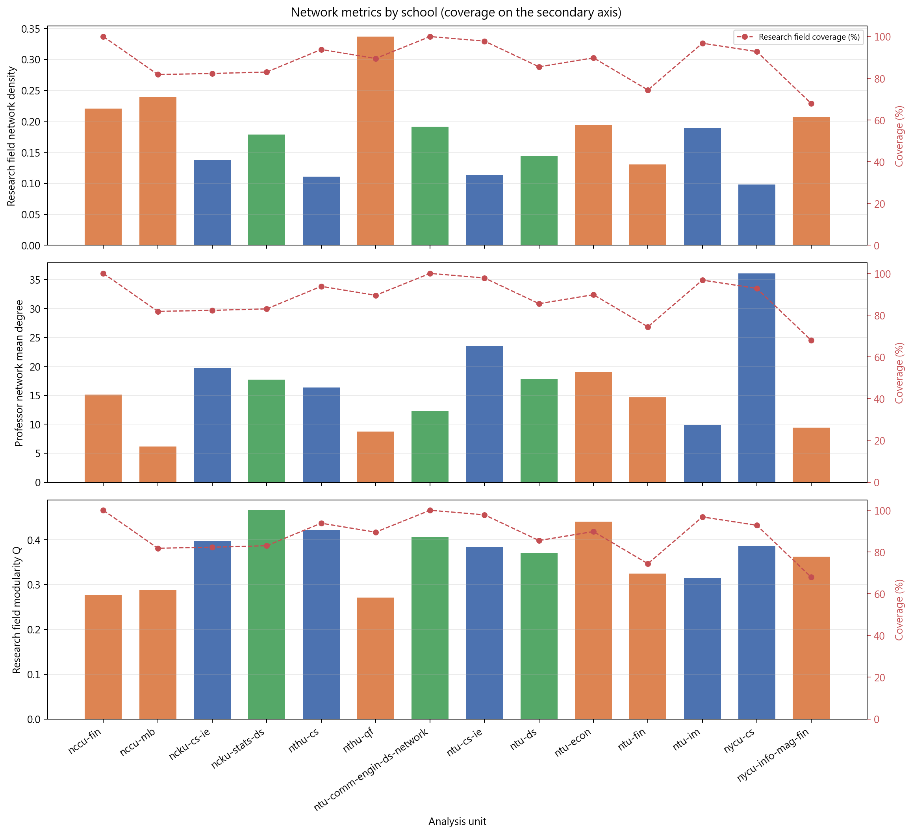

*圖：各系所正規化指標比較*  
*出處：`analysis/network-analysis/comparison/figures/01_metrics_by_school.png`*  
*建構方式：由 `4_group_and_cross_comparison.ipynb` 把 14 個系所的密度、Q、平均 degree 等正規化指標畫成分面長條圖，並標示 coverage。*

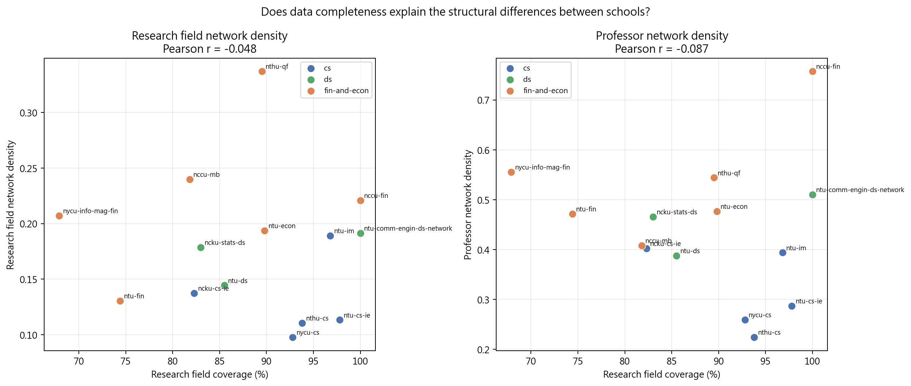

*圖：coverage 與網路密度的關係*  
*出處：`analysis/network-analysis/comparison/figures/11_coverage_vs_density.png`*  
*建構方式：散佈圖，x 軸為各系所研究領域覆蓋率、y 軸為領域網路密度；Pearson r = -0.048（教授網路 r = -0.087），接近 0，代表系所間的密度差異無法用資料完整度解釋。*

## 4. 研究主題比較

### 4.1 各系所前五大研究領域

| school_id | 前五大研究領域（教授人數） |
| --- | --- |
| `ncku-cs-ie` | Artificial Intelligence（17）、Machine Learning（11）、Deep Learning（9）、Embedded Systems（8）、Algorithms（7） |
| `nthu-cs` | Algorithms（16）、Automation and Control（11）、Computer Vision（10）、Multimedia Systems（10）、Electronic Design Automation（9） |
| `ntu-cs-ie` | Artificial Intelligence（18）、Machine Learning（15）、Multimedia Systems（14）、Computer Vision（11）、Algorithms（9） |
| `ntu-im` | Artificial Intelligence（7）、Machine Learning（6）、Big Data Analytics（5）、Entrepreneurship（5）、Information Security（5） |
| `nycu-cs` | Artificial Intelligence（35）、Machine Learning（21）、Deep Learning（16）、Computer Vision（15）、Image Processing（14） |
| `ncku-stats-ds` | Statistics（18）、Bioinformatics（8）、Biostatistics（8）、Machine Learning（5）、Statistical Consulting（5） |
| `ntu-comm-engin-ds-network` | Machine Learning（9）、Signal Processing（7）、Computer Networks（6）、Multimedia Systems（6）、Wireless Networks（5） |
| `ntu-ds` | Machine Learning（15）、Artificial Intelligence（15）、Deep Learning（8）、Multimedia Systems（7）、Computer Vision（7） |
| `nccu-fin` | Corporate Finance（9）、Financial Management（8）、Investments（6）、Risk Management（5）、Corporate Governance（4） |
| `nccu-mb` | Banking and Financial Institutions（6）、Risk Management（5）、Econometrics（4）、Asset Pricing（3）、Financial Engineering（3） |
| `nthu-qf` | Econometrics（7）、Financial Engineering（6）、Risk Management（5）、Corporate Finance（4）、Accounting（3） |
| `ntu-econ` | Macroeconomics（13）、Econometrics（11）、Labor Economics（10）、Monetary Economics（7）、Industrial Organization（7） |
| `ntu-fin` | Corporate Finance（15）、Behavioral Finance（8）、Asset Pricing（7）、Corporate Governance（6）、Sustainable Finance（4） |
| `nycu-info-mag-fin` | Financial Derivatives（6）、Corporate Finance（5）、Financial Technology（5）、Investments（5）、Risk Management（4） |

*出處：`analysis/descriptive-stats-after-preprocessing/group_comparison/research_fields/<group>.csv`*  
*建構方式：由 `scripts/data-preprocessing/2_rf_and_phd_inst_comparison.ipynb` 產生。研究領域為官網「主要研究領域」與「研究領域摘要」分別清洗、以雙語詞典標準化成英文 canonical 值後取聯集；計數為具有該領域的不重複教師人數，不做 Top-N 截斷。*

觀察：

- 五個資工系與台大資料科學學程都以 Artificial Intelligence 或 Machine Learning 為首，唯一例外是清大資工，以 Algorithms（16 人）與 Automation and Control／EDA 為首。
- 資料科學組內部差異大：成大統計以 Statistics（18 人）為主體，台大電信所資料科學組以 Machine Learning 與 Signal Processing 為主，台大資料科學學程以 AI 為主。
- 財金組內部也分化：台大財金與政大財管以 Corporate Finance 為首；政大金融以 Banking 為首；清大計財以 Econometrics 為首；台大經濟以 Macroeconomics 為首；陽明交大資財以 Financial Derivatives 為首並混入 AI。

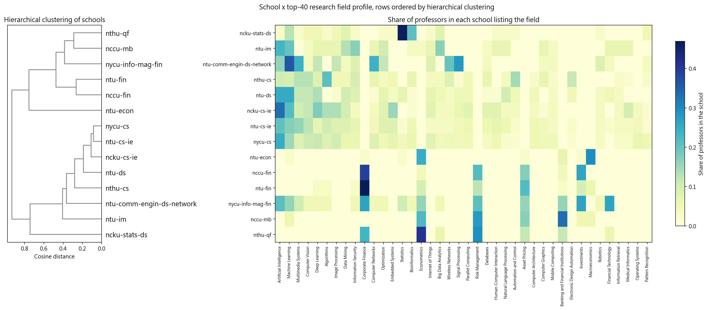

*圖：系所 × 研究領域比例熱圖*  
*出處：`analysis/network-analysis/comparison/figures/05_school_keyword_heatmap.png`*  
*建構方式：由 `school_keyword_share_matrix.csv` 繪製：每格為該系所研究此領域的教授比例（該系所教授數為分母），只取全體人數最多的領域。*

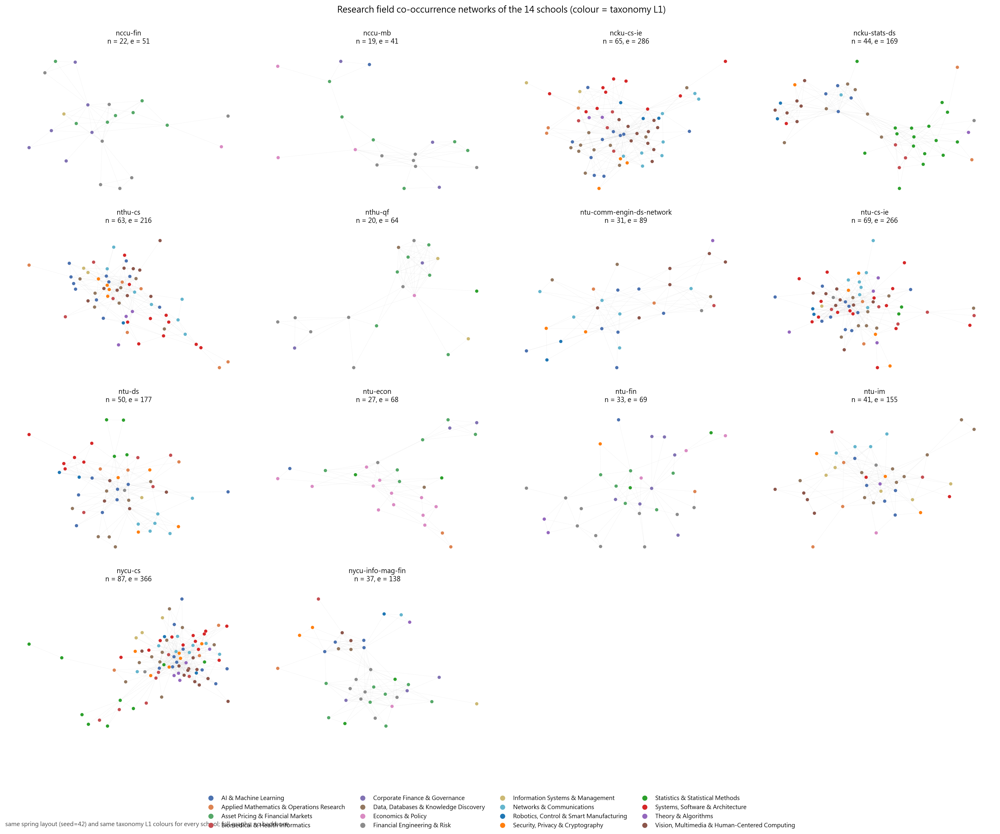

*圖：14 個系所的研究領域網路並排*  
*出處：`analysis/network-analysis/comparison/figures/03_small_multiples_keyword_networks.png`*  
*建構方式：把每個系所的研究領域網路（Louvain 社群著色）以相同版面並排，方便目視比較結構。*

### 4.2 三組研究領域的重疊

| 組 | 領域數 | 組內獨有 | 與其他組共享 |
| --- | --- | --- | --- |
| fin-and-econ | 69 | 41 | 28 |
| ds | 86 | 13 | 73 |
| cs | 115 | 38 | 77 |
| shared_by_all_three | 22 | 0 | 22 |

| 韋恩圖分區 | 領域數 | 三組人數合計 | 人數最多的領域 |
| --- | --- | --- | --- |
| cs only | 38 | 196 | Medical Informatics ／ Operating Systems ／ Distributed Systems |
| ds only | 13 | 38 | Statistical Computing ／ Partial Differential Equations ／ Reliability Analysis |
| fin-and-econ only | 41 | 321 | Corporate Finance ／ Risk Management ／ Asset Pricing |
| cs & ds | 50 | 606 | Data Mining ／ Image Processing ／ Embedded Systems |
| cs & fin-and-econ | 5 | 56 | Econometrics ／ Entrepreneurship ／ Theory of Computation |
| ds & fin-and-econ | 1 | 4 | Actuarial Science |
| cs & ds & fin-and-econ | 22 | 697 | Artificial Intelligence ／ Machine Learning ／ Multimedia Systems |

*出處：`analysis/network-analysis/comparison/group_field_overlap.csv`、`group_field_venn_summary.csv`（逐筆清單見 `group_field_venn_partitions.csv`）*  
*建構方式：以組層級去重後的教授研究領域集合，計算每個領域出現在哪些組，再分成七個韋恩分區。*

資料科學組 86 個領域中只有 13 個是該組獨有，與資工組共享 73 個；財金組則有 41 個獨有領域。這表示 ds 與 cs 在研究詞彙上高度重疊，而財金與經濟自成一個詞彙體系。

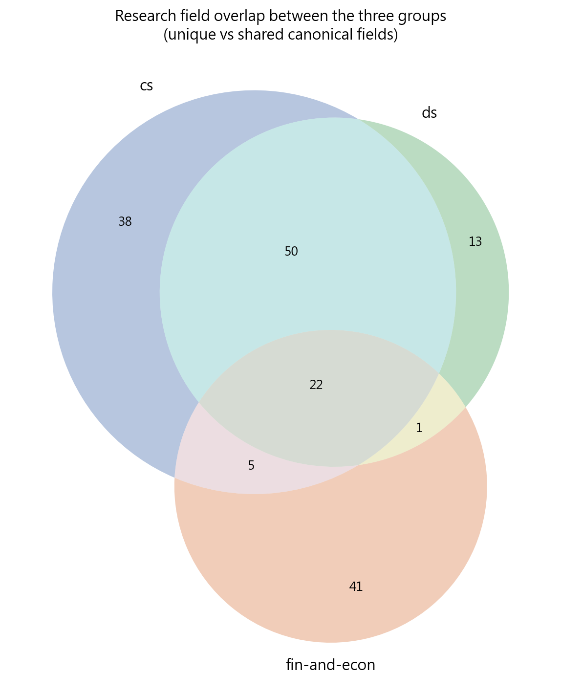

*圖：三組研究領域韋恩圖*  
*出處：`analysis/network-analysis/comparison/figures/07_group_field_overlap.png`*  
*建構方式：依上表七個分區繪製的韋恩圖。*

## 5. 人為分組是否有資料支持

| school_id | 指定分組 | 資料驅動分群（切 3 群） |
| --- | --- | --- |
| `ncku-cs-ie` | cs | 1 |
| `nthu-cs` | cs | 1 |
| `ntu-cs-ie` | cs | 1 |
| `ntu-im` | cs | 1 |
| `nycu-cs` | cs | 1 |
| `ncku-stats-ds` | ds | 1 |
| `ntu-comm-engin-ds-network` | ds | 1 |
| `ntu-ds` | ds | 1 |
| `nccu-fin` | fin-and-econ | 2 |
| `nccu-mb` | fin-and-econ | 2 |
| `nthu-qf` | fin-and-econ | 2 |
| `ntu-econ` | fin-and-econ | 3 |
| `ntu-fin` | fin-and-econ | 2 |
| `nycu-info-mag-fin` | fin-and-econ | 2 |

*出處：`analysis/network-analysis/comparison/school_grouping_check.csv`*  
*建構方式：以各系所的研究領域比例向量計算餘弦相似度，做階層分群後切成 3 群，與指定分組比較，NMI = 0.705、ARI = 0.531。*

資料最先分開的是財金與經濟組（群 2）與其他系所；台大經濟自成一群（群 3），因為它的詞彙（Macroeconomics、Labor Economics）與財金系所也不重疊。cs 與 ds 的 8 個系所全部落在同一群（群 1），資料無法把資料科學系所與資工系所分開，這與第 4.2 節「ds 只有 13 個獨有領域」的結果一致。換句話說，指定分組中「ds 組」是行政上的分類，在研究主題上它其實是資工組的子集合。

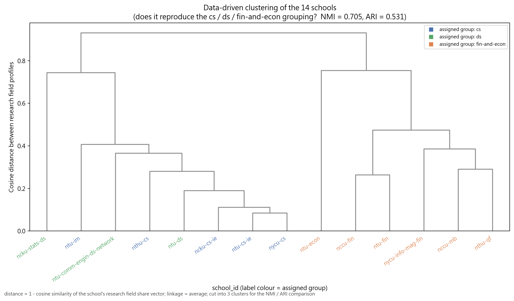

*圖：系所研究領域相似度樹狀圖*  
*出處：`analysis/network-analysis/comparison/figures/06_school_similarity_dendrogram.png`*  
*建構方式：以系所 × 領域比例矩陣的餘弦距離做階層分群（average linkage）繪製樹狀圖，葉節點顏色為指定分組。*

## 6. 網路結構的跨系所比較

### 6.1 虛無模型檢定的顯著情形

| school_id | 教授數 | 領域密度 | 領域 Q | 領域共現 | 教授 clustering | 顯著數 |
| --- | --- | --- | --- | --- | --- | --- |
| `ncku-cs-ie` | 51 | z = -2.2 * | z = +4.4 * | z = +2.3 * | z = +0.5 | 3 |
| `nthu-cs` | 76 | z = -2.9 * | z = +3.6 * | z = +3.2 * | z = +1.9 | 3 |
| `ntu-cs-ie` | 88 | z = -3.5 * | z = +3.8 * | z = +4.5 * | z = +2.4 * | 4 |
| `ntu-im` | 30 | z = -2.1 * | z = -0.3 | z = +2.1 | z = +1.3 | 1 |
| `nycu-cs` | 141 | z = -7.7 * | z = +10.0 * | z = +13.3 * | z = +4.8 * | 4 |
| `ncku-stats-ds` | 39 | z = -1.5 | z = +5.8 * | z = +1.1 | z = +1.3 | 1 |
| `ntu-comm-engin-ds-network` | 25 | z = -0.6 | z = +2.5 * | z = -0.9 | z = +2.0 * | 2 |
| `ntu-ds` | 59 | z = -2.5 * | z = +3.1 * | z = +2.8 * | z = +1.0 | 3 |
| `nccu-fin` | 23 | z = -1.2 | z = -0.1 | z = +1.0 | z = +1.8 | 0 |
| `nccu-mb` | 18 | z = -1.4 | z = -0.1 | z = +0.3 | z = +2.6 * | 1 |
| `nthu-qf` | 17 | z = -1.1 | z = +2.2 * | z = -0.0 | z = +2.5 * | 2 |
| `ntu-econ` | 44 | z = -1.3 | z = +5.7 * | z = +0.6 | z = +1.4 | 1 |
| `ntu-fin` | 32 | z = -2.4 * | z = -0.0 | z = +2.5 * | z = +0.4 | 2 |
| `nycu-info-mag-fin` | 19 | z = +0.7 | z = +0.8 | z = -0.7 | z = +0.5 | 0 |

（* 表示 empirical p < 0.05）

*出處：`analysis/network-analysis/comparison/null_model_summary.csv`*  
*建構方式：以保持二分結構與雙邊 degree 序列的 double edge swap（nswap = 10 × 邊數）產生 1,000 個隨機網路，比較觀測值與虛無分布，輸出 z-score 與雙尾 empirical p-value。*

四個統計量全部顯著的只有台大資工與陽明交大資工；清大資工三項顯著；成大資工、台大資料科學三項。財金系所大多不顯著，這主要是規模效應：領域數少於 25 個、教授數少於 25 位的網路，隨機重排後的結構與觀測值差異不大。因此「不顯著」不代表財金系所沒有主題結構，而是樣本太小無法排除隨機解釋。

### 6.2 Louvain 與 Girvan–Newman 對照

| school_id | 領域節點數 | Louvain Q | Louvain 社群數 | Girvan–Newman Q | GN 社群數 |
| --- | --- | --- | --- | --- | --- |
| `ntu-im` | 41 | 0.314 | 5 | 0.197 | 12 |
| `ncku-stats-ds` | 44 | 0.466 | 3 | 0.440 | 10 |
| `ntu-comm-engin-ds-network` | 31 | 0.407 | 4 | 0.360 | 5 |
| `ntu-ds` | 50 | 0.371 | 5 | 0.286 | 12 |
| `nccu-fin` | 22 | 0.276 | 4 | 0.182 | 5 |
| `nccu-mb` | 19 | 0.289 | 4 | 0.224 | 7 |
| `nthu-qf` | 20 | 0.271 | 3 | 0.254 | 5 |
| `ntu-econ` | 27 | 0.441 | 4 | 0.387 | 4 |
| `ntu-fin` | 33 | 0.325 | 7 | 0.284 | 4 |
| `nycu-info-mag-fin` | 37 | 0.362 | 4 | 0.346 | 2 |

*出處：`analysis/network-analysis/comparison/louvain_vs_girvan_newman.csv`*  
*建構方式：節點數 < 60 的研究領域網路另跑 Girvan–Newman（取前 12 層中 modularity 最高者）作為對照；節點數 ≥ 60 的系所因複雜度 O(m²n) 未跑。*

所有可比較的系所中 Louvain 的 Q 都不低於 GN，且不需事先指定社群數，因此各系所報告一律採 Louvain 結果。

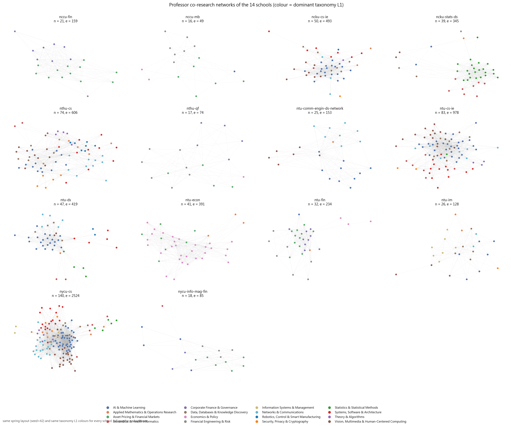

*圖：14 個系所的教授網路並排*  
*出處：`analysis/network-analysis/comparison/figures/04_small_multiples_professor_networks.png`*  
*建構方式：把每個系所的教授網路（Louvain 集群著色）以相同版面並排。*

### 6.3 λ 護欄與 taxonomy 一致度

| school_id | 觸發過度合併的 λ | 領域社群 vs L1 NMI | 教授集群 vs 主導 L1 NMI |
| --- | --- | --- | --- |
| `ncku-cs-ie` | 無 | 0.448 | 0.376 |
| `nthu-cs` | 無 | 0.450 | 0.487 |
| `ntu-cs-ie` | 0.3、0.4、0.5 | 0.406 | 0.485 |
| `ntu-im` | 0.3、0.4、0.5 | 0.438 | 0.551 |
| `nycu-cs` | 0.3、0.4、0.5 | 0.484 | 0.557 |
| `ncku-stats-ds` | 無 | 0.540 | 0.548 |
| `ntu-comm-engin-ds-network` | 無 | 0.432 | 0.839 |
| `ntu-ds` | 無 | 0.505 | 0.649 |
| `nccu-fin` | 0.3、0.4、0.5 | 0.353 | 0.458 |
| `nccu-mb` | 無 | 0.500 | 0.483 |
| `nthu-qf` | 0.5 | 0.296 | 0.416 |
| `ntu-econ` | 0.3、0.4、0.5 | 0.457 | 0.173 |
| `ntu-fin` | 無 | 0.566 | 0.557 |
| `nycu-info-mag-fin` | 無 | 0.502 | 0.720 |

*出處：`analysis/network-analysis/comparison/lambda_sensitivity_summary.csv`、`taxonomy_alignment.csv`*  
*建構方式：以 λ ∈ {0, 0.3, 0.4, 0.5} 各建一次教授網路，λ = 0 為 baseline；密度較 baseline 增加超過 50% 或 Q 下降超過 0.1 即標記為過度合併。 NMI 為 Louvain 社群與 taxonomy 分割的 normalized mutual information。*

政大財管、台大經濟、台大資工、台大資管、陽明交大資工在所有 λ 都觸發過度合併，這些系所的集群緊密度應以 λ = 0 的 baseline 解讀（各系所報告第 4.2 節）。教授集群與 taxonomy L1 的一致度以台大電信所資料科學組（0.84）與陽明交大資財（0.72）最高，台大經濟（0.17）最低，因為經濟系幾乎所有教授的主導 L1 都是 Economics & Policy。

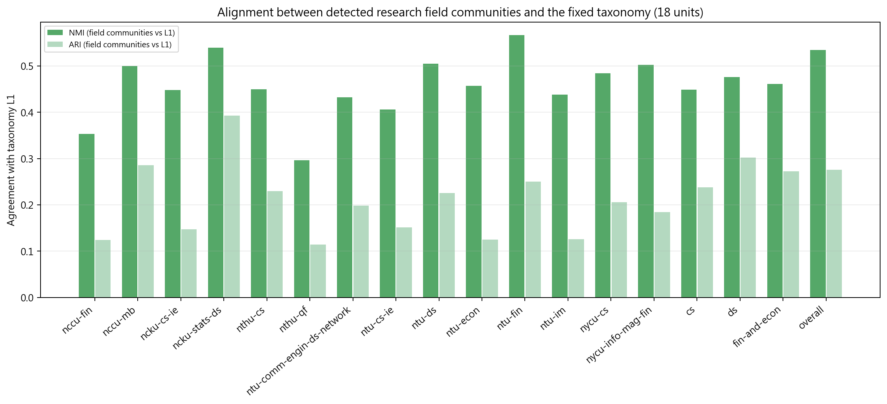

*圖：各單位社群與 taxonomy 的一致度*  
*出處：`analysis/network-analysis/comparison/figures/10_taxonomy_alignment.png`*  
*建構方式：以 `taxonomy_alignment.csv` 的 NMI 與 ARI 繪製，標示 coverage。*

## 7. 社群是被學校決定，還是被研究主題決定？

這是組層級才能回答的問題。把同組的系所合併成一個網路（跨校教授以 `person_id` 去重），再看 Louvain 集群比較貼近「學校」還是「研究主題（taxonomy L1）」。

| 單位 | 校數 | 教授數 | coverage % | 跨校邊比例 | E-I index | school assortativity | NMI vs 學校 | NMI vs 主題 L1 | 結論 |
| --- | --- | --- | --- | --- | --- | --- | --- | --- | --- |
| cs | 5 | 379 | 92.7 | 0.743 | 0.486 | 0.003 | 0.048 | 0.432 | 研究主題 |
| ds | 3 | 107 | 87.0 | 0.373 | -0.254 | 0.243 | 0.311 | 0.629 | 研究主題 |
| fin-and-econ | 6 | 148 | 83.0 | 0.726 | 0.452 | 0.107 | 0.305 | 0.477 | 研究主題 |
| overall | 14 | 616 | 88.9 | 0.785 | 0.569 | 0.069 | 0.329 | 0.551 | 研究主題 |

*出處：`analysis/network-analysis/comparison/cross_school_bridging_summary.csv`*  
*建構方式：`4_group_and_cross_comparison.ipynb` 在組層級與全體層級的教授網路上計算跨校邊比例、E-I index（(外部邊 − 內部邊) ÷ 總邊數）、school assortativity（教授是否傾向連到同校者），以及 Louvain 集群分別對 `school_id` 與 `parent_l1` 分割的 NMI。*

四個單位全部是「研究主題」勝出，school assortativity 都接近 0（cs 只有 0.003）。也就是說，把不同學校的教授放在一起時，集群依主題而非依學校形成。ds 組的 E-I index 為負（-0.254）是因為它只有 3 個系所且彼此重疊極深（10 位跨校重複教授去重後成為單一節點），須與 assortativity 併看。

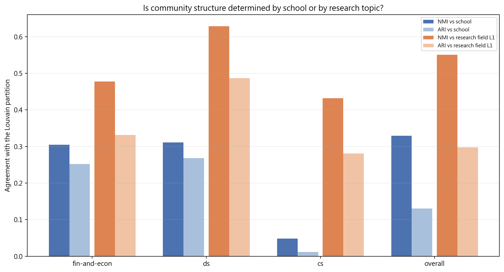

*圖：集群 vs 學校 / 主題的一致度*  
*出處：`analysis/network-analysis/comparison/figures/09_community_vs_school_alignment.png`*  
*建構方式：並排長條圖比較各組 Louvain 集群對學校分割與對 L1 分割的 NMI。*

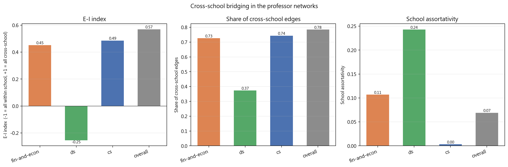

*圖：跨校連結比例與 E-I index*  
*出處：`analysis/network-analysis/comparison/figures/08_cross_school_bridging.png`*  
*建構方式：以組層級教授網路的跨校邊比例與 E-I index 繪製。*

### 7.1 跨校 broker 教授

| 組 | 合聘教授數 | 跨校 broker 數 | 合聘平均 betweenness | 非合聘平均 betweenness |
| --- | --- | --- | --- | --- |
| cs | 5 | 379 | 0.0042 | 0.0037 |
| ds | 9 | 102 | 0.0371 | 0.0143 |
| fin-and-econ | 2 | 147 | 0.0252 | 0.0084 |

*出處：`analysis/network-analysis/comparison/joint_appointment_summary.csv`*  
*建構方式：合聘教授（出現在多個系所名單）必然是跨校節點，因此單獨標記，避免與「研究主題造成的跨校連結」混淆。*

**資工組（cs） 跨校 betweenness 前六名**

| 教授 | 系所 | 合聘 | Degree | 跨校邊比例 | Betweenness | 主導 L1 |
| --- | --- | --- | --- | --- | --- | --- |
| 李濬屹 | ntu-cs-ie | 否 | 212 | 0.778 | 0.0779 | Systems, Software & Architecture |
| 連震杰 | ncku-cs-ie | 否 | 197 | 0.843 | 0.0608 | Vision, Multimedia & Human-Centered Computing |
| 謝孫源 | ncku-cs-ie | 否 | 220 | 0.845 | 0.0574 | AI & Machine Learning |
| 李端興 | nthu-cs | 否 | 235 | 0.847 | 0.0536 | AI & Machine Learning |
| 劉若慧 | ntu-im | 否 | 202 | 0.896 | 0.0505 | Data, Databases & Knowledge Discovery |
| 陳炘鈞 | ntu-im | 否 | 203 | 0.931 | 0.0417 | Data, Databases & Knowledge Discovery |

*出處：`analysis/network-analysis/cs/cross_school_bridging.csv`*

**資料科學組（ds） 跨校 betweenness 前六名**

| 教授 | 系所 | 合聘 | Degree | 跨校邊比例 | Betweenness | 主導 L1 |
| --- | --- | --- | --- | --- | --- | --- |
| 鄭順林 | ncku-stats-ds | 否 | 72 | 0.542 | 0.3522 | Statistics & Statistical Methods |
| 李政德 | ncku-stats-ds | 否 | 50 | 0.860 | 0.1836 | AI & Machine Learning |
| 馬瀰嘉 | ncku-stats-ds | 否 | 38 | 0.237 | 0.1258 | Statistics & Statistical Methods |
| 林澤 | ntu-comm-engin-ds-network ／ ntu-ds | 是 | 67 | 0.224 | 0.0942 | AI & Machine Learning |
| 李濬屹 | ntu-ds | 否 | 45 | 0.356 | 0.0793 | Systems, Software & Architecture |
| 陳祝嵩 | ntu-ds | 否 | 51 | 0.392 | 0.0783 | Vision, Multimedia & Human-Centered Computing |

*出處：`analysis/network-analysis/ds/cross_school_bridging.csv`*

**財金與經濟組（fin-and-econ） 跨校 betweenness 前六名**

| 教授 | 系所 | 合聘 | Degree | 跨校邊比例 | Betweenness | 主導 L1 |
| --- | --- | --- | --- | --- | --- | --- |
| 劉鋼 | nthu-qf | 否 | 113 | 0.858 | 0.1788 | Asset Pricing & Financial Markets |
| 林智勇 | nycu-info-mag-fin | 否 | 92 | 0.848 | 0.1150 | Asset Pricing & Financial Markets |
| 蔡易達 | ntu-fin | 否 | 95 | 0.768 | 0.0852 | Asset Pricing & Financial Markets |
| 和田健司 | ntu-econ | 否 | 77 | 0.649 | 0.0703 | Asset Pricing & Financial Markets |
| 林士貴 | nccu-mb | 否 | 74 | 0.851 | 0.0653 | Financial Engineering & Risk |
| 王建強 | ntu-econ | 否 | 77 | 0.753 | 0.0625 | Economics & Policy |

*出處：`analysis/network-analysis/fin-and-econ/cross_school_bridging.csv`*

合聘教授的平均 betweenness 是非合聘者的 2 到 3 倍，但 broker 前幾名多數不是合聘教授，例如 cs 組的李濬屹（台大資工）、連震杰（成大資工）、ds 組的鄭順林（成大統計）、財金組的劉鋼（清大計財）都是靠研究主題橫跨多個領域而成為橋梁。

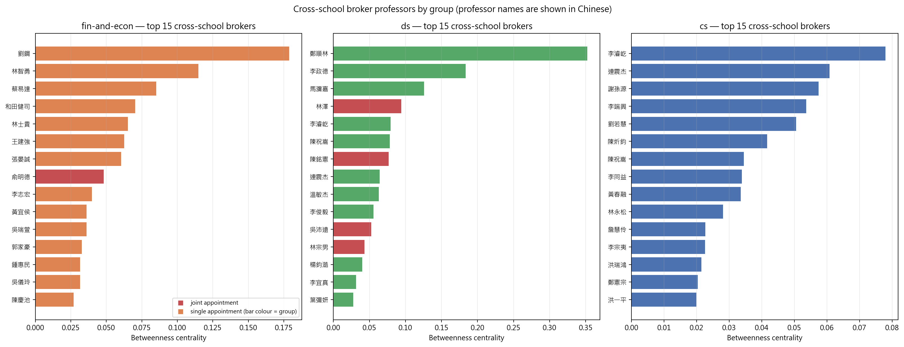

*圖：各組跨校 broker 前幾名*  
*出處：`analysis/network-analysis/comparison/figures/12_top_brokers.png`*  
*建構方式：以組層級教授網路的 betweenness 排序，合聘教授另以標記區分。*

## 8. 博士畢業學校比較

| school_id | 前四名博士畢業學校（教授人數） |
| --- | --- |
| `ncku-cs-ie` | National Taiwan University（10）、National Cheng Kung University（6）、National Tsing Hua University（5）、National Chiao Tung University（5） |
| `nthu-cs` | National Taiwan University（11）、National Tsing Hua University（10）、National Chiao Tung University（6）、University of California, Berkeley（4） |
| `ntu-cs-ie` | 官網未提供學歷 |
| `ntu-im` | National Taiwan University（4）、University of Arizona（3）、University of Illinois Urbana-Champaign（2）、University of California, Berkeley（2） |
| `nycu-cs` | National Chiao Tung University（29）、National Taiwan University（21）、Northwestern University（8）、National Tsing Hua University（8） |
| `ncku-stats-ds` | National Tsing Hua University（4）、National Cheng Kung University（3）、The Ohio State University（2）、University of Minnesota（2） |
| `ntu-comm-engin-ds-network` | National Taiwan University（5）、University of Michigan（4）、University of Illinois Urbana-Champaign（3）、University of Southern California（3） |
| `ntu-ds` | 官網未提供學歷 |
| `nccu-fin` | Nanyang Technological University（2）、Indiana University（2）、National Taiwan University（1）、University of Iowa（1） |
| `nccu-mb` | National Taiwan University（2）、National Chengchi University（2）、University of Chicago（1）、University of California, Los Angeles（1） |
| `nthu-qf` | National Taiwan University（6）、University of Wisconsin-Madison（2）、The Ohio State University（2）、Columbia University（1） |
| `ntu-econ` | University of Chicago（7）、University of California, Los Angeles（6）、University of Wisconsin-Madison（6）、The Ohio State University（4） |
| `ntu-fin` | National Taiwan University（8）、University at Buffalo（2）、University of Illinois Urbana-Champaign（2）、University of Washington（2） |
| `nycu-info-mag-fin` | National Taiwan University（8）、National Tsing Hua University（2）、The Ohio State University（1）、National Chengchi University（1） |

*出處：`analysis/descriptive-stats-after-preprocessing/group_comparison/phd_institutions/<group>.csv`*  
*建構方式：同一 notebook。學歷先被 `1_faculty_data_preprocessing.ipynb` 解析成「學位、科系、學校」三部分，取學位為博士的項目，學校名稱以別名表對應為英文 canonical 值；計數為不重複教師人數。*

- 台灣本土博士比例最高的是陽明交大資工（交大 29、台大 21）、清大資工（台大 11、清大 10）與成大資工（台大 10、成大 6）。
- 台大經濟是唯一前十名沒有任何台灣學校的系所（Chicago 7、UCLA 6、Wisconsin 6）。
- 台大資管的 University of Arizona（3 人）反映資管領域的學術傳統；台大電信所資料科學組的 Michigan（4）、UIUC、USC（各 3）反映電機通訊背景。
- 台大資工與台大資料科學學程的官網未提供學歷，成大統計的學歷完整率只有 44.7%，這三個單位的結果代表性有限。

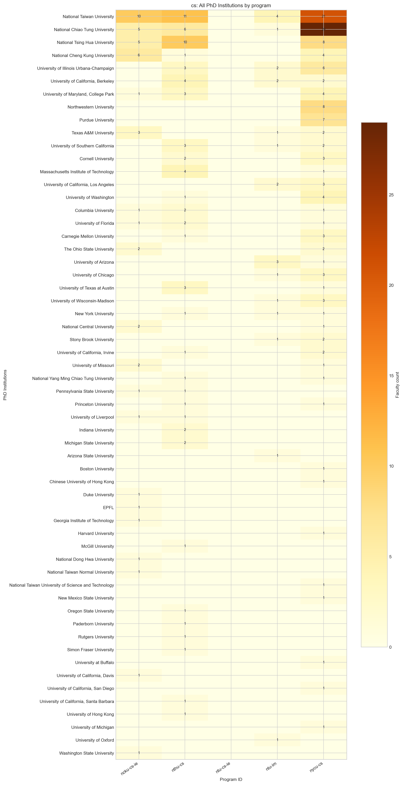

*圖：資工組各系所博士畢業學校*  
*出處：`analysis/descriptive-stats-after-preprocessing/group_comparison/phd_institutions/cs.png`*  
*建構方式：同一 notebook。學歷先被 `1_faculty_data_preprocessing.ipynb` 解析成「學位、科系、學校」三部分，取學位為博士的項目，學校名稱以別名表對應為英文 canonical 值；計數為不重複教師人數。*

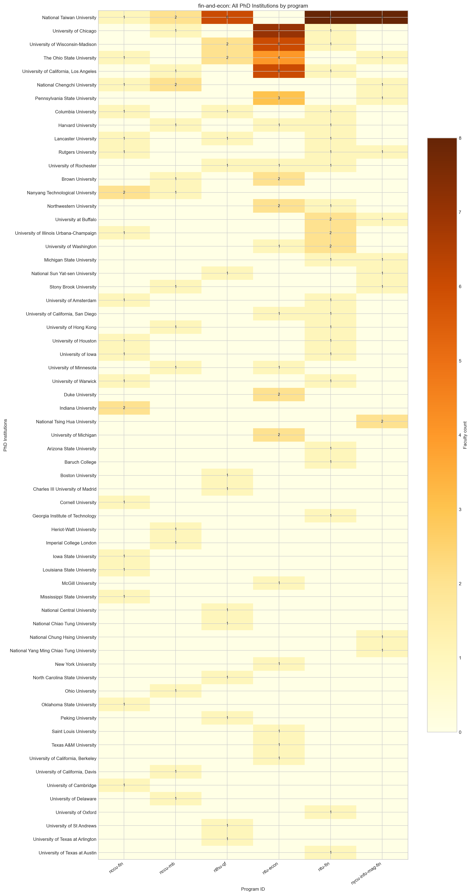

*圖：財金與經濟組各系所博士畢業學校*  
*出處：`analysis/descriptive-stats-after-preprocessing/group_comparison/phd_institutions/fin-and-econ.png`*  
*建構方式：同一 notebook。學歷先被 `1_faculty_data_preprocessing.ipynb` 解析成「學位、科系、學校」三部分，取學位為博士的項目，學校名稱以別名表對應為英文 canonical 值；計數為不重複教師人數。*

## 9. 綜合結論

1. **研究主題決定集群，學校不決定。** 四個跨校單位的 Louvain 集群都更貼近 taxonomy 而非學校，school assortativity 接近 0。
2. **資工與資料科學在詞彙上是同一個世界。** ds 組 86 個領域只有 13 個獨有，資料驅動分群把 8 個 cs／ds 系所放在同一群；財金與經濟則自成體系，台大經濟又獨立於財金之外。
3. **AI 是資工側的共同樞紐，Corporate Finance 與 Econometrics 是財金側的樞紐。** 這些領域的 betweenness 在各自系所都遠高於其他領域。
4. **集群區隔最清楚的是清大資工、台大電信所資料科學組與陽明交大資工**，最模糊的是政大財管與陽明交大資財，後者是因為領域少、教授之間幾乎全部互連。
5. **大型資工系的結構最穩健**：台大資工與陽明交大資工的四個虛無模型統計量全部顯著；小型財金系所多數不顯著，是樣本規模的限制。
6. **特色科系**：清大資工（演算法與 EDA）、成大資工（醫學資訊與智慧製造）、台大資管（創業與知識管理）、成大統計（工業統計與生物統計）、陽明交大資財（金融科技橋接財務與 AI）各有其他系所沒有的主題。
7. **資料限制**：coverage 從 67.9% 到 100%，台大資工與台大資料科學無學歷資料，成大資工的英文姓名多為模板文字，台大經濟與成大統計有中英未配對的重複紀錄。所有比較都應併看 coverage，且不可解讀為系所或教授的品質排名。

## 附錄：本報告引用的資料與圖表清單

| 檔案 | 產生階段 / 程式 | 建構方式摘要 |
| --- | --- | --- |
| `analysis/network-analysis/comparison/school_metrics_comparison.csv`、`group_metrics_comparison.csv` | `4_group_and_cross_comparison.ipynb` | 彙整 18 個單位的 `network_metrics.json`，只保留正規化指標並併列 coverage |
| `analysis/network-analysis/comparison/cross_school_bridging_summary.csv`、`joint_appointment_summary.csv`、`analysis/network-analysis/<group>/cross_school_bridging.csv` | 同上 | 組層級教授網路（跨校去重）的跨校邊比例、E-I index、assortativity、集群對學校／L1 的 NMI，以及每位教授的跨校 betweenness |
| `analysis/network-analysis/comparison/school_grouping_check.csv` | 同上 | 系所研究領域比例向量的餘弦相似度階層分群，切 3 群與指定分組比較 |
| `analysis/network-analysis/comparison/null_model_summary.csv`、`lambda_sensitivity_summary.csv`、`louvain_vs_girvan_newman.csv`、`taxonomy_alignment.csv` | 同上 | 彙整各單位的虛無模型、λ 敏感度、GN 對照與 taxonomy 一致度 |
| `analysis/network-analysis/comparison/group_field_overlap.csv`、`group_field_venn_summary.csv` | 同上 | 組層級研究領域集合的重疊與韋恩分區 |
| `analysis/network-analysis/comparison/figures/01, 03, 04, 05, 06, 07, 08, 09, 10, 11, 12` | 同上 | 上述 CSV 的視覺化 |
| `analysis/descriptive-stats-after-preprocessing/group_comparison/research_fields/*.csv`、`phd_institutions/*.csv`、`*.png` | `2_rf_and_phd_inst_comparison.ipynb` | 由 `scripts/data-preprocessing/2_rf_and_phd_inst_comparison.ipynb` 產生。研究領域為官網「主要研究領域」與「研究領域摘要」分別清洗、以雙語詞典標準化成英文 canonical 值後取聯集；計數為具有該領域的不重複教師人數，不做 Top-N 截斷。 同一 notebook。學歷先被 `1_faculty_data_preprocessing.ipynb` 解析成「學位、科系、學校」三部分，取學位為博士的項目，學校名稱以別名表對應為英文 canonical 值；計數為不重複教師人數。 |

更完整的方法說明見 `docs/network-analysis-report.md` 與 `docs/plan-for-network-analysis.md`。各系所的細節見同資料夾的 14 份個別報告。
