# 成功大學統計學系（統計與資料科學）（`ncku-stats-ds`）研究結果總結報告

所屬分組：資料科學組（ds）　｜　資料日期：2026-09-09 蒐集、2026-09-10 完成網路分析

> **本報告的資料來源**
> 本專案分三個階段：(1) 資料蒐集（`scripts/data-collection/`）從 14 個系所官網爬取師資的姓名、職稱、學歷與研究領域，中英文分開蒐集後配對；
> (2) 資料預處理（`scripts/data-preprocessing/`）把職稱、學歷、研究領域標準化成英文 canonical 值，並產生描述統計；
> (3) 網路分析（`scripts/network-analysis/current-version/`）建立「教授–研究領域」二分網路，投影成研究領域網路與教授網路，做社群偵測、中心性、虛無模型與敏感度分析。
> 本報告所有數字、表格與圖表都取自 `analysis/` 底下這三個階段的輸出，每張圖表下方都標明出處與建構方式，附錄另有完整清單。
> 「研究集群」指教授網路的 Louvain 社群；「重要老師」依教授在該網路中的 degree（與多少同儕共享領域）與 betweenness（是否位於集群之間的橋梁位置）判定，**不是**學術成就的排名。

## 1. 科系速覽

成大統計系是 14 個系所中唯一以**統計學**為主體的單位：Statistics 有 18 位教授研究，其次是 Bioinformatics 與 Biostatistics（各 8 人），再來是 Machine Learning、Statistical Consulting、Reliability Analysis、Bayesian Statistics、Statistical Computing（各 5 人）。官網列出 47 位教師，但名譽／退休教授就有 18 位，專任只有 15 位，兼任 16 位、客座 7 位，是一個歷史悠久、名單包含大量退休教師的系所。研究領域完整率 83.0%，學歷完整率只有 44.7%，中英文名單不完全相同（配對率 61.7%），有 7 位教授沒有中文姓名。

### 1.1 基本資料

| 項目 | 數值 |
| --- | --- |
| 官網師資人數（canonical 紀錄） | 47 |
| 職稱分類（一人可屬多類） | 名譽／退休 18、兼任 16、專任 15、客座 7、合聘 4、主管／講座 3 |
| 中英文紀錄配對率 | 61.7% |
| 研究領域完整率（標準化後） | 83.0% |
| 學歷完整率（標準化後） | 44.7% |
| 每位教授平均研究領域數 | 2.64 |
| 進入網路分析的教授數 | 39（8 位因無研究領域排除） |

*出處：`analysis/data-collection/ncku-stats-ds/quality-report.json`（人數、職稱、配對率）、`analysis/descriptive-stats-after-preprocessing/coverage_by_school.csv`（完整率）、`analysis/network-analysis/ncku-stats-ds/network_metrics.json`（進入網路人數）*  
*建構方式：quality-report 由 `scripts/data-collection/collect.py` 在爬取官網後統計 canonical 紀錄的職稱分類與中英配對；coverage 由 `1_faculty_data_preprocessing.ipynb` 計算標準化後有 canonical 值的教師比例。*

### 1.2 主要研究領域

| 排名 | 研究領域（canonical） | 教授人數 |
| --- | --- | --- |
| 1 | Statistics | 18 |
| 2 | Bioinformatics | 8 |
| 3 | Biostatistics | 8 |
| 4 | Machine Learning | 5 |
| 5 | Statistical Consulting | 5 |
| 6 | Reliability Analysis | 5 |
| 7 | Bayesian Statistics | 5 |
| 8 | Statistical Computing | 5 |
| 9 | Survival Analysis | 4 |
| 10 | Regression Analysis | 4 |
| 11 | Industrial Statistics | 4 |
| 12 | Multivariate Analysis | 4 |
| 13 | Big Data Analytics | 3 |
| 14 | Survey Sampling | 3 |
| 15 | Experimental Design | 3 |

*出處：`analysis/descriptive-stats-after-preprocessing/group_comparison/research_fields/ds.csv`（`ncku-stats-ds` 欄）*  
*建構方式：由 `scripts/data-preprocessing/2_rf_and_phd_inst_comparison.ipynb` 產生。研究領域為官網「主要研究領域」與「研究領域摘要」分別清洗、以雙語詞典標準化成英文 canonical 值後取聯集；計數為具有該領域的不重複教師人數，不做 Top-N 截斷。*

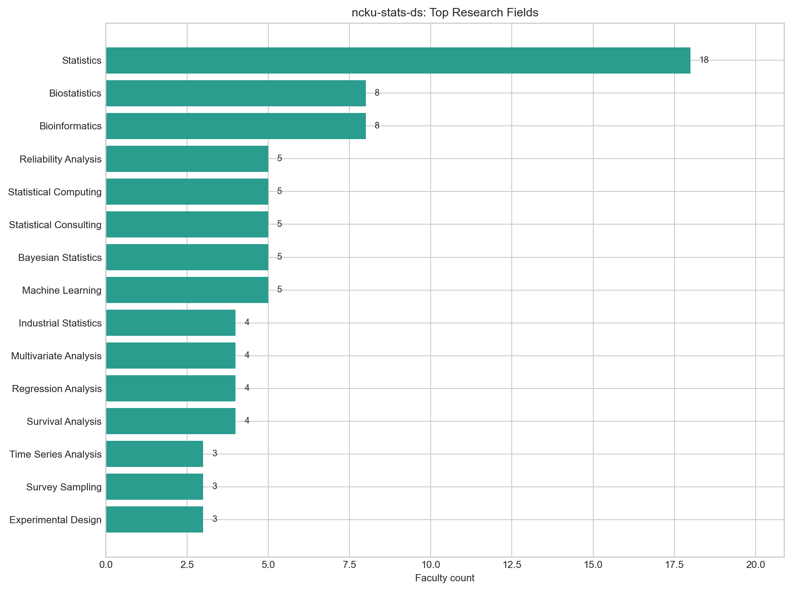

*圖：成功大學統計學系（統計與資料科學） 研究領域人數*  
*出處：`analysis/descriptive-stats-after-preprocessing/by_department/top_research_fields/ncku-stats-ds.png`*  
*建構方式：由 `scripts/data-preprocessing/2_rf_and_phd_inst_comparison.ipynb` 產生。研究領域為官網「主要研究領域」與「研究領域摘要」分別清洗、以雙語詞典標準化成英文 canonical 值後取聯集；計數為具有該領域的不重複教師人數，不做 Top-N 截斷。*

### 1.3 博士畢業學校

| 排名 | 博士畢業學校（canonical） | 教授人數 |
| --- | --- | --- |
| 1 | National Tsing Hua University | 4 |
| 2 | National Cheng Kung University | 3 |
| 3 | The Ohio State University | 2 |
| 4 | University of Minnesota | 2 |
| 5 | National Taiwan University | 1 |
| 6 | University of California, Los Angeles | 1 |
| 7 | Iowa State University | 1 |
| 8 | National Central University | 1 |
| 9 | National Chung Hsing University | 1 |
| 10 | National Sun Yat-sen University | 1 |

*出處：`analysis/descriptive-stats-after-preprocessing/group_comparison/phd_institutions/ds.csv`（`ncku-stats-ds` 欄）*  
*建構方式：同一 notebook。學歷先被 `1_faculty_data_preprocessing.ipynb` 解析成「學位、科系、學校」三部分，取學位為博士的項目，學校名稱以別名表對應為英文 canonical 值；計數為不重複教師人數。*

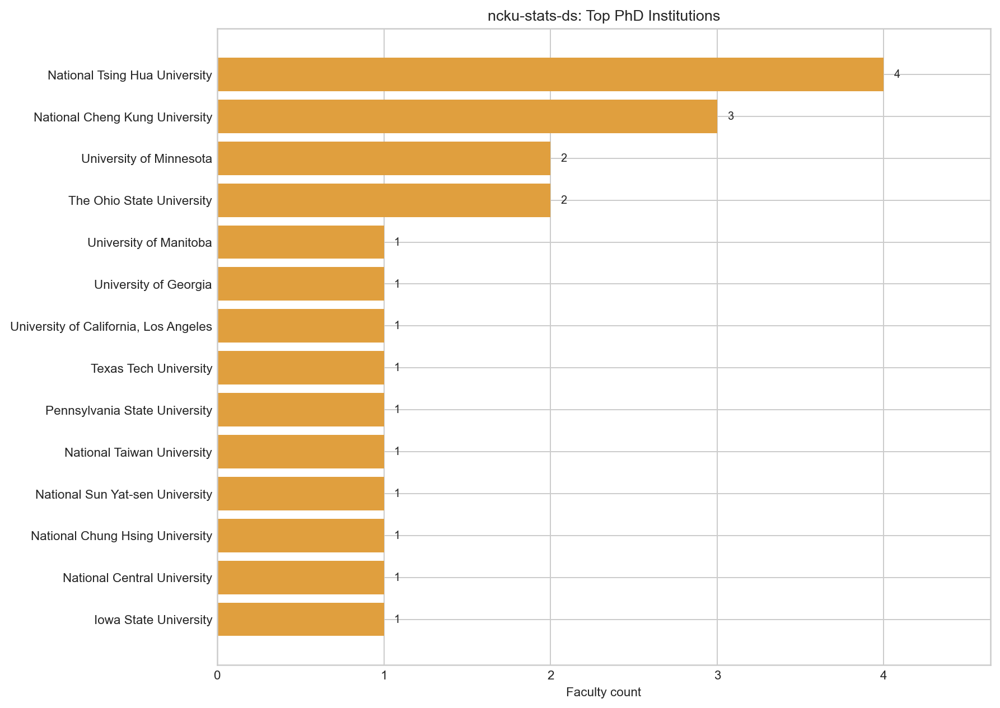

*圖：成功大學統計學系（統計與資料科學） 博士畢業學校人數*  
*出處：`analysis/descriptive-stats-after-preprocessing/by_department/top_phd_institutions/ncku-stats-ds.png`*  
*建構方式：同一 notebook。學歷先被 `1_faculty_data_preprocessing.ipynb` 解析成「學位、科系、學校」三部分，取學位為博士的項目，學校名稱以別名表對應為英文 canonical 值；計數為不重複教師人數。*

## 2. 研究領域網路結構

### 2.1 網路指標

| 指標 | 數值 | 說明 |
| --- | --- | --- |
| 二分網路：教授數 / 領域數 / 邊數 | 39 / 44 / 124 | 一條邊 = 一位教授研究一個領域 |
| 二分網路連通元件數 | 1 | 最大元件涵蓋 100.0% 教授 |
| 每位教授平均 / 最多領域數 | 3.18 / 9 |  |
| 研究領域網路：節點 / 邊 | 44 / 169 | 只含至少與一個其他領域共現的領域 |
| 研究領域網路密度 | 0.179 | 實際邊數 ÷ 可能邊數 |
| 研究領域網路平均 degree | 7.68 |  |
| 研究領域網路 modularity Q（Louvain） | 0.466 | 3 個社群；resolution 0.7 / 1.3 時為 2 / 5 個 |
| 領域社群 vs taxonomy L1 一致度 | NMI 0.540 / ARI 0.393 | 1 = 完全一致，0 = 無關 |
| 教授網路：節點 / 邊 | 39 / 345 | 只含最大連通元件 |
| 教授網路密度 | 0.466 |  |
| 教授網路 modularity Q（Louvain） | 0.171 | 4 個集群 |
| 教授集群 vs 主導 L1 一致度 | NMI 0.548 / ARI 0.402 |  |

*出處：`analysis/network-analysis/ncku-stats-ds/network_metrics.json`*  
*建構方式：由 `2_build_network_data.ipynb` 從 `faculty_standardized.json` 建立教授–研究領域二分網路：教授與研究領域各為一類節點，教授的標準化研究領域包含某領域即連一條邊。研究領域網路是二分網路的單邊投影：兩個領域若被同一位教授研究就相連，邊權為共同研究兩領域的教授人數。社群以 Louvain（seed = 42，resolution 1.0）偵測，指標以完整加權圖計算。教授網路是二分網路的另一邊投影：兩位教授共享研究領域就相連，邊權 w = S_exp + λ·S_inf；S_exp 為共享領域的 IDF 加權和（IDF 以全體 662 位教授計算一次），S_inf 為共享 taxonomy 上層分類的推論相似度，λ = 0.4。社群以 Louvain（seed = 42，resolution 1.0）偵測，節點大小與 degree 成正比。*

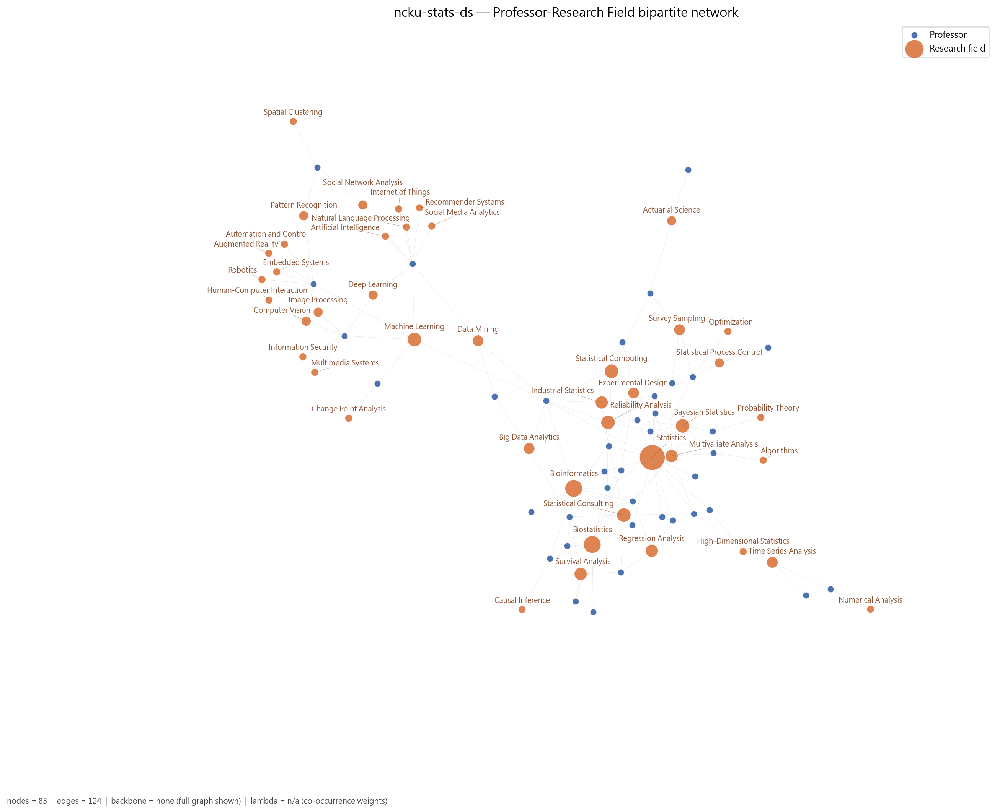

*圖：成功大學統計學系（統計與資料科學） 教授–研究領域二分網路*  
*出處：`analysis/network-analysis/ncku-stats-ds/figures/01_bipartite_network.png`*  
*建構方式：由 `2_build_network_data.ipynb` 從 `faculty_standardized.json` 建立教授–研究領域二分網路：教授與研究領域各為一類節點，教授的標準化研究領域包含某領域即連一條邊。圖中兩類節點以不同顏色區分，節點大小與 degree 成正比；邊數超過 400 時繪圖使用 disparity filter backbone（α = 0.05），指標仍以完整圖計算。*

### 2.2 關鍵研究領域

| 研究領域 | Degree | Degree centrality | Betweenness | PageRank | 教授數 | taxonomy L1 |
| --- | --- | --- | --- | --- | --- | --- |
| Machine Learning | 25 | 0.581 | 0.489 | 0.0637 | 5 | AI & Machine Learning |
| Statistics | 20 | 0.465 | 0.474 | 0.0907 | 18 | Statistics & Statistical Methods |
| Data Mining | 14 | 0.326 | 0.100 | 0.0340 | 3 | Data, Databases & Knowledge Discovery |
| Statistical Computing | 13 | 0.302 | 0.068 | 0.0372 | 5 | Statistics & Statistical Methods |
| Bioinformatics | 13 | 0.302 | 0.061 | 0.0452 | 8 | Biomedical & Health Informatics |
| Deep Learning | 12 | 0.279 | 0.007 | 0.0299 | 2 | AI & Machine Learning |
| Computer Vision | 11 | 0.256 | 0.005 | 0.0303 | 2 | Vision, Multimedia & Human-Centered Computing |
| Statistical Consulting | 11 | 0.256 | 0.003 | 0.0344 | 5 | Statistics & Statistical Methods |
| Reliability Analysis | 11 | 0.256 | 0.008 | 0.0388 | 5 | Statistics & Statistical Methods |
| Image Processing | 11 | 0.256 | 0.005 | 0.0303 | 2 | Vision, Multimedia & Human-Centered Computing |
| Pattern Recognition | 10 | 0.233 | 0.021 | 0.0251 | 2 | Vision, Multimedia & Human-Centered Computing |
| Big Data Analytics | 10 | 0.233 | 0.009 | 0.0234 | 3 | Data, Databases & Knowledge Discovery |

Betweenness 最高的五個領域：Machine Learning（0.49）、Statistics（0.47）、Data Mining（0.10）、Statistical Computing（0.07）、Bioinformatics（0.06）。Betweenness 高代表該領域位於不同主題群之間的連結位置，是系上跨主題的共同語言。

*出處：`analysis/network-analysis/ncku-stats-ds/keyword_centrality.csv`*  
*建構方式：研究領域網路是二分網路的單邊投影：兩個領域若被同一位教授研究就相連，邊權為共同研究兩領域的教授人數。社群以 Louvain（seed = 42，resolution 1.0）偵測，指標以完整加權圖計算。 degree 為相連領域數，betweenness 為經過該節點的最短路徑比例，PageRank 為加權隨機漫步的穩態機率；parent_l1 來自 `1_build_taxonomy.ipynb` 手工編定的三層 taxonomy（170 個 L3、46 個 L2、16 個 L1）。*

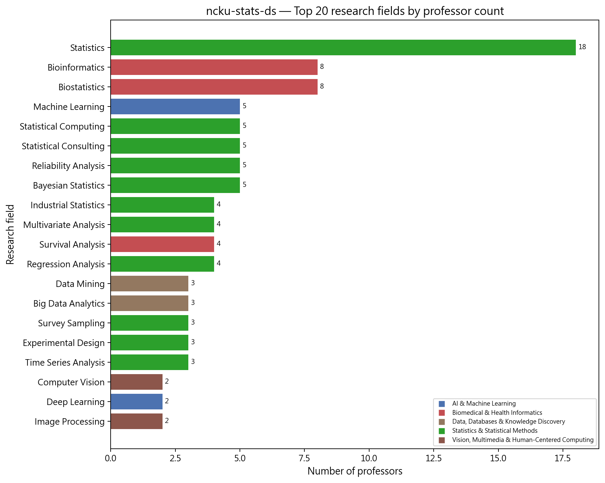

*圖：成功大學統計學系（統計與資料科學） 研究領域教授人數長條圖*  
*出處：`analysis/network-analysis/ncku-stats-ds/figures/10_top_keywords_bar.png`*  
*建構方式：以二分網路中每個領域節點的 degree（研究該領域的教授數）排序繪製。*

### 2.3 研究領域社群

| 社群 | 領域數 | 主要領域（教授人數） | 主要 taxonomy L1（領域數） |
| --- | --- | --- | --- |
| 0 | 23 | Statistics（18）、Bioinformatics（8）、Biostatistics（8）、Statistical Computing（5）、Reliability Analysis（5）、Statistical Consulting（5）、Bayesian Statistics（5） | Statistics & Statistical Methods 15、Biomedical & Health Informatics 3、Applied Mathematics & Operations Research 2 |
| 1 | 12 | Machine Learning（5）、Computer Vision（2）、Image Processing（2）、Pattern Recognition（2）、Augmented Reality（1）、Automation and Control（1）、Embedded Systems（1） | Vision, Multimedia & Human-Centered Computing 6、Robotics, Control & Smart Manufacturing 2、AI & Machine Learning 1 |
| 2 | 9 | Data Mining（3）、Deep Learning（2）、Social Network Analysis（2）、Artificial Intelligence（1）、Internet of Things（1）、Natural Language Processing（1）、Recommender Systems（1） | Data, Databases & Knowledge Discovery 5、AI & Machine Learning 3、Networks & Communications 1 |

*出處：`analysis/network-analysis/ncku-stats-ds/keyword_communities.csv`（`community` 欄）、`keyword_centrality.csv`（教授人數）*  
*建構方式：研究領域網路是二分網路的單邊投影：兩個領域若被同一位教授研究就相連，邊權為共同研究兩領域的教授人數。社群以 Louvain（seed = 42，resolution 1.0）偵測，指標以完整加權圖計算。*

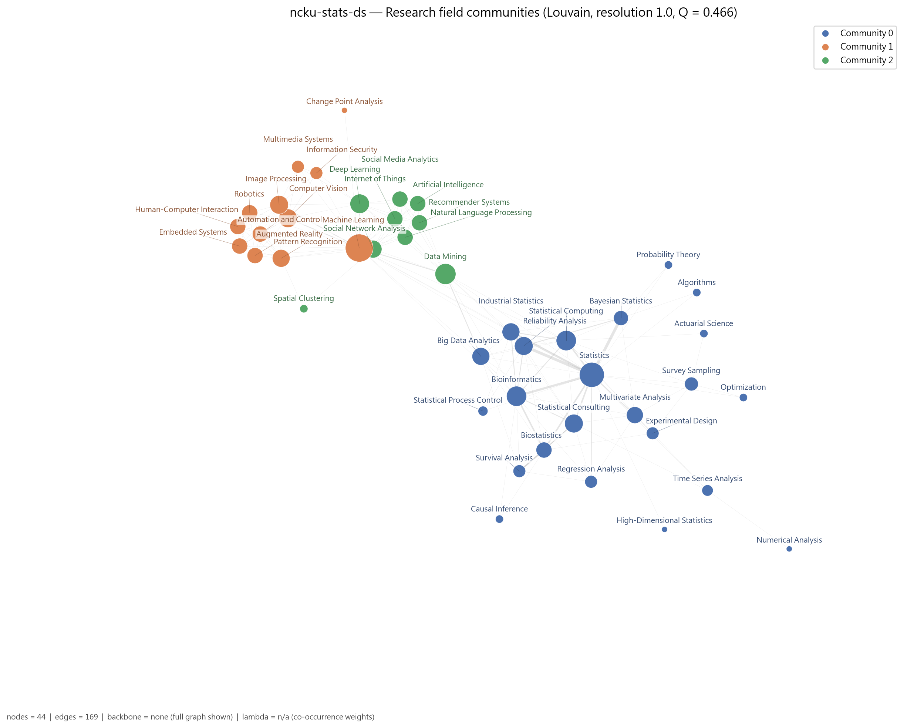

*圖：成功大學統計學系（統計與資料科學） 研究領域網路的 Louvain 社群*  
*出處：`analysis/network-analysis/ncku-stats-ds/figures/05_keyword_network_communities.png`*  
*建構方式：研究領域網路是二分網路的單邊投影：兩個領域若被同一位教授研究就相連，邊權為共同研究兩領域的教授人數。社群以 Louvain（seed = 42，resolution 1.0）偵測，指標以完整加權圖計算。節點顏色為社群，大小與 degree 成正比。*

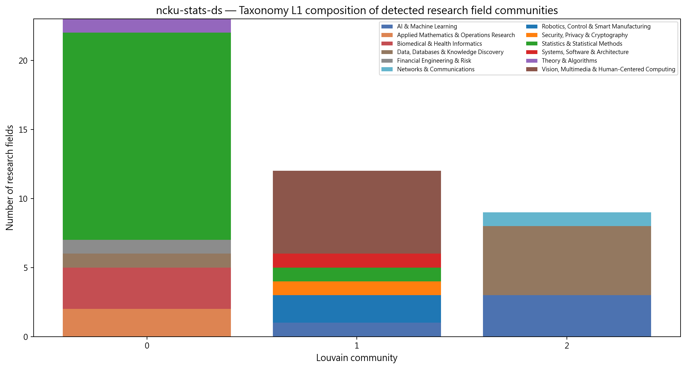

*圖：成功大學統計學系（統計與資料科學） 各研究領域社群的 taxonomy L1 組成*  
*出處：`analysis/network-analysis/ncku-stats-ds/figures/14_community_composition.png`*  
*建構方式：把每個 Louvain 領域社群內的領域依 taxonomy L1 分類計數，堆疊長條圖。用來檢查資料驅動的社群是否對應人工分類。*

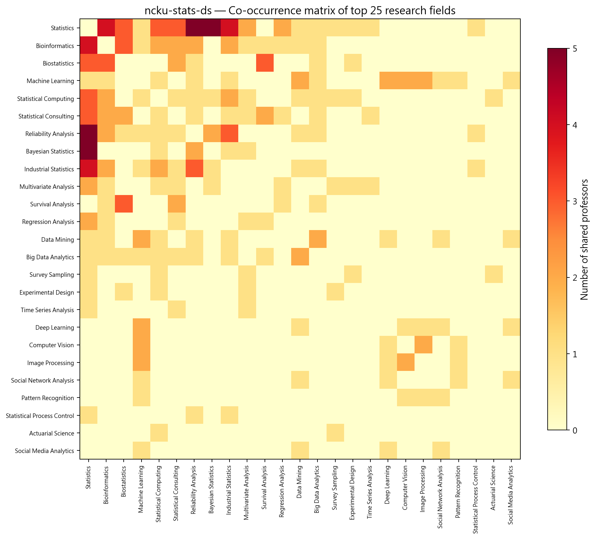

*圖：成功大學統計學系（統計與資料科學） 研究領域共現熱圖*  
*出處：`analysis/network-analysis/ncku-stats-ds/figures/13_keyword_cooccurrence_heatmap.png`*  
*建構方式：取研究領域網路的加權鄰接矩陣（共同研究兩領域的教授人數），依社群排序後繪製熱圖。*

## 3. 主要研究集群與重要老師

教授網路分成 4 個集群：統計方法與工業統計、生物統計與生物資訊、機器學習與資料科學、時間序列與多變量。研究領域網路的 modularity 顯著高於虛無模型（z = 5.8，p = 0.002），且 Machine Learning（0.49）與 Statistics（0.47）兩個領域的 betweenness 遠高於其他領域，分別代表「連到資料科學側」與「連到統計各分支」的兩座橋。

教授網路共 39 位教授、4 個集群（Louvain，Q = 0.171）。以下依集群人數排序；集群編號與圖中的 Community 編號一致。表中 Degree 為與該教授共享研究領域的同儕數，Betweenness 為該教授位於他人最短路徑上的比例（越高越像橋梁）。

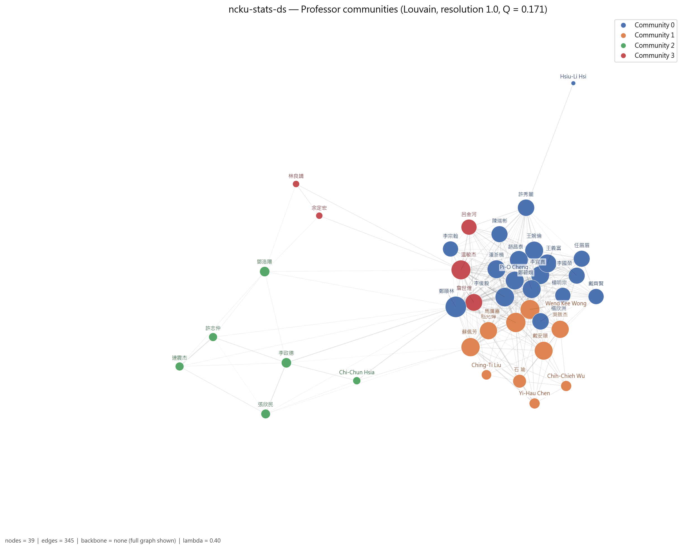

*圖：成功大學統計學系（統計與資料科學） 教授網路的 Louvain 集群*  
*出處：`analysis/network-analysis/ncku-stats-ds/figures/09_professor_network_communities.png`*  
*建構方式：教授網路是二分網路的另一邊投影：兩位教授共享研究領域就相連，邊權 w = S_exp + λ·S_inf；S_exp 為共享領域的 IDF 加權和（IDF 以全體 662 位教授計算一次），S_inf 為共享 taxonomy 上層分類的推論相似度，λ = 0.4。社群以 Louvain（seed = 42，resolution 1.0）偵測，節點大小與 degree 成正比。*

### 3.1 集群 0：統計方法、工業統計與可靠度集群（18 人）

- **成員共同研究領域**：Statistics（14 人）、Bayesian Statistics（5 人）、Statistical Computing（5 人）、Industrial Statistics（4 人）、Reliability Analysis（4 人）、Bioinformatics（3 人）、Actuarial Science（2 人）
- **成員主導 taxonomy L1**：Statistics & Statistical Methods 16 人、Biomedical & Health Informatics 1 人、Financial Engineering & Risk 1 人

18 位成員，16 位主導 Statistics & Statistical Methods，共享 Statistics（14 人）、Bayesian Statistics、Statistical Computing、Industrial Statistics 與 Reliability Analysis。鄭順林 degree（33）與 betweenness（0.336）皆為全系最高，研究橫跨大數據、生物資訊、資料探勘、工業統計與機器學習，也是資料科學組跨校 broker 的第一名；李俊毅（工業統計、統計計算、諮詢）、李宜真與王婉倫（貝氏統計）是集群核心；潘浙楠為名譽教授，代表工業統計與統計製程管制傳統。

| 姓名 | 英文名 | 職稱類別 | Degree | Betweenness | 研究領域（最多列 5 項） |
| --- | --- | --- | --- | --- | --- |
| 鄭順林 | Shuen-Lin Jeng | 專任 | 33 | 0.336 | Big Data Analytics、Bioinformatics、Data Mining、Industrial Statistics、Machine Learning |
| 李俊毅 | Chung-I Li | 專任 | 27 | 0.098 | Bioinformatics、Industrial Statistics、Statistical Computing、Statistical Consulting、Statistics |
| 潘浙楠 | Jeh-Nan Pan | 名譽／退休 | 25 | 0.051 | Industrial Statistics、Reliability Analysis、Statistical Process Control、Statistics |
| 李宜真 | I-Chen Lee | 專任 | 25 | 0.046 | Bayesian Statistics、Industrial Statistics、Reliability Analysis、Statistics |
| 王婉倫 | Wan-Lun Wang | 專任 | 25 | 0.026 | Bayesian Statistics、Multivariate Analysis、Statistical Computing、Statistics |
| Pi-O Cheng | Pi-O Cheng | 名譽／退休 | 25 | 0.000 | Regression Analysis、Statistics |
| 王義富 | Yi-Fu Wang | 專任 | 25 | 0.000 | Bayesian Statistics、Reliability Analysis、Statistics |
| 趙昌泰 | Chang-Tai Chao | 專任 | 25 | 0.000 | Optimization、Statistics、Survey Sampling |

其餘成員（10 位，依 degree 排序）：鄭碧娥、許秀麗、楊欣洲、陳瑞彬、任眉眉、李國榮、戴齊賢、李宗翰、楊明宗、Hsiu-Li Hsi

### 3.2 集群 1：生物統計與生物資訊集群（10 人）

- **成員共同研究領域**：Biostatistics（8 人）、Bioinformatics（4 人）、Survival Analysis（4 人）、Statistics（3 人）、Statistical Consulting（3 人）、Experimental Design（1 人）、Regression Analysis（1 人）
- **成員主導 taxonomy L1**：Biomedical & Health Informatics 7 人、Statistics & Statistical Methods 3 人

10 位成員，7 位主導 Biomedical & Health Informatics，共享 Biostatistics（8 人）、Bioinformatics、Survival Analysis 與 Statistical Consulting。馬瀰嘉 degree 29、betweenness 0.25，是集群中心與對外橋梁；Weng Kee Wong（兼任，實驗設計）、蘇佩芳（存活分析、大數據）、戴安順（因果推論）是主要成員。

| 姓名 | 英文名 | 職稱類別 | Degree | Betweenness | 研究領域（最多列 5 項） |
| --- | --- | --- | --- | --- | --- |
| 馬瀰嘉 | Mi-Chia Ma | 專任 | 29 | 0.250 | Bioinformatics、Biostatistics、Reliability Analysis、Statistical Consulting、Statistics |
| Weng Kee Wong | Weng Kee Wong | 兼任 | 28 | 0.015 | Biostatistics、Experimental Design、Statistics |
| 蘇佩芳 | Pei-Fang Su | 專任 | 26 | 0.037 | Big Data Analytics、Biostatistics、Statistical Consulting、Survival Analysis |
| 戴安順 | An-Shun Tai | 兼任 | 25 | 0.000 | Bioinformatics、Biostatistics、Causal Inference |
| 嵇允嬋 | Yun-Chan Chi | 兼任 | 23 | 0.009 | Regression Analysis、Statistical Consulting、Survival Analysis |
| 吳致杰 |  | 合聘 | 23 | 0.001 | Biostatistics、Statistics |
| 石 瑜 | Yu Shyr | 主管／講座 | 13 | 0.003 | Bioinformatics、Biostatistics、Survival Analysis |
| Chih-Chieh Wu | Chih-Chieh Wu | 兼任 | 8 | 0.000 | Biostatistics |

其餘成員（2 位，依 degree 排序）：Yi-Hau Chen、Ching-Ti Liu

### 3.3 集群 2：機器學習與資料科學集群（6 人）

- **成員共同研究領域**：Machine Learning（4 人）、Data Mining（2 人）、Pattern Recognition（2 人）、Social Network Analysis（2 人）、Deep Learning（2 人）、Computer Vision（2 人）、Image Processing（2 人）
- **成員主導 taxonomy L1**：AI & Machine Learning 2 人、Data, Databases & Knowledge Discovery 2 人、Vision, Multimedia & Human-Centered Computing 2 人

6 位成員，共享 Machine Learning、Data Mining、Pattern Recognition、Computer Vision 與 Deep Learning，是本系「資料科學」名稱對應的部分。李政德（與成大資工合聘）betweenness 0.101 為集群最高，研究 AI、資料探勘、深度學習與物聯網；連震杰同樣是成大資工合聘，帶入電腦視覺與擴增實境；許志仲（兼任）研究電腦視覺與資安。這個集群與統計主體的連結相對稀疏，成員 degree 只有 4 到 7。

| 姓名 | 英文名 | 職稱類別 | Degree | Betweenness | 研究領域（最多列 5 項） |
| --- | --- | --- | --- | --- | --- |
| 李政德（2 個系所） | Cheng-Te Li | 合聘 | 7 | 0.101 | Artificial Intelligence、Data Mining、Deep Learning、Internet of Things、Machine Learning |
| 鄧浩陽 | Hao Yang Teng | 專任 | 7 | 0.000 | Change Point Analysis、Machine Learning |
| 張欣民 | Hsing-Ming Chang | 專任 | 6 | 0.000 | Pattern Recognition、Social Network Analysis、Spatial Clustering |
| 許志仲 | Chih-Chung Hsu | 兼任 | 5 | 0.003 | Computer Vision、Deep Learning、Image Processing、Information Security、Machine Learning |
| 連震杰（2 個系所） | Jenn-Jier James Lien | 合聘 | 5 | 0.000 | Augmented Reality、Automation and Control、Computer Vision、Embedded Systems、Human-Computer Interaction |
| Chi-Chun Hsia | Chi-Chun Hsia | 兼任 | 4 | 0.000 | Big Data Analytics、Data Mining |

### 3.4 集群 3：時間序列與多變量分析集群（5 人）

- **成員共同研究領域**：Time Series Analysis（3 人）、Multivariate Analysis（3 人）、Numerical Analysis（1 人）、Experimental Design（1 人）、Survey Sampling（1 人）、Statistical Consulting（1 人）、Statistics（1 人）
- **成員主導 taxonomy L1**：Statistics & Statistical Methods 4 人、Applied Mathematics & Operations Research 1 人

共享 Time Series Analysis、Multivariate Analysis，另含 Experimental Design、Survey Sampling、Numerical Analysis。溫敏杰（系主任）degree 28、betweenness 0.127，是集群中心；詹世煌與呂金河為名譽教授，代表多變量分析與抽樣調查的傳統；林良靖、余定宏是專注時間序列的年輕成員。

| 姓名 | 英文名 | 職稱類別 | Degree | Betweenness | 研究領域（最多列 5 項） |
| --- | --- | --- | --- | --- | --- |
| 溫敏杰 | Miin-Jye Wen | 主管／講座 | 28 | 0.127 | Multivariate Analysis、Statistical Consulting、Statistics、Time Series Analysis |
| 詹世煌 | Shih-Huang Chan | 名譽／退休 | 22 | 0.009 | Bioinformatics、Multivariate Analysis、Regression Analysis |
| 呂金河 |  | 名譽／退休 | 18 | 0.006 | Experimental Design、Multivariate Analysis、Survey Sampling |
| 林良靖 | Liang-Ching Lin | 專任 | 3 | 0.000 | Numerical Analysis、Time Series Analysis |
| 余定宏 | Ting-Hung Yu | 專任 | 3 | 0.000 | Time Series Analysis |

*集群表出處：`analysis/network-analysis/ncku-stats-ds/professor_communities.csv`（集群歸屬）、`professor_centrality.csv`（degree、betweenness、職稱類別）、`prof_keyword_network.graphml`（成員研究領域，用來統計集群的共同領域）*  
*建構方式：教授網路是二分網路的另一邊投影：兩位教授共享研究領域就相連，邊權 w = S_exp + λ·S_inf；S_exp 為共享領域的 IDF 加權和（IDF 以全體 662 位教授計算一次），S_inf 為共享 taxonomy 上層分類的推論相似度，λ = 0.4。社群以 Louvain（seed = 42，resolution 1.0）偵測，節點大小與 degree 成正比。 職稱類別為官網職稱的分類，一人可屬多類時取主要類別；「N 個系所」表示該教授也出現在其他系所名單。*

### 3.5 全系的橋接者與樞紐

Betweenness 最高的教授（跨集群的橋梁）：

| 姓名 | 英文名 | 職稱類別 | Degree | Betweenness | 主導 L1 |
| --- | --- | --- | --- | --- | --- |
| 鄭順林 | Shuen-Lin Jeng | 專任 | 33 | 0.336 | Statistics & Statistical Methods |
| 馬瀰嘉 | Mi-Chia Ma | 專任 | 29 | 0.250 | Statistics & Statistical Methods |
| 溫敏杰 | Miin-Jye Wen | 主管／講座 | 28 | 0.127 | Statistics & Statistical Methods |
| 李政德 | Cheng-Te Li | 合聘 | 7 | 0.101 | AI & Machine Learning |
| 李俊毅 | Chung-I Li | 專任 | 27 | 0.098 | Statistics & Statistical Methods |
| 許秀麗 |  | 兼任 | 21 | 0.054 | Statistics & Statistical Methods |

Degree 最高的教授（與最多同儕共享領域的樞紐）：

| 姓名 | 英文名 | 職稱類別 | Degree | Betweenness | 主導 L1 |
| --- | --- | --- | --- | --- | --- |
| 鄭順林 | Shuen-Lin Jeng | 專任 | 33 | 0.336 | Statistics & Statistical Methods |
| 馬瀰嘉 | Mi-Chia Ma | 專任 | 29 | 0.250 | Statistics & Statistical Methods |
| Weng Kee Wong | Weng Kee Wong | 兼任 | 28 | 0.015 | Statistics & Statistical Methods |
| 溫敏杰 | Miin-Jye Wen | 主管／講座 | 28 | 0.127 | Statistics & Statistical Methods |
| 李俊毅 | Chung-I Li | 專任 | 27 | 0.098 | Statistics & Statistical Methods |
| 蘇佩芳 | Pei-Fang Su | 專任 | 26 | 0.037 | Biomedical & Health Informatics |

*出處：`analysis/network-analysis/ncku-stats-ds/professor_centrality.csv`*

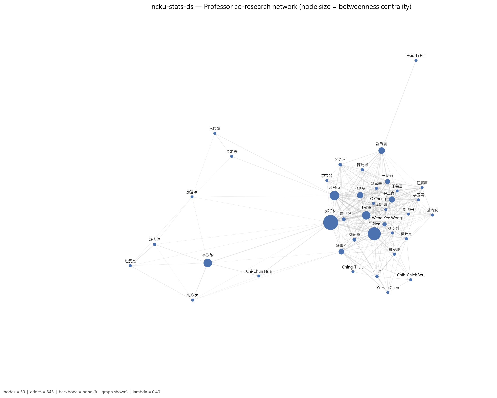

*圖：成功大學統計學系（統計與資料科學） 教授網路（節點大小 = betweenness）*  
*出處：`analysis/network-analysis/ncku-stats-ds/figures/08_professor_network_betweenness.png`*  
*建構方式：教授網路是二分網路的另一邊投影：兩位教授共享研究領域就相連，邊權 w = S_exp + λ·S_inf；S_exp 為共享領域的 IDF 加權和（IDF 以全體 662 位教授計算一次），S_inf 為共享 taxonomy 上層分類的推論相似度，λ = 0.4。社群以 Louvain（seed = 42，resolution 1.0）偵測，節點大小與 degree 成正比。此圖節點大小改為與 betweenness 成正比。*

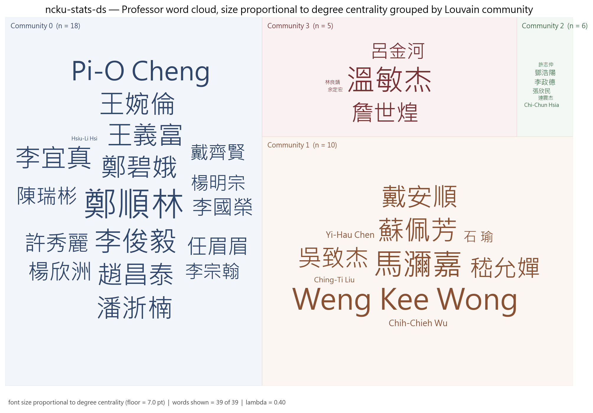

*圖：成功大學統計學系（統計與資料科學） 各集群教授 word cloud（字級 = degree）*  
*出處：`analysis/network-analysis/ncku-stats-ds/figures/27_professor_wordcloud_degree_by_community.png`*  
*建構方式：依 Louvain 集群分塊、同集群同色的教授姓名 word cloud，字級與 degree 成線性正比並設下限。*

## 4. 結構穩健性檢驗

### 4.1 虛無模型檢定

| 統計量 | 觀測值 | 虛無平均 | 虛無標準差 | z-score | empirical p | p < 0.05 |
| --- | --- | --- | --- | --- | --- | --- |
| 領域網路密度 | 0.1786 | 0.1919 | 0.0086 | -1.54 | 0.110 | 不顯著 |
| 領域網路 modularity Q | 0.4659 | 0.2787 | 0.0323 | 5.80 | 0.002 | 顯著 |
| 領域平均共現次數 | 1.2485 | 1.2075 | 0.0383 | 1.07 | 0.330 | 不顯著 |
| 教授網路 clustering 係數 | 0.7643 | 0.7251 | 0.0310 | 1.27 | 0.218 | 不顯著 |

*出處：`analysis/network-analysis/ncku-stats-ds/null_model_test.csv`*  
*建構方式：以保持二分結構與雙邊 degree 序列的 double edge swap（nswap = 10 × 邊數）產生 1,000 個隨機網路，比較觀測值與虛無分布，輸出 z-score 與雙尾 empirical p-value。 密度顯著偏低而 modularity、共現顯著偏高，代表領域共現集中在少數主題群，不是均勻分布。*

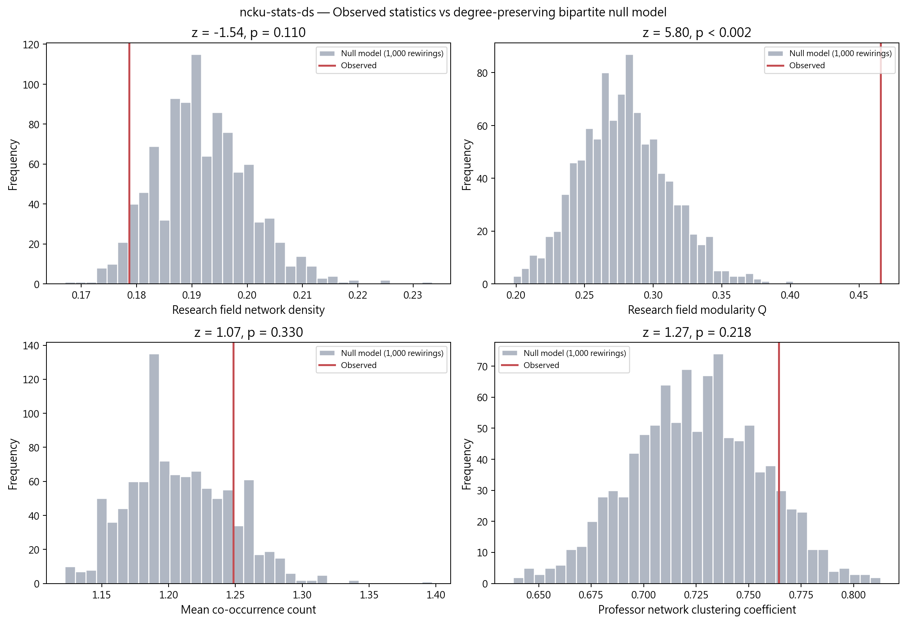

*圖：成功大學統計學系（統計與資料科學） 觀測值 vs 虛無模型分布*  
*出處：`analysis/network-analysis/ncku-stats-ds/figures/15_null_model_comparison.png`*  
*建構方式：以保持二分結構與雙邊 degree 序列的 double edge swap（nswap = 10 × 邊數）產生 1,000 個隨機網路，比較觀測值與虛無分布，輸出 z-score 與雙尾 empirical p-value。*

### 4.2 λ 敏感度

| λ | 邊數 | 密度 | Q | 集群數 | 密度相對 baseline | Q 下降 | 過度合併 |
| --- | --- | --- | --- | --- | --- | --- | --- |
| 0.0 | 249 | 0.336 | 0.219 | 6 | +0% | 0.000 | 否 |
| 0.3 | 345 | 0.466 | 0.174 | 4 | +39% | 0.045 | 否 |
| 0.4 | 345 | 0.466 | 0.171 | 4 | +39% | 0.048 | 否 |
| 0.5 | 345 | 0.466 | 0.158 | 4 | +39% | 0.061 | 否 |

*出處：`analysis/network-analysis/ncku-stats-ds/lambda_sensitivity.csv`*  
*建構方式：以 λ ∈ {0, 0.3, 0.4, 0.5} 各建一次教授網路，λ = 0 為 baseline；密度較 baseline 增加超過 50% 或 Q 下降超過 0.1 即標記為過度合併。*

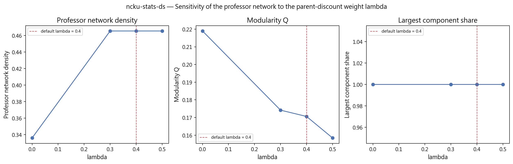

*圖：成功大學統計學系（統計與資料科學） λ 敏感度*  
*出處：`analysis/network-analysis/ncku-stats-ds/figures/16_lambda_sensitivity.png`*  
*建構方式：以 λ ∈ {0, 0.3, 0.4, 0.5} 各建一次教授網路，λ = 0 為 baseline；密度較 baseline 增加超過 50% 或 Q 下降超過 0.1 即標記為過度合併。*

### 4.3 taxonomy L1 覆蓋護欄

| taxonomy L1 | 教授數 | 覆蓋率 | flag |
| --- | --- | --- | --- |
| Statistics & Statistical Methods | 29 | 74.4% | too_broad |
| Biomedical & Health Informatics | 14 | 35.9% | ok |
| AI & Machine Learning | 5 | 12.8% | ok |
| Data, Databases & Knowledge Discovery | 5 | 12.8% | ok |
| Vision, Multimedia & Human-Centered Computing | 3 | 7.7% | ok |
| Applied Mathematics & Operations Research | 2 | 5.1% | ok |
| Financial Engineering & Risk | 2 | 5.1% | ok |
| Networks & Communications | 1 | 2.6% | ok |

*出處：`analysis/network-analysis/ncku-stats-ds/l1_coverage_guardrail.csv`（只列前 8 項）*  
*建構方式：計算每個 L1 分類涵蓋該單位多少比例的教授，超過 50% 標記 too_broad，代表此 L1 在本單位太寬，不能用來做 L1 roll-up 比較。*

## 5. 解讀與注意事項

- 47 位師資中 18 位為名譽／退休教授，且多數有研究領域並進入網路，因此集群反映的是包含歷史師資的整體樣貌，不只是現任專任教師。
- 7 位教授沒有中文姓名，在圖中以英文顯示；中英文名單配對率 61.7%，部分教授可能中英各留一筆紀錄。
- L1 護欄標記 Statistics & Statistical Methods 涵蓋超過 50% 教授。
- λ 敏感度未觸發過度合併；但 λ=0 的 baseline 有 6 個社群，λ=0.4 減為 4 個，代表推論連結把幾個小群合併進大群了，細部分群請參考 λ=0 的結果。
- 研究領域網路的第 0 個社群包含 44 個領域中的 23 個，統計各分支彼此高度共現，難以再細分。
- 博士畢業學校以清大（4 人）與成大（3 人）最多；學歷完整率只有 44.7%，此結果代表性有限。
- 研究領域來自官網自填內容，粒度與深度因人而異；網路密度與集群數反映填寫習慣的成分不可忽視，完整率不可解讀為系所或教授的品質排名。

## 附錄：本報告引用的資料與圖表清單

| 檔案 | 產生階段 / 程式 | 建構方式摘要 |
| --- | --- | --- |
| `analysis/data-collection/ncku-stats-ds/quality-report.json` | 資料蒐集 `scripts/data-collection/collect.py` | 爬取官網後統計 canonical 紀錄人數、職稱分類、中英配對率與欄位完整率 |
| `analysis/descriptive-stats-after-preprocessing/coverage_by_school.csv` | 預處理 `1_faculty_data_preprocessing.ipynb` | 標準化後各欄位有 canonical 值的教師比例與平均項目數 |
| `.../group_comparison/research_fields/ds.csv`、`by_department/top_research_fields/ncku-stats-ds.png` | 預處理 `2_rf_and_phd_inst_comparison.ipynb` | 由 `scripts/data-preprocessing/2_rf_and_phd_inst_comparison.ipynb` 產生。研究領域為官網「主要研究領域」與「研究領域摘要」分別清洗、以雙語詞典標準化成英文 canonical 值後取聯集；計數為具有該領域的不重複教師人數，不做 Top-N 截斷。 |
| `.../group_comparison/phd_institutions/ds.csv`、`by_department/top_phd_institutions/ncku-stats-ds.png` | 同上 | 同一 notebook。學歷先被 `1_faculty_data_preprocessing.ipynb` 解析成「學位、科系、學校」三部分，取學位為博士的項目，學校名稱以別名表對應為英文 canonical 值；計數為不重複教師人數。 |
| `analysis/network-analysis/ncku-stats-ds/network_metrics.json` | 網路分析 `2_build_network_data.ipynb` + `3_network_analysis.ipynb` | 由 `2_build_network_data.ipynb` 從 `faculty_standardized.json` 建立教授–研究領域二分網路：教授與研究領域各為一類節點，教授的標準化研究領域包含某領域即連一條邊。研究領域網路是二分網路的單邊投影：兩個領域若被同一位教授研究就相連，邊權為共同研究兩領域的教授人數。社群以 Louvain（seed = 42，resolution 1.0）偵測，指標以完整加權圖計算。教授網路是二分網路的另一邊投影：兩位教授共享研究領域就相連，邊權 w = S_exp + λ·S_inf；S_exp 為共享領域的 IDF 加權和（IDF 以全體 662 位教授計算一次），S_inf 為共享 taxonomy 上層分類的推論相似度，λ = 0.4。社群以 Louvain（seed = 42，resolution 1.0）偵測，節點大小與 degree 成正比。 |
| `analysis/network-analysis/ncku-stats-ds/keyword_centrality.csv`、`keyword_communities.csv` | `3_network_analysis.ipynb` | 研究領域網路的中心性與 Louvain 社群；taxonomy 來自 `1_build_taxonomy.ipynb` |
| `analysis/network-analysis/ncku-stats-ds/professor_centrality.csv`、`professor_communities.csv`、`prof_keyword_network.graphml` | `3_network_analysis.ipynb` | 教授網路的中心性與 Louvain 集群；graphml 為二分網路，本報告用它統計各集群成員的共同領域 |
| `analysis/network-analysis/ncku-stats-ds/null_model_test.csv` | `3_network_analysis.ipynb` | 以保持二分結構與雙邊 degree 序列的 double edge swap（nswap = 10 × 邊數）產生 1,000 個隨機網路，比較觀測值與虛無分布，輸出 z-score 與雙尾 empirical p-value。 |
| `analysis/network-analysis/ncku-stats-ds/lambda_sensitivity.csv` | `3_network_analysis.ipynb` | 以 λ ∈ {0, 0.3, 0.4, 0.5} 各建一次教授網路，λ = 0 為 baseline；密度較 baseline 增加超過 50% 或 Q 下降超過 0.1 即標記為過度合併。 |
| `analysis/network-analysis/ncku-stats-ds/l1_coverage_guardrail.csv` | `3_network_analysis.ipynb` | 每個 L1 涵蓋教授比例，> 50% 標記 too_broad |
| `analysis/network-analysis/ncku-stats-ds/figures/01, 05, 08, 09, 10, 13, 14, 15, 16, 27` | `3_network_analysis.ipynb` | 網路圖節點大小與 degree 或 betweenness 成正比、顏色依社群；邊數 > 400 時繪圖用 disparity filter backbone；word cloud 字級與中心性成線性正比 |

更完整的方法說明見 `docs/data-collection-report.md`、`docs/data-preprocessing-report.md`、`docs/network-analysis-report.md`。
