# 清華大學資訊工程學系（`nthu-cs`）研究結果總結報告

所屬分組：資工組（cs）　｜　資料日期：2026-09-09 蒐集、2026-09-10 完成網路分析

> **本報告的資料來源**
> 本專案分三個階段：(1) 資料蒐集（`scripts/data-collection/`）從 14 個系所官網爬取師資的姓名、職稱、學歷與研究領域，中英文分開蒐集後配對；
> (2) 資料預處理（`scripts/data-preprocessing/`）把職稱、學歷、研究領域標準化成英文 canonical 值，並產生描述統計；
> (3) 網路分析（`scripts/network-analysis/current-version/`）建立「教授–研究領域」二分網路，投影成研究領域網路與教授網路，做社群偵測、中心性、虛無模型與敏感度分析。
> 本報告所有數字、表格與圖表都取自 `analysis/` 底下這三個階段的輸出，每張圖表下方都標明出處與建構方式，附錄另有完整清單。
> 「研究集群」指教授網路的 Louvain 社群；「重要老師」依教授在該網路中的 degree（與多少同儕共享領域）與 betweenness（是否位於集群之間的橋梁位置）判定，**不是**學術成就的排名。

## 1. 科系速覽

清大資工系官網列出 81 位教師（專任 45、名譽 20、兼任 12、合聘 11），研究輪廓與其他資工系明顯不同：最多人研究的不是 AI 而是 **Algorithms（16 人）**，其次是 Automation and Control（11 人）、Computer Vision 與 Multimedia Systems（各 10 人）、Electronic Design Automation（9 人），Artificial Intelligence 只排第六（8 人）。這反映清大資工在理論演算法與 EDA／VLSI 設計自動化的傳統強項。研究領域完整率 93.8%，博士畢業學校以台大（11 人）、清大（10 人）、交大（6 人）為主，另有 UC Berkeley 與 MIT 各 4 人。

### 1.1 基本資料

| 項目 | 數值 |
| --- | --- |
| 官網師資人數（canonical 紀錄） | 81 |
| 職稱分類（一人可屬多類） | 專任 45、名譽／退休 20、兼任 12、合聘 11、主管／講座 8、實務 3 |
| 中英文紀錄配對率 | 75.3% |
| 研究領域完整率（標準化後） | 93.8% |
| 學歷完整率（標準化後） | 100.0% |
| 每位教授平均研究領域數 | 2.56 |
| 進入網路分析的教授數 | 76（5 位因無研究領域排除） |

*出處：`analysis/data-collection/nthu-cs/quality-report.json`（人數、職稱、配對率）、`analysis/descriptive-stats-after-preprocessing/coverage_by_school.csv`（完整率）、`analysis/network-analysis/nthu-cs/network_metrics.json`（進入網路人數）*  
*建構方式：quality-report 由 `scripts/data-collection/collect.py` 在爬取官網後統計 canonical 紀錄的職稱分類與中英配對；coverage 由 `1_faculty_data_preprocessing.ipynb` 計算標準化後有 canonical 值的教師比例。*

### 1.2 主要研究領域

| 排名 | 研究領域（canonical） | 教授人數 |
| --- | --- | --- |
| 1 | Algorithms | 16 |
| 2 | Automation and Control | 11 |
| 3 | Computer Vision | 10 |
| 4 | Multimedia Systems | 10 |
| 5 | Electronic Design Automation | 9 |
| 6 | Artificial Intelligence | 8 |
| 7 | Machine Learning | 7 |
| 8 | Information Security | 7 |
| 9 | Deep Learning | 6 |
| 10 | Wireless Networks | 6 |
| 11 | Bioinformatics | 5 |
| 12 | Databases | 5 |
| 13 | Computer Graphics | 5 |
| 14 | Computer Networks | 5 |
| 15 | Parallel Computing | 4 |

*出處：`analysis/descriptive-stats-after-preprocessing/group_comparison/research_fields/cs.csv`（`nthu-cs` 欄）*  
*建構方式：由 `scripts/data-preprocessing/2_rf_and_phd_inst_comparison.ipynb` 產生。研究領域為官網「主要研究領域」與「研究領域摘要」分別清洗、以雙語詞典標準化成英文 canonical 值後取聯集；計數為具有該領域的不重複教師人數，不做 Top-N 截斷。*

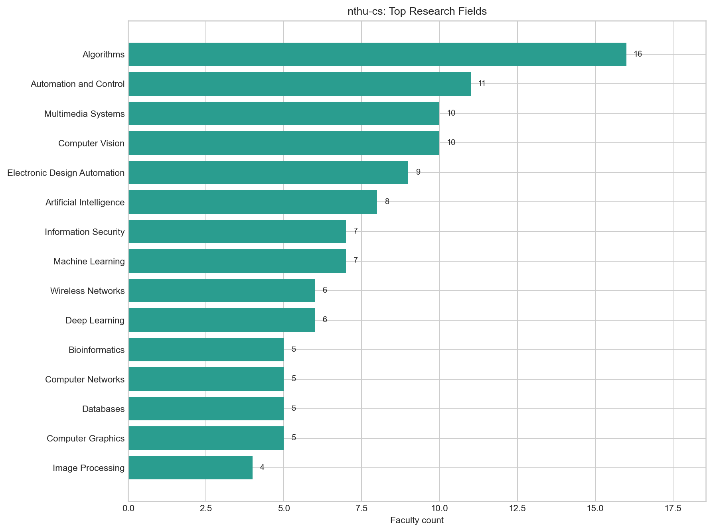

*圖：清華大學資訊工程學系 研究領域人數*  
*出處：`analysis/descriptive-stats-after-preprocessing/by_department/top_research_fields/nthu-cs.png`*  
*建構方式：由 `scripts/data-preprocessing/2_rf_and_phd_inst_comparison.ipynb` 產生。研究領域為官網「主要研究領域」與「研究領域摘要」分別清洗、以雙語詞典標準化成英文 canonical 值後取聯集；計數為具有該領域的不重複教師人數，不做 Top-N 截斷。*

### 1.3 博士畢業學校

| 排名 | 博士畢業學校（canonical） | 教授人數 |
| --- | --- | --- |
| 1 | National Taiwan University | 11 |
| 2 | National Tsing Hua University | 10 |
| 3 | National Chiao Tung University | 6 |
| 4 | University of California, Berkeley | 4 |
| 5 | Massachusetts Institute of Technology | 4 |
| 6 | University of Illinois Urbana-Champaign | 3 |
| 7 | University of Maryland, College Park | 3 |
| 8 | University of Southern California | 3 |
| 9 | University of Texas at Austin | 3 |
| 10 | Columbia University | 2 |

*出處：`analysis/descriptive-stats-after-preprocessing/group_comparison/phd_institutions/cs.csv`（`nthu-cs` 欄）*  
*建構方式：同一 notebook。學歷先被 `1_faculty_data_preprocessing.ipynb` 解析成「學位、科系、學校」三部分，取學位為博士的項目，學校名稱以別名表對應為英文 canonical 值；計數為不重複教師人數。*

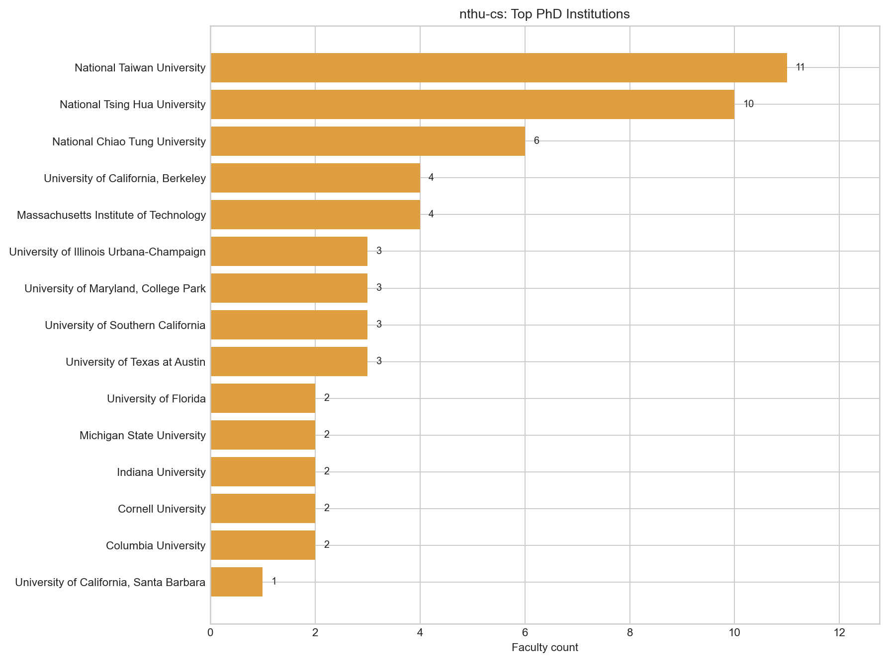

*圖：清華大學資訊工程學系 博士畢業學校人數*  
*出處：`analysis/descriptive-stats-after-preprocessing/by_department/top_phd_institutions/nthu-cs.png`*  
*建構方式：同一 notebook。學歷先被 `1_faculty_data_preprocessing.ipynb` 解析成「學位、科系、學校」三部分，取學位為博士的項目，學校名稱以別名表對應為英文 canonical 值；計數為不重複教師人數。*

## 2. 研究領域網路結構

### 2.1 網路指標

| 指標 | 數值 | 說明 |
| --- | --- | --- |
| 二分網路：教授數 / 領域數 / 邊數 | 76 / 65 / 207 | 一條邊 = 一位教授研究一個領域 |
| 二分網路連通元件數 | 3 | 最大元件涵蓋 97.4% 教授 |
| 每位教授平均 / 最多領域數 | 2.72 / 9 |  |
| 研究領域網路：節點 / 邊 | 63 / 216 | 只含至少與一個其他領域共現的領域 |
| 研究領域網路密度 | 0.111 | 實際邊數 ÷ 可能邊數 |
| 研究領域網路平均 degree | 6.86 |  |
| 研究領域網路 modularity Q（Louvain） | 0.422 | 6 個社群；resolution 0.7 / 1.3 時為 3 / 6 個 |
| 領域社群 vs taxonomy L1 一致度 | NMI 0.450 / ARI 0.230 | 1 = 完全一致，0 = 無關 |
| 教授網路：節點 / 邊 | 74 / 606 | 只含最大連通元件 |
| 教授網路密度 | 0.224 |  |
| 教授網路 modularity Q（Louvain） | 0.439 | 4 個集群 |
| 教授集群 vs 主導 L1 一致度 | NMI 0.487 / ARI 0.259 |  |

*出處：`analysis/network-analysis/nthu-cs/network_metrics.json`*  
*建構方式：由 `2_build_network_data.ipynb` 從 `faculty_standardized.json` 建立教授–研究領域二分網路：教授與研究領域各為一類節點，教授的標準化研究領域包含某領域即連一條邊。研究領域網路是二分網路的單邊投影：兩個領域若被同一位教授研究就相連，邊權為共同研究兩領域的教授人數。社群以 Louvain（seed = 42，resolution 1.0）偵測，指標以完整加權圖計算。教授網路是二分網路的另一邊投影：兩位教授共享研究領域就相連，邊權 w = S_exp + λ·S_inf；S_exp 為共享領域的 IDF 加權和（IDF 以全體 662 位教授計算一次），S_inf 為共享 taxonomy 上層分類的推論相似度，λ = 0.4。社群以 Louvain（seed = 42，resolution 1.0）偵測，節點大小與 degree 成正比。*

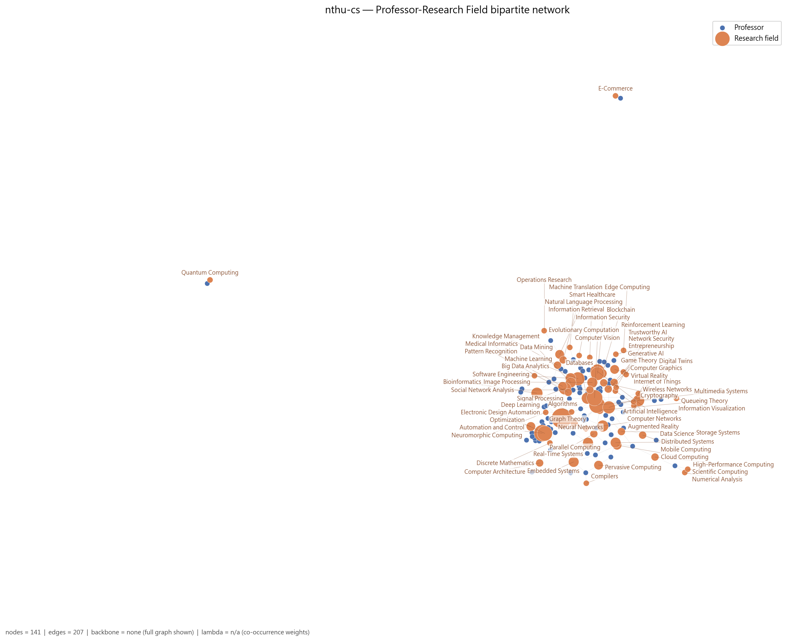

*圖：清華大學資訊工程學系 教授–研究領域二分網路*  
*出處：`analysis/network-analysis/nthu-cs/figures/01_bipartite_network.png`*  
*建構方式：由 `2_build_network_data.ipynb` 從 `faculty_standardized.json` 建立教授–研究領域二分網路：教授與研究領域各為一類節點，教授的標準化研究領域包含某領域即連一條邊。圖中兩類節點以不同顏色區分，節點大小與 degree 成正比；邊數超過 400 時繪圖使用 disparity filter backbone（α = 0.05），指標仍以完整圖計算。*

### 2.2 關鍵研究領域

| 研究領域 | Degree | Degree centrality | Betweenness | PageRank | 教授數 | taxonomy L1 |
| --- | --- | --- | --- | --- | --- | --- |
| Computer Vision | 25 | 0.403 | 0.274 | 0.0556 | 10 | Vision, Multimedia & Human-Centered Computing |
| Artificial Intelligence | 24 | 0.387 | 0.207 | 0.0512 | 8 | AI & Machine Learning |
| Multimedia Systems | 20 | 0.323 | 0.358 | 0.0513 | 10 | Vision, Multimedia & Human-Centered Computing |
| Machine Learning | 19 | 0.306 | 0.084 | 0.0389 | 7 | AI & Machine Learning |
| Algorithms | 16 | 0.258 | 0.229 | 0.0432 | 16 | Theory & Algorithms |
| Wireless Networks | 16 | 0.258 | 0.076 | 0.0291 | 6 | Networks & Communications |
| Information Security | 13 | 0.210 | 0.029 | 0.0268 | 7 | Security, Privacy & Cryptography |
| Deep Learning | 13 | 0.210 | 0.056 | 0.0257 | 6 | AI & Machine Learning |
| Game Theory | 12 | 0.194 | 0.000 | 0.0207 | 2 | Applied Mathematics & Operations Research |
| Databases | 11 | 0.177 | 0.030 | 0.0206 | 5 | Data, Databases & Knowledge Discovery |
| Social Network Analysis | 11 | 0.177 | 0.001 | 0.0182 | 2 | Data, Databases & Knowledge Discovery |
| Image Processing | 11 | 0.177 | 0.017 | 0.0254 | 4 | Vision, Multimedia & Human-Centered Computing |

Betweenness 最高的五個領域：Multimedia Systems（0.36）、Computer Vision（0.27）、Algorithms（0.23）、Artificial Intelligence（0.21）、Automation and Control（0.10）。Betweenness 高代表該領域位於不同主題群之間的連結位置，是系上跨主題的共同語言。

*出處：`analysis/network-analysis/nthu-cs/keyword_centrality.csv`*  
*建構方式：研究領域網路是二分網路的單邊投影：兩個領域若被同一位教授研究就相連，邊權為共同研究兩領域的教授人數。社群以 Louvain（seed = 42，resolution 1.0）偵測，指標以完整加權圖計算。 degree 為相連領域數，betweenness 為經過該節點的最短路徑比例，PageRank 為加權隨機漫步的穩態機率；parent_l1 來自 `1_build_taxonomy.ipynb` 手工編定的三層 taxonomy（170 個 L3、46 個 L2、16 個 L1）。*

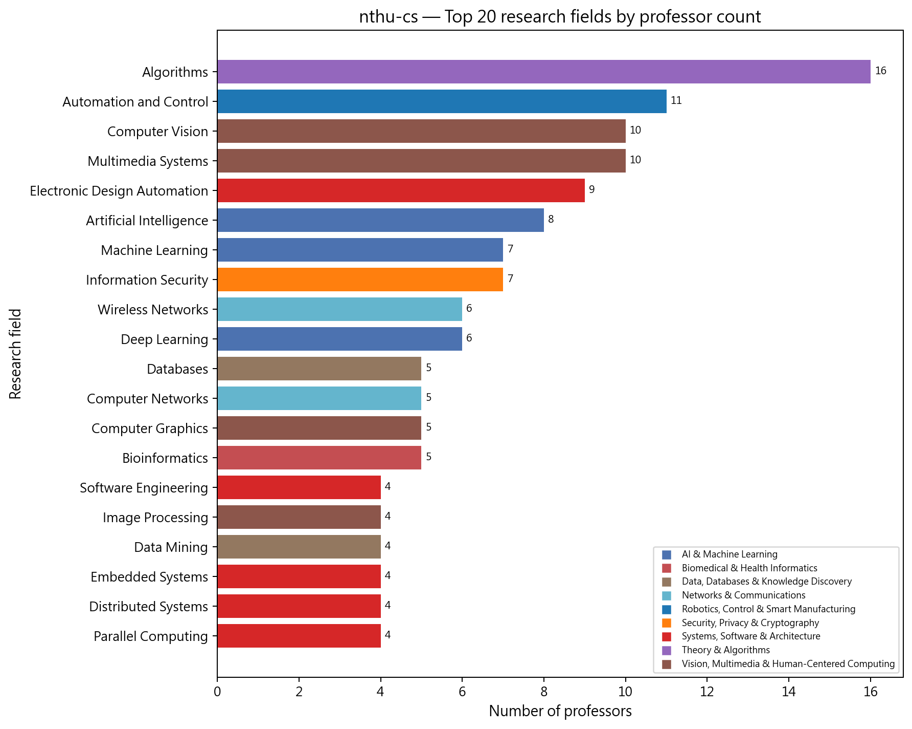

*圖：清華大學資訊工程學系 研究領域教授人數長條圖*  
*出處：`analysis/network-analysis/nthu-cs/figures/10_top_keywords_bar.png`*  
*建構方式：以二分網路中每個領域節點的 degree（研究該領域的教授數）排序繪製。*

### 2.3 研究領域社群

| 社群 | 領域數 | 主要領域（教授人數） | 主要 taxonomy L1（領域數） |
| --- | --- | --- | --- |
| 0 | 14 | Computer Networks（5）、Distributed Systems（4）、Embedded Systems（4）、Parallel Computing（4）、Cloud Computing（3）、Pervasive Computing（3）、High-Performance Computing（2） | Systems, Software & Architecture 6、Networks & Communications 4、Applied Mathematics & Operations Research 2 |
| 1 | 12 | Artificial Intelligence（8）、Information Security（7）、Software Engineering（4）、Blockchain（3）、Internet of Things（3）、Network Security（2）、Entrepreneurship（1） | AI & Machine Learning 4、Security, Privacy & Cryptography 3、Networks & Communications 2 |
| 2 | 11 | Machine Learning（7）、Deep Learning（6）、Databases（5）、Data Mining（4）、Natural Language Processing（3）、Big Data Analytics（3）、Information Retrieval（2） | AI & Machine Learning 4、Data, Databases & Knowledge Discovery 4、Information Systems & Management 1 |
| 3 | 11 | Computer Vision（10）、Multimedia Systems（10）、Computer Graphics（5）、Image Processing（4）、Cryptography（2）、Pattern Recognition（2）、Augmented Reality（1） | Vision, Multimedia & Human-Centered Computing 9、Security, Privacy & Cryptography 1、Systems, Software & Architecture 1 |
| 4 | 9 | Algorithms（16）、Automation and Control（11）、Electronic Design Automation（9）、Bioinformatics（5）、Optimization（3）、Computer Architecture（2）、Graph Theory（2） | Theory & Algorithms 3、Systems, Software & Architecture 2、Robotics, Control & Smart Manufacturing 1 |
| 5 | 6 | Wireless Networks（6）、Game Theory（2）、Social Network Analysis（2）、Queueing Theory（2）、Data Science（1）、Reinforcement Learning（1） | Applied Mathematics & Operations Research 2、Data, Databases & Knowledge Discovery 2、Networks & Communications 1 |

*出處：`analysis/network-analysis/nthu-cs/keyword_communities.csv`（`community` 欄）、`keyword_centrality.csv`（教授人數）*  
*建構方式：研究領域網路是二分網路的單邊投影：兩個領域若被同一位教授研究就相連，邊權為共同研究兩領域的教授人數。社群以 Louvain（seed = 42，resolution 1.0）偵測，指標以完整加權圖計算。*

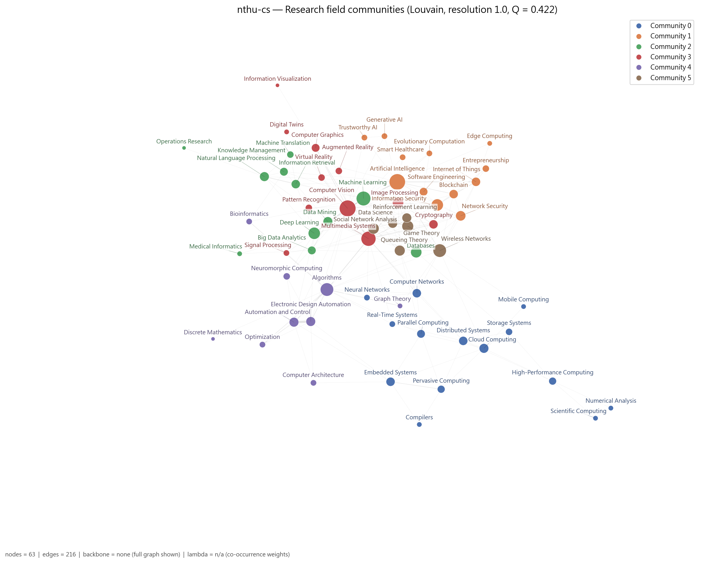

*圖：清華大學資訊工程學系 研究領域網路的 Louvain 社群*  
*出處：`analysis/network-analysis/nthu-cs/figures/05_keyword_network_communities.png`*  
*建構方式：研究領域網路是二分網路的單邊投影：兩個領域若被同一位教授研究就相連，邊權為共同研究兩領域的教授人數。社群以 Louvain（seed = 42，resolution 1.0）偵測，指標以完整加權圖計算。節點顏色為社群，大小與 degree 成正比。*

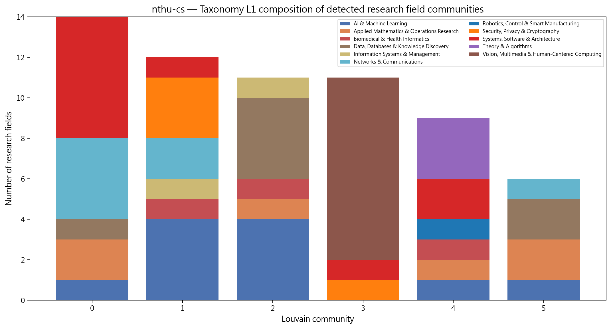

*圖：清華大學資訊工程學系 各研究領域社群的 taxonomy L1 組成*  
*出處：`analysis/network-analysis/nthu-cs/figures/14_community_composition.png`*  
*建構方式：把每個 Louvain 領域社群內的領域依 taxonomy L1 分類計數，堆疊長條圖。用來檢查資料驅動的社群是否對應人工分類。*

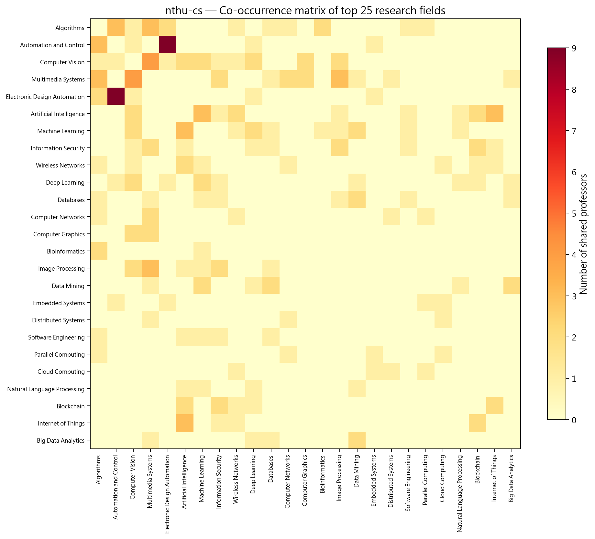

*圖：清華大學資訊工程學系 研究領域共現熱圖*  
*出處：`analysis/network-analysis/nthu-cs/figures/13_keyword_cooccurrence_heatmap.png`*  
*建構方式：取研究領域網路的加權鄰接矩陣（共同研究兩領域的教授人數），依社群排序後繪製熱圖。*

## 3. 主要研究集群與重要老師

教授網路分成 4 個集群，modularity Q = 0.439 是 14 個系所中最高的，代表集群之間的區隔最清楚。研究領域網路的密度（z = -2.9）、modularity（z = 3.6）與平均共現（z = 3.2）都與虛無模型有顯著差異。本系是少數沒有觸發任何 L1 過寬或 λ 過度合併護欄的單位，結果最穩健。

教授網路共 74 位教授、4 個集群（Louvain，Q = 0.439）。以下依集群人數排序；集群編號與圖中的 Community 編號一致。表中 Degree 為與該教授共享研究領域的同儕數，Betweenness 為該教授位於他人最短路徑上的比例（越高越像橋梁）。

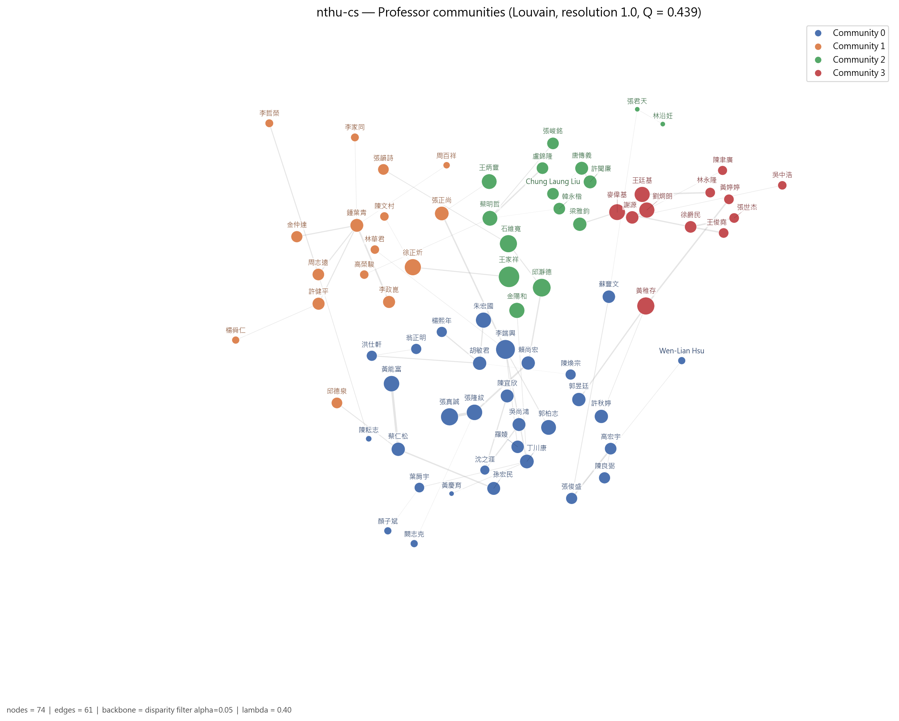

*圖：清華大學資訊工程學系 教授網路的 Louvain 集群*  
*出處：`analysis/network-analysis/nthu-cs/figures/09_professor_network_communities.png`*  
*建構方式：教授網路是二分網路的另一邊投影：兩位教授共享研究領域就相連，邊權 w = S_exp + λ·S_inf；S_exp 為共享領域的 IDF 加權和（IDF 以全體 662 位教授計算一次），S_inf 為共享 taxonomy 上層分類的推論相似度，λ = 0.4。社群以 Louvain（seed = 42，resolution 1.0）偵測，節點大小與 degree 成正比。*

### 3.1 集群 0：人工智慧、視覺、多媒體與資安集群（31 人）

- **成員共同研究領域**：Computer Vision（8 人）、Artificial Intelligence（7 人）、Machine Learning（7 人）、Information Security（7 人）、Multimedia Systems（6 人）、Deep Learning（5 人）、Computer Graphics（5 人）
- **成員主導 taxonomy L1**：AI & Machine Learning 11 人、Vision, Multimedia & Human-Centered Computing 8 人、Security, Privacy & Cryptography 6 人、Data, Databases & Knowledge Discovery 4 人、Networks & Communications 1 人、Systems, Software & Architecture 1 人

31 位成員，是本系最大的集群，主導 taxonomy 混合 AI & Machine Learning（11）、Vision（8）、Security（6）、Data（4），共享 Computer Vision、Artificial Intelligence、Machine Learning、Information Security、Multimedia Systems 與 Computer Graphics。李端興 degree 36、betweenness 0.214 皆為全系最高，研究 AI、電腦視覺、資料科學、賽局與機器學習；張真誠（合聘）是密碼學與影像資安的資深學者；張隆紋（兼任）betweenness 次之；黃能富代表區塊鏈、物聯網與網路安全；朱宏國代表電腦圖學與數位孿生。這個集群其實包含「視覺／圖學」與「資安／密碼」兩個子群，在 resolution 1.3 時會分開。

| 姓名 | 英文名 | 職稱類別 | Degree | Betweenness | 研究領域（最多列 5 項） |
| --- | --- | --- | --- | --- | --- |
| 李端興 | Duan-Shin Lee | 專任 | 36 | 0.214 | Artificial Intelligence、Computer Vision、Data Science、Game Theory、Machine Learning |
| 張真誠 | Chin-Chen Chang | 合聘 | 30 | 0.031 | Cryptography、Databases、Image Processing、Information Security、Multimedia Systems |
| 張隆紋 | Long-Wen Chang | 兼任 | 25 | 0.107 | Computer Vision、Cryptography、Game Theory、Image Processing、Information Security |
| 黃能富 | Nen-Fu Huang | 專任 | 25 | 0.043 | Artificial Intelligence、Blockchain、Internet of Things、Network Security、Wireless Networks |
| 朱宏國 | Hung-Kuo Chu | 專任 | 24 | 0.007 | Computer Graphics、Computer Vision、Digital Twins |
| 郭柏志 | Po-Chih Kuo | 專任 | 23 | 0.000 | Artificial Intelligence、Image Processing、Machine Learning、Smart Healthcare |
| 丁川康 | Chuan-Kang Ting | 專任 | 20 | 0.019 | Artificial Intelligence、Evolutionary Computation、Machine Learning、Software Engineering |
| 胡敏君 | Min-Chun Hu | 專任 | 19 | 0.061 | Augmented Reality、Computer Graphics、Computer Vision、Multimedia Systems、Virtual Reality |

其餘成員（23 位，依 degree 排序）：蔡仁松、賴尚宏、郭昱廷、許秋婷、陳宜欣、吳尚鴻、孫宏民、蘇豐文、羅婈、高宏宇、張俊盛、陳良弼、楊熙年、洪仕軒、翁正明、陳煥宗、葉肩宇、沈之涯、Wen-Lian Hsu、闕志克、顏子斌、陳耘志、黃慶育

### 3.2 集群 1：網路、雲端與系統集群（16 人）

- **成員共同研究領域**：Distributed Systems（4 人）、Computer Networks（4 人）、Cloud Computing（3 人）、Embedded Systems（3 人）、Parallel Computing（3 人）、Pervasive Computing（3 人）、Wireless Networks（3 人）
- **成員主導 taxonomy L1**：Networks & Communications 9 人、Systems, Software & Architecture 5 人、Applied Mathematics & Operations Research 2 人

16 位成員，9 位主導 Networks & Communications、5 位主導 Systems，共享 Distributed Systems、Computer Networks、Cloud Computing、Embedded Systems、Parallel Computing 與 Pervasive Computing。徐正炘 degree 最高（27，網路、分散式系統、多媒體）；鍾葉青（名譽）與張正尚（合聘）betweenness 較高；許健平代表雲端與無線網路；李政崑代表編譯器與嵌入式系統。

| 姓名 | 英文名 | 職稱類別 | Degree | Betweenness | 研究領域（最多列 5 項） |
| --- | --- | --- | --- | --- | --- |
| 徐正炘 | Cheng-Hsin Hsu | 專任 | 27 | 0.025 | Computer Networks、Distributed Systems、Multimedia Systems |
| 張正尚 | Cheng-Shang Chang | 合聘 | 20 | 0.056 | Computer Networks、Parallel Computing、Queueing Theory |
| 鍾葉青 | Yeh-Ching Chung | 名譽／退休 | 18 | 0.064 | Cloud Computing、Embedded Systems、Parallel Computing、Pervasive Computing |
| 許健平 | Jang-Ping Sheu | 專任 | 16 | 0.048 | Cloud Computing、Mobile Computing、Wireless Networks |
| 李政崑 | Jenq-Kuen Lee | 專任 | 16 | 0.002 | Compilers、Embedded Systems、Pervasive Computing |
| 周志遠 |  | 專任 | 15 | 0.030 | Cloud Computing、Distributed Systems、High-Performance Computing、Storage Systems |
| 金仲達 | Chung-Ta King | 兼任 | 14 | 0.003 | Distributed Systems、Pervasive Computing |
| 張韻詩 |  | 主管／講座 | 13 | 0.003 | Distributed Systems、Real-Time Systems |

其餘成員（8 位，依 degree 排序）：邱德泉、林華君、陳文村、高榮駿、李哲榮、李家同、楊舜仁、周百祥

### 3.3 集群 2：演算法與生物資訊集群（15 人）

- **成員共同研究領域**：Algorithms（13 人）、Bioinformatics（4 人）、Multimedia Systems（3 人）、Graph Theory（2 人）、Discrete Mathematics（1 人）、Optimization（1 人）、Computer Networks（1 人）
- **成員主導 taxonomy L1**：Theory & Algorithms 5 人、Biomedical & Health Informatics 4 人、Systems, Software & Architecture 2 人、AI & Machine Learning 1 人、Vision, Multimedia & Human-Centered Computing 1 人、Data, Databases & Knowledge Discovery 1 人、Applied Mathematics & Operations Research 1 人

15 位成員，共享 Algorithms（13 人）、Bioinformatics、Multimedia Systems 與 Graph Theory。王家祥（名譽教授）degree 42 為全系最高，研究演算法、網路、多媒體與神經網路；邱瀞德 betweenness 最高（0.07），結合演算法、電腦視覺與訊號處理；石維寬（即時系統）、金陽和（名譽，資料庫與軟體工程）、蔡明哲（圖論與無線網路）是主要成員。

| 姓名 | 英文名 | 職稱類別 | Degree | Betweenness | 研究領域（最多列 5 項） |
| --- | --- | --- | --- | --- | --- |
| 王家祥 | Jia-Shung Wang | 名譽／退休 | 42 | 0.027 | Algorithms、Computer Networks、Multimedia Systems、Neural Networks |
| 邱瀞德 | Ching-Te Chiu | 專任 | 32 | 0.070 | Algorithms、Computer Vision、Multimedia Systems、Signal Processing |
| 石維寬 | Wei-Kuan Shih | 專任 | 30 | 0.017 | Algorithms、Multimedia Systems、Real-Time Systems |
| 金陽和 | Y.H. Chin | 名譽／退休 | 24 | 0.043 | Algorithms、Databases、Software Engineering |
| 蔡明哲 | Ming-Jer Tsai | 專任 | 23 | 0.038 | Algorithms、Graph Theory、Wireless Networks |
| 王炳豐 | Biing-Feng Wang | 專任 | 23 | 0.018 | Algorithms、Parallel Computing |
| 梁雅鈞 | Ya-Chun Liang | 專任 | 19 | 0.000 | Algorithms、Optimization |
| 唐傳義 | Chuan-Yi Tang | 合聘 | 18 | 0.021 | Algorithms、Bioinformatics |

其餘成員（7 位，依 degree 排序）：許聞廉、Chung Laung Liu、張峻銘、盧錦隆、韓永楷、張君天、林沿妊

### 3.4 集群 3：電子設計自動化與計算機架構集群（12 人）

- **成員共同研究領域**：Automation and Control（11 人）、Electronic Design Automation（9 人）、Algorithms（3 人）、Computer Architecture（2 人）、Optimization（2 人）、Embedded Systems（1 人）、Computer Vision（1 人）
- **成員主導 taxonomy L1**：Robotics, Control & Smart Manufacturing 7 人、Applied Mathematics & Operations Research 2 人、Systems, Software & Architecture 2 人、AI & Machine Learning 1 人

12 位成員，7 位主導 Robotics, Control & Smart Manufacturing（Automation and Control 在 taxonomy 中歸於此類），共享 Automation and Control（11 人）、Electronic Design Automation（9 人）、Algorithms 與 Computer Architecture。黃稚存 degree 30、betweenness 0.147 為集群最高，研究自動化、電腦視覺、深度學習、EDA 與神經形態運算；麥偉基、王廷基、劉炯朗（講座教授）是 EDA 核心；謝源（合聘）帶入計算機架構與嵌入式系統。

| 姓名 | 英文名 | 職稱類別 | Degree | Betweenness | 研究領域（最多列 5 項） |
| --- | --- | --- | --- | --- | --- |
| 黃稚存 | Chih-Tsun Huang | 專任 | 30 | 0.147 | Automation and Control、Computer Vision、Deep Learning、Electronic Design Automation、Neuromorphic Computing |
| 麥偉基 | Wai-Kei Mak | 專任 | 26 | 0.010 | Algorithms、Automation and Control、Optimization |
| 劉炯朗 |  | 主管／講座 | 24 | 0.035 | Algorithms、Automation and Control、Electronic Design Automation |
| 王廷基 | Ting-Chi Wang | 專任 | 24 | 0.035 | Algorithms、Automation and Control、Electronic Design Automation |
| 謝源 | Yuan Xie | 合聘 | 17 | 0.074 | Automation and Control、Computer Architecture、Electronic Design Automation、Embedded Systems |
| 徐爵民 | Jyuo-Min Shyu | 名譽／退休 | 15 | 0.000 | Automation and Control、Electronic Design Automation、Optimization |
| 張世杰 |  | 專任 | 11 | 0.000 | Automation and Control、Electronic Design Automation |
| 林永隆 |  | 主管／講座 | 11 | 0.000 | Automation and Control、Electronic Design Automation |

其餘成員（4 位，依 degree 排序）：王俊堯、黃婷婷、陳聿廣、吳中浩

*集群表出處：`analysis/network-analysis/nthu-cs/professor_communities.csv`（集群歸屬）、`professor_centrality.csv`（degree、betweenness、職稱類別）、`prof_keyword_network.graphml`（成員研究領域，用來統計集群的共同領域）*  
*建構方式：教授網路是二分網路的另一邊投影：兩位教授共享研究領域就相連，邊權 w = S_exp + λ·S_inf；S_exp 為共享領域的 IDF 加權和（IDF 以全體 662 位教授計算一次），S_inf 為共享 taxonomy 上層分類的推論相似度，λ = 0.4。社群以 Louvain（seed = 42，resolution 1.0）偵測，節點大小與 degree 成正比。 職稱類別為官網職稱的分類，一人可屬多類時取主要類別；「N 個系所」表示該教授也出現在其他系所名單。*

### 3.5 全系的橋接者與樞紐

Betweenness 最高的教授（跨集群的橋梁）：

| 姓名 | 英文名 | 職稱類別 | Degree | Betweenness | 主導 L1 |
| --- | --- | --- | --- | --- | --- |
| 李端興 | Duan-Shin Lee | 專任 | 36 | 0.214 | AI & Machine Learning |
| 黃稚存 | Chih-Tsun Huang | 專任 | 30 | 0.147 | AI & Machine Learning |
| 張隆紋 | Long-Wen Chang | 兼任 | 25 | 0.107 | Vision, Multimedia & Human-Centered Computing |
| 謝源 | Yuan Xie | 合聘 | 17 | 0.074 | Systems, Software & Architecture |
| 邱瀞德 | Ching-Te Chiu | 專任 | 32 | 0.070 | Vision, Multimedia & Human-Centered Computing |
| 鍾葉青 | Yeh-Ching Chung | 名譽／退休 | 18 | 0.064 | Networks & Communications |

Degree 最高的教授（與最多同儕共享領域的樞紐）：

| 姓名 | 英文名 | 職稱類別 | Degree | Betweenness | 主導 L1 |
| --- | --- | --- | --- | --- | --- |
| 王家祥 | Jia-Shung Wang | 名譽／退休 | 42 | 0.027 | AI & Machine Learning |
| 李端興 | Duan-Shin Lee | 專任 | 36 | 0.214 | AI & Machine Learning |
| 邱瀞德 | Ching-Te Chiu | 專任 | 32 | 0.070 | Vision, Multimedia & Human-Centered Computing |
| 張真誠 | Chin-Chen Chang | 合聘 | 30 | 0.031 | Security, Privacy & Cryptography |
| 黃稚存 | Chih-Tsun Huang | 專任 | 30 | 0.147 | AI & Machine Learning |
| 石維寬 | Wei-Kuan Shih | 專任 | 30 | 0.017 | Systems, Software & Architecture |

*出處：`analysis/network-analysis/nthu-cs/professor_centrality.csv`*

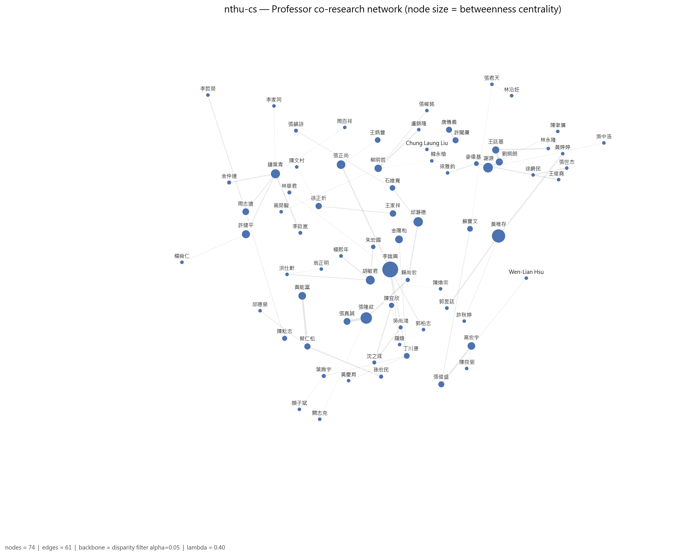

*圖：清華大學資訊工程學系 教授網路（節點大小 = betweenness）*  
*出處：`analysis/network-analysis/nthu-cs/figures/08_professor_network_betweenness.png`*  
*建構方式：教授網路是二分網路的另一邊投影：兩位教授共享研究領域就相連，邊權 w = S_exp + λ·S_inf；S_exp 為共享領域的 IDF 加權和（IDF 以全體 662 位教授計算一次），S_inf 為共享 taxonomy 上層分類的推論相似度，λ = 0.4。社群以 Louvain（seed = 42，resolution 1.0）偵測，節點大小與 degree 成正比。此圖節點大小改為與 betweenness 成正比。*

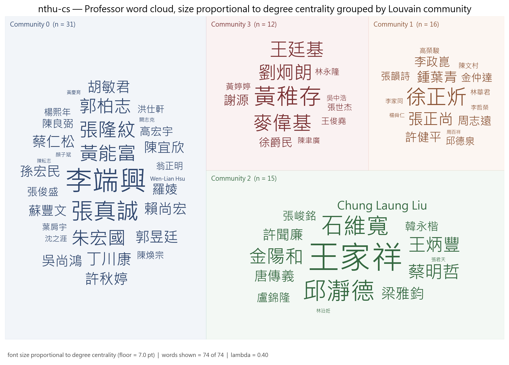

*圖：清華大學資訊工程學系 各集群教授 word cloud（字級 = degree）*  
*出處：`analysis/network-analysis/nthu-cs/figures/27_professor_wordcloud_degree_by_community.png`*  
*建構方式：依 Louvain 集群分塊、同集群同色的教授姓名 word cloud，字級與 degree 成線性正比並設下限。*

另有 2 位教授雖有研究領域，但與其他教授沒有共享任何領域，孤立於最大連通元件之外，不屬於任何集群。

## 4. 結構穩健性檢驗

### 4.1 虛無模型檢定

| 統計量 | 觀測值 | 虛無平均 | 虛無標準差 | z-score | empirical p | p < 0.05 |
| --- | --- | --- | --- | --- | --- | --- |
| 領域網路密度 | 0.1106 | 0.1254 | 0.0051 | -2.88 | 0.002 | 顯著 |
| 領域網路 modularity Q | 0.4165 | 0.3286 | 0.0244 | 3.59 | 0.006 | 顯著 |
| 領域平均共現次數 | 1.2269 | 1.1436 | 0.0257 | 3.24 | 0.004 | 顯著 |
| 教授網路 clustering 係數 | 0.6658 | 0.6175 | 0.0258 | 1.87 | 0.058 | 不顯著 |

*出處：`analysis/network-analysis/nthu-cs/null_model_test.csv`*  
*建構方式：以保持二分結構與雙邊 degree 序列的 double edge swap（nswap = 10 × 邊數）產生 1,000 個隨機網路，比較觀測值與虛無分布，輸出 z-score 與雙尾 empirical p-value。 密度顯著偏低而 modularity、共現顯著偏高，代表領域共現集中在少數主題群，不是均勻分布。*

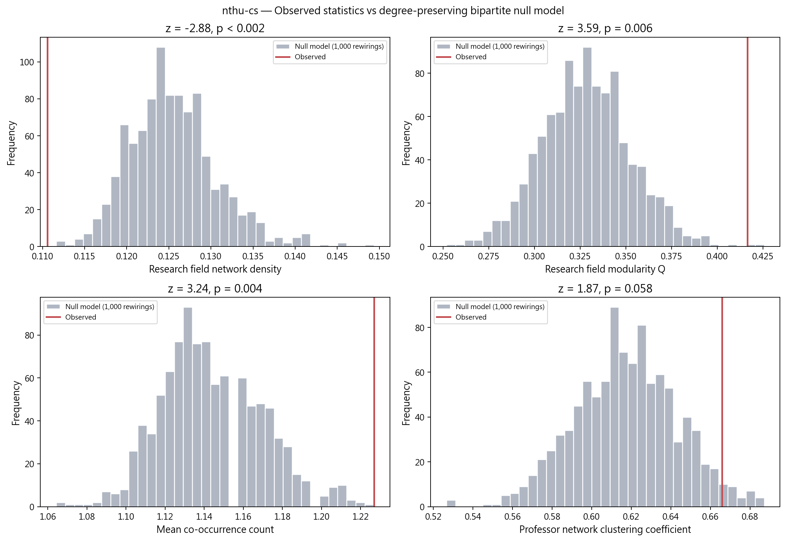

*圖：清華大學資訊工程學系 觀測值 vs 虛無模型分布*  
*出處：`analysis/network-analysis/nthu-cs/figures/15_null_model_comparison.png`*  
*建構方式：以保持二分結構與雙邊 degree 序列的 double edge swap（nswap = 10 × 邊數）產生 1,000 個隨機網路，比較觀測值與虛無分布，輸出 z-score 與雙尾 empirical p-value。*

### 4.2 λ 敏感度

| λ | 邊數 | 密度 | Q | 集群數 | 密度相對 baseline | Q 下降 | 過度合併 |
| --- | --- | --- | --- | --- | --- | --- | --- |
| 0.0 | 433 | 0.160 | 0.466 | 4 | +0% | 0.000 | 否 |
| 0.3 | 606 | 0.224 | 0.447 | 5 | +40% | 0.018 | 否 |
| 0.4 | 606 | 0.224 | 0.439 | 4 | +40% | 0.027 | 否 |
| 0.5 | 606 | 0.224 | 0.432 | 5 | +40% | 0.033 | 否 |

*出處：`analysis/network-analysis/nthu-cs/lambda_sensitivity.csv`*  
*建構方式：以 λ ∈ {0, 0.3, 0.4, 0.5} 各建一次教授網路，λ = 0 為 baseline；密度較 baseline 增加超過 50% 或 Q 下降超過 0.1 即標記為過度合併。*

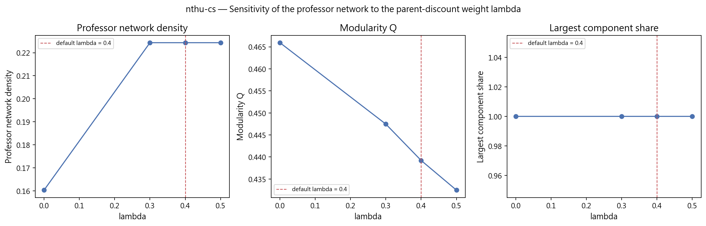

*圖：清華大學資訊工程學系 λ 敏感度*  
*出處：`analysis/network-analysis/nthu-cs/figures/16_lambda_sensitivity.png`*  
*建構方式：以 λ ∈ {0, 0.3, 0.4, 0.5} 各建一次教授網路，λ = 0 為 baseline；密度較 baseline 增加超過 50% 或 Q 下降超過 0.1 即標記為過度合併。*

### 4.3 taxonomy L1 覆蓋護欄

| taxonomy L1 | 教授數 | 覆蓋率 | flag |
| --- | --- | --- | --- |
| Systems, Software & Architecture | 27 | 36.5% | ok |
| Vision, Multimedia & Human-Centered Computing | 20 | 27.0% | ok |
| AI & Machine Learning | 18 | 24.3% | ok |
| Networks & Communications | 17 | 23.0% | ok |
| Theory & Algorithms | 16 | 21.6% | ok |
| Data, Databases & Knowledge Discovery | 11 | 14.9% | ok |
| Robotics, Control & Smart Manufacturing | 11 | 14.9% | ok |
| Applied Mathematics & Operations Research | 8 | 10.8% | ok |

*出處：`analysis/network-analysis/nthu-cs/l1_coverage_guardrail.csv`（只列前 8 項）*  
*建構方式：計算每個 L1 分類涵蓋該單位多少比例的教授，超過 50% 標記 too_broad，代表此 L1 在本單位太寬，不能用來做 L1 roll-up 比較。*

## 5. 解讀與注意事項

- 「Automation and Control」是預處理階段對 EDA／VLSI 相關原文的 canonical 對應，在本系實際上多指電子設計自動化與 VLSI 設計，而非工業控制。
- 20 位名譽教授中多數有研究領域並進入網路（例如王家祥、鍾葉青、金陽和），集群反映的是包含資深退休師資的整體樣貌。
- 中英文官網名單不完全相同（配對率 75.3%），有 2 位教授沒有中文姓名，另有 2 位孤立於教授網路之外。
- λ 敏感度未觸發過度合併，λ=0 與 λ=0.4 的社群數都是 4；沒有任何 L1 被標記為過寬。
- 教授網路 clustering 係數與虛無模型差異接近但未達顯著（z = 1.9，p = 0.058）。
- 研究領域來自官網自填內容，粒度與深度因人而異；網路密度與集群數反映填寫習慣的成分不可忽視，完整率不可解讀為系所或教授的品質排名。

## 附錄：本報告引用的資料與圖表清單

| 檔案 | 產生階段 / 程式 | 建構方式摘要 |
| --- | --- | --- |
| `analysis/data-collection/nthu-cs/quality-report.json` | 資料蒐集 `scripts/data-collection/collect.py` | 爬取官網後統計 canonical 紀錄人數、職稱分類、中英配對率與欄位完整率 |
| `analysis/descriptive-stats-after-preprocessing/coverage_by_school.csv` | 預處理 `1_faculty_data_preprocessing.ipynb` | 標準化後各欄位有 canonical 值的教師比例與平均項目數 |
| `.../group_comparison/research_fields/cs.csv`、`by_department/top_research_fields/nthu-cs.png` | 預處理 `2_rf_and_phd_inst_comparison.ipynb` | 由 `scripts/data-preprocessing/2_rf_and_phd_inst_comparison.ipynb` 產生。研究領域為官網「主要研究領域」與「研究領域摘要」分別清洗、以雙語詞典標準化成英文 canonical 值後取聯集；計數為具有該領域的不重複教師人數，不做 Top-N 截斷。 |
| `.../group_comparison/phd_institutions/cs.csv`、`by_department/top_phd_institutions/nthu-cs.png` | 同上 | 同一 notebook。學歷先被 `1_faculty_data_preprocessing.ipynb` 解析成「學位、科系、學校」三部分，取學位為博士的項目，學校名稱以別名表對應為英文 canonical 值；計數為不重複教師人數。 |
| `analysis/network-analysis/nthu-cs/network_metrics.json` | 網路分析 `2_build_network_data.ipynb` + `3_network_analysis.ipynb` | 由 `2_build_network_data.ipynb` 從 `faculty_standardized.json` 建立教授–研究領域二分網路：教授與研究領域各為一類節點，教授的標準化研究領域包含某領域即連一條邊。研究領域網路是二分網路的單邊投影：兩個領域若被同一位教授研究就相連，邊權為共同研究兩領域的教授人數。社群以 Louvain（seed = 42，resolution 1.0）偵測，指標以完整加權圖計算。教授網路是二分網路的另一邊投影：兩位教授共享研究領域就相連，邊權 w = S_exp + λ·S_inf；S_exp 為共享領域的 IDF 加權和（IDF 以全體 662 位教授計算一次），S_inf 為共享 taxonomy 上層分類的推論相似度，λ = 0.4。社群以 Louvain（seed = 42，resolution 1.0）偵測，節點大小與 degree 成正比。 |
| `analysis/network-analysis/nthu-cs/keyword_centrality.csv`、`keyword_communities.csv` | `3_network_analysis.ipynb` | 研究領域網路的中心性與 Louvain 社群；taxonomy 來自 `1_build_taxonomy.ipynb` |
| `analysis/network-analysis/nthu-cs/professor_centrality.csv`、`professor_communities.csv`、`prof_keyword_network.graphml` | `3_network_analysis.ipynb` | 教授網路的中心性與 Louvain 集群；graphml 為二分網路，本報告用它統計各集群成員的共同領域 |
| `analysis/network-analysis/nthu-cs/null_model_test.csv` | `3_network_analysis.ipynb` | 以保持二分結構與雙邊 degree 序列的 double edge swap（nswap = 10 × 邊數）產生 1,000 個隨機網路，比較觀測值與虛無分布，輸出 z-score 與雙尾 empirical p-value。 |
| `analysis/network-analysis/nthu-cs/lambda_sensitivity.csv` | `3_network_analysis.ipynb` | 以 λ ∈ {0, 0.3, 0.4, 0.5} 各建一次教授網路，λ = 0 為 baseline；密度較 baseline 增加超過 50% 或 Q 下降超過 0.1 即標記為過度合併。 |
| `analysis/network-analysis/nthu-cs/l1_coverage_guardrail.csv` | `3_network_analysis.ipynb` | 每個 L1 涵蓋教授比例，> 50% 標記 too_broad |
| `analysis/network-analysis/nthu-cs/figures/01, 05, 08, 09, 10, 13, 14, 15, 16, 27` | `3_network_analysis.ipynb` | 網路圖節點大小與 degree 或 betweenness 成正比、顏色依社群；邊數 > 400 時繪圖用 disparity filter backbone；word cloud 字級與中心性成線性正比 |

更完整的方法說明見 `docs/data-collection-report.md`、`docs/data-preprocessing-report.md`、`docs/network-analysis-report.md`。
