# 清華大學計量財務金融學系（`nthu-qf`）研究結果總結報告

所屬分組：財金與經濟組（fin-and-econ）　｜　資料日期：2026-09-09 蒐集、2026-09-10 完成網路分析

> **本報告的資料來源**
> 本專案分三個階段：(1) 資料蒐集（`scripts/data-collection/`）從 14 個系所官網爬取師資的姓名、職稱、學歷與研究領域，中英文分開蒐集後配對；
> (2) 資料預處理（`scripts/data-preprocessing/`）把職稱、學歷、研究領域標準化成英文 canonical 值，並產生描述統計；
> (3) 網路分析（`scripts/network-analysis/current-version/`）建立「教授–研究領域」二分網路，投影成研究領域網路與教授網路，做社群偵測、中心性、虛無模型與敏感度分析。
> 本報告所有數字、表格與圖表都取自 `analysis/` 底下這三個階段的輸出，每張圖表下方都標明出處與建構方式，附錄另有完整清單。
> 「研究集群」指教授網路的 Louvain 社群；「重要老師」依教授在該網路中的 degree（與多少同儕共享領域）與 betweenness（是否位於集群之間的橋梁位置）判定，**不是**學術成就的排名。

## 1. 科系速覽

清大計財系是一個小而集中的**計量財務**科系，19 位師資中專任 18 位，研究主題以 Econometrics（7 人）、Financial Engineering（6 人）、Risk Management（5 人）與 Corporate Finance（4 人）為主。與其他財金系所相比，本系的特色是**計量方法與金融工程的比重高於公司理財**，且教授之間共享領域的程度高，教授網路的最大連通元件涵蓋全部 17 位進入網路的教授。官網中英文共用同一頁面，多數教授沒有官網提供的英文姓名，因此圖表中僅顯示中文。

### 1.1 基本資料

| 項目 | 數值 |
| --- | --- |
| 官網師資人數（canonical 紀錄） | 19 |
| 職稱分類（一人可屬多類） | 專任 18、主管／講座 4、兼任 1、名譽／退休 1、教師（未細分） 1、合聘 1、實務 1 |
| 中英文紀錄配對率 | 100.0% |
| 研究領域完整率（標準化後） | 89.5% |
| 學歷完整率（標準化後） | 94.7% |
| 每位教授平均研究領域數 | 2.37 |
| 進入網路分析的教授數 | 17（2 位因無研究領域排除） |

*出處：`analysis/data-collection/nthu-qf/quality-report.json`（人數、職稱、配對率）、`analysis/descriptive-stats-after-preprocessing/coverage_by_school.csv`（完整率）、`analysis/network-analysis/nthu-qf/network_metrics.json`（進入網路人數）*  
*建構方式：quality-report 由 `scripts/data-collection/collect.py` 在爬取官網後統計 canonical 紀錄的職稱分類與中英配對；coverage 由 `1_faculty_data_preprocessing.ipynb` 計算標準化後有 canonical 值的教師比例。*

### 1.2 主要研究領域

| 排名 | 研究領域（canonical） | 教授人數 |
| --- | --- | --- |
| 1 | Econometrics | 7 |
| 2 | Financial Engineering | 6 |
| 3 | Risk Management | 5 |
| 4 | Corporate Finance | 4 |
| 5 | Accounting | 3 |
| 6 | International Finance | 2 |
| 7 | Financial Derivatives | 2 |
| 8 | Banking and Financial Institutions | 2 |
| 9 | Asset Pricing | 2 |
| 10 | Real Estate Finance | 2 |
| 11 | Financial Markets | 1 |
| 12 | Behavioral Finance | 1 |
| 13 | Credit Risk | 1 |
| 14 | Financial Technology | 1 |
| 15 | Insurance | 1 |

*出處：`analysis/descriptive-stats-after-preprocessing/group_comparison/research_fields/fin-and-econ.csv`（`nthu-qf` 欄）*  
*建構方式：由 `scripts/data-preprocessing/2_rf_and_phd_inst_comparison.ipynb` 產生。研究領域為官網「主要研究領域」與「研究領域摘要」分別清洗、以雙語詞典標準化成英文 canonical 值後取聯集；計數為具有該領域的不重複教師人數，不做 Top-N 截斷。*

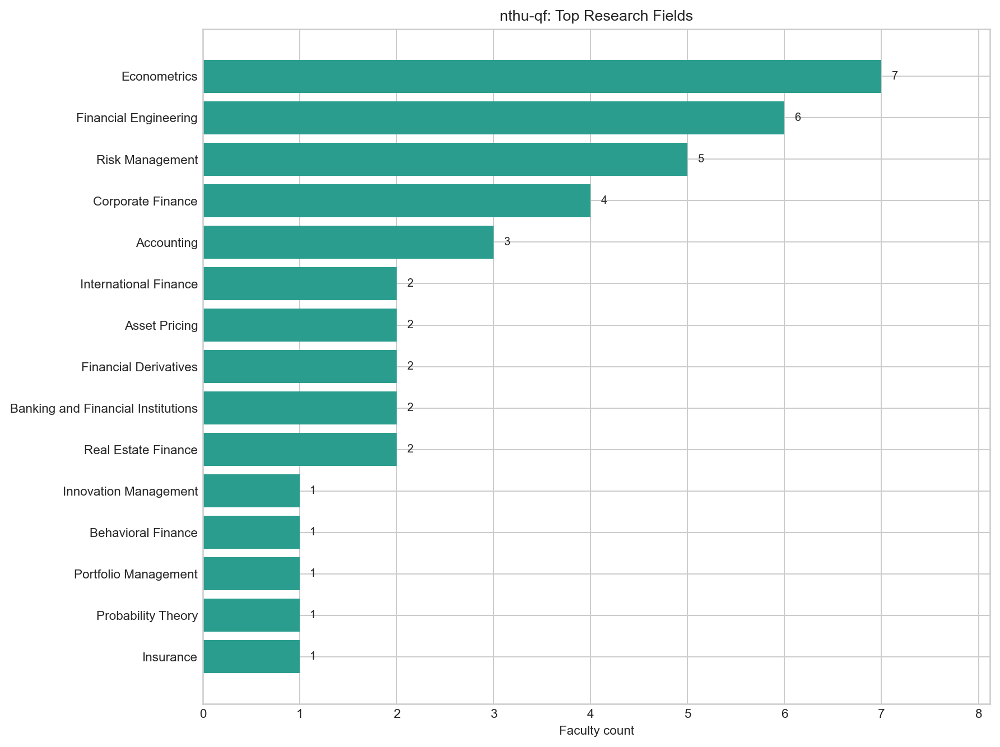

*圖：清華大學計量財務金融學系 研究領域人數*  
*出處：`analysis/descriptive-stats-after-preprocessing/by_department/top_research_fields/nthu-qf.png`*  
*建構方式：由 `scripts/data-preprocessing/2_rf_and_phd_inst_comparison.ipynb` 產生。研究領域為官網「主要研究領域」與「研究領域摘要」分別清洗、以雙語詞典標準化成英文 canonical 值後取聯集；計數為具有該領域的不重複教師人數，不做 Top-N 截斷。*

### 1.3 博士畢業學校

| 排名 | 博士畢業學校（canonical） | 教授人數 |
| --- | --- | --- |
| 1 | National Taiwan University | 6 |
| 2 | University of Wisconsin-Madison | 2 |
| 3 | The Ohio State University | 2 |
| 4 | Columbia University | 1 |
| 5 | Lancaster University | 1 |
| 6 | University of Rochester | 1 |
| 7 | National Sun Yat-sen University | 1 |
| 8 | Boston University | 1 |
| 9 | Charles III University of Madrid | 1 |
| 10 | National Central University | 1 |

*出處：`analysis/descriptive-stats-after-preprocessing/group_comparison/phd_institutions/fin-and-econ.csv`（`nthu-qf` 欄）*  
*建構方式：同一 notebook。學歷先被 `1_faculty_data_preprocessing.ipynb` 解析成「學位、科系、學校」三部分，取學位為博士的項目，學校名稱以別名表對應為英文 canonical 值；計數為不重複教師人數。*

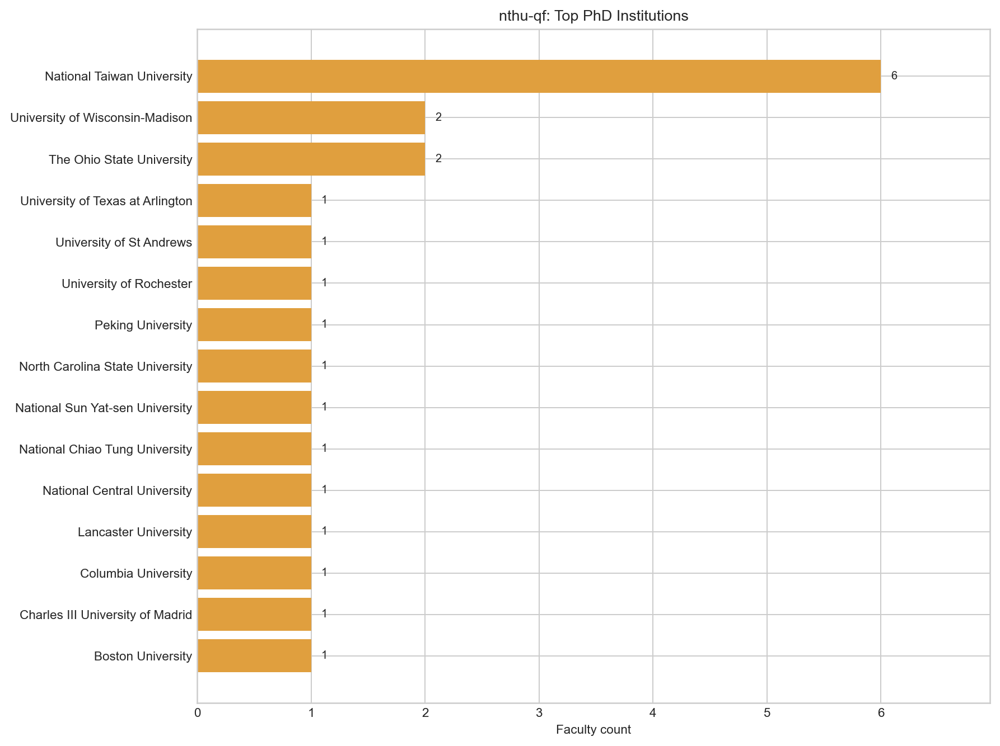

*圖：清華大學計量財務金融學系 博士畢業學校人數*  
*出處：`analysis/descriptive-stats-after-preprocessing/by_department/top_phd_institutions/nthu-qf.png`*  
*建構方式：同一 notebook。學歷先被 `1_faculty_data_preprocessing.ipynb` 解析成「學位、科系、學校」三部分，取學位為博士的項目，學校名稱以別名表對應為英文 canonical 值；計數為不重複教師人數。*

## 2. 研究領域網路結構

### 2.1 網路指標

| 指標 | 數值 | 說明 |
| --- | --- | --- |
| 二分網路：教授數 / 領域數 / 邊數 | 17 / 20 / 45 | 一條邊 = 一位教授研究一個領域 |
| 二分網路連通元件數 | 1 | 最大元件涵蓋 100.0% 教授 |
| 每位教授平均 / 最多領域數 | 2.65 / 10 |  |
| 研究領域網路：節點 / 邊 | 20 / 64 | 只含至少與一個其他領域共現的領域 |
| 研究領域網路密度 | 0.337 | 實際邊數 ÷ 可能邊數 |
| 研究領域網路平均 degree | 6.40 |  |
| 研究領域網路 modularity Q（Louvain） | 0.271 | 3 個社群；resolution 0.7 / 1.3 時為 3 / 4 個 |
| 領域社群 vs taxonomy L1 一致度 | NMI 0.296 / ARI 0.114 | 1 = 完全一致，0 = 無關 |
| 教授網路：節點 / 邊 | 17 / 74 | 只含最大連通元件 |
| 教授網路密度 | 0.544 |  |
| 教授網路 modularity Q（Louvain） | 0.184 | 3 個集群 |
| 教授集群 vs 主導 L1 一致度 | NMI 0.416 / ARI 0.185 |  |

*出處：`analysis/network-analysis/nthu-qf/network_metrics.json`*  
*建構方式：由 `2_build_network_data.ipynb` 從 `faculty_standardized.json` 建立教授–研究領域二分網路：教授與研究領域各為一類節點，教授的標準化研究領域包含某領域即連一條邊。研究領域網路是二分網路的單邊投影：兩個領域若被同一位教授研究就相連，邊權為共同研究兩領域的教授人數。社群以 Louvain（seed = 42，resolution 1.0）偵測，指標以完整加權圖計算。教授網路是二分網路的另一邊投影：兩位教授共享研究領域就相連，邊權 w = S_exp + λ·S_inf；S_exp 為共享領域的 IDF 加權和（IDF 以全體 662 位教授計算一次），S_inf 為共享 taxonomy 上層分類的推論相似度，λ = 0.4。社群以 Louvain（seed = 42，resolution 1.0）偵測，節點大小與 degree 成正比。*

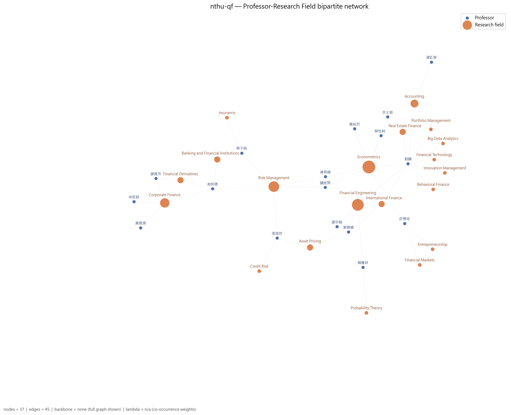

*圖：清華大學計量財務金融學系 教授–研究領域二分網路*  
*出處：`analysis/network-analysis/nthu-qf/figures/01_bipartite_network.png`*  
*建構方式：由 `2_build_network_data.ipynb` 從 `faculty_standardized.json` 建立教授–研究領域二分網路：教授與研究領域各為一類節點，教授的標準化研究領域包含某領域即連一條邊。圖中兩類節點以不同顏色區分，節點大小與 degree 成正比；邊數超過 400 時繪圖使用 disparity filter backbone（α = 0.05），指標仍以完整圖計算。*

### 2.2 關鍵研究領域

| 研究領域 | Degree | Degree centrality | Betweenness | PageRank | 教授數 | taxonomy L1 |
| --- | --- | --- | --- | --- | --- | --- |
| Financial Engineering | 12 | 0.632 | 0.287 | 0.1001 | 6 | Financial Engineering & Risk |
| Econometrics | 12 | 0.632 | 0.395 | 0.1059 | 7 | Economics & Policy |
| International Finance | 10 | 0.526 | 0.015 | 0.0657 | 2 | Asset Pricing & Financial Markets |
| Real Estate Finance | 9 | 0.474 | 0.000 | 0.0586 | 2 | Asset Pricing & Financial Markets |
| Portfolio Management | 9 | 0.474 | 0.000 | 0.0533 | 1 | Asset Pricing & Financial Markets |
| Innovation Management | 9 | 0.474 | 0.000 | 0.0533 | 1 | Information Systems & Management |
| Financial Technology | 9 | 0.474 | 0.000 | 0.0533 | 1 | Financial Engineering & Risk |
| Accounting | 9 | 0.474 | 0.000 | 0.0586 | 3 | Corporate Finance & Governance |
| Big Data Analytics | 9 | 0.474 | 0.000 | 0.0533 | 1 | Data, Databases & Knowledge Discovery |
| Behavioral Finance | 9 | 0.474 | 0.000 | 0.0533 | 1 | Asset Pricing & Financial Markets |
| Risk Management | 8 | 0.421 | 0.430 | 0.0865 | 5 | Financial Engineering & Risk |
| Asset Pricing | 4 | 0.211 | 0.003 | 0.0337 | 2 | Asset Pricing & Financial Markets |

Betweenness 最高的五個領域：Risk Management（0.43）、Econometrics（0.39）、Financial Engineering（0.29）、International Finance（0.01）、Banking and Financial Institutions（0.01）。Betweenness 高代表該領域位於不同主題群之間的連結位置，是系上跨主題的共同語言。

*出處：`analysis/network-analysis/nthu-qf/keyword_centrality.csv`*  
*建構方式：研究領域網路是二分網路的單邊投影：兩個領域若被同一位教授研究就相連，邊權為共同研究兩領域的教授人數。社群以 Louvain（seed = 42，resolution 1.0）偵測，指標以完整加權圖計算。 degree 為相連領域數，betweenness 為經過該節點的最短路徑比例，PageRank 為加權隨機漫步的穩態機率；parent_l1 來自 `1_build_taxonomy.ipynb` 手工編定的三層 taxonomy（170 個 L3、46 個 L2、16 個 L1）。*

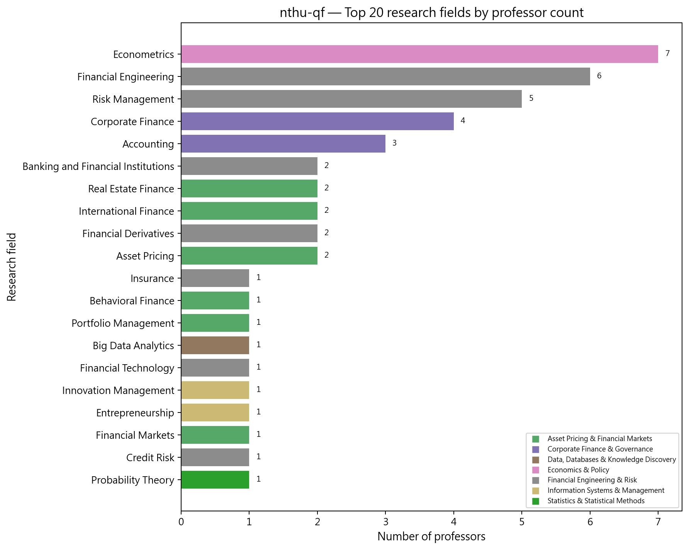

*圖：清華大學計量財務金融學系 研究領域教授人數長條圖*  
*出處：`analysis/network-analysis/nthu-qf/figures/10_top_keywords_bar.png`*  
*建構方式：以二分網路中每個領域節點的 degree（研究該領域的教授數）排序繪製。*

### 2.3 研究領域社群

| 社群 | 領域數 | 主要領域（教授人數） | 主要 taxonomy L1（領域數） |
| --- | --- | --- | --- |
| 0 | 8 | Accounting（3）、International Finance（2）、Real Estate Finance（2）、Behavioral Finance（1）、Big Data Analytics（1）、Financial Technology（1）、Innovation Management（1） | Asset Pricing & Financial Markets 4、Corporate Finance & Governance 1、Data, Databases & Knowledge Discovery 1 |
| 1 | 7 | Risk Management（5）、Corporate Finance（4）、Asset Pricing（2）、Banking and Financial Institutions（2）、Financial Derivatives（2）、Credit Risk（1）、Insurance（1） | Financial Engineering & Risk 5、Corporate Finance & Governance 1、Asset Pricing & Financial Markets 1 |
| 2 | 5 | Econometrics（7）、Financial Engineering（6）、Entrepreneurship（1）、Financial Markets（1）、Probability Theory（1） | Economics & Policy 1、Financial Engineering & Risk 1、Information Systems & Management 1 |

*出處：`analysis/network-analysis/nthu-qf/keyword_communities.csv`（`community` 欄）、`keyword_centrality.csv`（教授人數）*  
*建構方式：研究領域網路是二分網路的單邊投影：兩個領域若被同一位教授研究就相連，邊權為共同研究兩領域的教授人數。社群以 Louvain（seed = 42，resolution 1.0）偵測，指標以完整加權圖計算。*

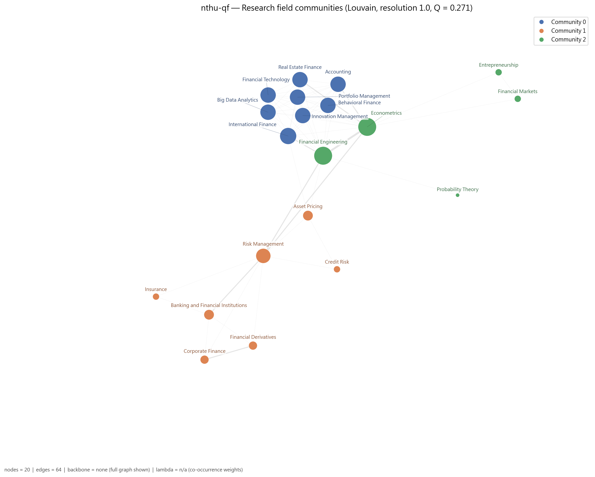

*圖：清華大學計量財務金融學系 研究領域網路的 Louvain 社群*  
*出處：`analysis/network-analysis/nthu-qf/figures/05_keyword_network_communities.png`*  
*建構方式：研究領域網路是二分網路的單邊投影：兩個領域若被同一位教授研究就相連，邊權為共同研究兩領域的教授人數。社群以 Louvain（seed = 42，resolution 1.0）偵測，指標以完整加權圖計算。節點顏色為社群，大小與 degree 成正比。*

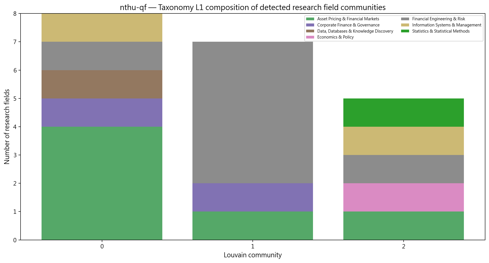

*圖：清華大學計量財務金融學系 各研究領域社群的 taxonomy L1 組成*  
*出處：`analysis/network-analysis/nthu-qf/figures/14_community_composition.png`*  
*建構方式：把每個 Louvain 領域社群內的領域依 taxonomy L1 分類計數，堆疊長條圖。用來檢查資料驅動的社群是否對應人工分類。*

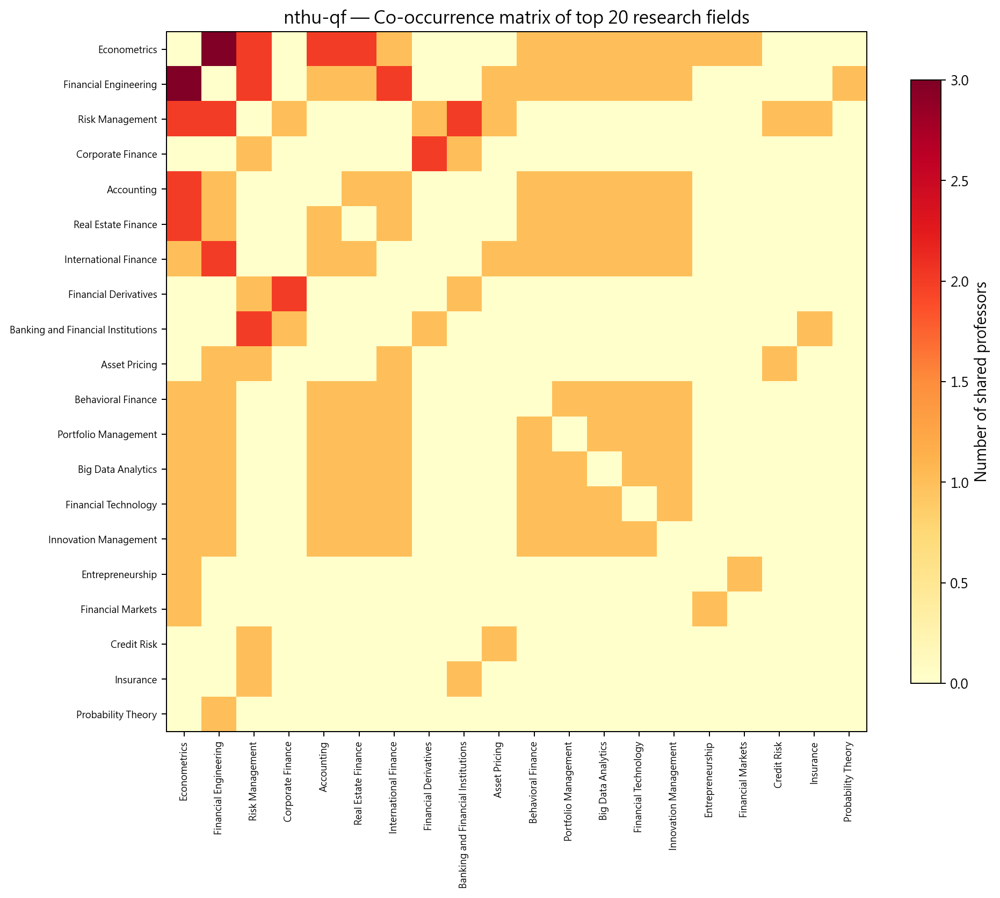

*圖：清華大學計量財務金融學系 研究領域共現熱圖*  
*出處：`analysis/network-analysis/nthu-qf/figures/13_keyword_cooccurrence_heatmap.png`*  
*建構方式：取研究領域網路的加權鄰接矩陣（共同研究兩領域的教授人數），依社群排序後繪製熱圖。*

## 3. 主要研究集群與重要老師

教授網路分成 3 個集群，分別對應「公司理財與風險」、「計量、會計與不動產」、「金融工程」。研究領域網路的 modularity 顯著高於虛無模型（z = 2.2，p = 0.042），教授網路的 clustering 也顯著（z = 2.5，p = 0.008），代表這三條軸線是真實的主題分工。

教授網路共 17 位教授、3 個集群（Louvain，Q = 0.184）。以下依集群人數排序；集群編號與圖中的 Community 編號一致。表中 Degree 為與該教授共享研究領域的同儕數，Betweenness 為該教授位於他人最短路徑上的比例（越高越像橋梁）。

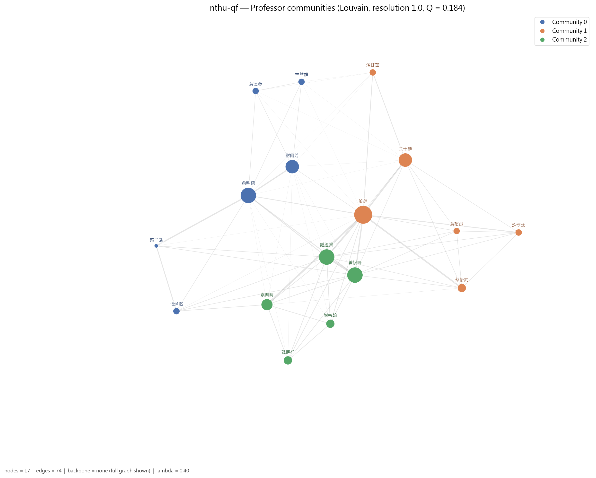

*圖：清華大學計量財務金融學系 教授網路的 Louvain 集群*  
*出處：`analysis/network-analysis/nthu-qf/figures/09_professor_network_communities.png`*  
*建構方式：教授網路是二分網路的另一邊投影：兩位教授共享研究領域就相連，邊權 w = S_exp + λ·S_inf；S_exp 為共享領域的 IDF 加權和（IDF 以全體 662 位教授計算一次），S_inf 為共享 taxonomy 上層分類的推論相似度，λ = 0.4。社群以 Louvain（seed = 42，resolution 1.0）偵測，節點大小與 degree 成正比。*

### 3.1 集群 0：公司理財與風險管理集群（6 人）

- **成員共同研究領域**：Corporate Finance（4 人）、Risk Management（3 人）、Banking and Financial Institutions（2 人）、Financial Derivatives（2 人）、Asset Pricing（1 人）、Credit Risk（1 人）、Insurance（1 人）
- **成員主導 taxonomy L1**：Financial Engineering & Risk 3 人、Corporate Finance & Governance 3 人

共享 Corporate Finance、Risk Management、Banking and Financial Institutions 與 Financial Derivatives。俞明德是集群中心（degree 13、betweenness 0.267），同時也是陽明交大資財系的合聘教授，是本系少數的跨校節點；謝佩芳專注公司理財與衍生性商品；張焯然結合資產訂價與信用風險。

| 姓名 | 英文名 | 職稱類別 | Degree | Betweenness | 研究領域（最多列 5 項） |
| --- | --- | --- | --- | --- | --- |
| 俞明德（2 個系所） |  | 專任 | 13 | 0.267 | Banking and Financial Institutions、Corporate Finance、Financial Derivatives、Risk Management |
| 謝佩芳 |  | 專任 | 11 | 0.000 | Corporate Finance、Financial Derivatives |
| 張焯然 |  | 專任 | 6 | 0.000 | Asset Pricing、Credit Risk、Risk Management |
| 林哲群 |  | 專任 | 6 | 0.000 | Corporate Finance |
| 黃德源 |  | 專任 | 6 | 0.000 | Corporate Finance |
| 蔡子晧 |  | 專任 | 5 | 0.000 | Banking and Financial Institutions、Insurance、Risk Management |

### 3.2 集群 1：計量、會計與不動產金融集群（6 人）

- **成員共同研究領域**：Econometrics（5 人）、Accounting（3 人）、Real Estate Finance（2 人）、Behavioral Finance（1 人）、Big Data Analytics（1 人）、Financial Engineering（1 人）、Financial Technology（1 人）
- **成員主導 taxonomy L1**：Asset Pricing & Financial Markets 3 人、Corporate Finance & Governance 2 人、Economics & Policy 1 人

共享 Econometrics、Accounting 與 Real Estate Finance。劉鋼的 betweenness（0.443）為全系最高、degree 也最高（16），研究橫跨會計、行為財務、大數據分析與金融工程，是連結三個集群的樞紐。余士迪結合會計與計量，蔡怡純專注計量與不動產金融。

| 姓名 | 英文名 | 職稱類別 | Degree | Betweenness | 研究領域（最多列 5 項） |
| --- | --- | --- | --- | --- | --- |
| 劉鋼 | Kang Liu | 專任 | 16 | 0.443 | Accounting、Behavioral Finance、Big Data Analytics、Econometrics、Financial Engineering |
| 余士迪 |  | 專任 | 11 | 0.004 | Accounting、Econometrics |
| 蔡怡純 |  | 專任 | 7 | 0.000 | Econometrics、Real Estate Finance |
| 潘虹華 |  | 專任 | 6 | 0.000 | Accounting |
| 許博炫 |  | 專任 | 6 | 0.000 | Econometrics、Entrepreneurship、Financial Markets |
| 黃裕烈 |  | 專任 | 6 | 0.000 | Econometrics |

### 3.3 集群 2：金融工程集群（5 人）

- **成員共同研究領域**：Financial Engineering（5 人）、Econometrics（2 人）、Risk Management（2 人）、Asset Pricing（1 人）、International Finance（1 人）、Probability Theory（1 人）
- **成員主導 taxonomy L1**：Financial Engineering & Risk 4 人、Asset Pricing & Financial Markets 1 人

5 位成員全部有 Financial Engineering，並延伸到 Econometrics、Risk Management、Probability Theory。曾祺峰與鍾經樊的研究組合完全相同（Econometrics、Financial Engineering、Risk Management），degree 並列 13；索樂晴加入 Asset Pricing 與 International Finance；韓傳祥則連到 Probability Theory。

| 姓名 | 英文名 | 職稱類別 | Degree | Betweenness | 研究領域（最多列 5 項） |
| --- | --- | --- | --- | --- | --- |
| 曾祺峰 |  | 專任 | 13 | 0.060 | Econometrics、Financial Engineering、Risk Management |
| 鍾經樊 |  | 專任 | 13 | 0.060 | Econometrics、Financial Engineering、Risk Management |
| 索樂晴 |  | 專任 | 9 | 0.058 | Asset Pricing、Financial Engineering、International Finance |
| 謝宗翰 |  | 專任 | 7 | 0.000 | Financial Engineering |
| 韓傳祥 |  | 專任 | 7 | 0.000 | Financial Engineering、Probability Theory |

*集群表出處：`analysis/network-analysis/nthu-qf/professor_communities.csv`（集群歸屬）、`professor_centrality.csv`（degree、betweenness、職稱類別）、`prof_keyword_network.graphml`（成員研究領域，用來統計集群的共同領域）*  
*建構方式：教授網路是二分網路的另一邊投影：兩位教授共享研究領域就相連，邊權 w = S_exp + λ·S_inf；S_exp 為共享領域的 IDF 加權和（IDF 以全體 662 位教授計算一次），S_inf 為共享 taxonomy 上層分類的推論相似度，λ = 0.4。社群以 Louvain（seed = 42，resolution 1.0）偵測，節點大小與 degree 成正比。 職稱類別為官網職稱的分類，一人可屬多類時取主要類別；「N 個系所」表示該教授也出現在其他系所名單。*

### 3.4 全系的橋接者與樞紐

Betweenness 最高的教授（跨集群的橋梁）：

| 姓名 | 英文名 | 職稱類別 | Degree | Betweenness | 主導 L1 |
| --- | --- | --- | --- | --- | --- |
| 劉鋼 | Kang Liu | 專任 | 16 | 0.443 | Asset Pricing & Financial Markets |
| 俞明德 |  | 專任 | 13 | 0.267 | Financial Engineering & Risk |
| 曾祺峰 |  | 專任 | 13 | 0.060 | Financial Engineering & Risk |
| 鍾經樊 |  | 專任 | 13 | 0.060 | Financial Engineering & Risk |
| 索樂晴 |  | 專任 | 9 | 0.058 | Asset Pricing & Financial Markets |
| 余士迪 |  | 專任 | 11 | 0.004 | Corporate Finance & Governance |

Degree 最高的教授（與最多同儕共享領域的樞紐）：

| 姓名 | 英文名 | 職稱類別 | Degree | Betweenness | 主導 L1 |
| --- | --- | --- | --- | --- | --- |
| 劉鋼 | Kang Liu | 專任 | 16 | 0.443 | Asset Pricing & Financial Markets |
| 俞明德 |  | 專任 | 13 | 0.267 | Financial Engineering & Risk |
| 曾祺峰 |  | 專任 | 13 | 0.060 | Financial Engineering & Risk |
| 鍾經樊 |  | 專任 | 13 | 0.060 | Financial Engineering & Risk |
| 謝佩芳 |  | 專任 | 11 | 0.000 | Corporate Finance & Governance |
| 余士迪 |  | 專任 | 11 | 0.004 | Corporate Finance & Governance |

*出處：`analysis/network-analysis/nthu-qf/professor_centrality.csv`*

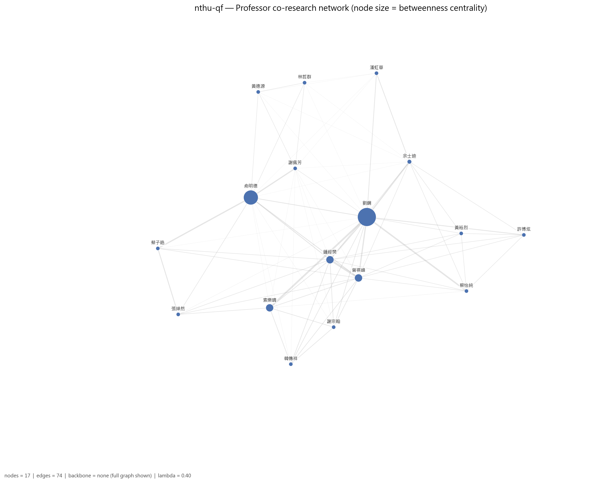

*圖：清華大學計量財務金融學系 教授網路（節點大小 = betweenness）*  
*出處：`analysis/network-analysis/nthu-qf/figures/08_professor_network_betweenness.png`*  
*建構方式：教授網路是二分網路的另一邊投影：兩位教授共享研究領域就相連，邊權 w = S_exp + λ·S_inf；S_exp 為共享領域的 IDF 加權和（IDF 以全體 662 位教授計算一次），S_inf 為共享 taxonomy 上層分類的推論相似度，λ = 0.4。社群以 Louvain（seed = 42，resolution 1.0）偵測，節點大小與 degree 成正比。此圖節點大小改為與 betweenness 成正比。*

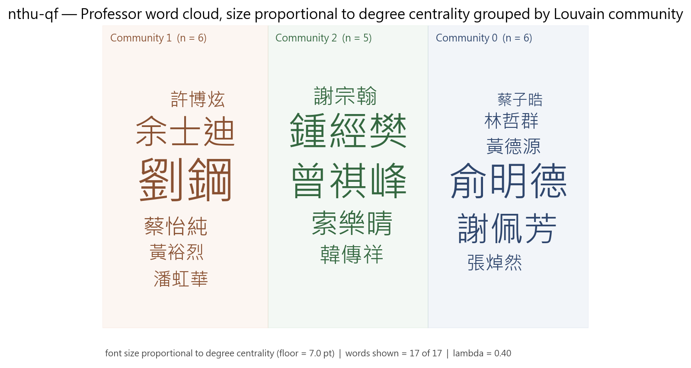

*圖：清華大學計量財務金融學系 各集群教授 word cloud（字級 = degree）*  
*出處：`analysis/network-analysis/nthu-qf/figures/27_professor_wordcloud_degree_by_community.png`*  
*建構方式：依 Louvain 集群分塊、同集群同色的教授姓名 word cloud，字級與 degree 成線性正比並設下限。*

## 4. 結構穩健性檢驗

### 4.1 虛無模型檢定

| 統計量 | 觀測值 | 虛無平均 | 虛無標準差 | z-score | empirical p | p < 0.05 |
| --- | --- | --- | --- | --- | --- | --- |
| 領域網路密度 | 0.3368 | 0.3695 | 0.0290 | -1.13 | 0.282 | 不顯著 |
| 領域網路 modularity Q | 0.2708 | 0.1848 | 0.0397 | 2.17 | 0.042 | 顯著 |
| 領域平均共現次數 | 1.1406 | 1.1417 | 0.0425 | -0.03 | 1.000 | 不顯著 |
| 教授網路 clustering 係數 | 0.8403 | 0.6838 | 0.0624 | 2.51 | 0.008 | 顯著 |

*出處：`analysis/network-analysis/nthu-qf/null_model_test.csv`*  
*建構方式：以保持二分結構與雙邊 degree 序列的 double edge swap（nswap = 10 × 邊數）產生 1,000 個隨機網路，比較觀測值與虛無分布，輸出 z-score 與雙尾 empirical p-value。 密度顯著偏低而 modularity、共現顯著偏高，代表領域共現集中在少數主題群，不是均勻分布。*

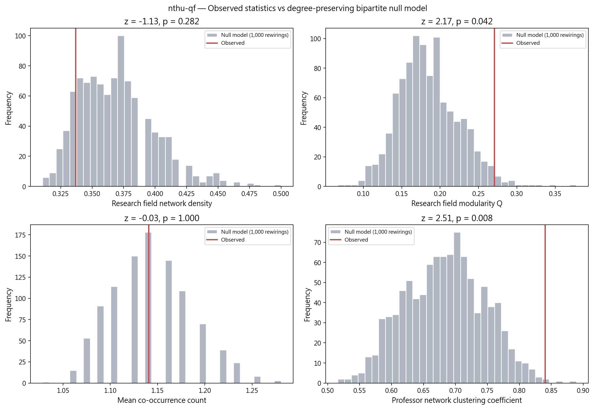

*圖：清華大學計量財務金融學系 觀測值 vs 虛無模型分布*  
*出處：`analysis/network-analysis/nthu-qf/figures/15_null_model_comparison.png`*  
*建構方式：以保持二分結構與雙邊 degree 序列的 double edge swap（nswap = 10 × 邊數）產生 1,000 個隨機網路，比較觀測值與虛無分布，輸出 z-score 與雙尾 empirical p-value。*

### 4.2 λ 敏感度

| λ | 邊數 | 密度 | Q | 集群數 | 密度相對 baseline | Q 下降 | 過度合併 |
| --- | --- | --- | --- | --- | --- | --- | --- |
| 0.0 | 51 | 0.375 | 0.275 | 3 | +0% | 0.000 | 否 |
| 0.3 | 74 | 0.544 | 0.204 | 3 | +45% | 0.071 | 否 |
| 0.4 | 74 | 0.544 | 0.184 | 3 | +45% | 0.091 | 否 |
| 0.5 | 74 | 0.544 | 0.166 | 3 | +45% | 0.108 | 是 |

*出處：`analysis/network-analysis/nthu-qf/lambda_sensitivity.csv`*  
*建構方式：以 λ ∈ {0, 0.3, 0.4, 0.5} 各建一次教授網路，λ = 0 為 baseline；密度較 baseline 增加超過 50% 或 Q 下降超過 0.1 即標記為過度合併。*

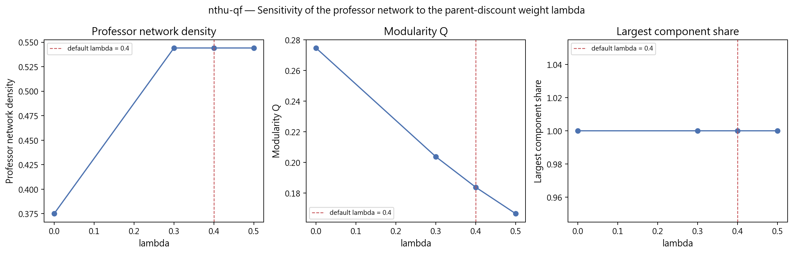

*圖：清華大學計量財務金融學系 λ 敏感度*  
*出處：`analysis/network-analysis/nthu-qf/figures/16_lambda_sensitivity.png`*  
*建構方式：以 λ ∈ {0, 0.3, 0.4, 0.5} 各建一次教授網路，λ = 0 為 baseline；密度較 baseline 增加超過 50% 或 Q 下降超過 0.1 即標記為過度合併。*

### 4.3 taxonomy L1 覆蓋護欄

| taxonomy L1 | 教授數 | 覆蓋率 | flag |
| --- | --- | --- | --- |
| Financial Engineering & Risk | 10 | 58.8% | too_broad |
| Corporate Finance & Governance | 7 | 41.2% | ok |
| Economics & Policy | 7 | 41.2% | ok |
| Asset Pricing & Financial Markets | 5 | 29.4% | ok |
| Information Systems & Management | 2 | 11.8% | ok |
| Data, Databases & Knowledge Discovery | 1 | 5.9% | ok |
| Statistics & Statistical Methods | 1 | 5.9% | ok |

*出處：`analysis/network-analysis/nthu-qf/l1_coverage_guardrail.csv`（只列前 8 項）*  
*建構方式：計算每個 L1 分類涵蓋該單位多少比例的教授，超過 50% 標記 too_broad，代表此 L1 在本單位太寬，不能用來做 L1 roll-up 比較。*

## 5. 解讀與注意事項

- 英文姓名完整率只有 10.5%，這是官網中英共用頁面的限制，不是蒐集失敗；本系多數教授在圖中只有中文名。
- L1 護欄標記 Financial Engineering & Risk 涵蓋超過 50% 教授。
- λ = 0.5 觸發過度合併護欄，λ = 0.3 與 0.4 未觸發；λ=0 的 baseline 同樣是 3 個社群，集群結論穩健。
- Risk Management、Econometrics、Financial Engineering 三個領域的 betweenness（0.43、0.39、0.29）遠高於其他領域，是三個集群之間的連結點。
- 博士畢業學校以台大最多（6 人），其次為 University of Wisconsin-Madison 與 The Ohio State University（各 2 人）。
- 研究領域來自官網自填內容，粒度與深度因人而異；網路密度與集群數反映填寫習慣的成分不可忽視，完整率不可解讀為系所或教授的品質排名。

## 附錄：本報告引用的資料與圖表清單

| 檔案 | 產生階段 / 程式 | 建構方式摘要 |
| --- | --- | --- |
| `analysis/data-collection/nthu-qf/quality-report.json` | 資料蒐集 `scripts/data-collection/collect.py` | 爬取官網後統計 canonical 紀錄人數、職稱分類、中英配對率與欄位完整率 |
| `analysis/descriptive-stats-after-preprocessing/coverage_by_school.csv` | 預處理 `1_faculty_data_preprocessing.ipynb` | 標準化後各欄位有 canonical 值的教師比例與平均項目數 |
| `.../group_comparison/research_fields/fin-and-econ.csv`、`by_department/top_research_fields/nthu-qf.png` | 預處理 `2_rf_and_phd_inst_comparison.ipynb` | 由 `scripts/data-preprocessing/2_rf_and_phd_inst_comparison.ipynb` 產生。研究領域為官網「主要研究領域」與「研究領域摘要」分別清洗、以雙語詞典標準化成英文 canonical 值後取聯集；計數為具有該領域的不重複教師人數，不做 Top-N 截斷。 |
| `.../group_comparison/phd_institutions/fin-and-econ.csv`、`by_department/top_phd_institutions/nthu-qf.png` | 同上 | 同一 notebook。學歷先被 `1_faculty_data_preprocessing.ipynb` 解析成「學位、科系、學校」三部分，取學位為博士的項目，學校名稱以別名表對應為英文 canonical 值；計數為不重複教師人數。 |
| `analysis/network-analysis/nthu-qf/network_metrics.json` | 網路分析 `2_build_network_data.ipynb` + `3_network_analysis.ipynb` | 由 `2_build_network_data.ipynb` 從 `faculty_standardized.json` 建立教授–研究領域二分網路：教授與研究領域各為一類節點，教授的標準化研究領域包含某領域即連一條邊。研究領域網路是二分網路的單邊投影：兩個領域若被同一位教授研究就相連，邊權為共同研究兩領域的教授人數。社群以 Louvain（seed = 42，resolution 1.0）偵測，指標以完整加權圖計算。教授網路是二分網路的另一邊投影：兩位教授共享研究領域就相連，邊權 w = S_exp + λ·S_inf；S_exp 為共享領域的 IDF 加權和（IDF 以全體 662 位教授計算一次），S_inf 為共享 taxonomy 上層分類的推論相似度，λ = 0.4。社群以 Louvain（seed = 42，resolution 1.0）偵測，節點大小與 degree 成正比。 |
| `analysis/network-analysis/nthu-qf/keyword_centrality.csv`、`keyword_communities.csv` | `3_network_analysis.ipynb` | 研究領域網路的中心性與 Louvain 社群；taxonomy 來自 `1_build_taxonomy.ipynb` |
| `analysis/network-analysis/nthu-qf/professor_centrality.csv`、`professor_communities.csv`、`prof_keyword_network.graphml` | `3_network_analysis.ipynb` | 教授網路的中心性與 Louvain 集群；graphml 為二分網路，本報告用它統計各集群成員的共同領域 |
| `analysis/network-analysis/nthu-qf/null_model_test.csv` | `3_network_analysis.ipynb` | 以保持二分結構與雙邊 degree 序列的 double edge swap（nswap = 10 × 邊數）產生 1,000 個隨機網路，比較觀測值與虛無分布，輸出 z-score 與雙尾 empirical p-value。 |
| `analysis/network-analysis/nthu-qf/lambda_sensitivity.csv` | `3_network_analysis.ipynb` | 以 λ ∈ {0, 0.3, 0.4, 0.5} 各建一次教授網路，λ = 0 為 baseline；密度較 baseline 增加超過 50% 或 Q 下降超過 0.1 即標記為過度合併。 |
| `analysis/network-analysis/nthu-qf/l1_coverage_guardrail.csv` | `3_network_analysis.ipynb` | 每個 L1 涵蓋教授比例，> 50% 標記 too_broad |
| `analysis/network-analysis/nthu-qf/figures/01, 05, 08, 09, 10, 13, 14, 15, 16, 27` | `3_network_analysis.ipynb` | 網路圖節點大小與 degree 或 betweenness 成正比、顏色依社群；邊數 > 400 時繪圖用 disparity filter backbone；word cloud 字級與中心性成線性正比 |

更完整的方法說明見 `docs/data-collection-report.md`、`docs/data-preprocessing-report.md`、`docs/network-analysis-report.md`。
