# 台灣大學資訊工程學系（`ntu-cs-ie`）研究結果總結報告

所屬分組：資工組（cs）　｜　資料日期：2026-09-09 蒐集、2026-09-10 完成網路分析

> **本報告的資料來源**
> 本專案分三個階段：(1) 資料蒐集（`scripts/data-collection/`）從 14 個系所官網爬取師資的姓名、職稱、學歷與研究領域，中英文分開蒐集後配對；
> (2) 資料預處理（`scripts/data-preprocessing/`）把職稱、學歷、研究領域標準化成英文 canonical 值，並產生描述統計；
> (3) 網路分析（`scripts/network-analysis/current-version/`）建立「教授–研究領域」二分網路，投影成研究領域網路與教授網路，做社群偵測、中心性、虛無模型與敏感度分析。
> 本報告所有數字、表格與圖表都取自 `analysis/` 底下這三個階段的輸出，每張圖表下方都標明出處與建構方式，附錄另有完整清單。
> 「研究集群」指教授網路的 Louvain 社群；「重要老師」依教授在該網路中的 degree（與多少同儕共享領域）與 betweenness（是否位於集群之間的橋梁位置）判定，**不是**學術成就的排名。

## 1. 科系速覽

台大資工系官網列出 90 位教師（專任 55、兼任 13、名譽 11、合聘 9、客座 7），研究領域完整率 97.8%，是大型資工系中最完整的。研究輪廓以 Artificial Intelligence（18 人）、Machine Learning（15 人）、Multimedia Systems（14 人）、Computer Vision（11 人）為主，其次是 Algorithms（9 人）、Data Mining、Optimization、Embedded Systems、Image Processing（各 7 人）。官網未提供學歷，因此沒有博士畢業學校資料。

### 1.1 基本資料

| 項目 | 數值 |
| --- | --- |
| 官網師資人數（canonical 紀錄） | 90 |
| 職稱分類（一人可屬多類） | 專任 55、主管／講座 18、兼任 13、名譽／退休 11、合聘 9、客座 7、專案 1 |
| 中英文紀錄配對率 | 97.8% |
| 研究領域完整率（標準化後） | 97.8% |
| 學歷完整率（標準化後） | 0.0% |
| 每位教授平均研究領域數 | 2.84 |
| 進入網路分析的教授數 | 88（2 位因無研究領域排除） |

*出處：`analysis/data-collection/ntu-cs-ie/quality-report.json`（人數、職稱、配對率）、`analysis/descriptive-stats-after-preprocessing/coverage_by_school.csv`（完整率）、`analysis/network-analysis/ntu-cs-ie/network_metrics.json`（進入網路人數）*  
*建構方式：quality-report 由 `scripts/data-collection/collect.py` 在爬取官網後統計 canonical 紀錄的職稱分類與中英配對；coverage 由 `1_faculty_data_preprocessing.ipynb` 計算標準化後有 canonical 值的教師比例。*

### 1.2 主要研究領域

| 排名 | 研究領域（canonical） | 教授人數 |
| --- | --- | --- |
| 1 | Artificial Intelligence | 18 |
| 2 | Machine Learning | 15 |
| 3 | Multimedia Systems | 14 |
| 4 | Computer Vision | 11 |
| 5 | Algorithms | 9 |
| 6 | Data Mining | 7 |
| 7 | Optimization | 7 |
| 8 | Embedded Systems | 7 |
| 9 | Image Processing | 7 |
| 10 | Information Security | 6 |
| 11 | Human-Computer Interaction | 6 |
| 12 | Deep Learning | 6 |
| 13 | Natural Language Processing | 5 |
| 14 | Bioinformatics | 5 |
| 15 | Databases | 5 |

*出處：`analysis/descriptive-stats-after-preprocessing/group_comparison/research_fields/cs.csv`（`ntu-cs-ie` 欄）*  
*建構方式：由 `scripts/data-preprocessing/2_rf_and_phd_inst_comparison.ipynb` 產生。研究領域為官網「主要研究領域」與「研究領域摘要」分別清洗、以雙語詞典標準化成英文 canonical 值後取聯集；計數為具有該領域的不重複教師人數，不做 Top-N 截斷。*

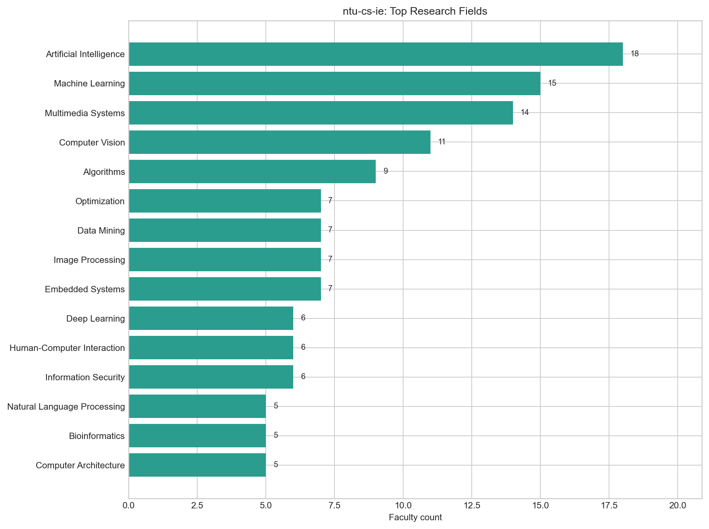

*圖：台灣大學資訊工程學系 研究領域人數*  
*出處：`analysis/descriptive-stats-after-preprocessing/by_department/top_research_fields/ntu-cs-ie.png`*  
*建構方式：由 `scripts/data-preprocessing/2_rf_and_phd_inst_comparison.ipynb` 產生。研究領域為官網「主要研究領域」與「研究領域摘要」分別清洗、以雙語詞典標準化成英文 canonical 值後取聯集；計數為具有該領域的不重複教師人數，不做 Top-N 截斷。*

### 1.3 博士畢業學校

官網未提供學歷資料，蒐集系統刻意不從外部網站補資料，因此本系沒有博士畢業學校統計。

## 2. 研究領域網路結構

### 2.1 網路指標

| 指標 | 數值 | 說明 |
| --- | --- | --- |
| 二分網路：教授數 / 領域數 / 邊數 | 88 / 74 / 256 | 一條邊 = 一位教授研究一個領域 |
| 二分網路連通元件數 | 5 | 最大元件涵蓋 94.3% 教授 |
| 每位教授平均 / 最多領域數 | 2.91 / 8 |  |
| 研究領域網路：節點 / 邊 | 69 / 266 | 只含至少與一個其他領域共現的領域 |
| 研究領域網路密度 | 0.113 | 實際邊數 ÷ 可能邊數 |
| 研究領域網路平均 degree | 7.71 |  |
| 研究領域網路 modularity Q（Louvain） | 0.385 | 6 個社群；resolution 0.7 / 1.3 時為 4 / 7 個 |
| 領域社群 vs taxonomy L1 一致度 | NMI 0.406 / ARI 0.151 | 1 = 完全一致，0 = 無關 |
| 教授網路：節點 / 邊 | 83 / 978 | 只含最大連通元件 |
| 教授網路密度 | 0.287 |  |
| 教授網路 modularity Q（Louvain） | 0.318 | 6 個集群 |
| 教授集群 vs 主導 L1 一致度 | NMI 0.485 / ARI 0.295 |  |

*出處：`analysis/network-analysis/ntu-cs-ie/network_metrics.json`*  
*建構方式：由 `2_build_network_data.ipynb` 從 `faculty_standardized.json` 建立教授–研究領域二分網路：教授與研究領域各為一類節點，教授的標準化研究領域包含某領域即連一條邊。研究領域網路是二分網路的單邊投影：兩個領域若被同一位教授研究就相連，邊權為共同研究兩領域的教授人數。社群以 Louvain（seed = 42，resolution 1.0）偵測，指標以完整加權圖計算。教授網路是二分網路的另一邊投影：兩位教授共享研究領域就相連，邊權 w = S_exp + λ·S_inf；S_exp 為共享領域的 IDF 加權和（IDF 以全體 662 位教授計算一次），S_inf 為共享 taxonomy 上層分類的推論相似度，λ = 0.4。社群以 Louvain（seed = 42，resolution 1.0）偵測，節點大小與 degree 成正比。*

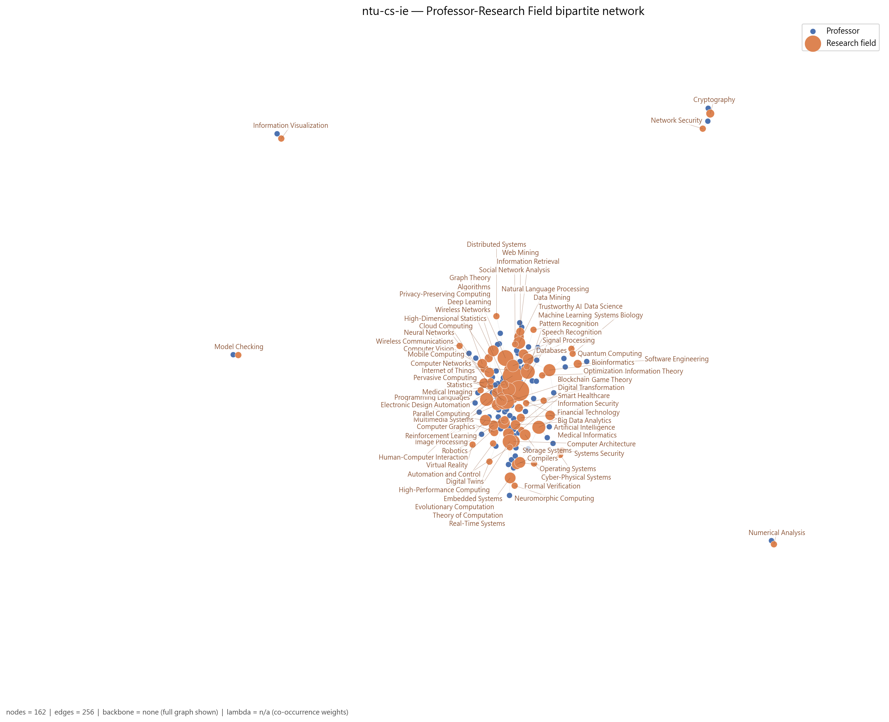

*圖：台灣大學資訊工程學系 教授–研究領域二分網路*  
*出處：`analysis/network-analysis/ntu-cs-ie/figures/01_bipartite_network.png`*  
*建構方式：由 `2_build_network_data.ipynb` 從 `faculty_standardized.json` 建立教授–研究領域二分網路：教授與研究領域各為一類節點，教授的標準化研究領域包含某領域即連一條邊。圖中兩類節點以不同顏色區分，節點大小與 degree 成正比；邊數超過 400 時繪圖使用 disparity filter backbone（α = 0.05），指標仍以完整圖計算。*

### 2.2 關鍵研究領域

| 研究領域 | Degree | Degree centrality | Betweenness | PageRank | 教授數 | taxonomy L1 |
| --- | --- | --- | --- | --- | --- | --- |
| Artificial Intelligence | 31 | 0.456 | 0.263 | 0.0557 | 18 | AI & Machine Learning |
| Multimedia Systems | 23 | 0.338 | 0.139 | 0.0455 | 14 | Vision, Multimedia & Human-Centered Computing |
| Machine Learning | 23 | 0.338 | 0.352 | 0.0510 | 15 | AI & Machine Learning |
| Computer Vision | 22 | 0.324 | 0.180 | 0.0457 | 11 | Vision, Multimedia & Human-Centered Computing |
| Optimization | 18 | 0.265 | 0.130 | 0.0301 | 7 | Applied Mathematics & Operations Research |
| Deep Learning | 16 | 0.235 | 0.020 | 0.0272 | 6 | AI & Machine Learning |
| Parallel Computing | 15 | 0.221 | 0.035 | 0.0228 | 5 | Systems, Software & Architecture |
| Computer Architecture | 15 | 0.221 | 0.063 | 0.0267 | 5 | Systems, Software & Architecture |
| Algorithms | 14 | 0.206 | 0.065 | 0.0265 | 9 | Theory & Algorithms |
| Image Processing | 14 | 0.206 | 0.015 | 0.0278 | 7 | Vision, Multimedia & Human-Centered Computing |
| Embedded Systems | 13 | 0.191 | 0.084 | 0.0267 | 7 | Systems, Software & Architecture |
| Cloud Computing | 13 | 0.191 | 0.013 | 0.0194 | 4 | Networks & Communications |

Betweenness 最高的五個領域：Machine Learning（0.35）、Artificial Intelligence（0.26）、Computer Vision（0.18）、Multimedia Systems（0.14）、Optimization（0.13）。Betweenness 高代表該領域位於不同主題群之間的連結位置，是系上跨主題的共同語言。

*出處：`analysis/network-analysis/ntu-cs-ie/keyword_centrality.csv`*  
*建構方式：研究領域網路是二分網路的單邊投影：兩個領域若被同一位教授研究就相連，邊權為共同研究兩領域的教授人數。社群以 Louvain（seed = 42，resolution 1.0）偵測，指標以完整加權圖計算。 degree 為相連領域數，betweenness 為經過該節點的最短路徑比例，PageRank 為加權隨機漫步的穩態機率；parent_l1 來自 `1_build_taxonomy.ipynb` 手工編定的三層 taxonomy（170 個 L3、46 個 L2、16 個 L1）。*

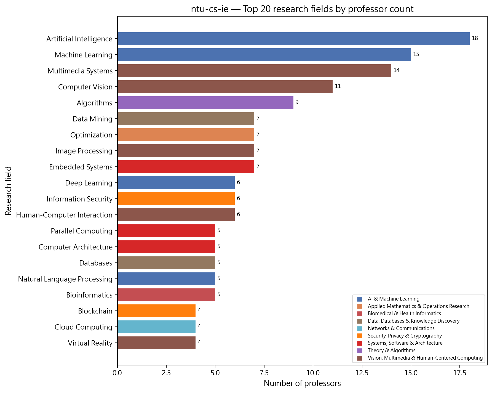

*圖：台灣大學資訊工程學系 研究領域教授人數長條圖*  
*出處：`analysis/network-analysis/ntu-cs-ie/figures/10_top_keywords_bar.png`*  
*建構方式：以二分網路中每個領域節點的 degree（研究該領域的教授數）排序繪製。*

### 2.3 研究領域社群

| 社群 | 領域數 | 主要領域（教授人數） | 主要 taxonomy L1（領域數） |
| --- | --- | --- | --- |
| 0 | 17 | Artificial Intelligence（18）、Machine Learning（15）、Data Mining（7）、Natural Language Processing（5）、Computer Networks（4）、Speech Recognition（3）、Smart Healthcare（2） | AI & Machine Learning 5、Data, Databases & Knowledge Discovery 2、Statistics & Statistical Methods 2 |
| 1 | 16 | Multimedia Systems（14）、Computer Vision（11）、Image Processing（7）、Deep Learning（6）、Human-Computer Interaction（6）、Databases（5）、Blockchain（4） | Vision, Multimedia & Human-Centered Computing 7、Data, Databases & Knowledge Discovery 4、AI & Machine Learning 2 |
| 2 | 12 | Optimization（7）、Computer Architecture（5）、Parallel Computing（5）、Compilers（4）、Robotics（3）、Reinforcement Learning（2）、Automation and Control（2） | Systems, Software & Architecture 6、Robotics, Control & Smart Manufacturing 2、AI & Machine Learning 2 |
| 3 | 10 | Algorithms（9）、Cloud Computing（4）、Graph Theory（4）、Mobile Computing（3）、Internet of Things（3）、Wireless Networks（3）、Pervasive Computing（3） | Networks & Communications 6、Theory & Algorithms 2、Security, Privacy & Cryptography 1 |
| 4 | 9 | Embedded Systems（7）、Information Security（6）、Operating Systems（4）、Real-Time Systems（4）、Storage Systems（3）、Neuromorphic Computing（1）、Formal Verification（1） | Systems, Software & Architecture 5、Security, Privacy & Cryptography 2、Data, Databases & Knowledge Discovery 1 |
| 5 | 5 | Bioinformatics（5）、Medical Informatics（3）、Software Engineering（2）、Data Science（1）、Systems Biology（1） | Biomedical & Health Informatics 3、Systems, Software & Architecture 1、Data, Databases & Knowledge Discovery 1 |

*出處：`analysis/network-analysis/ntu-cs-ie/keyword_communities.csv`（`community` 欄）、`keyword_centrality.csv`（教授人數）*  
*建構方式：研究領域網路是二分網路的單邊投影：兩個領域若被同一位教授研究就相連，邊權為共同研究兩領域的教授人數。社群以 Louvain（seed = 42，resolution 1.0）偵測，指標以完整加權圖計算。*

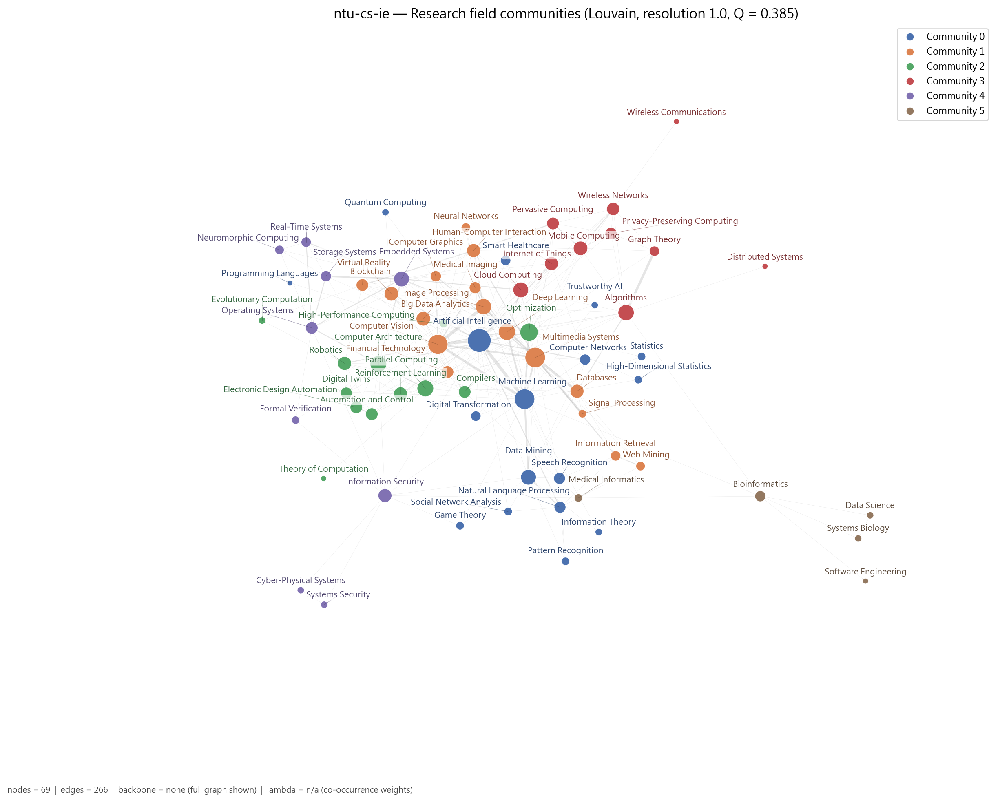

*圖：台灣大學資訊工程學系 研究領域網路的 Louvain 社群*  
*出處：`analysis/network-analysis/ntu-cs-ie/figures/05_keyword_network_communities.png`*  
*建構方式：研究領域網路是二分網路的單邊投影：兩個領域若被同一位教授研究就相連，邊權為共同研究兩領域的教授人數。社群以 Louvain（seed = 42，resolution 1.0）偵測，指標以完整加權圖計算。節點顏色為社群，大小與 degree 成正比。*

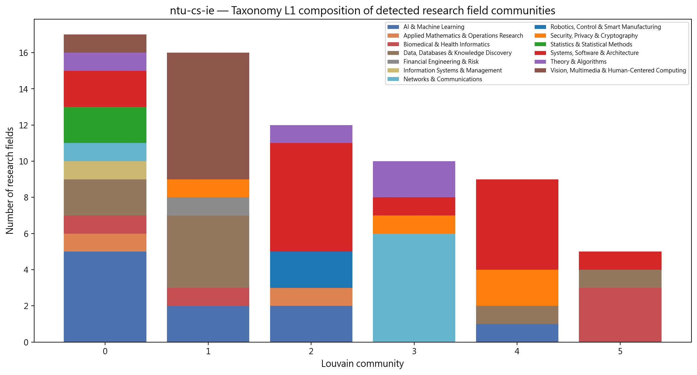

*圖：台灣大學資訊工程學系 各研究領域社群的 taxonomy L1 組成*  
*出處：`analysis/network-analysis/ntu-cs-ie/figures/14_community_composition.png`*  
*建構方式：把每個 Louvain 領域社群內的領域依 taxonomy L1 分類計數，堆疊長條圖。用來檢查資料驅動的社群是否對應人工分類。*

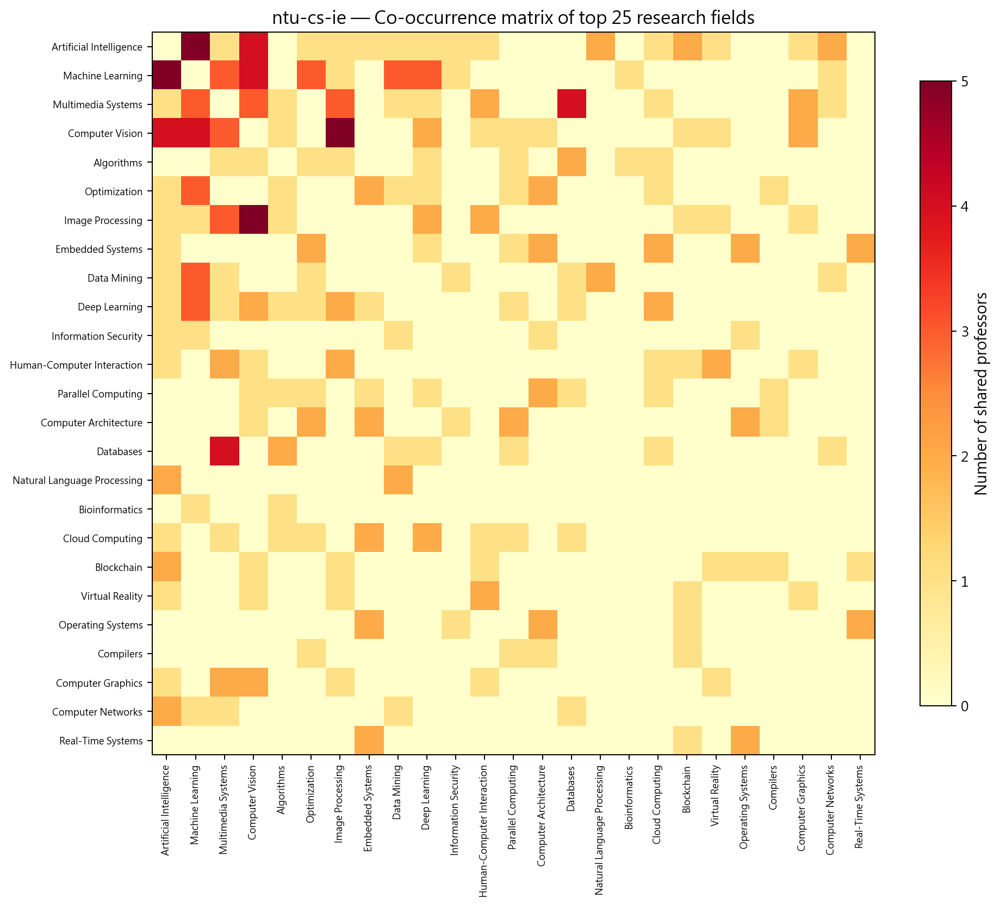

*圖：台灣大學資訊工程學系 研究領域共現熱圖*  
*出處：`analysis/network-analysis/ntu-cs-ie/figures/13_keyword_cooccurrence_heatmap.png`*  
*建構方式：取研究領域網路的加權鄰接矩陣（共同研究兩領域的教授人數），依社群排序後繪製熱圖。*

## 3. 主要研究集群與重要老師

教授網路分成 6 個集群，主軸是「多媒體與視覺」、「嵌入式系統與架構」兩個大集群，再加上「機器學習核心」、「NLP 與語音」、「演算法」、「AI 與網路」四個中型集群。研究領域網路的四個虛無模型統計量全部顯著（密度 z = -3.5、modularity z = 3.8、平均共現 z = 4.5、教授 clustering z = 2.4），主題結構非常明確。

教授網路共 83 位教授、6 個集群（Louvain，Q = 0.318）。以下依集群人數排序；集群編號與圖中的 Community 編號一致。表中 Degree 為與該教授共享研究領域的同儕數，Betweenness 為該教授位於他人最短路徑上的比例（越高越像橋梁）。

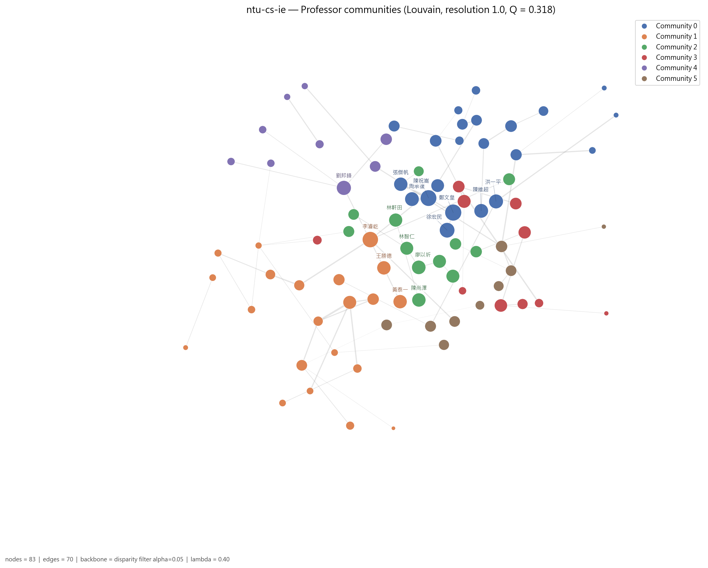

*圖：台灣大學資訊工程學系 教授網路的 Louvain 集群*  
*出處：`analysis/network-analysis/ntu-cs-ie/figures/09_professor_network_communities.png`*  
*建構方式：教授網路是二分網路的另一邊投影：兩位教授共享研究領域就相連，邊權 w = S_exp + λ·S_inf；S_exp 為共享領域的 IDF 加權和（IDF 以全體 662 位教授計算一次），S_inf 為共享 taxonomy 上層分類的推論相似度，λ = 0.4。社群以 Louvain（seed = 42，resolution 1.0）偵測，節點大小與 degree 成正比。*

### 3.1 集群 0：多媒體、電腦視覺與人機互動集群（22 人）

- **成員共同研究領域**：Multimedia Systems（10 人）、Computer Vision（10 人）、Image Processing（7 人）、Human-Computer Interaction（6 人）、Machine Learning（5 人）、Computer Graphics（4 人）、Signal Processing（4 人）
- **成員主導 taxonomy L1**：Vision, Multimedia & Human-Centered Computing 15 人、AI & Machine Learning 5 人、Networks & Communications 2 人

22 位成員，15 位主導 Vision, Multimedia & Human-Centered Computing，共享 Multimedia Systems、Computer Vision（各 10 人）、Image Processing、Human-Computer Interaction、Computer Graphics 與 Signal Processing。鄭文皇 degree 51 為全系最高（AI、電腦視覺、數位轉型、金融科技），與資料科學學程合聘；陳祝嵩 betweenness 0.136 為全系最高（大數據、電腦視覺、深度學習、影像處理）；徐宏民、洪一平（人機互動、區塊鏈）、周承復（多媒體、智慧醫療）是核心成員。

| 姓名 | 英文名 | 職稱類別 | Degree | Betweenness | 研究領域（最多列 5 項） |
| --- | --- | --- | --- | --- | --- |
| 鄭文皇（2 個系所） | Wen-Huang Cheng | 專任 | 51 | 0.028 | Artificial Intelligence、Computer Vision、Digital Transformation、Financial Technology、Machine Learning |
| 陳祝嵩（2 個系所） | Chu-Song Chen | 專任 | 49 | 0.136 | Big Data Analytics、Computer Vision、Deep Learning、Image Processing、Machine Learning |
| 徐宏民 | Winston H. Hsu | 專任 | 43 | 0.002 | Artificial Intelligence、Computer Vision、Machine Learning |
| 洪一平 | Yi-Ping Hung | 專任 | 39 | 0.099 | Artificial Intelligence、Blockchain、Computer Vision、Human-Computer Interaction、Image Processing |
| 周承復 | Cheng-Fu Chou | 專任 | 38 | 0.003 | Machine Learning、Multimedia Systems、Smart Healthcare |
| 陳維超 | Wei-Chao Chen | 客座 | 38 | 0.002 | Artificial Intelligence、Computer Graphics、Computer Vision |
| 張傑帆 | Jie-Fan Chang | 專任 | 36 | 0.023 | Computer Vision、Deep Learning、Image Processing、Medical Imaging、Neural Networks |
| 柯宗瑋 | Tsung-Wei Ke | 專任 | 33 | 0.009 | Computer Vision、Machine Learning、Robotics |

其餘成員（14 位，依 degree 排序）：陳炳宇、湯耀中、陳彥仰、顏文明、李明穗、莊永裕、吳家麟、歐陽明、傅楸善、李琳山、張瑞峰、朱浩華、鄭龍磻、鄧善元

### 3.2 集群 1：嵌入式系統、架構與作業系統集群（21 人）

- **成員共同研究領域**：Embedded Systems（7 人）、Computer Architecture（5 人）、Real-Time Systems（4 人）、Operating Systems（4 人）、Information Security（4 人）、Compilers（4 人）、Parallel Computing（3 人）
- **成員主導 taxonomy L1**：Systems, Software & Architecture 11 人、Biomedical & Health Informatics 4 人、Data, Databases & Knowledge Discovery 2 人、Security, Privacy & Cryptography 2 人、Networks & Communications 1 人、AI & Machine Learning 1 人

21 位成員，11 位主導 Systems, Software & Architecture，共享 Embedded Systems、Computer Architecture、Real-Time Systems、Operating Systems、Information Security、Compilers 與 Parallel Computing。李濬屹 degree 47、betweenness 0.085（自動化、架構、電腦視覺、數位孿生、EDA），也是 cs 組跨校 broker 第一名；郭大維（講座教授，嵌入式、作業系統、儲存系統）與王勝德（合聘，雲端、嵌入式、物聯網）是資深核心；楊佳玲代表儲存系統與大數據。

| 姓名 | 英文名 | 職稱類別 | Degree | Betweenness | 研究領域（最多列 5 項） |
| --- | --- | --- | --- | --- | --- |
| 李濬屹（2 個系所） | Chun-Yi Lee | 專任 | 47 | 0.085 | Automation and Control、Computer Architecture、Computer Vision、Digital Twins、Electronic Design Automation |
| 王勝德 | Sheng-De Wang | 合聘 | 36 | 0.051 | Cloud Computing、Deep Learning、Embedded Systems、Internet of Things、Optimization |
| 黃泰一（2 個系所） | Tai-Yi Huang | 客座 | 36 | 0.008 | Artificial Intelligence、Cloud Computing、Embedded Systems、Smart Healthcare |
| 郭大維 | Tei-Wei Kuo | 主管／講座 | 34 | 0.032 | Embedded Systems、Neuromorphic Computing、Operating Systems、Real-Time Systems、Storage Systems |
| 楊佳玲 | Chia-Lin Yang | 專任 | 27 | 0.016 | Big Data Analytics、Embedded Systems、Storage Systems |
| 廖世偉 | Shih-wei Liao | 專任 | 26 | 0.025 | Big Data Analytics、Blockchain、Compilers、Financial Technology |
| 黎士瑋 | Shih-Wei Li | 專任 | 24 | 0.048 | Computer Architecture、Formal Verification、Information Security、Operating Systems |
| 洪士灝（2 個系所） | Shih-Hao Hung | 專任 | 22 | 0.020 | Computer Architecture、Embedded Systems、Optimization、Parallel Computing |

其餘成員（13 位，依 degree 排序）：徐慰中、張原豪、薛智文、林忠緯、陳俊良、洪鼎詠、高成炎、賴飛羆、施吉昇、林桂傑、曾宇鳳、李允中、周存貹

### 3.3 集群 2：機器學習核心集群（12 人）

- **成員共同研究領域**：Machine Learning（10 人）、Data Mining（3 人）、Optimization（3 人）、Artificial Intelligence（3 人）、Deep Learning（2 人）、Neural Networks（1 人）、Information Theory（1 人）
- **成員主導 taxonomy L1**：AI & Machine Learning 11 人、Statistics & Statistical Methods 1 人

12 位成員中 11 位主導 AI & Machine Learning，共享 Machine Learning（10 人）、Data Mining、Optimization 與 Artificial Intelligence。廖以圻（AI、機器學習、最佳化、強化學習）degree 37 最高；林軒田、林智仁是台灣機器學習領域的代表性學者（資料探勘、資訊理論、最佳化）；陳尚澤（賽局、資安）betweenness 最高，與資料科學學程合聘；王士欣代表深度學習。

| 姓名 | 英文名 | 職稱類別 | Degree | Betweenness | 研究領域（最多列 5 項） |
| --- | --- | --- | --- | --- | --- |
| 廖以圻 | Yi-Chi Liao | 專任 | 37 | 0.020 | Artificial Intelligence、Machine Learning、Optimization、Reinforcement Learning |
| 陳尚澤（2 個系所） | Shang-Tse Chen | 專任 | 36 | 0.028 | Data Mining、Game Theory、Information Security、Machine Learning |
| 林軒田 | Hsuan-Tien Lin | 專任 | 35 | 0.000 | Data Mining、Information Theory、Machine Learning |
| 林智仁 | CJ Lin | 專任 | 34 | 0.026 | Data Mining、Machine Learning、Optimization |
| 王士欣 | Shih-Hsin Wang | 專任 | 34 | 0.002 | Artificial Intelligence、Deep Learning、Machine Learning |
| 羅紹元 | Shao-Yuan Lo | 專任 | 34 | 0.000 | Artificial Intelligence、Machine Learning、Trustworthy AI |
| 傅立成 | Li-Chen Fu | 專任 | 29 | 0.006 | Evolutionary Computation、Robotics、Virtual Reality |
| 李宏毅（3 個系所） | Hung-Yi Lee | 合聘 | 27 | 0.005 | Deep Learning、Machine Learning、Speech Recognition |

其餘成員（4 位，依 degree 排序）：林靖茹、歐陽彥正、李彥寰、劉長遠

### 3.4 集群 3：自然語言、語音與資訊檢索集群（10 人）

- **成員共同研究領域**：Natural Language Processing（5 人）、Data Mining（4 人）、Information Retrieval（3 人）、Multimedia Systems（3 人）、Web Mining（2 人）、Speech Recognition（2 人）、Databases（2 人）
- **成員主導 taxonomy L1**：AI & Machine Learning 5 人、Data, Databases & Knowledge Discovery 4 人、Biomedical & Health Informatics 1 人

10 位成員，共享 Natural Language Processing（5 人）、Data Mining、Information Retrieval、Multimedia Systems、Web Mining 與 Speech Recognition。陳銘憲（同時出現在 3 個系所名單）degree 34 最高；林守德（AI、資料探勘、NLP、社會網路分析）與鄭卜壬（資料庫、資訊檢索、網路探勘）betweenness 較高；洪小文（客座）代表語音辨識；張智星（兼任）代表音樂資訊檢索與語音。

| 姓名 | 英文名 | 職稱類別 | Degree | Betweenness | 研究領域（最多列 5 項） |
| --- | --- | --- | --- | --- | --- |
| 陳銘憲（3 個系所） | Ming-Syan Chen | 合聘 | 34 | 0.029 | Computer Networks、Data Mining、Databases、Multimedia Systems |
| 林守德（2 個系所） | Shou-De Lin | 專任 | 32 | 0.016 | Artificial Intelligence、Data Mining、Natural Language Processing、Social Network Analysis |
| 洪小文 | Hsiao-Wuen Hon | 客座 | 31 | 0.011 | Data Mining、Natural Language Processing、Pattern Recognition、Speech Recognition |
| 鄭卜壬（2 個系所） | Pu-Jen Cheng | 專任 | 28 | 0.045 | Databases、Information Retrieval、Multimedia Systems、Web Mining |
| 張智星 | Jyh-Shing Roger Jang | 兼任 | 28 | 0.007 | Information Retrieval、Multimedia Systems、Speech Recognition |
| 陳縕儂（2 個系所） | Yun-Nung Chen | 專任 | 22 | 0.003 | Artificial Intelligence、Natural Language Processing |
| 黃宣誠 | Hsuan-Cheng Huang | 專任 | 17 | 0.002 | Bioinformatics、Data Science、Systems Biology |
| 陳信希（2 個系所） | Hsin-Hsi Chen | 專任 | 16 | 0.021 | Information Retrieval、Natural Language Processing、Web Mining |

其餘成員（2 位，依 degree 排序）：許永真、林一鵬

### 3.5 集群 4：演算法與圖論集群（9 人）

- **成員共同研究領域**：Algorithms（8 人）、Graph Theory（4 人）、Databases（2 人）、Parallel Computing（2 人）、Distributed Systems（1 人）、Mobile Computing（1 人）、Optimization（1 人）
- **成員主導 taxonomy L1**：Theory & Algorithms 3 人、Systems, Software & Architecture 2 人、AI & Machine Learning 1 人、Data, Databases & Knowledge Discovery 1 人、Networks & Communications 1 人、Biomedical & Health Informatics 1 人

9 位成員，共享 Algorithms（8 人）、Graph Theory、Databases 與 Parallel Computing。劉邦鋒 degree 40 為集群最高（演算法、雲端、資料庫、深度學習、平行計算）；陳健輝（講座教授，圖論、行動計算、無線網路）betweenness 最高；趙坤茂結合演算法與生物資訊；徐讚昇（兼任）代表隱私保護計算；陳文進為兼任。

| 姓名 | 英文名 | 職稱類別 | Degree | Betweenness | 研究領域（最多列 5 項） |
| --- | --- | --- | --- | --- | --- |
| 劉邦鋒 | Pangfeng Liu | 專任 | 40 | 0.058 | Algorithms、Cloud Computing、Databases、Deep Learning、Parallel Computing |
| 陳文進 | Wen-Chin Chen | 兼任 | 27 | 0.018 | Algorithms、Databases、Multimedia Systems |
| 陳健輝 | Gen-Huey Chen | 主管／講座 | 24 | 0.052 | Algorithms、Graph Theory、Mobile Computing、Optimization、Wireless Networks |
| 徐讚昇 | Tsan-Sheng Hsu | 兼任 | 15 | 0.001 | Algorithms、Graph Theory、Privacy-Preserving Computing |
| 趙坤茂 | Kun-Mao Chao | 專任 | 13 | 0.025 | Algorithms、Bioinformatics |
| 李德財 | Der-Tsai Lee | 主管／講座 | 13 | 0.000 | Algorithms、Distributed Systems |
| 呂育道（2 個系所） | Yuh-Dauh Lyuu | 專任 | 13 | 0.000 | Parallel Computing、Theory of Computation |
| 呂學一 | Hsueh-I Lu | 專任 | 10 | 0.000 | Algorithms、Graph Theory |

其餘成員（1 位，依 degree 排序）：黃上恩

### 3.6 集群 5：人工智慧、網路與物聯網集群（9 人）

- **成員共同研究領域**：Artificial Intelligence（8 人）、Computer Networks（2 人）、Internet of Things（2 人）、Wireless Networks（2 人）、Blockchain（1 人）、Quantum Computing（1 人）、Mobile Computing（1 人）
- **成員主導 taxonomy L1**：AI & Machine Learning 6 人、Networks & Communications 3 人

9 位成員，6 位主導 AI & Machine Learning、3 位主導 Networks，共享 Artificial Intelligence（8 人）、Computer Networks、Internet of Things 與 Wireless Networks。巫芳璟（AI、物聯網、行動運算、隱私保護）degree 27、betweenness 0.051 為集群最高，與資料科學學程合聘；逄愛君代表網路與物聯網；梁伯嵩（客座）帶入區塊鏈與量子計算；項潔（講座教授）代表程式語言；張耀文（合聘）帶入 EDA。

| 姓名 | 英文名 | 職稱類別 | Degree | Betweenness | 研究領域（最多列 5 項） |
| --- | --- | --- | --- | --- | --- |
| 巫芳璟（2 個系所） | Fang-Jing Wu | 專任 | 27 | 0.051 | Artificial Intelligence、Internet of Things、Mobile Computing、Pervasive Computing、Privacy-Preserving Computing |
| 梁伯嵩（2 個系所） | Bor-Sung Liang | 客座 | 25 | 0.005 | Artificial Intelligence、Blockchain、Quantum Computing |
| 逄愛君 | Ai-Chun Pang | 專任 | 24 | 0.006 | Artificial Intelligence、Computer Networks、Internet of Things |
| 項潔 | Jieh Hsiang | 主管／講座 | 24 | 0.005 | Artificial Intelligence、Programming Languages |
| 張耀文（2 個系所） | Yao-Wen Chang | 合聘 | 24 | 0.005 | Artificial Intelligence、Automation and Control、Electronic Design Automation |
| 蔡欣穆 | HM Tsai | 專任 | 22 | 0.006 | Artificial Intelligence、Information Security |
| 廖婉君（3 個系所） | Wanjiun Liao | 合聘 | 21 | 0.001 | Artificial Intelligence、Computer Networks |
| 許舜欽 | Shun-Chin Hsu | 名譽／退休 | 17 | 0.000 | Artificial Intelligence |

其餘成員（1 位，依 degree 排序）：葉丙成

*集群表出處：`analysis/network-analysis/ntu-cs-ie/professor_communities.csv`（集群歸屬）、`professor_centrality.csv`（degree、betweenness、職稱類別）、`prof_keyword_network.graphml`（成員研究領域，用來統計集群的共同領域）*  
*建構方式：教授網路是二分網路的另一邊投影：兩位教授共享研究領域就相連，邊權 w = S_exp + λ·S_inf；S_exp 為共享領域的 IDF 加權和（IDF 以全體 662 位教授計算一次），S_inf 為共享 taxonomy 上層分類的推論相似度，λ = 0.4。社群以 Louvain（seed = 42，resolution 1.0）偵測，節點大小與 degree 成正比。 職稱類別為官網職稱的分類，一人可屬多類時取主要類別；「N 個系所」表示該教授也出現在其他系所名單。*

### 3.7 全系的橋接者與樞紐

Betweenness 最高的教授（跨集群的橋梁）：

| 姓名 | 英文名 | 職稱類別 | Degree | Betweenness | 主導 L1 |
| --- | --- | --- | --- | --- | --- |
| 陳祝嵩 | Chu-Song Chen | 專任 | 49 | 0.136 | Vision, Multimedia & Human-Centered Computing |
| 洪一平 | Yi-Ping Hung | 專任 | 39 | 0.099 | Vision, Multimedia & Human-Centered Computing |
| 李濬屹 | Chun-Yi Lee | 專任 | 47 | 0.085 | Systems, Software & Architecture |
| 劉邦鋒 | Pangfeng Liu | 專任 | 40 | 0.058 | AI & Machine Learning |
| 陳健輝 | Gen-Huey Chen | 主管／講座 | 24 | 0.052 | Networks & Communications |
| 王勝德 | Sheng-De Wang | 合聘 | 36 | 0.051 | Networks & Communications |

Degree 最高的教授（與最多同儕共享領域的樞紐）：

| 姓名 | 英文名 | 職稱類別 | Degree | Betweenness | 主導 L1 |
| --- | --- | --- | --- | --- | --- |
| 鄭文皇 | Wen-Huang Cheng | 專任 | 51 | 0.028 | AI & Machine Learning |
| 陳祝嵩 | Chu-Song Chen | 專任 | 49 | 0.136 | Vision, Multimedia & Human-Centered Computing |
| 李濬屹 | Chun-Yi Lee | 專任 | 47 | 0.085 | Systems, Software & Architecture |
| 徐宏民 | Winston H. Hsu | 專任 | 43 | 0.002 | AI & Machine Learning |
| 劉邦鋒 | Pangfeng Liu | 專任 | 40 | 0.058 | AI & Machine Learning |
| 洪一平 | Yi-Ping Hung | 專任 | 39 | 0.099 | Vision, Multimedia & Human-Centered Computing |

*出處：`analysis/network-analysis/ntu-cs-ie/professor_centrality.csv`*

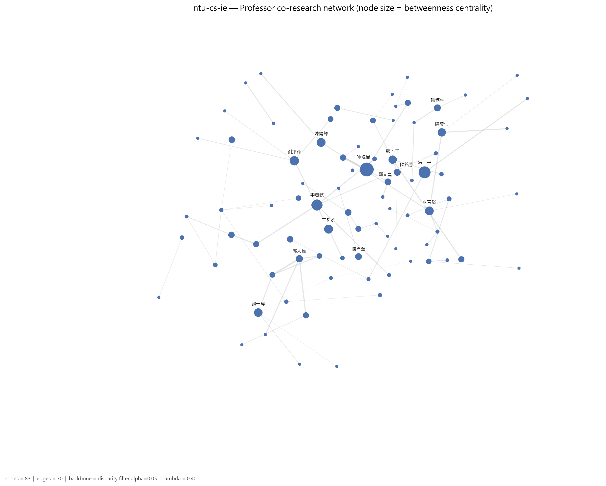

*圖：台灣大學資訊工程學系 教授網路（節點大小 = betweenness）*  
*出處：`analysis/network-analysis/ntu-cs-ie/figures/08_professor_network_betweenness.png`*  
*建構方式：教授網路是二分網路的另一邊投影：兩位教授共享研究領域就相連，邊權 w = S_exp + λ·S_inf；S_exp 為共享領域的 IDF 加權和（IDF 以全體 662 位教授計算一次），S_inf 為共享 taxonomy 上層分類的推論相似度，λ = 0.4。社群以 Louvain（seed = 42，resolution 1.0）偵測，節點大小與 degree 成正比。此圖節點大小改為與 betweenness 成正比。*

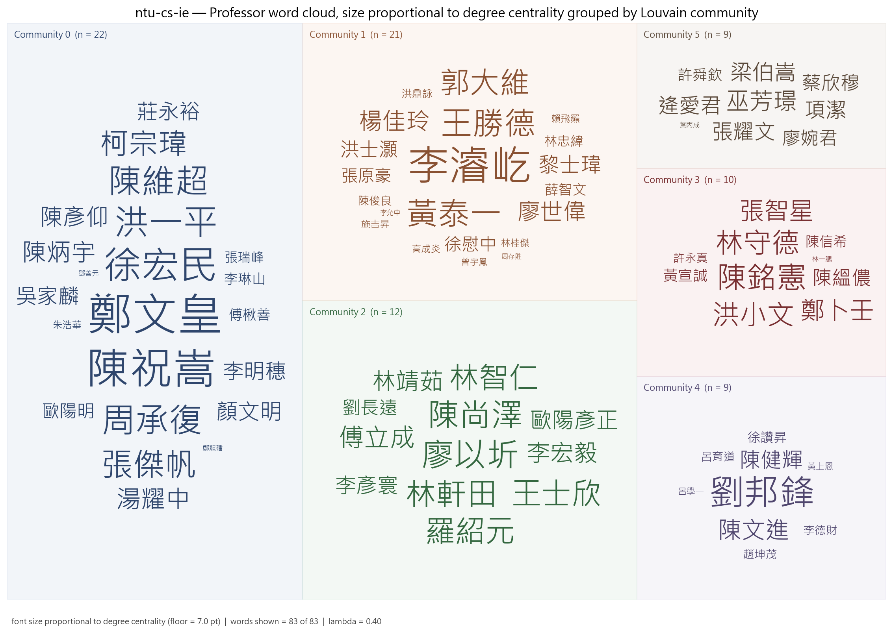

*圖：台灣大學資訊工程學系 各集群教授 word cloud（字級 = degree）*  
*出處：`analysis/network-analysis/ntu-cs-ie/figures/27_professor_wordcloud_degree_by_community.png`*  
*建構方式：依 Louvain 集群分塊、同集群同色的教授姓名 word cloud，字級與 degree 成線性正比並設下限。*

另有 5 位教授雖有研究領域，但與其他教授沒有共享任何領域，孤立於最大連通元件之外，不屬於任何集群。

## 4. 結構穩健性檢驗

### 4.1 虛無模型檢定

| 統計量 | 觀測值 | 虛無平均 | 虛無標準差 | z-score | empirical p | p < 0.05 |
| --- | --- | --- | --- | --- | --- | --- |
| 領域網路密度 | 0.1134 | 0.1267 | 0.0038 | -3.55 | 0.002 | 顯著 |
| 領域網路 modularity Q | 0.3841 | 0.3052 | 0.0208 | 3.79 | 0.002 | 顯著 |
| 領域平均共現次數 | 1.2632 | 1.1590 | 0.0233 | 4.46 | 0.002 | 顯著 |
| 教授網路 clustering 係數 | 0.6560 | 0.6109 | 0.0188 | 2.40 | 0.016 | 顯著 |

*出處：`analysis/network-analysis/ntu-cs-ie/null_model_test.csv`*  
*建構方式：以保持二分結構與雙邊 degree 序列的 double edge swap（nswap = 10 × 邊數）產生 1,000 個隨機網路，比較觀測值與虛無分布，輸出 z-score 與雙尾 empirical p-value。 密度顯著偏低而 modularity、共現顯著偏高，代表領域共現集中在少數主題群，不是均勻分布。*

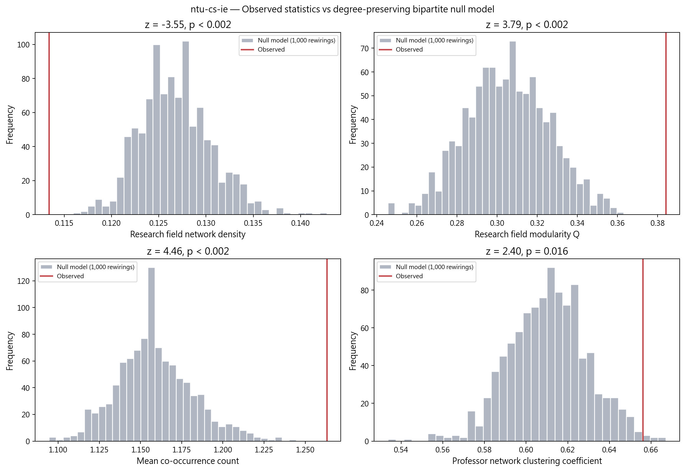

*圖：台灣大學資訊工程學系 觀測值 vs 虛無模型分布*  
*出處：`analysis/network-analysis/ntu-cs-ie/figures/15_null_model_comparison.png`*  
*建構方式：以保持二分結構與雙邊 degree 序列的 double edge swap（nswap = 10 × 邊數）產生 1,000 個隨機網路，比較觀測值與虛無分布，輸出 z-score 與雙尾 empirical p-value。*

### 4.2 λ 敏感度

| λ | 邊數 | 密度 | Q | 集群數 | 密度相對 baseline | Q 下降 | 過度合併 |
| --- | --- | --- | --- | --- | --- | --- | --- |
| 0.0 | 623 | 0.183 | 0.373 | 5 | +0% | 0.000 | 否 |
| 0.3 | 978 | 0.287 | 0.324 | 5 | +57% | 0.049 | 是 |
| 0.4 | 978 | 0.287 | 0.318 | 6 | +57% | 0.055 | 是 |
| 0.5 | 978 | 0.287 | 0.312 | 5 | +57% | 0.062 | 是 |

*出處：`analysis/network-analysis/ntu-cs-ie/lambda_sensitivity.csv`*  
*建構方式：以 λ ∈ {0, 0.3, 0.4, 0.5} 各建一次教授網路，λ = 0 為 baseline；密度較 baseline 增加超過 50% 或 Q 下降超過 0.1 即標記為過度合併。*

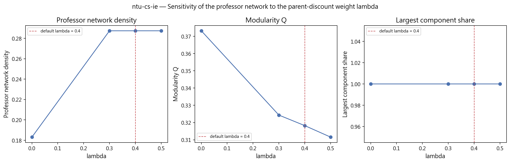

*圖：台灣大學資訊工程學系 λ 敏感度*  
*出處：`analysis/network-analysis/ntu-cs-ie/figures/16_lambda_sensitivity.png`*  
*建構方式：以 λ ∈ {0, 0.3, 0.4, 0.5} 各建一次教授網路，λ = 0 為 baseline；密度較 baseline 增加超過 50% 或 Q 下降超過 0.1 即標記為過度合併。*

### 4.3 taxonomy L1 覆蓋護欄

| taxonomy L1 | 教授數 | 覆蓋率 | flag |
| --- | --- | --- | --- |
| AI & Machine Learning | 39 | 47.0% | ok |
| Vision, Multimedia & Human-Centered Computing | 29 | 34.9% | ok |
| Systems, Software & Architecture | 24 | 28.9% | ok |
| Data, Databases & Knowledge Discovery | 19 | 22.9% | ok |
| Networks & Communications | 12 | 14.5% | ok |
| Security, Privacy & Cryptography | 12 | 14.5% | ok |
| Biomedical & Health Informatics | 11 | 13.3% | ok |
| Theory & Algorithms | 11 | 13.3% | ok |

*出處：`analysis/network-analysis/ntu-cs-ie/l1_coverage_guardrail.csv`（只列前 8 項）*  
*建構方式：計算每個 L1 分類涵蓋該單位多少比例的教授，超過 50% 標記 too_broad，代表此 L1 在本單位太寬，不能用來做 L1 roll-up 比較。*

## 5. 解讀與注意事項

- 官網未提供學歷，本報告沒有博士畢業學校資料。
- λ 在 0.3、0.4、0.5 都觸發過度合併護欄（密度由 0.183 增至 0.287、Q 降 0.05 至 0.06）。λ=0 的 baseline 有 5 個社群，λ=0.4 有 6 個，差異在於 AI 與網路集群（集群 5）是否獨立；細部解讀應以 λ=0 為準。
- 本系沒有任何 L1 被標記為過寬，內部主題分布相對均衡。
- 有 5 位教授孤立於教授網路之外，另有 2 位因官網未填研究領域而排除。
- 多位教授同時出現在台大資料科學學程與電信所名單（鄭文皇、陳祝嵩、李濬屹、陳尚澤、陳銘憲、林守德、鄭卜壬、巫芳璟、張耀文等），系所層級不去重。
- 研究領域來自官網自填內容，粒度與深度因人而異；網路密度與集群數反映填寫習慣的成分不可忽視，完整率不可解讀為系所或教授的品質排名。

## 附錄：本報告引用的資料與圖表清單

| 檔案 | 產生階段 / 程式 | 建構方式摘要 |
| --- | --- | --- |
| `analysis/data-collection/ntu-cs-ie/quality-report.json` | 資料蒐集 `scripts/data-collection/collect.py` | 爬取官網後統計 canonical 紀錄人數、職稱分類、中英配對率與欄位完整率 |
| `analysis/descriptive-stats-after-preprocessing/coverage_by_school.csv` | 預處理 `1_faculty_data_preprocessing.ipynb` | 標準化後各欄位有 canonical 值的教師比例與平均項目數 |
| `.../group_comparison/research_fields/cs.csv`、`by_department/top_research_fields/ntu-cs-ie.png` | 預處理 `2_rf_and_phd_inst_comparison.ipynb` | 由 `scripts/data-preprocessing/2_rf_and_phd_inst_comparison.ipynb` 產生。研究領域為官網「主要研究領域」與「研究領域摘要」分別清洗、以雙語詞典標準化成英文 canonical 值後取聯集；計數為具有該領域的不重複教師人數，不做 Top-N 截斷。 |
| `.../group_comparison/phd_institutions/cs.csv`、`by_department/top_phd_institutions/ntu-cs-ie.png` | 同上 | 同一 notebook。學歷先被 `1_faculty_data_preprocessing.ipynb` 解析成「學位、科系、學校」三部分，取學位為博士的項目，學校名稱以別名表對應為英文 canonical 值；計數為不重複教師人數。 |
| `analysis/network-analysis/ntu-cs-ie/network_metrics.json` | 網路分析 `2_build_network_data.ipynb` + `3_network_analysis.ipynb` | 由 `2_build_network_data.ipynb` 從 `faculty_standardized.json` 建立教授–研究領域二分網路：教授與研究領域各為一類節點，教授的標準化研究領域包含某領域即連一條邊。研究領域網路是二分網路的單邊投影：兩個領域若被同一位教授研究就相連，邊權為共同研究兩領域的教授人數。社群以 Louvain（seed = 42，resolution 1.0）偵測，指標以完整加權圖計算。教授網路是二分網路的另一邊投影：兩位教授共享研究領域就相連，邊權 w = S_exp + λ·S_inf；S_exp 為共享領域的 IDF 加權和（IDF 以全體 662 位教授計算一次），S_inf 為共享 taxonomy 上層分類的推論相似度，λ = 0.4。社群以 Louvain（seed = 42，resolution 1.0）偵測，節點大小與 degree 成正比。 |
| `analysis/network-analysis/ntu-cs-ie/keyword_centrality.csv`、`keyword_communities.csv` | `3_network_analysis.ipynb` | 研究領域網路的中心性與 Louvain 社群；taxonomy 來自 `1_build_taxonomy.ipynb` |
| `analysis/network-analysis/ntu-cs-ie/professor_centrality.csv`、`professor_communities.csv`、`prof_keyword_network.graphml` | `3_network_analysis.ipynb` | 教授網路的中心性與 Louvain 集群；graphml 為二分網路，本報告用它統計各集群成員的共同領域 |
| `analysis/network-analysis/ntu-cs-ie/null_model_test.csv` | `3_network_analysis.ipynb` | 以保持二分結構與雙邊 degree 序列的 double edge swap（nswap = 10 × 邊數）產生 1,000 個隨機網路，比較觀測值與虛無分布，輸出 z-score 與雙尾 empirical p-value。 |
| `analysis/network-analysis/ntu-cs-ie/lambda_sensitivity.csv` | `3_network_analysis.ipynb` | 以 λ ∈ {0, 0.3, 0.4, 0.5} 各建一次教授網路，λ = 0 為 baseline；密度較 baseline 增加超過 50% 或 Q 下降超過 0.1 即標記為過度合併。 |
| `analysis/network-analysis/ntu-cs-ie/l1_coverage_guardrail.csv` | `3_network_analysis.ipynb` | 每個 L1 涵蓋教授比例，> 50% 標記 too_broad |
| `analysis/network-analysis/ntu-cs-ie/figures/01, 05, 08, 09, 10, 13, 14, 15, 16, 27` | `3_network_analysis.ipynb` | 網路圖節點大小與 degree 或 betweenness 成正比、顏色依社群；邊數 > 400 時繪圖用 disparity filter backbone；word cloud 字級與中心性成線性正比 |

更完整的方法說明見 `docs/data-collection-report.md`、`docs/data-preprocessing-report.md`、`docs/network-analysis-report.md`。
