# 台灣大學財務金融學系（`ntu-fin`）研究結果總結報告

所屬分組：財金與經濟組（fin-and-econ）　｜　資料日期：2026-09-09 蒐集、2026-09-10 完成網路分析

> **本報告的資料來源**
> 本專案分三個階段：(1) 資料蒐集（`scripts/data-collection/`）從 14 個系所官網爬取師資的姓名、職稱、學歷與研究領域，中英文分開蒐集後配對；
> (2) 資料預處理（`scripts/data-preprocessing/`）把職稱、學歷、研究領域標準化成英文 canonical 值，並產生描述統計；
> (3) 網路分析（`scripts/network-analysis/current-version/`）建立「教授–研究領域」二分網路，投影成研究領域網路與教授網路，做社群偵測、中心性、虛無模型與敏感度分析。
> 本報告所有數字、表格與圖表都取自 `analysis/` 底下這三個階段的輸出，每張圖表下方都標明出處與建構方式，附錄另有完整清單。
> 「研究集群」指教授網路的 Louvain 社群；「重要老師」依教授在該網路中的 degree（與多少同儕共享領域）與 betweenness（是否位於集群之間的橋梁位置）判定，**不是**學術成就的排名。

## 1. 科系速覽

台大財金系是一個以**公司理財**為絕對核心的科系：Corporate Finance 有 15 位教授研究，是第二名 Behavioral Finance（8 人）的近兩倍，在研究領域網路中的 betweenness 高達 0.67，幾乎所有其他領域都經由它相連。官網列出 43 位教師（專任 22、兼任 12、名譽 3），但研究領域完整率只有 74.4%，有 11 位因官網未填研究領域而未進入網路，是台大四個系所中完整率最低者。博士畢業學校以台大最多（8 人），其餘分散在美國各校。

### 1.1 基本資料

| 項目 | 數值 |
| --- | --- |
| 官網師資人數（canonical 紀錄） | 43 |
| 職稱分類（一人可屬多類） | 專任 22、兼任 12、主管／講座 5、名譽／退休 3、合聘 1 |
| 中英文紀錄配對率 | 100.0% |
| 研究領域完整率（標準化後） | 74.4% |
| 學歷完整率（標準化後） | 95.3% |
| 每位教授平均研究領域數 | 2.00 |
| 進入網路分析的教授數 | 32（11 位因無研究領域排除） |

*出處：`analysis/data-collection/ntu-fin/quality-report.json`（人數、職稱、配對率）、`analysis/descriptive-stats-after-preprocessing/coverage_by_school.csv`（完整率）、`analysis/network-analysis/ntu-fin/network_metrics.json`（進入網路人數）*  
*建構方式：quality-report 由 `scripts/data-collection/collect.py` 在爬取官網後統計 canonical 紀錄的職稱分類與中英配對；coverage 由 `1_faculty_data_preprocessing.ipynb` 計算標準化後有 canonical 值的教師比例。*

### 1.2 主要研究領域

| 排名 | 研究領域（canonical） | 教授人數 |
| --- | --- | --- |
| 1 | Corporate Finance | 15 |
| 2 | Behavioral Finance | 8 |
| 3 | Asset Pricing | 7 |
| 4 | Corporate Governance | 6 |
| 5 | Sustainable Finance | 4 |
| 6 | Risk Management | 4 |
| 7 | International Finance | 3 |
| 8 | Financial Derivatives | 3 |
| 9 | Investments | 3 |
| 10 | Financial Markets | 3 |
| 11 | Econometrics | 3 |
| 12 | Macroeconomics | 2 |
| 13 | Asset Management | 2 |
| 14 | Accounting | 2 |
| 15 | Insurance | 2 |

*出處：`analysis/descriptive-stats-after-preprocessing/group_comparison/research_fields/fin-and-econ.csv`（`ntu-fin` 欄）*  
*建構方式：由 `scripts/data-preprocessing/2_rf_and_phd_inst_comparison.ipynb` 產生。研究領域為官網「主要研究領域」與「研究領域摘要」分別清洗、以雙語詞典標準化成英文 canonical 值後取聯集；計數為具有該領域的不重複教師人數，不做 Top-N 截斷。*

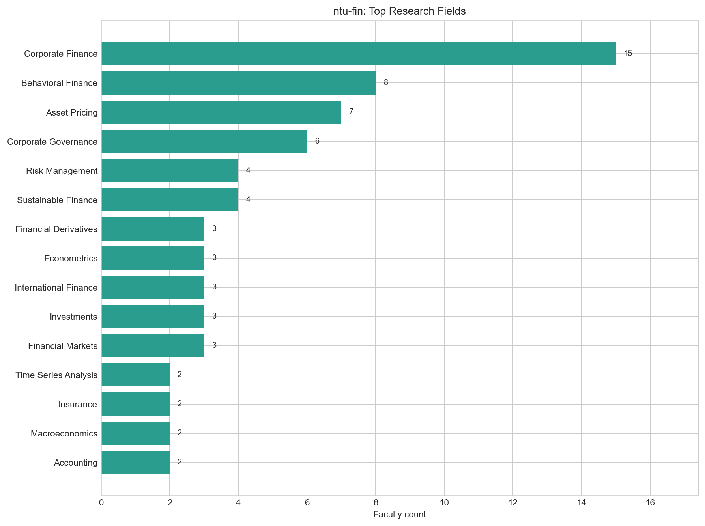

*圖：台灣大學財務金融學系 研究領域人數*  
*出處：`analysis/descriptive-stats-after-preprocessing/by_department/top_research_fields/ntu-fin.png`*  
*建構方式：由 `scripts/data-preprocessing/2_rf_and_phd_inst_comparison.ipynb` 產生。研究領域為官網「主要研究領域」與「研究領域摘要」分別清洗、以雙語詞典標準化成英文 canonical 值後取聯集；計數為具有該領域的不重複教師人數，不做 Top-N 截斷。*

### 1.3 博士畢業學校

| 排名 | 博士畢業學校（canonical） | 教授人數 |
| --- | --- | --- |
| 1 | National Taiwan University | 8 |
| 2 | University at Buffalo | 2 |
| 3 | University of Illinois Urbana-Champaign | 2 |
| 4 | University of Washington | 2 |
| 5 | Columbia University | 1 |
| 6 | University of California, San Diego | 1 |
| 7 | University of Oxford | 1 |
| 8 | Georgia Institute of Technology | 1 |
| 9 | Baruch College | 1 |
| 10 | Arizona State University | 1 |

*出處：`analysis/descriptive-stats-after-preprocessing/group_comparison/phd_institutions/fin-and-econ.csv`（`ntu-fin` 欄）*  
*建構方式：同一 notebook。學歷先被 `1_faculty_data_preprocessing.ipynb` 解析成「學位、科系、學校」三部分，取學位為博士的項目，學校名稱以別名表對應為英文 canonical 值；計數為不重複教師人數。*

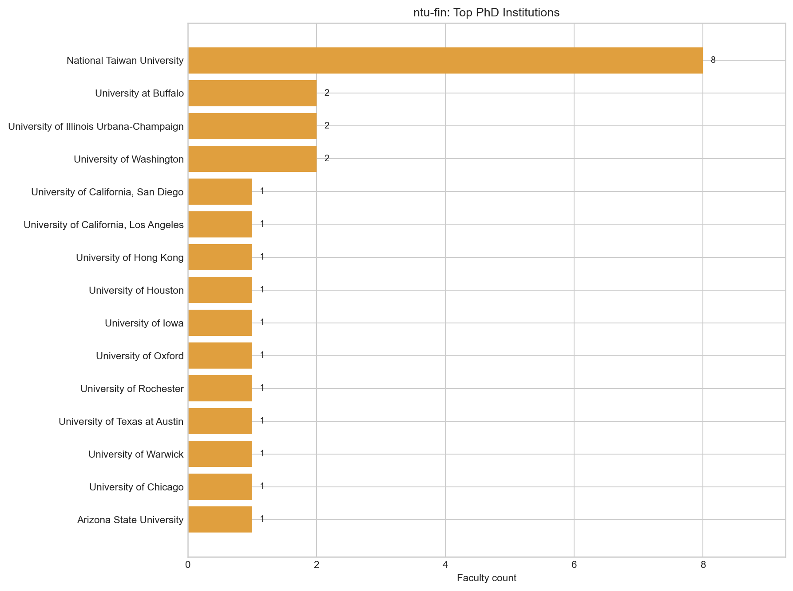

*圖：台灣大學財務金融學系 博士畢業學校人數*  
*出處：`analysis/descriptive-stats-after-preprocessing/by_department/top_phd_institutions/ntu-fin.png`*  
*建構方式：同一 notebook。學歷先被 `1_faculty_data_preprocessing.ipynb` 解析成「學位、科系、學校」三部分，取學位為博士的項目，學校名稱以別名表對應為英文 canonical 值；計數為不重複教師人數。*

## 2. 研究領域網路結構

### 2.1 網路指標

| 指標 | 數值 | 說明 |
| --- | --- | --- |
| 二分網路：教授數 / 領域數 / 邊數 | 32 / 33 / 86 | 一條邊 = 一位教授研究一個領域 |
| 二分網路連通元件數 | 1 | 最大元件涵蓋 100.0% 教授 |
| 每位教授平均 / 最多領域數 | 2.69 / 6 |  |
| 研究領域網路：節點 / 邊 | 33 / 69 | 只含至少與一個其他領域共現的領域 |
| 研究領域網路密度 | 0.131 | 實際邊數 ÷ 可能邊數 |
| 研究領域網路平均 degree | 4.18 |  |
| 研究領域網路 modularity Q（Louvain） | 0.325 | 7 個社群；resolution 0.7 / 1.3 時為 5 / 7 個 |
| 領域社群 vs taxonomy L1 一致度 | NMI 0.566 / ARI 0.250 | 1 = 完全一致，0 = 無關 |
| 教授網路：節點 / 邊 | 32 / 234 | 只含最大連通元件 |
| 教授網路密度 | 0.472 |  |
| 教授網路 modularity Q（Louvain） | 0.152 | 5 個集群 |
| 教授集群 vs 主導 L1 一致度 | NMI 0.557 / ARI 0.385 |  |

*出處：`analysis/network-analysis/ntu-fin/network_metrics.json`*  
*建構方式：由 `2_build_network_data.ipynb` 從 `faculty_standardized.json` 建立教授–研究領域二分網路：教授與研究領域各為一類節點，教授的標準化研究領域包含某領域即連一條邊。研究領域網路是二分網路的單邊投影：兩個領域若被同一位教授研究就相連，邊權為共同研究兩領域的教授人數。社群以 Louvain（seed = 42，resolution 1.0）偵測，指標以完整加權圖計算。教授網路是二分網路的另一邊投影：兩位教授共享研究領域就相連，邊權 w = S_exp + λ·S_inf；S_exp 為共享領域的 IDF 加權和（IDF 以全體 662 位教授計算一次），S_inf 為共享 taxonomy 上層分類的推論相似度，λ = 0.4。社群以 Louvain（seed = 42，resolution 1.0）偵測，節點大小與 degree 成正比。*

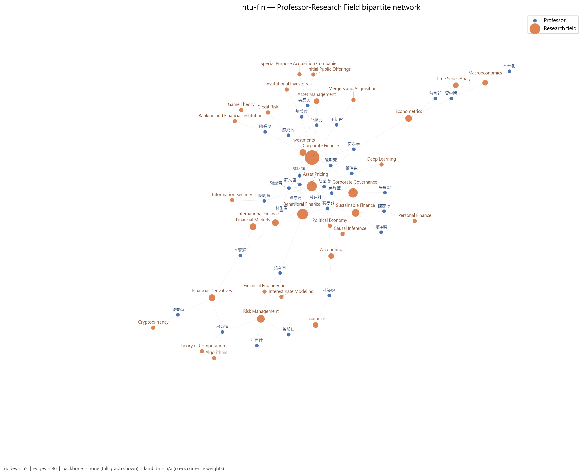

*圖：台灣大學財務金融學系 教授–研究領域二分網路*  
*出處：`analysis/network-analysis/ntu-fin/figures/01_bipartite_network.png`*  
*建構方式：由 `2_build_network_data.ipynb` 從 `faculty_standardized.json` 建立教授–研究領域二分網路：教授與研究領域各為一類節點，教授的標準化研究領域包含某領域即連一條邊。圖中兩類節點以不同顏色區分，節點大小與 degree 成正比；邊數超過 400 時繪圖使用 disparity filter backbone（α = 0.05），指標仍以完整圖計算。*

### 2.2 關鍵研究領域

| 研究領域 | Degree | Degree centrality | Betweenness | PageRank | 教授數 | taxonomy L1 |
| --- | --- | --- | --- | --- | --- | --- |
| Corporate Finance | 18 | 0.562 | 0.670 | 0.1561 | 15 | Corporate Finance & Governance |
| Behavioral Finance | 11 | 0.344 | 0.223 | 0.0869 | 8 | Asset Pricing & Financial Markets |
| Asset Pricing | 10 | 0.312 | 0.180 | 0.0733 | 7 | Asset Pricing & Financial Markets |
| Corporate Governance | 8 | 0.250 | 0.061 | 0.0635 | 6 | Corporate Finance & Governance |
| Risk Management | 7 | 0.219 | 0.114 | 0.0430 | 4 | Financial Engineering & Risk |
| Financial Derivatives | 6 | 0.188 | 0.079 | 0.0395 | 3 | Financial Engineering & Risk |
| Accounting | 6 | 0.188 | 0.047 | 0.0308 | 2 | Corporate Finance & Governance |
| Sustainable Finance | 6 | 0.188 | 0.002 | 0.0390 | 4 | Financial Engineering & Risk |
| International Finance | 6 | 0.188 | 0.075 | 0.0362 | 3 | Asset Pricing & Financial Markets |
| Causal Inference | 5 | 0.156 | 0.000 | 0.0250 | 1 | Statistics & Statistical Methods |
| Financial Markets | 5 | 0.156 | 0.026 | 0.0324 | 3 | Asset Pricing & Financial Markets |
| Econometrics | 4 | 0.125 | 0.121 | 0.0328 | 3 | Economics & Policy |

Betweenness 最高的五個領域：Corporate Finance（0.67）、Behavioral Finance（0.22）、Asset Pricing（0.18）、Econometrics（0.12）、Risk Management（0.11）。Betweenness 高代表該領域位於不同主題群之間的連結位置，是系上跨主題的共同語言。

*出處：`analysis/network-analysis/ntu-fin/keyword_centrality.csv`*  
*建構方式：研究領域網路是二分網路的單邊投影：兩個領域若被同一位教授研究就相連，邊權為共同研究兩領域的教授人數。社群以 Louvain（seed = 42，resolution 1.0）偵測，指標以完整加權圖計算。 degree 為相連領域數，betweenness 為經過該節點的最短路徑比例，PageRank 為加權隨機漫步的穩態機率；parent_l1 來自 `1_build_taxonomy.ipynb` 手工編定的三層 taxonomy（170 個 L3、46 個 L2、16 個 L1）。*

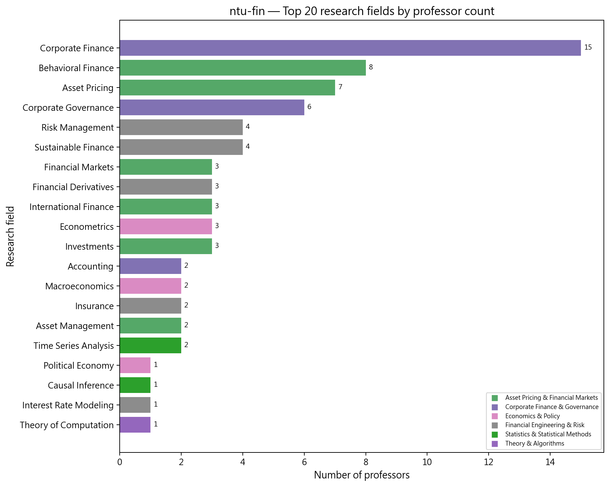

*圖：台灣大學財務金融學系 研究領域教授人數長條圖*  
*出處：`analysis/network-analysis/ntu-fin/figures/10_top_keywords_bar.png`*  
*建構方式：以二分網路中每個領域節點的 degree（研究該領域的教授數）排序繪製。*

### 2.3 研究領域社群

| 社群 | 領域數 | 主要領域（教授人數） | 主要 taxonomy L1（領域數） |
| --- | --- | --- | --- |
| 0 | 10 | Corporate Finance（15）、Behavioral Finance（8）、Corporate Governance（6）、Investments（3）、Accounting（2）、Asset Management（2）、Causal Inference（1） | Corporate Finance & Governance 5、Asset Pricing & Financial Markets 3、Statistics & Statistical Methods 1 |
| 1 | 8 | Risk Management（4）、Financial Derivatives（3）、Insurance（2）、Algorithms（1）、Financial Engineering（1）、Interest Rate Modeling（1）、Theory of Computation（1） | Financial Engineering & Risk 6、Theory & Algorithms 2 |
| 2 | 4 | Asset Pricing（7）、Financial Markets（3）、Information Security（1）、Deep Learning（1） | Asset Pricing & Financial Markets 2、Security, Privacy & Cryptography 1、AI & Machine Learning 1 |
| 3 | 4 | Sustainable Finance（4）、International Finance（3）、Political Economy（1）、Personal Finance（1） | Financial Engineering & Risk 2、Asset Pricing & Financial Markets 1、Economics & Policy 1 |
| 4 | 3 | Econometrics（3）、Macroeconomics（2）、Time Series Analysis（2） | Economics & Policy 2、Statistics & Statistical Methods 1 |
| 5 | 2 | Initial Public Offerings（1）、Special Purpose Acquisition Companies（1） | Corporate Finance & Governance 2 |
| 6 | 2 | Banking and Financial Institutions（1）、Game Theory（1） | Financial Engineering & Risk 1、Applied Mathematics & Operations Research 1 |

*出處：`analysis/network-analysis/ntu-fin/keyword_communities.csv`（`community` 欄）、`keyword_centrality.csv`（教授人數）*  
*建構方式：研究領域網路是二分網路的單邊投影：兩個領域若被同一位教授研究就相連，邊權為共同研究兩領域的教授人數。社群以 Louvain（seed = 42，resolution 1.0）偵測，指標以完整加權圖計算。*

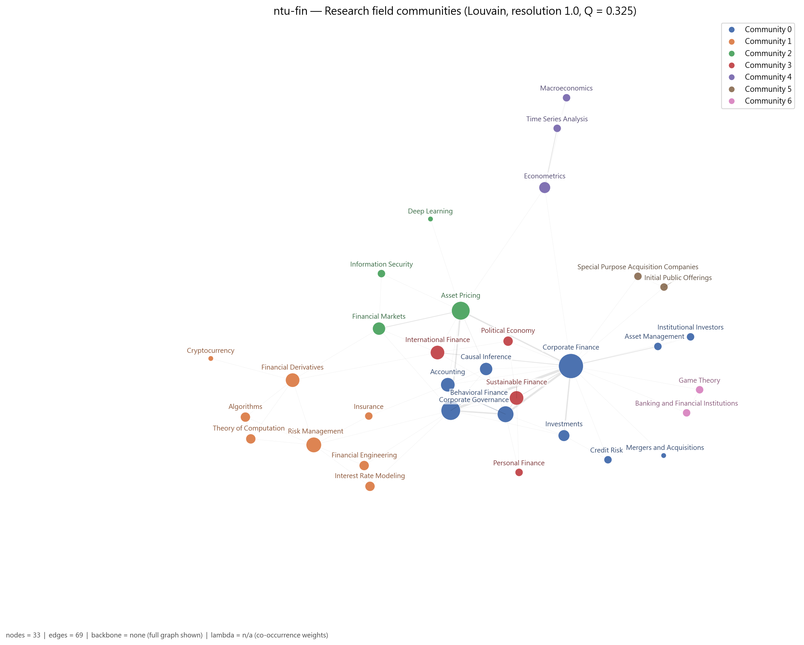

*圖：台灣大學財務金融學系 研究領域網路的 Louvain 社群*  
*出處：`analysis/network-analysis/ntu-fin/figures/05_keyword_network_communities.png`*  
*建構方式：研究領域網路是二分網路的單邊投影：兩個領域若被同一位教授研究就相連，邊權為共同研究兩領域的教授人數。社群以 Louvain（seed = 42，resolution 1.0）偵測，指標以完整加權圖計算。節點顏色為社群，大小與 degree 成正比。*

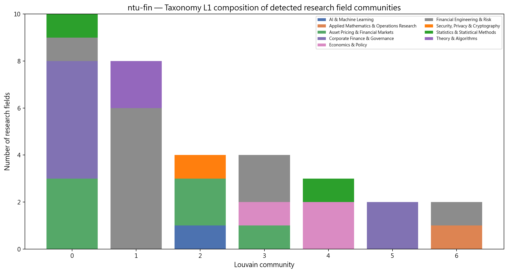

*圖：台灣大學財務金融學系 各研究領域社群的 taxonomy L1 組成*  
*出處：`analysis/network-analysis/ntu-fin/figures/14_community_composition.png`*  
*建構方式：把每個 Louvain 領域社群內的領域依 taxonomy L1 分類計數，堆疊長條圖。用來檢查資料驅動的社群是否對應人工分類。*

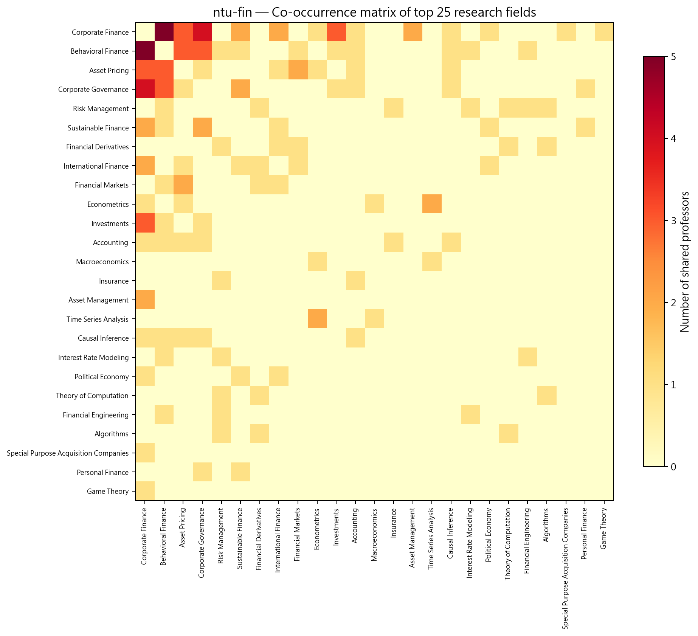

*圖：台灣大學財務金融學系 研究領域共現熱圖*  
*出處：`analysis/network-analysis/ntu-fin/figures/13_keyword_cooccurrence_heatmap.png`*  
*建構方式：取研究領域網路的加權鄰接矩陣（共同研究兩領域的教授人數），依社群排序後繪製熱圖。*

## 3. 主要研究集群與重要老師

教授網路分成 5 個集群，但其中兩個很小。主軸是「資產訂價與行為財務」、「公司理財與治理」兩個大集群，再加上「永續金融」、「風險與保險」與「計量總體」三個較小的群。研究領域網路的密度顯著低於虛無模型（z = -2.4）、平均共現次數顯著高於虛無模型（z = 2.5），代表領域共現高度集中在少數組合上。

教授網路共 32 位教授、5 個集群（Louvain，Q = 0.152）。以下依集群人數排序；集群編號與圖中的 Community 編號一致。表中 Degree 為與該教授共享研究領域的同儕數，Betweenness 為該教授位於他人最短路徑上的比例（越高越像橋梁）。

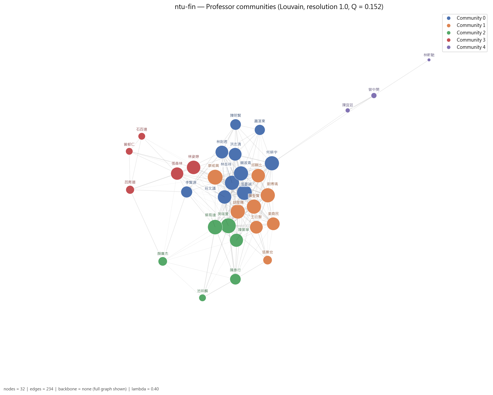

*圖：台灣大學財務金融學系 教授網路的 Louvain 集群*  
*出處：`analysis/network-analysis/ntu-fin/figures/09_professor_network_communities.png`*  
*建構方式：教授網路是二分網路的另一邊投影：兩位教授共享研究領域就相連，邊權 w = S_exp + λ·S_inf；S_exp 為共享領域的 IDF 加權和（IDF 以全體 662 位教授計算一次），S_inf 為共享 taxonomy 上層分類的推論相似度，λ = 0.4。社群以 Louvain（seed = 42，resolution 1.0）偵測，節點大小與 degree 成正比。*

### 3.1 集群 0：資產訂價與行為財務集群（10 人）

- **成員共同研究領域**：Asset Pricing（7 人）、Corporate Finance（5 人）、Behavioral Finance（5 人）、Financial Markets（3 人）、International Finance（2 人）、Econometrics（1 人）、Accounting（1 人）
- **成員主導 taxonomy L1**：Asset Pricing & Financial Markets 8 人、Corporate Finance & Governance 1 人、AI & Machine Learning 1 人

10 位成員，8 位主導 taxonomy 為 Asset Pricing & Financial Markets，共享 Asset Pricing、Corporate Finance、Behavioral Finance 與 Financial Markets。張晏誠 degree 最高（23）且 betweenness（0.361）為全系最高，研究橫跨會計、資產訂價、行為財務、因果推論與公司理財；何耕宇（資產訂價、公司理財、計量）與賴淑青（國際金融）是次要中心。

| 姓名 | 英文名 | 職稱類別 | Degree | Betweenness | 研究領域（最多列 5 項） |
| --- | --- | --- | --- | --- | --- |
| 張晏誠 | Yen-Cheng Chang | 專任 | 23 | 0.361 | Accounting、Asset Pricing、Behavioral Finance、Causal Inference、Corporate Finance |
| 何耕宇 | Keng-Yu Ho | 專任 | 21 | 0.182 | Asset Pricing、Corporate Finance、Econometrics |
| 賴淑青 | Sandy Lai | 專任 | 21 | 0.040 | Asset Pricing、Corporate Finance、International Finance |
| 林岳祥 | Yueh-Hsiang Lin | 兼任 | 21 | 0.024 | Behavioral Finance、Corporate Finance、Investments |
| 莊文議 | Wen-I Chuang | 專任 | 19 | 0.000 | Behavioral Finance、Corporate Finance |
| 林則君（2 個系所） | Tse-Chun Lin | 主管／講座 | 17 | 0.075 | Asset Pricing、Behavioral Finance、Financial Markets |
| 洪志清 | Chih-Ching Hung | 專任 | 17 | 0.001 | Asset Pricing、Behavioral Finance |
| 李賢源 | Shyan-Yuan Lee | 專任 | 13 | 0.032 | Financial Derivatives、Financial Markets、International Finance |

其餘成員（2 位，依 degree 排序）：陳明賢、蕭湛東

### 3.2 集群 1：公司理財與公司治理集群（8 人）

- **成員共同研究領域**：Corporate Finance（7 人）、Corporate Governance（3 人）、Asset Management（2 人）、Investments（2 人）、Institutional Investors（1 人）、Initial Public Offerings（1 人）、Special Purpose Acquisition Companies（1 人）
- **成員主導 taxonomy L1**：Corporate Finance & Governance 6 人、Asset Pricing & Financial Markets 2 人

8 位成員中 6 位主導 Corporate Finance & Governance，共享 Corporate Finance（7 人）、Corporate Governance、Asset Management 與 Investments。廖咸興 degree 最高（23），陳聖賢（系主任）、胡星陽與邱顯比（名譽教授）、劉博瑀 degree 相近，是一個內部高度同質的資深集群。

| 姓名 | 英文名 | 職稱類別 | Degree | Betweenness | 研究領域（最多列 5 項） |
| --- | --- | --- | --- | --- | --- |
| 廖咸興 | Hsien-Hsing Liao | 專任 | 23 | 0.000 | Corporate Finance、Credit Risk、Investments |
| 陳聖賢 | Sheng-Syan Chen | 主管／講座 | 21 | 0.013 | Corporate Finance、Corporate Governance、Investments |
| 胡星陽 | Shing-Yang Hu | 名譽／退休 | 21 | 0.006 | Behavioral Finance、Corporate Finance、Corporate Governance |
| 劉博瑀 | Po-Yu Liu | 專任 | 21 | 0.004 | Asset Management、Corporate Finance、Institutional Investors |
| 邱顯比 | Shean-Bii Chiu | 名譽／退休 | 19 | 0.000 | Asset Management、Corporate Finance |
| 姜堯民 | Yao-Min Chiang | 專任 | 17 | 0.000 | Corporate Finance、Initial Public Offerings、Special Purpose Acquisition Companies |
| 王衍智 | Yan-Zhi Wang | 專任 | 17 | 0.000 | Corporate Finance、Mergers and Acquisitions |
| 張景宏 | Ching-Hung Chang | 專任 | 8 | 0.000 | Corporate Governance |

### 3.3 集群 2：永續金融與公司理財集群（6 人）

- **成員共同研究領域**：Sustainable Finance（4 人）、Corporate Finance（3 人）、Corporate Governance（2 人）、Behavioral Finance（1 人）、International Finance（1 人）、Political Economy（1 人）、Personal Finance（1 人）
- **成員主導 taxonomy L1**：Financial Engineering & Risk 3 人、Corporate Finance & Governance 1 人、Asset Pricing & Financial Markets 1 人、Applied Mathematics & Operations Research 1 人

共享 Sustainable Finance（4 人）與 Corporate Finance。吳瑞萱（兼任）degree 23、betweenness 0.18，同時涵蓋行為財務、公司治理與永續金融；蔡易達結合國際金融、政治經濟與永續金融，也是組層級的跨校 broker 之一；顏廣杰研究加密貨幣與衍生性商品，位於集群邊緣。

| 姓名 | 英文名 | 職稱類別 | Degree | Betweenness | 研究領域（最多列 5 項） |
| --- | --- | --- | --- | --- | --- |
| 吳瑞萱 | Ruei-Shian Wu | 兼任 | 23 | 0.180 | Behavioral Finance、Corporate Finance、Corporate Governance、Sustainable Finance |
| 蔡易達 | Yi-Da Tsai | 專任 | 22 | 0.012 | Corporate Finance、International Finance、Political Economy、Sustainable Finance |
| 陳業寧 | Yehning Chen | 專任 | 18 | 0.000 | Banking and Financial Institutions、Corporate Finance、Game Theory |
| 陳彥行 | Yan-Shing Chen | 專任 | 12 | 0.003 | Corporate Governance、Personal Finance、Sustainable Finance |
| 顏廣杰 | Kuang-Chieh Yen | 兼任 | 8 | 0.000 | Cryptocurrency、Financial Derivatives |
| 池祥麟 | Hsiang-Lin Chih | 兼任 | 5 | 0.000 | Sustainable Finance |

### 3.4 集群 3：風險管理、保險與衍生性商品集群（5 人）

- **成員共同研究領域**：Risk Management（4 人）、Insurance（2 人）、Algorithms（1 人）、Financial Derivatives（1 人）、Theory of Computation（1 人）、Behavioral Finance（1 人）、Financial Engineering（1 人）
- **成員主導 taxonomy L1**：Financial Engineering & Risk 4 人、Corporate Finance & Governance 1 人

共享 Risk Management、Insurance 與 Financial Derivatives。張森林（行為財務、金融工程、利率模型、風險）betweenness 最高；呂育道是與台大資工的合聘教授，帶入 Algorithms 與 Theory of Computation，是本系唯一連到資工領域的節點；曾郁仁與林姿婷代表保險軸線。

| 姓名 | 英文名 | 職稱類別 | Degree | Betweenness | 研究領域（最多列 5 項） |
| --- | --- | --- | --- | --- | --- |
| 林姿婷 | Tzu-Ting Lin | 專任 | 19 | 0.045 | Accounting、Insurance |
| 張森林 | San-Lin Chung | 專任 | 16 | 0.103 | Behavioral Finance、Financial Engineering、Interest Rate Modeling、Risk Management |
| 呂育道（2 個系所） | Yun-Dauh Lyuu | 合聘 | 7 | 0.013 | Algorithms、Financial Derivatives、Risk Management、Theory of Computation |
| 曾郁仁 | Larry Y. Tzeng | 專任 | 5 | 0.006 | Insurance、Risk Management |
| 石百達 | Pai-Ta Shih | 專任 | 5 | 0.000 | Risk Management |

### 3.5 集群 4：計量經濟與總體集群（3 人）

- **成員共同研究領域**：Macroeconomics（2 人）、Econometrics（2 人）、Time Series Analysis（2 人）
- **成員主導 taxonomy L1**：Economics & Policy 3 人

只有 3 人：管中閔、陳宜廷、林軒馳，共享 Econometrics、Macroeconomics 與 Time Series Analysis。這三人的研究主題與系上其他教授幾乎不重疊，只透過管中閔微弱地連到主網路。

| 姓名 | 英文名 | 職稱類別 | Degree | Betweenness | 研究領域（最多列 5 項） |
| --- | --- | --- | --- | --- | --- |
| 管中閔 | Chung-Ming Kuan | 主管／講座 | 3 | 0.065 | Econometrics、Macroeconomics、Time Series Analysis |
| 陳宜廷 | Yi-Ting Chen | — | 2 | 0.000 | Econometrics、Time Series Analysis |
| 林軒馳 | Hsuan-Chih Lin | 專任 | 1 | 0.000 | Macroeconomics |

*集群表出處：`analysis/network-analysis/ntu-fin/professor_communities.csv`（集群歸屬）、`professor_centrality.csv`（degree、betweenness、職稱類別）、`prof_keyword_network.graphml`（成員研究領域，用來統計集群的共同領域）*  
*建構方式：教授網路是二分網路的另一邊投影：兩位教授共享研究領域就相連，邊權 w = S_exp + λ·S_inf；S_exp 為共享領域的 IDF 加權和（IDF 以全體 662 位教授計算一次），S_inf 為共享 taxonomy 上層分類的推論相似度，λ = 0.4。社群以 Louvain（seed = 42，resolution 1.0）偵測，節點大小與 degree 成正比。 職稱類別為官網職稱的分類，一人可屬多類時取主要類別；「N 個系所」表示該教授也出現在其他系所名單。*

### 3.6 全系的橋接者與樞紐

Betweenness 最高的教授（跨集群的橋梁）：

| 姓名 | 英文名 | 職稱類別 | Degree | Betweenness | 主導 L1 |
| --- | --- | --- | --- | --- | --- |
| 張晏誠 | Yen-Cheng Chang | 專任 | 23 | 0.361 | Corporate Finance & Governance |
| 何耕宇 | Keng-Yu Ho | 專任 | 21 | 0.182 | Asset Pricing & Financial Markets |
| 吳瑞萱 | Ruei-Shian Wu | 兼任 | 23 | 0.180 | Corporate Finance & Governance |
| 張森林 | San-Lin Chung | 專任 | 16 | 0.103 | Financial Engineering & Risk |
| 林則君 | Tse-Chun Lin | 主管／講座 | 17 | 0.075 | Asset Pricing & Financial Markets |
| 管中閔 | Chung-Ming Kuan | 主管／講座 | 3 | 0.065 | Economics & Policy |

Degree 最高的教授（與最多同儕共享領域的樞紐）：

| 姓名 | 英文名 | 職稱類別 | Degree | Betweenness | 主導 L1 |
| --- | --- | --- | --- | --- | --- |
| 吳瑞萱 | Ruei-Shian Wu | 兼任 | 23 | 0.180 | Corporate Finance & Governance |
| 廖咸興 | Hsien-Hsing Liao | 專任 | 23 | 0.000 | Asset Pricing & Financial Markets |
| 張晏誠 | Yen-Cheng Chang | 專任 | 23 | 0.361 | Corporate Finance & Governance |
| 蔡易達 | Yi-Da Tsai | 專任 | 22 | 0.012 | Asset Pricing & Financial Markets |
| 何耕宇 | Keng-Yu Ho | 專任 | 21 | 0.182 | Asset Pricing & Financial Markets |
| 劉博瑀 | Po-Yu Liu | 專任 | 21 | 0.004 | Corporate Finance & Governance |

*出處：`analysis/network-analysis/ntu-fin/professor_centrality.csv`*

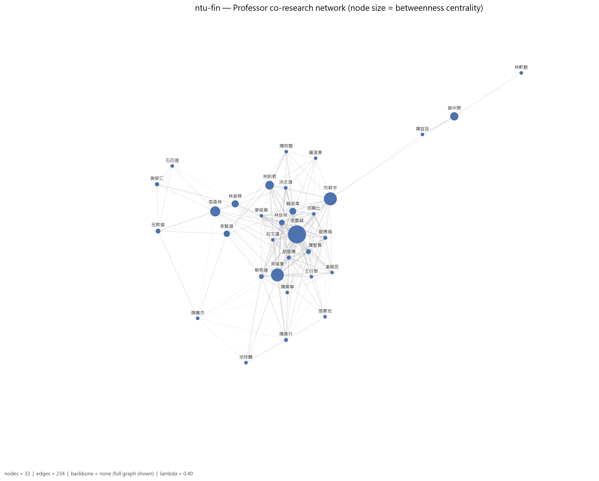

*圖：台灣大學財務金融學系 教授網路（節點大小 = betweenness）*  
*出處：`analysis/network-analysis/ntu-fin/figures/08_professor_network_betweenness.png`*  
*建構方式：教授網路是二分網路的另一邊投影：兩位教授共享研究領域就相連，邊權 w = S_exp + λ·S_inf；S_exp 為共享領域的 IDF 加權和（IDF 以全體 662 位教授計算一次），S_inf 為共享 taxonomy 上層分類的推論相似度，λ = 0.4。社群以 Louvain（seed = 42，resolution 1.0）偵測，節點大小與 degree 成正比。此圖節點大小改為與 betweenness 成正比。*

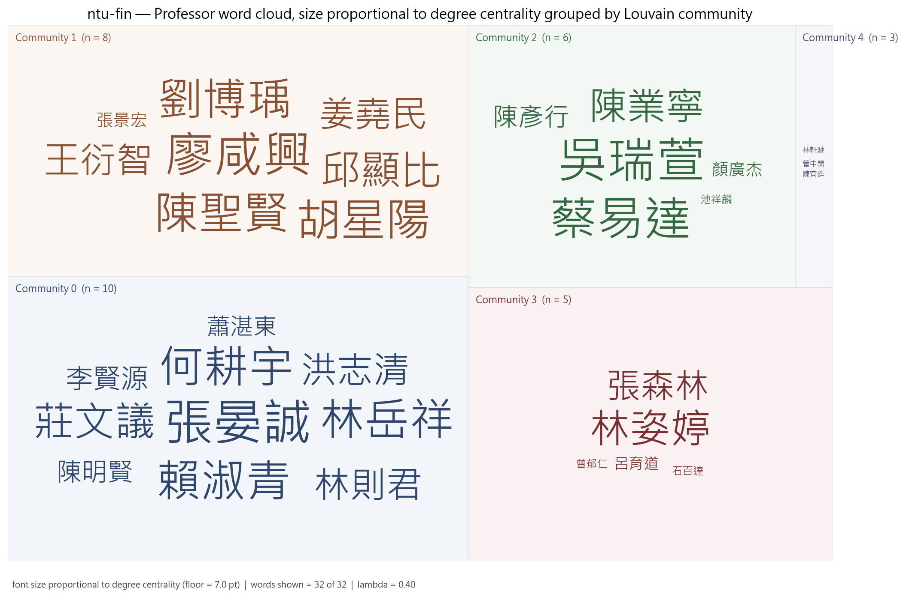

*圖：台灣大學財務金融學系 各集群教授 word cloud（字級 = degree）*  
*出處：`analysis/network-analysis/ntu-fin/figures/27_professor_wordcloud_degree_by_community.png`*  
*建構方式：依 Louvain 集群分塊、同集群同色的教授姓名 word cloud，字級與 degree 成線性正比並設下限。*

## 4. 結構穩健性檢驗

### 4.1 虛無模型檢定

| 統計量 | 觀測值 | 虛無平均 | 虛無標準差 | z-score | empirical p | p < 0.05 |
| --- | --- | --- | --- | --- | --- | --- |
| 領域網路密度 | 0.1307 | 0.1486 | 0.0074 | -2.42 | 0.004 | 顯著 |
| 領域網路 modularity Q | 0.3249 | 0.3262 | 0.0356 | -0.03 | 0.987 | 不顯著 |
| 領域平均共現次數 | 1.3043 | 1.1981 | 0.0430 | 2.47 | 0.032 | 顯著 |
| 教授網路 clustering 係數 | 0.7328 | 0.7176 | 0.0390 | 0.39 | 0.737 | 不顯著 |

*出處：`analysis/network-analysis/ntu-fin/null_model_test.csv`*  
*建構方式：以保持二分結構與雙邊 degree 序列的 double edge swap（nswap = 10 × 邊數）產生 1,000 個隨機網路，比較觀測值與虛無分布，輸出 z-score 與雙尾 empirical p-value。 密度顯著偏低而 modularity、共現顯著偏高，代表領域共現集中在少數主題群，不是均勻分布。*

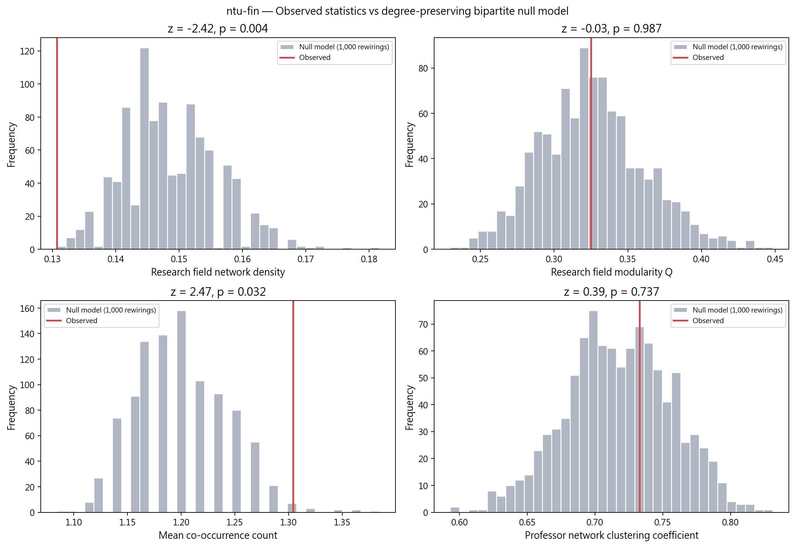

*圖：台灣大學財務金融學系 觀測值 vs 虛無模型分布*  
*出處：`analysis/network-analysis/ntu-fin/figures/15_null_model_comparison.png`*  
*建構方式：以保持二分結構與雙邊 degree 序列的 double edge swap（nswap = 10 × 邊數）產生 1,000 個隨機網路，比較觀測值與虛無分布，輸出 z-score 與雙尾 empirical p-value。*

### 4.2 λ 敏感度

| λ | 邊數 | 密度 | Q | 集群數 | 密度相對 baseline | Q 下降 | 過度合併 |
| --- | --- | --- | --- | --- | --- | --- | --- |
| 0.0 | 170 | 0.343 | 0.218 | 5 | +0% | 0.000 | 否 |
| 0.3 | 234 | 0.472 | 0.167 | 5 | +38% | 0.051 | 否 |
| 0.4 | 234 | 0.472 | 0.152 | 5 | +38% | 0.066 | 否 |
| 0.5 | 234 | 0.472 | 0.154 | 5 | +38% | 0.064 | 否 |

*出處：`analysis/network-analysis/ntu-fin/lambda_sensitivity.csv`*  
*建構方式：以 λ ∈ {0, 0.3, 0.4, 0.5} 各建一次教授網路，λ = 0 為 baseline；密度較 baseline 增加超過 50% 或 Q 下降超過 0.1 即標記為過度合併。*

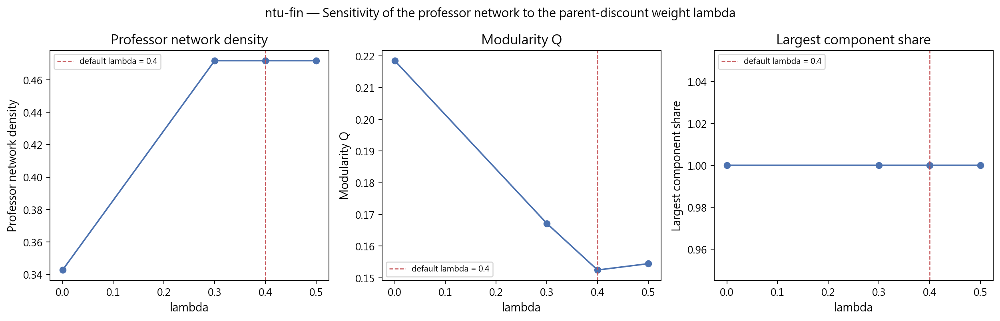

*圖：台灣大學財務金融學系 λ 敏感度*  
*出處：`analysis/network-analysis/ntu-fin/figures/16_lambda_sensitivity.png`*  
*建構方式：以 λ ∈ {0, 0.3, 0.4, 0.5} 各建一次教授網路，λ = 0 為 baseline；密度較 baseline 增加超過 50% 或 Q 下降超過 0.1 即標記為過度合併。*

### 4.3 taxonomy L1 覆蓋護欄

| taxonomy L1 | 教授數 | 覆蓋率 | flag |
| --- | --- | --- | --- |
| Asset Pricing & Financial Markets | 18 | 56.2% | too_broad |
| Corporate Finance & Governance | 18 | 56.2% | too_broad |
| Financial Engineering & Risk | 13 | 40.6% | ok |
| Economics & Policy | 5 | 15.6% | ok |
| Statistics & Statistical Methods | 3 | 9.4% | ok |
| AI & Machine Learning | 1 | 3.1% | ok |
| Applied Mathematics & Operations Research | 1 | 3.1% | ok |
| Security, Privacy & Cryptography | 1 | 3.1% | ok |

*出處：`analysis/network-analysis/ntu-fin/l1_coverage_guardrail.csv`（只列前 8 項）*  
*建構方式：計算每個 L1 分類涵蓋該單位多少比例的教授，超過 50% 標記 too_broad，代表此 L1 在本單位太寬，不能用來做 L1 roll-up 比較。*

## 5. 解讀與注意事項

- 11 位教授（25.6%）因官網未填研究領域而未進入網路，這些人多為兼任與名譽教授；解讀「系上研究輪廓」時要記得這是專任為主的樣本。
- L1 護欄標記 Asset Pricing & Financial Markets 與 Corporate Finance & Governance 都涵蓋超過 50% 教授。
- λ 敏感度未觸發過度合併，λ=0 與 λ=0.4 的社群數都是 5，集群結論穩健。
- 研究領域網路偵測到 7 個社群，但其中 3 個只有 2 到 4 個領域（例如 Initial Public Offerings 與 SPAC 自成一群），是少數教授的特殊主題，不代表系上的主流分工。
- 本系同時蒐集了「主要研究領域」與「研究領域摘要」兩個欄位，摘要中的主題（如 Causal Inference）也會進入網路。
- 研究領域來自官網自填內容，粒度與深度因人而異；網路密度與集群數反映填寫習慣的成分不可忽視，完整率不可解讀為系所或教授的品質排名。

## 附錄：本報告引用的資料與圖表清單

| 檔案 | 產生階段 / 程式 | 建構方式摘要 |
| --- | --- | --- |
| `analysis/data-collection/ntu-fin/quality-report.json` | 資料蒐集 `scripts/data-collection/collect.py` | 爬取官網後統計 canonical 紀錄人數、職稱分類、中英配對率與欄位完整率 |
| `analysis/descriptive-stats-after-preprocessing/coverage_by_school.csv` | 預處理 `1_faculty_data_preprocessing.ipynb` | 標準化後各欄位有 canonical 值的教師比例與平均項目數 |
| `.../group_comparison/research_fields/fin-and-econ.csv`、`by_department/top_research_fields/ntu-fin.png` | 預處理 `2_rf_and_phd_inst_comparison.ipynb` | 由 `scripts/data-preprocessing/2_rf_and_phd_inst_comparison.ipynb` 產生。研究領域為官網「主要研究領域」與「研究領域摘要」分別清洗、以雙語詞典標準化成英文 canonical 值後取聯集；計數為具有該領域的不重複教師人數，不做 Top-N 截斷。 |
| `.../group_comparison/phd_institutions/fin-and-econ.csv`、`by_department/top_phd_institutions/ntu-fin.png` | 同上 | 同一 notebook。學歷先被 `1_faculty_data_preprocessing.ipynb` 解析成「學位、科系、學校」三部分，取學位為博士的項目，學校名稱以別名表對應為英文 canonical 值；計數為不重複教師人數。 |
| `analysis/network-analysis/ntu-fin/network_metrics.json` | 網路分析 `2_build_network_data.ipynb` + `3_network_analysis.ipynb` | 由 `2_build_network_data.ipynb` 從 `faculty_standardized.json` 建立教授–研究領域二分網路：教授與研究領域各為一類節點，教授的標準化研究領域包含某領域即連一條邊。研究領域網路是二分網路的單邊投影：兩個領域若被同一位教授研究就相連，邊權為共同研究兩領域的教授人數。社群以 Louvain（seed = 42，resolution 1.0）偵測，指標以完整加權圖計算。教授網路是二分網路的另一邊投影：兩位教授共享研究領域就相連，邊權 w = S_exp + λ·S_inf；S_exp 為共享領域的 IDF 加權和（IDF 以全體 662 位教授計算一次），S_inf 為共享 taxonomy 上層分類的推論相似度，λ = 0.4。社群以 Louvain（seed = 42，resolution 1.0）偵測，節點大小與 degree 成正比。 |
| `analysis/network-analysis/ntu-fin/keyword_centrality.csv`、`keyword_communities.csv` | `3_network_analysis.ipynb` | 研究領域網路的中心性與 Louvain 社群；taxonomy 來自 `1_build_taxonomy.ipynb` |
| `analysis/network-analysis/ntu-fin/professor_centrality.csv`、`professor_communities.csv`、`prof_keyword_network.graphml` | `3_network_analysis.ipynb` | 教授網路的中心性與 Louvain 集群；graphml 為二分網路，本報告用它統計各集群成員的共同領域 |
| `analysis/network-analysis/ntu-fin/null_model_test.csv` | `3_network_analysis.ipynb` | 以保持二分結構與雙邊 degree 序列的 double edge swap（nswap = 10 × 邊數）產生 1,000 個隨機網路，比較觀測值與虛無分布，輸出 z-score 與雙尾 empirical p-value。 |
| `analysis/network-analysis/ntu-fin/lambda_sensitivity.csv` | `3_network_analysis.ipynb` | 以 λ ∈ {0, 0.3, 0.4, 0.5} 各建一次教授網路，λ = 0 為 baseline；密度較 baseline 增加超過 50% 或 Q 下降超過 0.1 即標記為過度合併。 |
| `analysis/network-analysis/ntu-fin/l1_coverage_guardrail.csv` | `3_network_analysis.ipynb` | 每個 L1 涵蓋教授比例，> 50% 標記 too_broad |
| `analysis/network-analysis/ntu-fin/figures/01, 05, 08, 09, 10, 13, 14, 15, 16, 27` | `3_network_analysis.ipynb` | 網路圖節點大小與 degree 或 betweenness 成正比、顏色依社群；邊數 > 400 時繪圖用 disparity filter backbone；word cloud 字級與中心性成線性正比 |

更完整的方法說明見 `docs/data-collection-report.md`、`docs/data-preprocessing-report.md`、`docs/network-analysis-report.md`。
