# 台灣大學資訊管理學系（`ntu-im`）研究結果總結報告

所屬分組：資工組（cs）　｜　資料日期：2026-09-09 蒐集、2026-09-10 完成網路分析

> **本報告的資料來源**
> 本專案分三個階段：(1) 資料蒐集（`scripts/data-collection/`）從 14 個系所官網爬取師資的姓名、職稱、學歷與研究領域，中英文分開蒐集後配對；
> (2) 資料預處理（`scripts/data-preprocessing/`）把職稱、學歷、研究領域標準化成英文 canonical 值，並產生描述統計；
> (3) 網路分析（`scripts/network-analysis/current-version/`）建立「教授–研究領域」二分網路，投影成研究領域網路與教授網路，做社群偵測、中心性、虛無模型與敏感度分析。
> 本報告所有數字、表格與圖表都取自 `analysis/` 底下這三個階段的輸出，每張圖表下方都標明出處與建構方式，附錄另有完整清單。
> 「研究集群」指教授網路的 Louvain 社群；「重要老師」依教授在該網路中的 degree（與多少同儕共享領域）與 betweenness（是否位於集群之間的橋梁位置）判定，**不是**學術成就的排名。

## 1. 科系速覽

台大資管系是管理學院下的資訊科系，研究輪廓同時包含技術與管理兩面：Artificial Intelligence（7 人）、Machine Learning（6 人）、Big Data Analytics 與 Information Security（各 5 人）代表技術面；Entrepreneurship（5 人）、Knowledge Management（4 人）、Innovation Management 與 Operations Research（各 3 人）代表管理面，這些管理領域在其他資工系幾乎不出現。官網列出 31 位教師（專任 21、兼任 10），研究領域完整率 96.8%，每位教授平均 3.1 個領域，是 14 個系所中最高的。博士畢業學校以台大（4 人）與 University of Arizona（3 人，資管領域的傳統重鎮）為主。

### 1.1 基本資料

| 項目 | 數值 |
| --- | --- |
| 官網師資人數（canonical 紀錄） | 31 |
| 職稱分類（一人可屬多類） | 專任 21、兼任 10、主管／講座 3、合聘 1、實務 1、專案 1 |
| 中英文紀錄配對率 | 100.0% |
| 研究領域完整率（標準化後） | 96.8% |
| 學歷完整率（標準化後） | 77.4% |
| 每位教授平均研究領域數 | 3.10 |
| 進入網路分析的教授數 | 30（1 位因無研究領域排除） |

*出處：`analysis/data-collection/ntu-im/quality-report.json`（人數、職稱、配對率）、`analysis/descriptive-stats-after-preprocessing/coverage_by_school.csv`（完整率）、`analysis/network-analysis/ntu-im/network_metrics.json`（進入網路人數）*  
*建構方式：quality-report 由 `scripts/data-collection/collect.py` 在爬取官網後統計 canonical 紀錄的職稱分類與中英配對；coverage 由 `1_faculty_data_preprocessing.ipynb` 計算標準化後有 canonical 值的教師比例。*

### 1.2 主要研究領域

| 排名 | 研究領域（canonical） | 教授人數 |
| --- | --- | --- |
| 1 | Artificial Intelligence | 7 |
| 2 | Machine Learning | 6 |
| 3 | Big Data Analytics | 5 |
| 4 | Entrepreneurship | 5 |
| 5 | Information Security | 5 |
| 6 | Data Mining | 4 |
| 7 | Knowledge Management | 4 |
| 8 | Optimization | 3 |
| 9 | Innovation Management | 3 |
| 10 | Operations Research | 3 |
| 11 | Social Media Analytics | 3 |
| 12 | E-Commerce | 2 |
| 13 | Natural Language Processing | 2 |
| 14 | Financial Technology | 2 |
| 15 | Information Retrieval | 2 |

*出處：`analysis/descriptive-stats-after-preprocessing/group_comparison/research_fields/cs.csv`（`ntu-im` 欄）*  
*建構方式：由 `scripts/data-preprocessing/2_rf_and_phd_inst_comparison.ipynb` 產生。研究領域為官網「主要研究領域」與「研究領域摘要」分別清洗、以雙語詞典標準化成英文 canonical 值後取聯集；計數為具有該領域的不重複教師人數，不做 Top-N 截斷。*

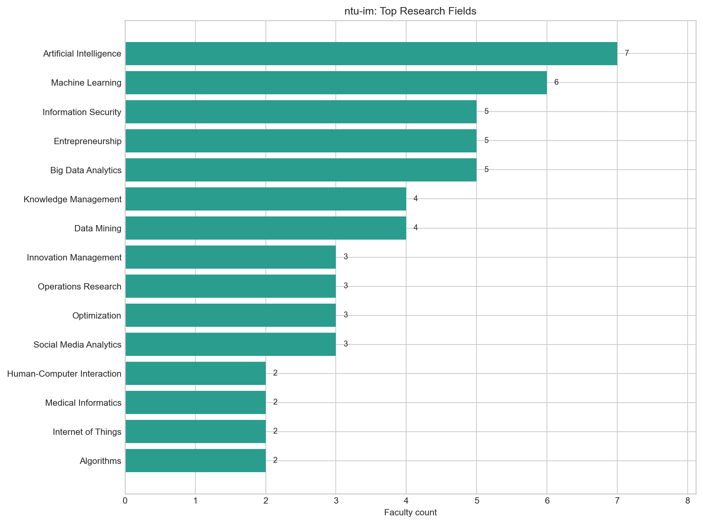

*圖：台灣大學資訊管理學系 研究領域人數*  
*出處：`analysis/descriptive-stats-after-preprocessing/by_department/top_research_fields/ntu-im.png`*  
*建構方式：由 `scripts/data-preprocessing/2_rf_and_phd_inst_comparison.ipynb` 產生。研究領域為官網「主要研究領域」與「研究領域摘要」分別清洗、以雙語詞典標準化成英文 canonical 值後取聯集；計數為具有該領域的不重複教師人數，不做 Top-N 截斷。*

### 1.3 博士畢業學校

| 排名 | 博士畢業學校（canonical） | 教授人數 |
| --- | --- | --- |
| 1 | National Taiwan University | 4 |
| 2 | University of Arizona | 3 |
| 3 | University of Illinois Urbana-Champaign | 2 |
| 4 | University of California, Berkeley | 2 |
| 5 | University of California, Los Angeles | 2 |
| 6 | National Chiao Tung University | 1 |
| 7 | Texas A&M University | 1 |
| 8 | University of Southern California | 1 |
| 9 | University of Chicago | 1 |
| 10 | University of Wisconsin-Madison | 1 |

*出處：`analysis/descriptive-stats-after-preprocessing/group_comparison/phd_institutions/cs.csv`（`ntu-im` 欄）*  
*建構方式：同一 notebook。學歷先被 `1_faculty_data_preprocessing.ipynb` 解析成「學位、科系、學校」三部分，取學位為博士的項目，學校名稱以別名表對應為英文 canonical 值；計數為不重複教師人數。*

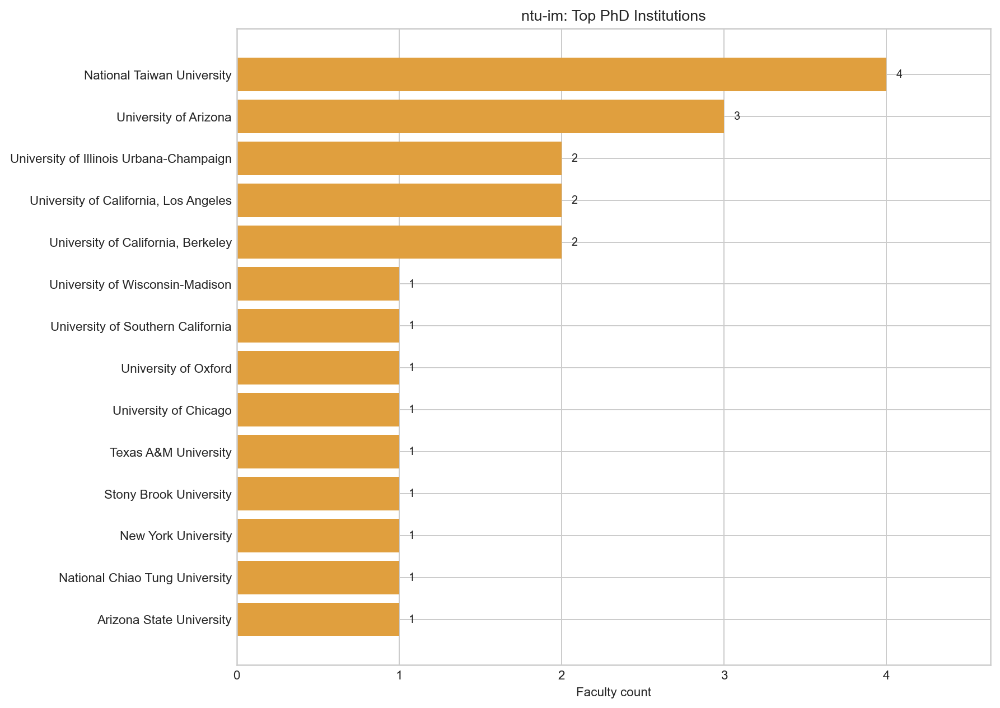

*圖：台灣大學資訊管理學系 博士畢業學校人數*  
*出處：`analysis/descriptive-stats-after-preprocessing/by_department/top_phd_institutions/ntu-im.png`*  
*建構方式：同一 notebook。學歷先被 `1_faculty_data_preprocessing.ipynb` 解析成「學位、科系、學校」三部分，取學位為博士的項目，學校名稱以別名表對應為英文 canonical 值；計數為不重複教師人數。*

## 2. 研究領域網路結構

### 2.1 網路指標

| 指標 | 數值 | 說明 |
| --- | --- | --- |
| 二分網路：教授數 / 領域數 / 邊數 | 30 / 44 / 96 | 一條邊 = 一位教授研究一個領域 |
| 二分網路連通元件數 | 4 | 最大元件涵蓋 86.7% 教授 |
| 每位教授平均 / 最多領域數 | 3.20 / 9 |  |
| 研究領域網路：節點 / 邊 | 41 / 155 | 只含至少與一個其他領域共現的領域 |
| 研究領域網路密度 | 0.189 | 實際邊數 ÷ 可能邊數 |
| 研究領域網路平均 degree | 7.56 |  |
| 研究領域網路 modularity Q（Louvain） | 0.314 | 5 個社群；resolution 0.7 / 1.3 時為 3 / 7 個 |
| 領域社群 vs taxonomy L1 一致度 | NMI 0.438 / ARI 0.126 | 1 = 完全一致，0 = 無關 |
| 教授網路：節點 / 邊 | 26 / 128 | 只含最大連通元件 |
| 教授網路密度 | 0.394 |  |
| 教授網路 modularity Q（Louvain） | 0.248 | 4 個集群 |
| 教授集群 vs 主導 L1 一致度 | NMI 0.551 / ARI 0.263 |  |

*出處：`analysis/network-analysis/ntu-im/network_metrics.json`*  
*建構方式：由 `2_build_network_data.ipynb` 從 `faculty_standardized.json` 建立教授–研究領域二分網路：教授與研究領域各為一類節點，教授的標準化研究領域包含某領域即連一條邊。研究領域網路是二分網路的單邊投影：兩個領域若被同一位教授研究就相連，邊權為共同研究兩領域的教授人數。社群以 Louvain（seed = 42，resolution 1.0）偵測，指標以完整加權圖計算。教授網路是二分網路的另一邊投影：兩位教授共享研究領域就相連，邊權 w = S_exp + λ·S_inf；S_exp 為共享領域的 IDF 加權和（IDF 以全體 662 位教授計算一次），S_inf 為共享 taxonomy 上層分類的推論相似度，λ = 0.4。社群以 Louvain（seed = 42，resolution 1.0）偵測，節點大小與 degree 成正比。*

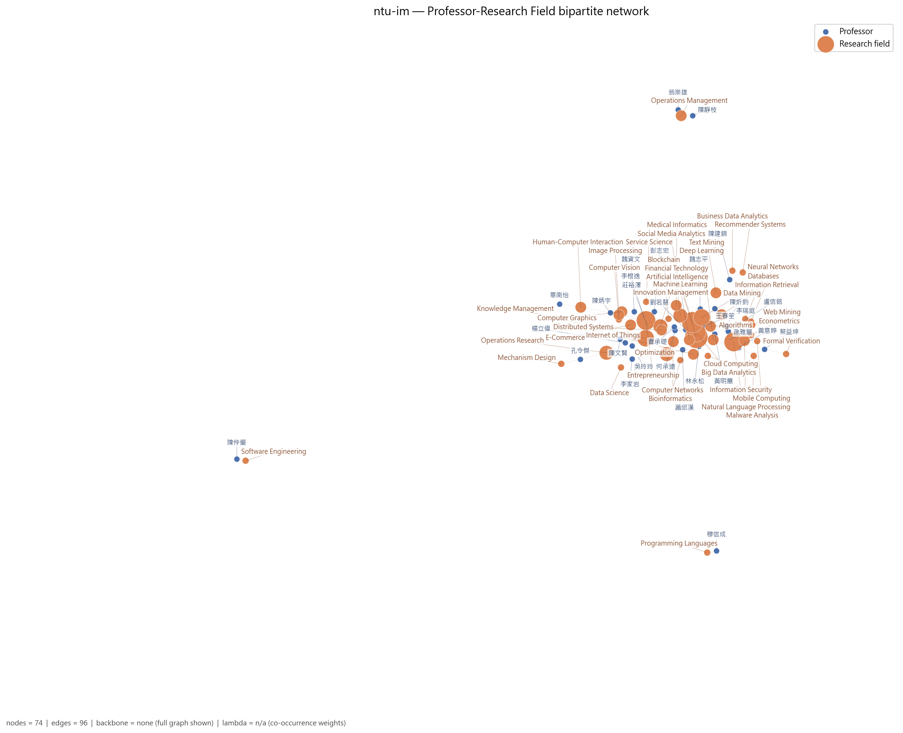

*圖：台灣大學資訊管理學系 教授–研究領域二分網路*  
*出處：`analysis/network-analysis/ntu-im/figures/01_bipartite_network.png`*  
*建構方式：由 `2_build_network_data.ipynb` 從 `faculty_standardized.json` 建立教授–研究領域二分網路：教授與研究領域各為一類節點，教授的標準化研究領域包含某領域即連一條邊。圖中兩類節點以不同顏色區分，節點大小與 degree 成正比；邊數超過 400 時繪圖使用 disparity filter backbone（α = 0.05），指標仍以完整圖計算。*

### 2.2 關鍵研究領域

| 研究領域 | Degree | Degree centrality | Betweenness | PageRank | 教授數 | taxonomy L1 |
| --- | --- | --- | --- | --- | --- | --- |
| Machine Learning | 24 | 0.600 | 0.389 | 0.0739 | 6 | AI & Machine Learning |
| Big Data Analytics | 21 | 0.525 | 0.351 | 0.0690 | 5 | Data, Databases & Knowledge Discovery |
| Information Security | 17 | 0.425 | 0.107 | 0.0505 | 5 | Security, Privacy & Cryptography |
| Artificial Intelligence | 14 | 0.350 | 0.239 | 0.0534 | 7 | AI & Machine Learning |
| Algorithms | 13 | 0.325 | 0.004 | 0.0360 | 2 | Theory & Algorithms |
| Financial Technology | 13 | 0.325 | 0.002 | 0.0339 | 2 | Financial Engineering & Risk |
| Social Media Analytics | 13 | 0.325 | 0.103 | 0.0411 | 3 | Data, Databases & Knowledge Discovery |
| Data Mining | 12 | 0.300 | 0.005 | 0.0346 | 4 | Data, Databases & Knowledge Discovery |
| Deep Learning | 11 | 0.275 | 0.013 | 0.0288 | 2 | AI & Machine Learning |
| Information Retrieval | 11 | 0.275 | 0.007 | 0.0307 | 2 | Data, Databases & Knowledge Discovery |
| Knowledge Management | 10 | 0.250 | 0.035 | 0.0271 | 4 | Information Systems & Management |
| Distributed Systems | 10 | 0.250 | 0.000 | 0.0249 | 2 | Systems, Software & Architecture |

Betweenness 最高的五個領域：Machine Learning（0.39）、Big Data Analytics（0.35）、Artificial Intelligence（0.24）、Information Security（0.11）、Social Media Analytics（0.10）。Betweenness 高代表該領域位於不同主題群之間的連結位置，是系上跨主題的共同語言。

*出處：`analysis/network-analysis/ntu-im/keyword_centrality.csv`*  
*建構方式：研究領域網路是二分網路的單邊投影：兩個領域若被同一位教授研究就相連，邊權為共同研究兩領域的教授人數。社群以 Louvain（seed = 42，resolution 1.0）偵測，指標以完整加權圖計算。 degree 為相連領域數，betweenness 為經過該節點的最短路徑比例，PageRank 為加權隨機漫步的穩態機率；parent_l1 來自 `1_build_taxonomy.ipynb` 手工編定的三層 taxonomy（170 個 L3、46 個 L2、16 個 L1）。*

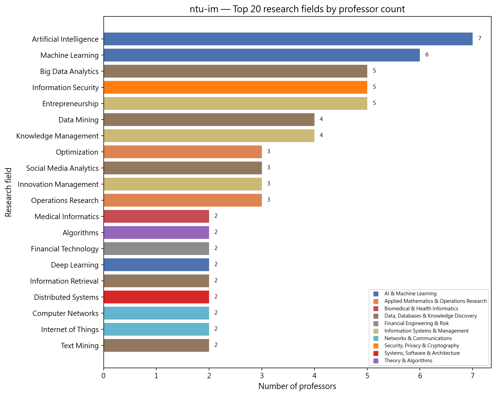

*圖：台灣大學資訊管理學系 研究領域教授人數長條圖*  
*出處：`analysis/network-analysis/ntu-im/figures/10_top_keywords_bar.png`*  
*建構方式：以二分網路中每個領域節點的 degree（研究該領域的教授數）排序繪製。*

### 2.3 研究領域社群

| 社群 | 領域數 | 主要領域（教授人數） | 主要 taxonomy L1（領域數） |
| --- | --- | --- | --- |
| 0 | 14 | Data Mining（4）、Knowledge Management（4）、Social Media Analytics（3）、Operations Research（3）、Deep Learning（2）、Distributed Systems（2）、Medical Informatics（2） | Data, Databases & Knowledge Discovery 6、Information Systems & Management 3、Applied Mathematics & Operations Research 2 |
| 1 | 14 | Artificial Intelligence（7）、Big Data Analytics（5）、Information Security（5）、Entrepreneurship（5）、Optimization（3）、Innovation Management（3）、Financial Technology（2） | Networks & Communications 4、Security, Privacy & Cryptography 2、Information Systems & Management 2 |
| 2 | 6 | Machine Learning（6）、Algorithms（2）、Information Retrieval（2）、Databases（1）、Neural Networks（1）、Web Mining（1） | Data, Databases & Knowledge Discovery 3、AI & Machine Learning 2、Theory & Algorithms 1 |
| 3 | 4 | Computer Graphics（2）、Image Processing（2）、Human-Computer Interaction（2）、Computer Vision（1） | Vision, Multimedia & Human-Centered Computing 4 |
| 4 | 3 | Natural Language Processing（2）、Malware Analysis（1）、Econometrics（1） | AI & Machine Learning 1、Security, Privacy & Cryptography 1、Economics & Policy 1 |

*出處：`analysis/network-analysis/ntu-im/keyword_communities.csv`（`community` 欄）、`keyword_centrality.csv`（教授人數）*  
*建構方式：研究領域網路是二分網路的單邊投影：兩個領域若被同一位教授研究就相連，邊權為共同研究兩領域的教授人數。社群以 Louvain（seed = 42，resolution 1.0）偵測，指標以完整加權圖計算。*

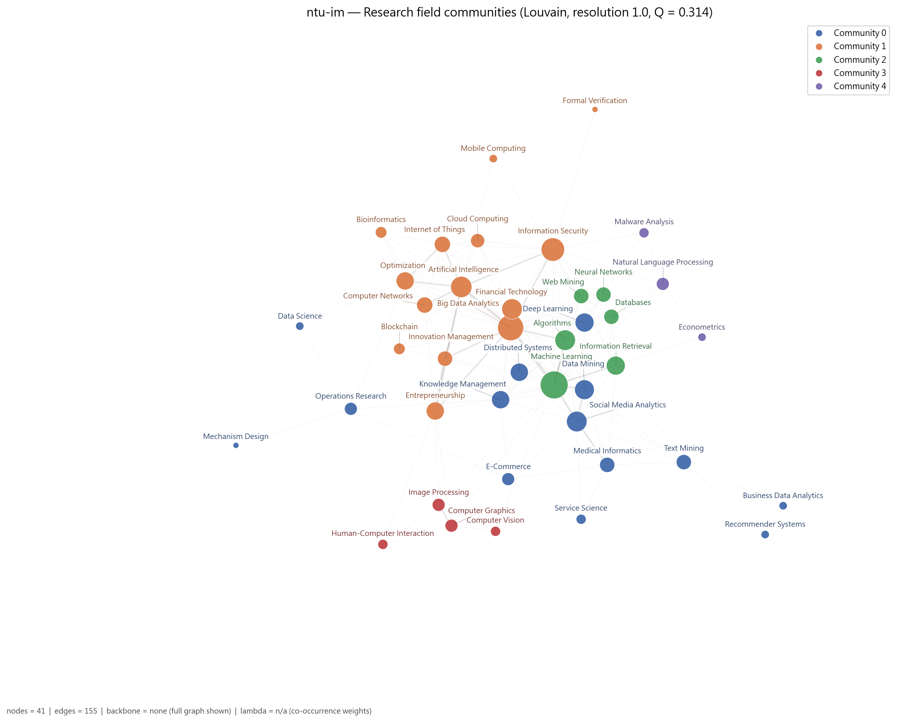

*圖：台灣大學資訊管理學系 研究領域網路的 Louvain 社群*  
*出處：`analysis/network-analysis/ntu-im/figures/05_keyword_network_communities.png`*  
*建構方式：研究領域網路是二分網路的單邊投影：兩個領域若被同一位教授研究就相連，邊權為共同研究兩領域的教授人數。社群以 Louvain（seed = 42，resolution 1.0）偵測，指標以完整加權圖計算。節點顏色為社群，大小與 degree 成正比。*

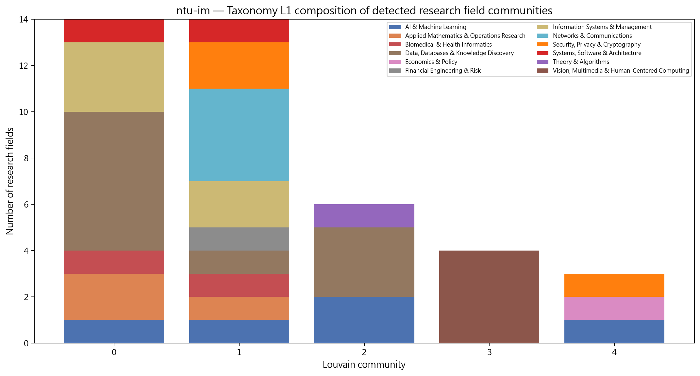

*圖：台灣大學資訊管理學系 各研究領域社群的 taxonomy L1 組成*  
*出處：`analysis/network-analysis/ntu-im/figures/14_community_composition.png`*  
*建構方式：把每個 Louvain 領域社群內的領域依 taxonomy L1 分類計數，堆疊長條圖。用來檢查資料驅動的社群是否對應人工分類。*

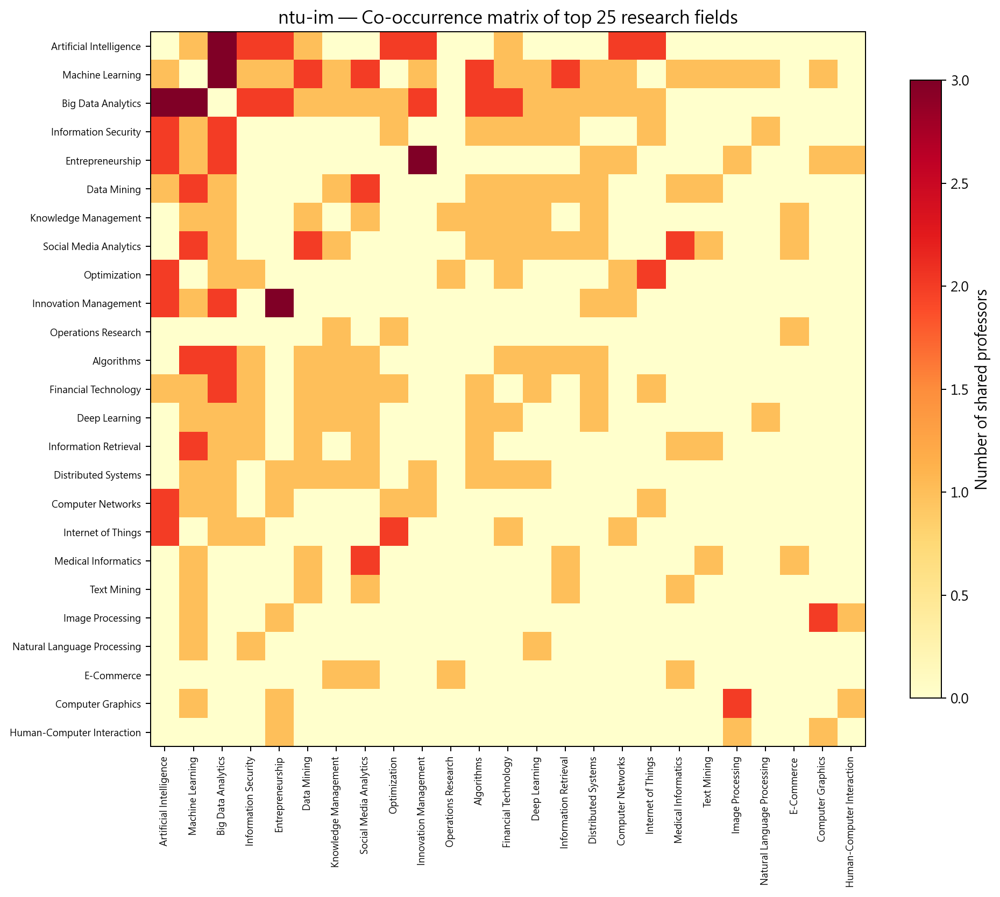

*圖：台灣大學資訊管理學系 研究領域共現熱圖*  
*出處：`analysis/network-analysis/ntu-im/figures/13_keyword_cooccurrence_heatmap.png`*  
*建構方式：取研究領域網路的加權鄰接矩陣（共同研究兩領域的教授人數），依社群排序後繪製熱圖。*

## 3. 主要研究集群與重要老師

教授網路分成 4 個集群：資料探勘與商業分析、創新創業與資訊管理、AI 與資安網路、知識管理與作業研究。Machine Learning（0.39）、Big Data Analytics（0.35）、Artificial Intelligence（0.24）三個領域的 betweenness 最高，是把技術面與管理面連起來的橋。

教授網路共 26 位教授、4 個集群（Louvain，Q = 0.248）。以下依集群人數排序；集群編號與圖中的 Community 編號一致。表中 Degree 為與該教授共享研究領域的同儕數，Betweenness 為該教授位於他人最短路徑上的比例（越高越像橋梁）。

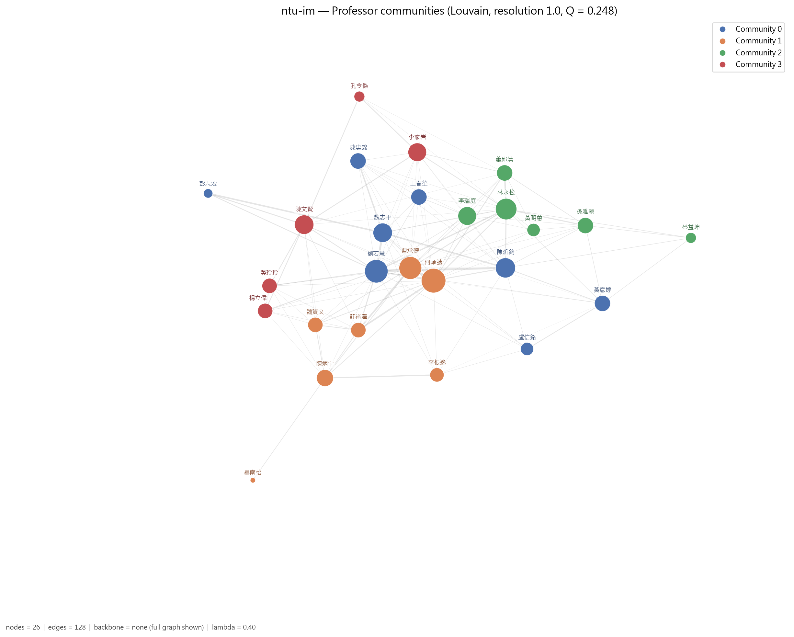

*圖：台灣大學資訊管理學系 教授網路的 Louvain 集群*  
*出處：`analysis/network-analysis/ntu-im/figures/09_professor_network_communities.png`*  
*建構方式：教授網路是二分網路的另一邊投影：兩位教授共享研究領域就相連，邊權 w = S_exp + λ·S_inf；S_exp 為共享領域的 IDF 加權和（IDF 以全體 662 位教授計算一次），S_inf 為共享 taxonomy 上層分類的推論相似度，λ = 0.4。社群以 Louvain（seed = 42，resolution 1.0）偵測，節點大小與 degree 成正比。*

### 3.1 集群 0：資料探勘與商業分析集群（8 人）

- **成員共同研究領域**：Machine Learning（4 人）、Data Mining（3 人）、Social Media Analytics（3 人）、Algorithms（2 人）、Big Data Analytics（2 人）、Deep Learning（2 人）、Medical Informatics（2 人）
- **成員主導 taxonomy L1**：Data, Databases & Knowledge Discovery 5 人、AI & Machine Learning 2 人、Information Systems & Management 1 人

8 位成員，5 位主導 Data, Databases & Knowledge Discovery，共享 Machine Learning、Data Mining、Social Media Analytics、Big Data Analytics 與 Medical Informatics。劉若慧（講座教授）degree 19、betweenness 0.357 為全系最高，研究演算法、大數據、資料探勘、深度學習與分散式系統，也是 cs 組跨校 broker 前五名；陳炘鈞（講座教授，資訊檢索、資安）與魏志平（資料探勘、醫學資訊、社群媒體分析）是核心；黃意婷代表惡意程式分析與 NLP。

| 姓名 | 英文名 | 職稱類別 | Degree | Betweenness | 研究領域（最多列 5 項） |
| --- | --- | --- | --- | --- | --- |
| 劉若慧 | Olivia Liu Sheng | 主管／講座 | 19 | 0.357 | Algorithms、Big Data Analytics、Data Mining、Deep Learning、Distributed Systems |
| 陳炘鈞 | Hsin-Chun Chen | 主管／講座 | 14 | 0.097 | Algorithms、Big Data Analytics、Databases、Information Retrieval、Information Security |
| 魏志平 | Chih-Ping Wei | 專任 | 13 | 0.140 | Data Mining、Information Retrieval、Machine Learning、Medical Informatics、Social Media Analytics |
| 黃意婷 | Yi-Ting Huang | 專任 | 9 | 0.017 | Deep Learning、Information Security、Malware Analysis、Natural Language Processing |
| 王春笙 | Chun-Sheng Wang | 專任 | 9 | 0.000 | Data Mining |
| 陳建錦 | Chien Chin Chen | 專任 | 9 | 0.000 | Business Data Analytics、Recommender Systems、Text Mining |
| 盧信銘 | Hsin-Min Lu | — | 6 | 0.003 | Econometrics、Machine Learning、Natural Language Processing |
| 彭志宏 | Chih-Hung PENG | 專任 | 3 | 0.000 | E-Commerce、Medical Informatics、Service Science、Social Media Analytics |

### 3.2 集群 1：創新創業與資訊管理集群（7 人）

- **成員共同研究領域**：Entrepreneurship（5 人）、Innovation Management（3 人）、Artificial Intelligence（2 人）、Big Data Analytics（2 人）、Machine Learning（2 人）、Computer Graphics（2 人）、Image Processing（2 人）
- **成員主導 taxonomy L1**：Information Systems & Management 3 人、Vision, Multimedia & Human-Centered Computing 3 人、AI & Machine Learning 1 人

7 位成員，共享 Entrepreneurship（5 人）、Innovation Management、Artificial Intelligence 與 Big Data Analytics。何承遠 degree 21 為全系最高（AI、大數據、網路、創業、創新管理）；曹承礎（區塊鏈、創業）次之；陳炳宇（與資工合聘，電腦圖學、人機互動）betweenness 0.113，是此集群連到視覺領域的橋；莊裕澤代表分散式系統與創新管理。

| 姓名 | 英文名 | 職稱類別 | Degree | Betweenness | 研究領域（最多列 5 項） |
| --- | --- | --- | --- | --- | --- |
| 何承遠 | Cheng-Yuan Ho | 專任 | 21 | 0.192 | Artificial Intelligence、Big Data Analytics、Computer Networks、Entrepreneurship、Innovation Management |
| 曹承礎 | Seng-Cho Chou | 專任 | 18 | 0.042 | Artificial Intelligence、Big Data Analytics、Blockchain、Entrepreneurship、Innovation Management |
| 陳炳宇（2 個系所） | Bing-Yu Chen | 專任 | 10 | 0.113 | Computer Graphics、Entrepreneurship、Human-Computer Interaction、Image Processing |
| 莊裕澤 | Yuh-Jzer Joung | 專任 | 8 | 0.000 | Distributed Systems、Entrepreneurship、Innovation Management |
| 魏資文 | Tzu-Wen Wei | 兼任 | 8 | 0.000 | Entrepreneurship |
| 李根逸 | Ken-Yi Lee | 專任 | 7 | 0.007 | Computer Graphics、Computer Vision、Image Processing、Machine Learning |
| 畢南怡 | Nanyi Bi | 專任 | 1 | 0.000 | Human-Computer Interaction |

### 3.3 集群 2：人工智慧、資安與網路集群（6 人）

- **成員共同研究領域**：Artificial Intelligence（5 人）、Information Security（3 人）、Internet of Things（2 人）、Optimization（2 人）、Mobile Computing（1 人）、Data Mining（1 人）、Big Data Analytics（1 人）
- **成員主導 taxonomy L1**：AI & Machine Learning 3 人、Networks & Communications 2 人、Security, Privacy & Cryptography 1 人

6 位成員，共享 Artificial Intelligence（5 人）、Information Security、Internet of Things 與 Optimization。林永松 degree 16、betweenness 0.187（AI、大數據、雲端、金融科技、資安）是集群中心；李瑞庭（AI、資料探勘）、孫雅麗（資安、行動運算）、蕭邱漢（生物資訊、網路、物聯網、最佳化）是主要成員；黃明蕙為系主任。

| 姓名 | 英文名 | 職稱類別 | Degree | Betweenness | 研究領域（最多列 5 項） |
| --- | --- | --- | --- | --- | --- |
| 林永松 | Yeong-Sung Lin | 專任 | 16 | 0.187 | Artificial Intelligence、Big Data Analytics、Cloud Computing、Financial Technology、Information Security |
| 李瑞庭 | J. T. Lee | 專任 | 12 | 0.003 | Artificial Intelligence、Data Mining |
| 孫雅麗 | Yeali Sun | 專任 | 9 | 0.003 | Artificial Intelligence、Information Security、Mobile Computing |
| 蕭邱漢 | Chiu-Han Hsiao | 專任 | 9 | 0.000 | Artificial Intelligence、Bioinformatics、Computer Networks、Internet of Things、Optimization |
| 黃明蕙 | Ming-Hui Huang | 主管／講座 | 6 | 0.000 | Artificial Intelligence |
| 蔡益坤 | Yih-Kuen Tsay | 專任 | 4 | 0.000 | Formal Verification、Information Security |

### 3.4 集群 3：知識管理與作業研究集群（5 人）

- **成員共同研究領域**：Knowledge Management（3 人）、Operations Research（3 人）、Mechanism Design（1 人）、Data Science（1 人）、Optimization（1 人）、E-Commerce（1 人）
- **成員主導 taxonomy L1**：Information Systems & Management 3 人、Applied Mathematics & Operations Research 2 人

5 位成員，共享 Knowledge Management（3 人）與 Operations Research（3 人），另含 Mechanism Design、E-Commerce 與 Data Science。陳文賢（兼任，電子商務、知識管理、作業研究）degree 13 最高；李家岩（與成大資工合聘，資料科學、作業研究、最佳化）次之；吳玲玲、楊立偉專注知識管理；孔令傑代表機制設計與作業研究。

| 姓名 | 英文名 | 職稱類別 | Degree | Betweenness | 研究領域（最多列 5 項） |
| --- | --- | --- | --- | --- | --- |
| 陳文賢 | Wen-Hsien Chen | 兼任 | 13 | 0.073 | E-Commerce、Knowledge Management、Operations Research |
| 李家岩（2 個系所） | Chia-Yen Lee | 專任 | 12 | 0.020 | Data Science、Operations Research、Optimization |
| 吳玲玲 | Ling-Ling Wu | 專任 | 8 | 0.000 | Knowledge Management |
| 楊立偉 | Willie Li-wei Yang | 專任 | 8 | 0.000 | Knowledge Management |
| 孔令傑 | Ling-Chieh Kung | 專任 | 4 | 0.000 | Mechanism Design、Operations Research |

*集群表出處：`analysis/network-analysis/ntu-im/professor_communities.csv`（集群歸屬）、`professor_centrality.csv`（degree、betweenness、職稱類別）、`prof_keyword_network.graphml`（成員研究領域，用來統計集群的共同領域）*  
*建構方式：教授網路是二分網路的另一邊投影：兩位教授共享研究領域就相連，邊權 w = S_exp + λ·S_inf；S_exp 為共享領域的 IDF 加權和（IDF 以全體 662 位教授計算一次），S_inf 為共享 taxonomy 上層分類的推論相似度，λ = 0.4。社群以 Louvain（seed = 42，resolution 1.0）偵測，節點大小與 degree 成正比。 職稱類別為官網職稱的分類，一人可屬多類時取主要類別；「N 個系所」表示該教授也出現在其他系所名單。*

### 3.5 全系的橋接者與樞紐

Betweenness 最高的教授（跨集群的橋梁）：

| 姓名 | 英文名 | 職稱類別 | Degree | Betweenness | 主導 L1 |
| --- | --- | --- | --- | --- | --- |
| 劉若慧 | Olivia Liu Sheng | 主管／講座 | 19 | 0.357 | Data, Databases & Knowledge Discovery |
| 何承遠 | Cheng-Yuan Ho | 專任 | 21 | 0.192 | AI & Machine Learning |
| 林永松 | Yeong-Sung Lin | 專任 | 16 | 0.187 | Networks & Communications |
| 魏志平 | Chih-Ping Wei | 專任 | 13 | 0.140 | Data, Databases & Knowledge Discovery |
| 陳炳宇 | Bing-Yu Chen | 專任 | 10 | 0.113 | Vision, Multimedia & Human-Centered Computing |
| 陳炘鈞 | Hsin-Chun Chen | 主管／講座 | 14 | 0.097 | Data, Databases & Knowledge Discovery |

Degree 最高的教授（與最多同儕共享領域的樞紐）：

| 姓名 | 英文名 | 職稱類別 | Degree | Betweenness | 主導 L1 |
| --- | --- | --- | --- | --- | --- |
| 何承遠 | Cheng-Yuan Ho | 專任 | 21 | 0.192 | AI & Machine Learning |
| 劉若慧 | Olivia Liu Sheng | 主管／講座 | 19 | 0.357 | Data, Databases & Knowledge Discovery |
| 曹承礎 | Seng-Cho Chou | 專任 | 18 | 0.042 | Information Systems & Management |
| 林永松 | Yeong-Sung Lin | 專任 | 16 | 0.187 | Networks & Communications |
| 陳炘鈞 | Hsin-Chun Chen | 主管／講座 | 14 | 0.097 | Data, Databases & Knowledge Discovery |
| 魏志平 | Chih-Ping Wei | 專任 | 13 | 0.140 | Data, Databases & Knowledge Discovery |

*出處：`analysis/network-analysis/ntu-im/professor_centrality.csv`*

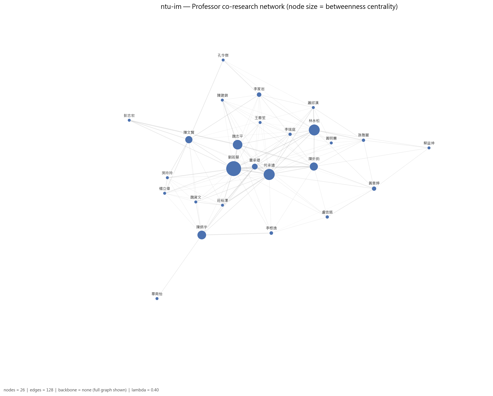

*圖：台灣大學資訊管理學系 教授網路（節點大小 = betweenness）*  
*出處：`analysis/network-analysis/ntu-im/figures/08_professor_network_betweenness.png`*  
*建構方式：教授網路是二分網路的另一邊投影：兩位教授共享研究領域就相連，邊權 w = S_exp + λ·S_inf；S_exp 為共享領域的 IDF 加權和（IDF 以全體 662 位教授計算一次），S_inf 為共享 taxonomy 上層分類的推論相似度，λ = 0.4。社群以 Louvain（seed = 42，resolution 1.0）偵測，節點大小與 degree 成正比。此圖節點大小改為與 betweenness 成正比。*

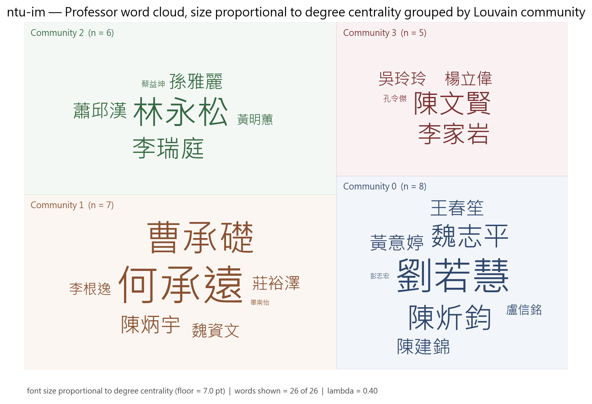

*圖：台灣大學資訊管理學系 各集群教授 word cloud（字級 = degree）*  
*出處：`analysis/network-analysis/ntu-im/figures/27_professor_wordcloud_degree_by_community.png`*  
*建構方式：依 Louvain 集群分塊、同集群同色的教授姓名 word cloud，字級與 degree 成線性正比並設下限。*

另有 4 位教授雖有研究領域，但與其他教授沒有共享任何領域，孤立於最大連通元件之外，不屬於任何集群。

## 4. 結構穩健性檢驗

### 4.1 虛無模型檢定

| 統計量 | 觀測值 | 虛無平均 | 虛無標準差 | z-score | empirical p | p < 0.05 |
| --- | --- | --- | --- | --- | --- | --- |
| 領域網路密度 | 0.1890 | 0.2081 | 0.0093 | -2.05 | 0.020 | 顯著 |
| 領域網路 modularity Q | 0.3250 | 0.3366 | 0.0335 | -0.35 | 0.741 | 不顯著 |
| 領域平均共現次數 | 1.1613 | 1.1056 | 0.0269 | 2.07 | 0.072 | 不顯著 |
| 教授網路 clustering 係數 | 0.6374 | 0.5725 | 0.0497 | 1.31 | 0.204 | 不顯著 |

*出處：`analysis/network-analysis/ntu-im/null_model_test.csv`*  
*建構方式：以保持二分結構與雙邊 degree 序列的 double edge swap（nswap = 10 × 邊數）產生 1,000 個隨機網路，比較觀測值與虛無分布，輸出 z-score 與雙尾 empirical p-value。 密度顯著偏低而 modularity、共現顯著偏高，代表領域共現集中在少數主題群，不是均勻分布。*

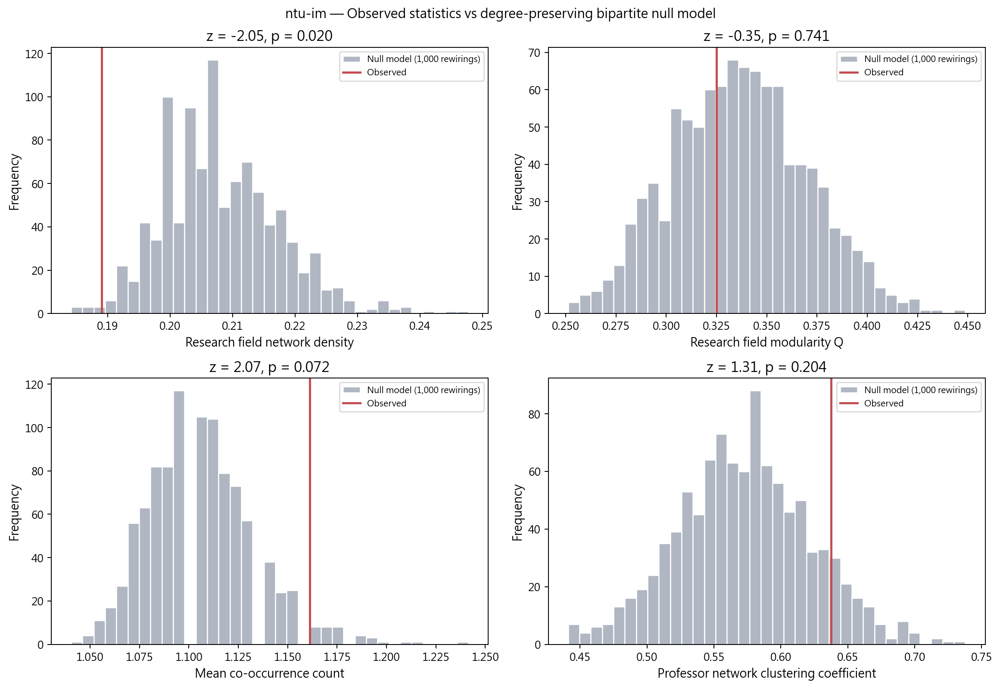

*圖：台灣大學資訊管理學系 觀測值 vs 虛無模型分布*  
*出處：`analysis/network-analysis/ntu-im/figures/15_null_model_comparison.png`*  
*建構方式：以保持二分結構與雙邊 degree 序列的 double edge swap（nswap = 10 × 邊數）產生 1,000 個隨機網路，比較觀測值與虛無分布，輸出 z-score 與雙尾 empirical p-value。*

### 4.2 λ 敏感度

| λ | 邊數 | 密度 | Q | 集群數 | 密度相對 baseline | Q 下降 | 過度合併 |
| --- | --- | --- | --- | --- | --- | --- | --- |
| 0.0 | 82 | 0.252 | 0.346 | 4 | +0% | 0.000 | 否 |
| 0.3 | 128 | 0.394 | 0.266 | 4 | +56% | 0.080 | 是 |
| 0.4 | 128 | 0.394 | 0.248 | 4 | +56% | 0.098 | 是 |
| 0.5 | 128 | 0.394 | 0.239 | 4 | +56% | 0.107 | 是 |

*出處：`analysis/network-analysis/ntu-im/lambda_sensitivity.csv`*  
*建構方式：以 λ ∈ {0, 0.3, 0.4, 0.5} 各建一次教授網路，λ = 0 為 baseline；密度較 baseline 增加超過 50% 或 Q 下降超過 0.1 即標記為過度合併。*

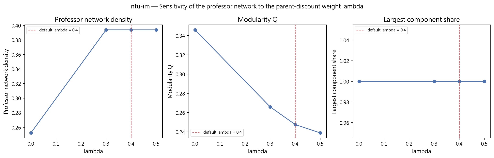

*圖：台灣大學資訊管理學系 λ 敏感度*  
*出處：`analysis/network-analysis/ntu-im/figures/16_lambda_sensitivity.png`*  
*建構方式：以 λ ∈ {0, 0.3, 0.4, 0.5} 各建一次教授網路，λ = 0 為 baseline；密度較 baseline 增加超過 50% 或 Q 下降超過 0.1 即標記為過度合併。*

### 4.3 taxonomy L1 覆蓋護欄

| taxonomy L1 | 教授數 | 覆蓋率 | flag |
| --- | --- | --- | --- |
| AI & Machine Learning | 13 | 50.0% | ok |
| Data, Databases & Knowledge Discovery | 11 | 42.3% | ok |
| Information Systems & Management | 10 | 38.5% | ok |
| Security, Privacy & Cryptography | 6 | 23.1% | ok |
| Applied Mathematics & Operations Research | 5 | 19.2% | ok |
| Networks & Communications | 4 | 15.4% | ok |
| Biomedical & Health Informatics | 3 | 11.5% | ok |
| Systems, Software & Architecture | 3 | 11.5% | ok |

*出處：`analysis/network-analysis/ntu-im/l1_coverage_guardrail.csv`（只列前 8 項）*  
*建構方式：計算每個 L1 分類涵蓋該單位多少比例的教授，超過 50% 標記 too_broad，代表此 L1 在本單位太寬，不能用來做 L1 roll-up 比較。*

## 5. 解讀與注意事項

- λ 在 0.3、0.4、0.5 都觸發過度合併護欄（密度由 0.252 增至 0.394、Q 降 0.08 至 0.11）。λ=0 的 baseline 同樣是 4 個社群，集群結論穩健，但集群之間的緊密度應以 baseline 為準。
- 有 4 位教授孤立於教授網路之外（最大連通元件涵蓋 86.7% 教授），另有 1 位因官網未填研究領域而排除。
- 研究領域網路密度顯著低於虛無模型（z = -2.1，p = 0.02），但 modularity 未顯著，代表領域共現集中，但沒有形成強模組。
- 沒有任何 L1 被標記為過寬；AI & Machine Learning 剛好涵蓋 50.0%，是護欄邊界。
- 研究領域網路有 5 個社群，其中「Computer Graphics／Image Processing／HCI」與「NLP／Malware Analysis／Econometrics」兩個小群分別來自陳炳宇與黃意婷等個別教授。
- 研究領域來自官網自填內容，粒度與深度因人而異；網路密度與集群數反映填寫習慣的成分不可忽視，完整率不可解讀為系所或教授的品質排名。

## 附錄：本報告引用的資料與圖表清單

| 檔案 | 產生階段 / 程式 | 建構方式摘要 |
| --- | --- | --- |
| `analysis/data-collection/ntu-im/quality-report.json` | 資料蒐集 `scripts/data-collection/collect.py` | 爬取官網後統計 canonical 紀錄人數、職稱分類、中英配對率與欄位完整率 |
| `analysis/descriptive-stats-after-preprocessing/coverage_by_school.csv` | 預處理 `1_faculty_data_preprocessing.ipynb` | 標準化後各欄位有 canonical 值的教師比例與平均項目數 |
| `.../group_comparison/research_fields/cs.csv`、`by_department/top_research_fields/ntu-im.png` | 預處理 `2_rf_and_phd_inst_comparison.ipynb` | 由 `scripts/data-preprocessing/2_rf_and_phd_inst_comparison.ipynb` 產生。研究領域為官網「主要研究領域」與「研究領域摘要」分別清洗、以雙語詞典標準化成英文 canonical 值後取聯集；計數為具有該領域的不重複教師人數，不做 Top-N 截斷。 |
| `.../group_comparison/phd_institutions/cs.csv`、`by_department/top_phd_institutions/ntu-im.png` | 同上 | 同一 notebook。學歷先被 `1_faculty_data_preprocessing.ipynb` 解析成「學位、科系、學校」三部分，取學位為博士的項目，學校名稱以別名表對應為英文 canonical 值；計數為不重複教師人數。 |
| `analysis/network-analysis/ntu-im/network_metrics.json` | 網路分析 `2_build_network_data.ipynb` + `3_network_analysis.ipynb` | 由 `2_build_network_data.ipynb` 從 `faculty_standardized.json` 建立教授–研究領域二分網路：教授與研究領域各為一類節點，教授的標準化研究領域包含某領域即連一條邊。研究領域網路是二分網路的單邊投影：兩個領域若被同一位教授研究就相連，邊權為共同研究兩領域的教授人數。社群以 Louvain（seed = 42，resolution 1.0）偵測，指標以完整加權圖計算。教授網路是二分網路的另一邊投影：兩位教授共享研究領域就相連，邊權 w = S_exp + λ·S_inf；S_exp 為共享領域的 IDF 加權和（IDF 以全體 662 位教授計算一次），S_inf 為共享 taxonomy 上層分類的推論相似度，λ = 0.4。社群以 Louvain（seed = 42，resolution 1.0）偵測，節點大小與 degree 成正比。 |
| `analysis/network-analysis/ntu-im/keyword_centrality.csv`、`keyword_communities.csv` | `3_network_analysis.ipynb` | 研究領域網路的中心性與 Louvain 社群；taxonomy 來自 `1_build_taxonomy.ipynb` |
| `analysis/network-analysis/ntu-im/professor_centrality.csv`、`professor_communities.csv`、`prof_keyword_network.graphml` | `3_network_analysis.ipynb` | 教授網路的中心性與 Louvain 集群；graphml 為二分網路，本報告用它統計各集群成員的共同領域 |
| `analysis/network-analysis/ntu-im/null_model_test.csv` | `3_network_analysis.ipynb` | 以保持二分結構與雙邊 degree 序列的 double edge swap（nswap = 10 × 邊數）產生 1,000 個隨機網路，比較觀測值與虛無分布，輸出 z-score 與雙尾 empirical p-value。 |
| `analysis/network-analysis/ntu-im/lambda_sensitivity.csv` | `3_network_analysis.ipynb` | 以 λ ∈ {0, 0.3, 0.4, 0.5} 各建一次教授網路，λ = 0 為 baseline；密度較 baseline 增加超過 50% 或 Q 下降超過 0.1 即標記為過度合併。 |
| `analysis/network-analysis/ntu-im/l1_coverage_guardrail.csv` | `3_network_analysis.ipynb` | 每個 L1 涵蓋教授比例，> 50% 標記 too_broad |
| `analysis/network-analysis/ntu-im/figures/01, 05, 08, 09, 10, 13, 14, 15, 16, 27` | `3_network_analysis.ipynb` | 網路圖節點大小與 degree 或 betweenness 成正比、顏色依社群；邊數 > 400 時繪圖用 disparity filter backbone；word cloud 字級與中心性成線性正比 |

更完整的方法說明見 `docs/data-collection-report.md`、`docs/data-preprocessing-report.md`、`docs/network-analysis-report.md`。
