# 陽明交通大學資訊管理與財務金融學系（`nycu-info-mag-fin`）研究結果總結報告

所屬分組：財金與經濟組（fin-and-econ）　｜　資料日期：2026-09-09 蒐集、2026-09-10 完成網路分析

> **本報告的資料來源**
> 本專案分三個階段：(1) 資料蒐集（`scripts/data-collection/`）從 14 個系所官網爬取師資的姓名、職稱、學歷與研究領域，中英文分開蒐集後配對；
> (2) 資料預處理（`scripts/data-preprocessing/`）把職稱、學歷、研究領域標準化成英文 canonical 值，並產生描述統計；
> (3) 網路分析（`scripts/network-analysis/current-version/`）建立「教授–研究領域」二分網路，投影成研究領域網路與教授網路，做社群偵測、中心性、虛無模型與敏感度分析。
> 本報告所有數字、表格與圖表都取自 `analysis/` 底下這三個階段的輸出，每張圖表下方都標明出處與建構方式，附錄另有完整清單。
> 「研究集群」指教授網路的 Louvain 社群；「重要老師」依教授在該網路中的 degree（與多少同儕共享領域）與 betweenness（是否位於集群之間的橋梁位置）判定，**不是**學術成就的排名。

## 1. 科系速覽

陽明交大資財系是 14 個系所中**唯一同時涵蓋財務金融與資訊技術**的單位：最多人研究的領域是 Financial Derivatives（6 人）、Corporate Finance、Financial Technology、Investments（各 5 人），但 Artificial Intelligence（4 人）與 Machine Learning（3 人）也進入前十名。官網列出 28 位教師，其中專任 15 位的中英文研究領域完整，但合聘與兼任名單多未填研究領域，整體完整率 67.9%，是 14 個系所中最低的，有 9 位未進入網路。Financial Technology 在研究領域網路中的 betweenness（0.41）最高，正是財務與資訊兩側的橋梁。

### 1.1 基本資料

| 項目 | 數值 |
| --- | --- |
| 官網師資人數（canonical 紀錄） | 28 |
| 職稱分類（一人可屬多類） | 教師（未細分） 12、兼任 10、專任 10、主管／講座 1、客座 1 |
| 中英文紀錄配對率 | 100.0% |
| 研究領域完整率（標準化後） | 67.9% |
| 學歷完整率（標準化後） | 100.0% |
| 每位教授平均研究領域數 | 2.82 |
| 進入網路分析的教授數 | 19（9 位因無研究領域排除） |

*出處：`analysis/data-collection/nycu-info-mag-fin/quality-report.json`（人數、職稱、配對率）、`analysis/descriptive-stats-after-preprocessing/coverage_by_school.csv`（完整率）、`analysis/network-analysis/nycu-info-mag-fin/network_metrics.json`（進入網路人數）*  
*建構方式：quality-report 由 `scripts/data-collection/collect.py` 在爬取官網後統計 canonical 紀錄的職稱分類與中英配對；coverage 由 `1_faculty_data_preprocessing.ipynb` 計算標準化後有 canonical 值的教師比例。*

### 1.2 主要研究領域

| 排名 | 研究領域（canonical） | 教授人數 |
| --- | --- | --- |
| 1 | Financial Derivatives | 6 |
| 2 | Corporate Finance | 5 |
| 3 | Financial Technology | 5 |
| 4 | Investments | 5 |
| 5 | Risk Management | 4 |
| 6 | Artificial Intelligence | 4 |
| 7 | Financial Engineering | 3 |
| 8 | Machine Learning | 3 |
| 9 | Credit Risk | 3 |
| 10 | Econometrics | 3 |
| 11 | Banking and Financial Institutions | 3 |
| 12 | Asset Pricing | 3 |
| 13 | Financial Management | 2 |
| 14 | International Finance | 2 |
| 15 | Multimedia Systems | 2 |

*出處：`analysis/descriptive-stats-after-preprocessing/group_comparison/research_fields/fin-and-econ.csv`（`nycu-info-mag-fin` 欄）*  
*建構方式：由 `scripts/data-preprocessing/2_rf_and_phd_inst_comparison.ipynb` 產生。研究領域為官網「主要研究領域」與「研究領域摘要」分別清洗、以雙語詞典標準化成英文 canonical 值後取聯集；計數為具有該領域的不重複教師人數，不做 Top-N 截斷。*

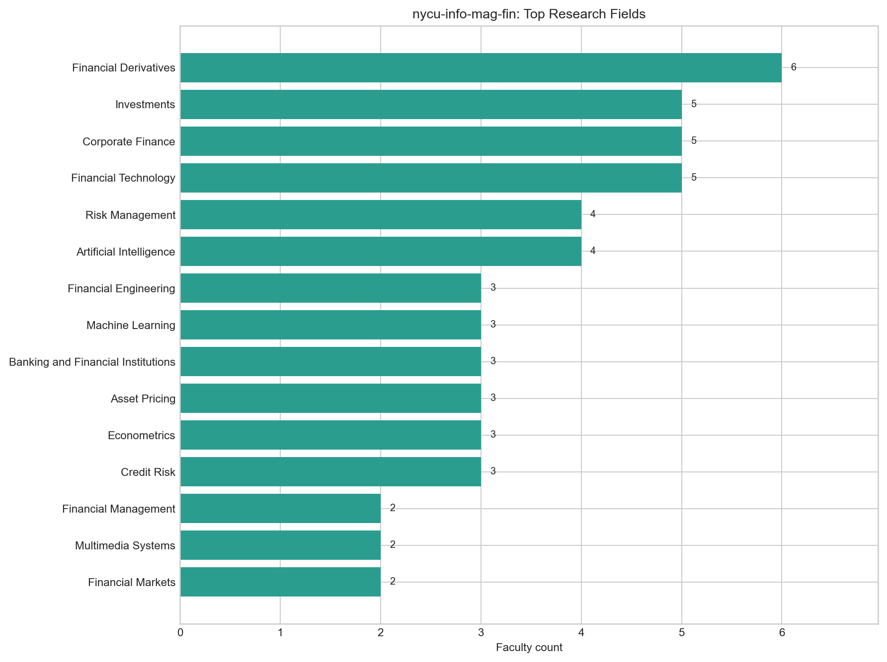

*圖：陽明交通大學資訊管理與財務金融學系 研究領域人數*  
*出處：`analysis/descriptive-stats-after-preprocessing/by_department/top_research_fields/nycu-info-mag-fin.png`*  
*建構方式：由 `scripts/data-preprocessing/2_rf_and_phd_inst_comparison.ipynb` 產生。研究領域為官網「主要研究領域」與「研究領域摘要」分別清洗、以雙語詞典標準化成英文 canonical 值後取聯集；計數為具有該領域的不重複教師人數，不做 Top-N 截斷。*

### 1.3 博士畢業學校

| 排名 | 博士畢業學校（canonical） | 教授人數 |
| --- | --- | --- |
| 1 | National Taiwan University | 8 |
| 2 | National Tsing Hua University | 2 |
| 3 | The Ohio State University | 1 |
| 4 | National Chengchi University | 1 |
| 5 | Pennsylvania State University | 1 |
| 6 | Rutgers University | 1 |
| 7 | University at Buffalo | 1 |
| 8 | Michigan State University | 1 |
| 9 | National Sun Yat-sen University | 1 |
| 10 | Stony Brook University | 1 |

*出處：`analysis/descriptive-stats-after-preprocessing/group_comparison/phd_institutions/fin-and-econ.csv`（`nycu-info-mag-fin` 欄）*  
*建構方式：同一 notebook。學歷先被 `1_faculty_data_preprocessing.ipynb` 解析成「學位、科系、學校」三部分，取學位為博士的項目，學校名稱以別名表對應為英文 canonical 值；計數為不重複教師人數。*

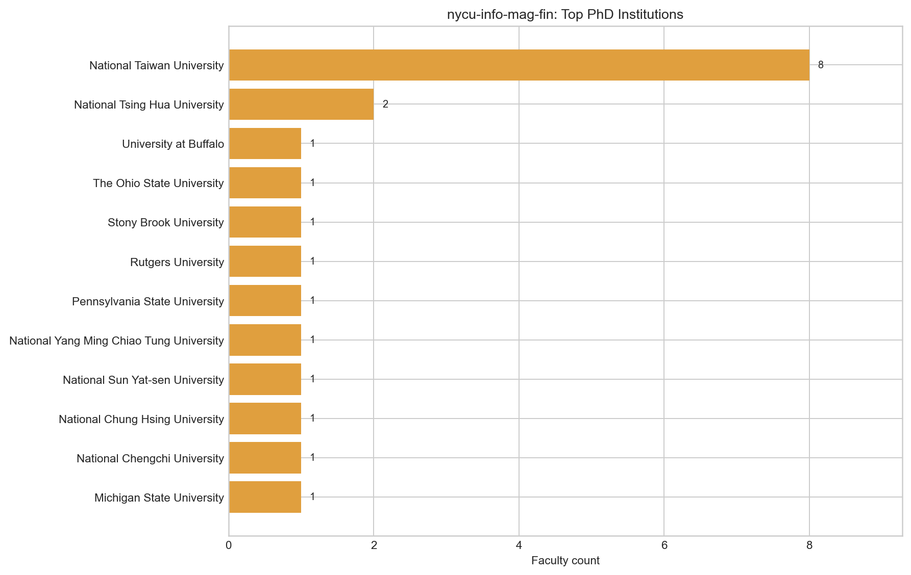

*圖：陽明交通大學資訊管理與財務金融學系 博士畢業學校人數*  
*出處：`analysis/descriptive-stats-after-preprocessing/by_department/top_phd_institutions/nycu-info-mag-fin.png`*  
*建構方式：同一 notebook。學歷先被 `1_faculty_data_preprocessing.ipynb` 解析成「學位、科系、學校」三部分，取學位為博士的項目，學校名稱以別名表對應為英文 canonical 值；計數為不重複教師人數。*

## 2. 研究領域網路結構

### 2.1 網路指標

| 指標 | 數值 | 說明 |
| --- | --- | --- |
| 二分網路：教授數 / 領域數 / 邊數 | 19 / 39 / 79 | 一條邊 = 一位教授研究一個領域 |
| 二分網路連通元件數 | 2 | 最大元件涵蓋 94.7% 教授 |
| 每位教授平均 / 最多領域數 | 4.16 / 9 |  |
| 研究領域網路：節點 / 邊 | 37 / 138 | 只含至少與一個其他領域共現的領域 |
| 研究領域網路密度 | 0.207 | 實際邊數 ÷ 可能邊數 |
| 研究領域網路平均 degree | 7.46 |  |
| 研究領域網路 modularity Q（Louvain） | 0.362 | 4 個社群；resolution 0.7 / 1.3 時為 2 / 5 個 |
| 領域社群 vs taxonomy L1 一致度 | NMI 0.502 / ARI 0.185 | 1 = 完全一致，0 = 無關 |
| 教授網路：節點 / 邊 | 18 / 85 | 只含最大連通元件 |
| 教授網路密度 | 0.556 |  |
| 教授網路 modularity Q（Louvain） | 0.140 | 4 個集群 |
| 教授集群 vs 主導 L1 一致度 | NMI 0.720 / ARI 0.522 |  |

*出處：`analysis/network-analysis/nycu-info-mag-fin/network_metrics.json`*  
*建構方式：由 `2_build_network_data.ipynb` 從 `faculty_standardized.json` 建立教授–研究領域二分網路：教授與研究領域各為一類節點，教授的標準化研究領域包含某領域即連一條邊。研究領域網路是二分網路的單邊投影：兩個領域若被同一位教授研究就相連，邊權為共同研究兩領域的教授人數。社群以 Louvain（seed = 42，resolution 1.0）偵測，指標以完整加權圖計算。教授網路是二分網路的另一邊投影：兩位教授共享研究領域就相連，邊權 w = S_exp + λ·S_inf；S_exp 為共享領域的 IDF 加權和（IDF 以全體 662 位教授計算一次），S_inf 為共享 taxonomy 上層分類的推論相似度，λ = 0.4。社群以 Louvain（seed = 42，resolution 1.0）偵測，節點大小與 degree 成正比。*

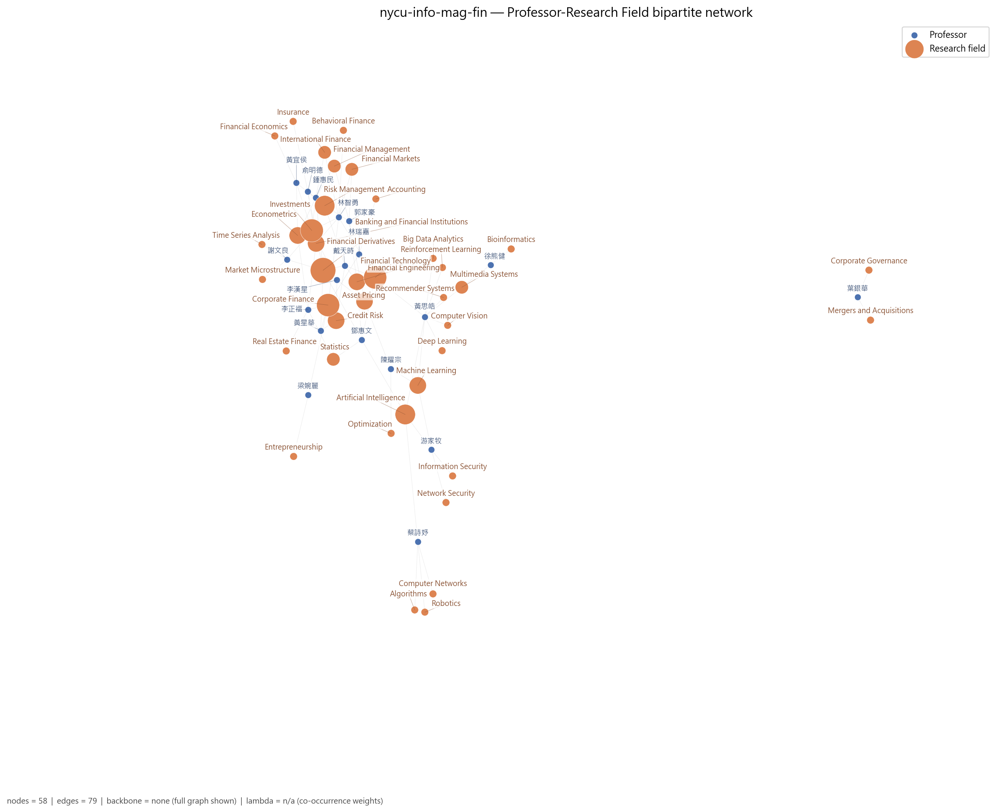

*圖：陽明交通大學資訊管理與財務金融學系 教授–研究領域二分網路*  
*出處：`analysis/network-analysis/nycu-info-mag-fin/figures/01_bipartite_network.png`*  
*建構方式：由 `2_build_network_data.ipynb` 從 `faculty_standardized.json` 建立教授–研究領域二分網路：教授與研究領域各為一類節點，教授的標準化研究領域包含某領域即連一條邊。圖中兩類節點以不同顏色區分，節點大小與 degree 成正比；邊數超過 400 時繪圖使用 disparity filter backbone（α = 0.05），指標仍以完整圖計算。*

### 2.2 關鍵研究領域

| 研究領域 | Degree | Degree centrality | Betweenness | PageRank | 教授數 | taxonomy L1 |
| --- | --- | --- | --- | --- | --- | --- |
| Financial Technology | 20 | 0.556 | 0.413 | 0.0699 | 5 | Financial Engineering & Risk |
| Artificial Intelligence | 16 | 0.444 | 0.265 | 0.0611 | 4 | AI & Machine Learning |
| Investments | 15 | 0.417 | 0.089 | 0.0531 | 5 | Asset Pricing & Financial Markets |
| Financial Derivatives | 15 | 0.417 | 0.200 | 0.0581 | 6 | Financial Engineering & Risk |
| Corporate Finance | 13 | 0.361 | 0.110 | 0.0475 | 5 | Corporate Finance & Governance |
| Machine Learning | 12 | 0.333 | 0.065 | 0.0443 | 3 | AI & Machine Learning |
| Banking and Financial Institutions | 12 | 0.333 | 0.015 | 0.0388 | 3 | Financial Engineering & Risk |
| Risk Management | 12 | 0.333 | 0.033 | 0.0412 | 4 | Financial Engineering & Risk |
| Financial Markets | 10 | 0.278 | 0.004 | 0.0299 | 2 | Asset Pricing & Financial Markets |
| Econometrics | 10 | 0.278 | 0.019 | 0.0335 | 3 | Economics & Policy |
| Multimedia Systems | 9 | 0.250 | 0.056 | 0.0326 | 2 | Vision, Multimedia & Human-Centered Computing |
| Financial Engineering | 9 | 0.250 | 0.036 | 0.0351 | 3 | Financial Engineering & Risk |

Betweenness 最高的五個領域：Financial Technology（0.41）、Artificial Intelligence（0.26）、Financial Derivatives（0.20）、Corporate Finance（0.11）、Investments（0.09）。Betweenness 高代表該領域位於不同主題群之間的連結位置，是系上跨主題的共同語言。

*出處：`analysis/network-analysis/nycu-info-mag-fin/keyword_centrality.csv`*  
*建構方式：研究領域網路是二分網路的單邊投影：兩個領域若被同一位教授研究就相連，邊權為共同研究兩領域的教授人數。社群以 Louvain（seed = 42，resolution 1.0）偵測，指標以完整加權圖計算。 degree 為相連領域數，betweenness 為經過該節點的最短路徑比例，PageRank 為加權隨機漫步的穩態機率；parent_l1 來自 `1_build_taxonomy.ipynb` 手工編定的三層 taxonomy（170 個 L3、46 個 L2、16 個 L1）。*

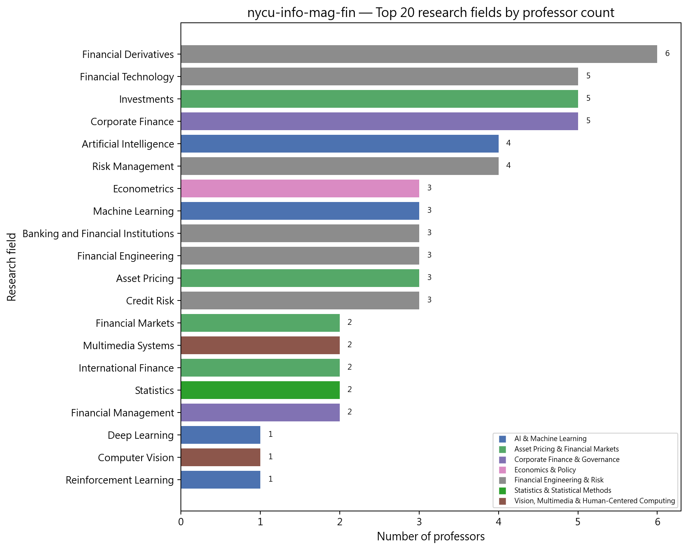

*圖：陽明交通大學資訊管理與財務金融學系 研究領域教授人數長條圖*  
*出處：`analysis/network-analysis/nycu-info-mag-fin/figures/10_top_keywords_bar.png`*  
*建構方式：以二分網路中每個領域節點的 degree（研究該領域的教授數）排序繪製。*

### 2.3 研究領域社群

| 社群 | 領域數 | 主要領域（教授人數） | 主要 taxonomy L1（領域數） |
| --- | --- | --- | --- |
| 0 | 12 | Investments（5）、Corporate Finance（5）、Banking and Financial Institutions（3）、Econometrics（3）、Financial Markets（2）、International Finance（2）、Statistics（2） | Asset Pricing & Financial Markets 6、Corporate Finance & Governance 2、Financial Engineering & Risk 1 |
| 1 | 12 | Financial Technology（5）、Artificial Intelligence（4）、Machine Learning（3）、Multimedia Systems（2）、Big Data Analytics（1）、Computer Vision（1）、Deep Learning（1） | AI & Machine Learning 4、Vision, Multimedia & Human-Centered Computing 2、Data, Databases & Knowledge Discovery 2 |
| 2 | 10 | Financial Derivatives（6）、Risk Management（4）、Financial Engineering（3）、Asset Pricing（3）、Credit Risk（3）、Financial Management（2）、Insurance（1） | Financial Engineering & Risk 5、Asset Pricing & Financial Markets 2、Corporate Finance & Governance 1 |
| 3 | 3 | Algorithms（1）、Computer Networks（1）、Robotics（1） | Theory & Algorithms 1、Networks & Communications 1、Robotics, Control & Smart Manufacturing 1 |

*出處：`analysis/network-analysis/nycu-info-mag-fin/keyword_communities.csv`（`community` 欄）、`keyword_centrality.csv`（教授人數）*  
*建構方式：研究領域網路是二分網路的單邊投影：兩個領域若被同一位教授研究就相連，邊權為共同研究兩領域的教授人數。社群以 Louvain（seed = 42，resolution 1.0）偵測，指標以完整加權圖計算。*

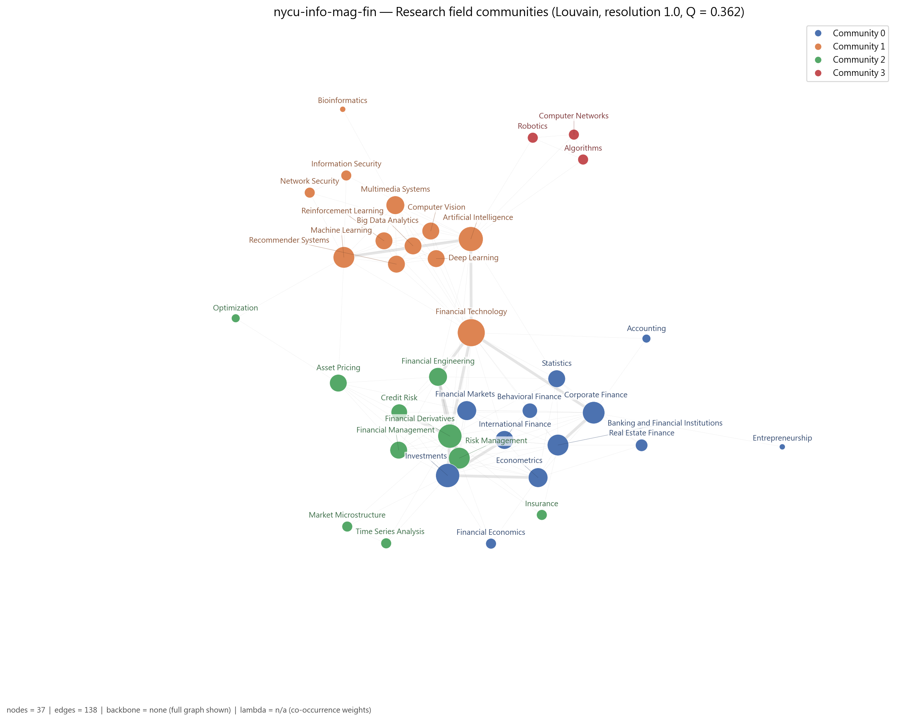

*圖：陽明交通大學資訊管理與財務金融學系 研究領域網路的 Louvain 社群*  
*出處：`analysis/network-analysis/nycu-info-mag-fin/figures/05_keyword_network_communities.png`*  
*建構方式：研究領域網路是二分網路的單邊投影：兩個領域若被同一位教授研究就相連，邊權為共同研究兩領域的教授人數。社群以 Louvain（seed = 42，resolution 1.0）偵測，指標以完整加權圖計算。節點顏色為社群，大小與 degree 成正比。*

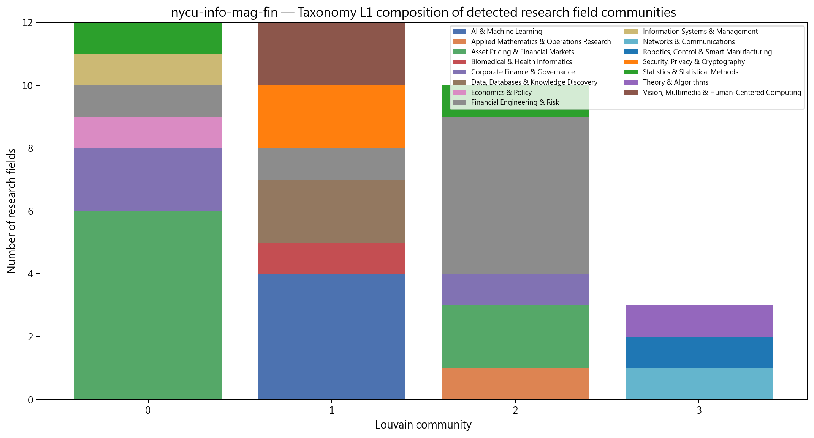

*圖：陽明交通大學資訊管理與財務金融學系 各研究領域社群的 taxonomy L1 組成*  
*出處：`analysis/network-analysis/nycu-info-mag-fin/figures/14_community_composition.png`*  
*建構方式：把每個 Louvain 領域社群內的領域依 taxonomy L1 分類計數，堆疊長條圖。用來檢查資料驅動的社群是否對應人工分類。*

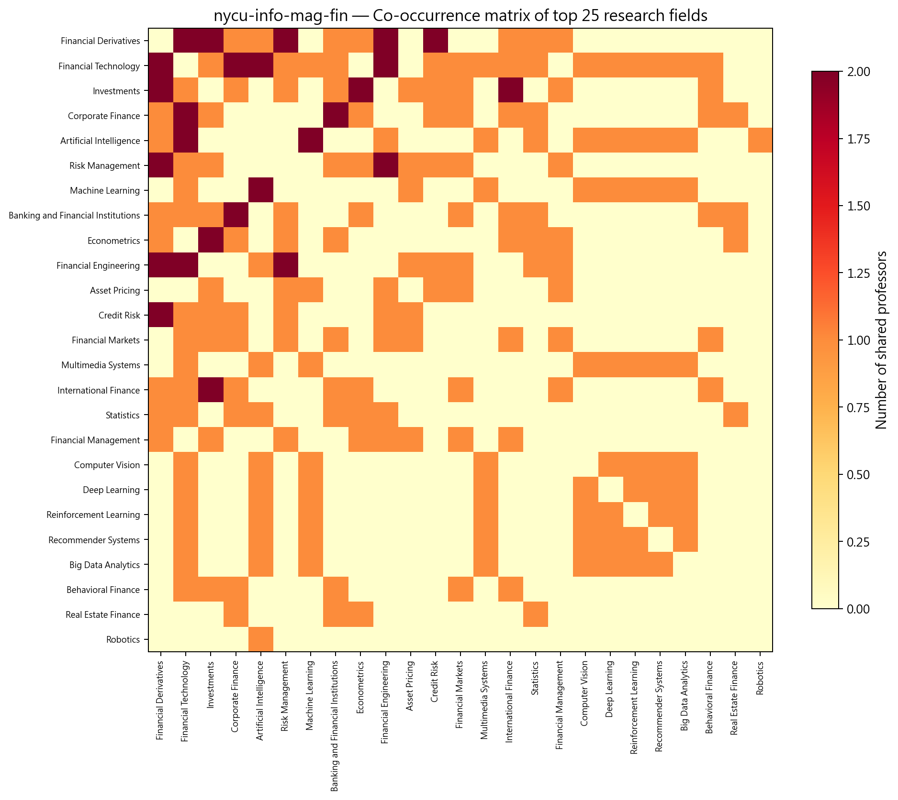

*圖：陽明交通大學資訊管理與財務金融學系 研究領域共現熱圖*  
*出處：`analysis/network-analysis/nycu-info-mag-fin/figures/13_keyword_cooccurrence_heatmap.png`*  
*建構方式：取研究領域網路的加權鄰接矩陣（共同研究兩領域的教授人數），依社群排序後繪製熱圖。*

## 3. 主要研究集群與重要老師

教授網路分成 4 個集群：投資與資產訂價、金融工程與金融科技、公司理財與銀行，以及一個純資訊技術的 AI 集群。資訊集群與財務集群之間主要靠 Financial Technology 與 Artificial Intelligence 兩個領域相連。

教授網路共 18 位教授、4 個集群（Louvain，Q = 0.140）。以下依集群人數排序；集群編號與圖中的 Community 編號一致。表中 Degree 為與該教授共享研究領域的同儕數，Betweenness 為該教授位於他人最短路徑上的比例（越高越像橋梁）。

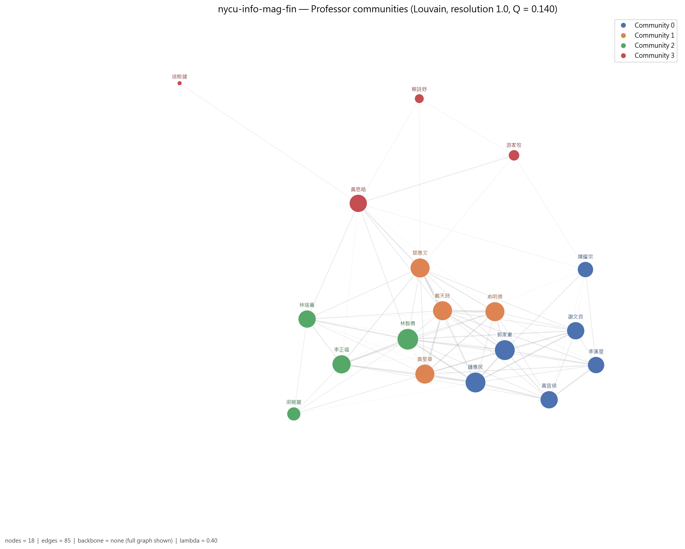

*圖：陽明交通大學資訊管理與財務金融學系 教授網路的 Louvain 集群*  
*出處：`analysis/network-analysis/nycu-info-mag-fin/figures/09_professor_network_communities.png`*  
*建構方式：教授網路是二分網路的另一邊投影：兩位教授共享研究領域就相連，邊權 w = S_exp + λ·S_inf；S_exp 為共享領域的 IDF 加權和（IDF 以全體 662 位教授計算一次），S_inf 為共享 taxonomy 上層分類的推論相似度，λ = 0.4。社群以 Louvain（seed = 42，resolution 1.0）偵測，節點大小與 degree 成正比。*

### 3.1 集群 0：投資與資產訂價集群（6 人）

- **成員共同研究領域**：Investments（4 人）、Asset Pricing（3 人）、Financial Derivatives（2 人）、Financial Management（2 人）、Risk Management（2 人）、Econometrics（2 人）、Credit Risk（1 人）
- **成員主導 taxonomy L1**：Asset Pricing & Financial Markets 5 人、AI & Machine Learning 1 人

6 位成員中 5 位主導 Asset Pricing & Financial Markets，共享 Investments、Asset Pricing、Financial Derivatives 與 Financial Management。鍾惠民與郭家豪 degree 並列最高（13），前者橫跨計量、衍生性商品、國際金融與投資，後者橫跨資產訂價、金融工程與風險；謝文良與黃宜侯專注投資與市場。

| 姓名 | 英文名 | 職稱類別 | Degree | Betweenness | 研究領域（最多列 5 項） |
| --- | --- | --- | --- | --- | --- |
| 鍾惠民 | Huimin Chung | 教師（未細分） | 13 | 0.074 | Econometrics、Financial Derivatives、Financial Management、International Finance、Investments |
| 郭家豪 | Jia-hau Guo | 專任 | 13 | 0.066 | Asset Pricing、Financial Engineering、Financial Management、Financial Markets、Risk Management |
| 謝文良 | Wen-Liang Hsieh | 教師（未細分） | 10 | 0.000 | Financial Derivatives、Investments、Market Microstructure、Time Series Analysis |
| 黃宜侯 | Alex YiHou Huang | 教師（未細分） | 10 | 0.000 | Econometrics、Financial Economics、Investments、Risk Management |
| 李漢星 | Han-Hsing Lee | 教師（未細分） | 9 | 0.015 | Asset Pricing、Credit Risk、Investments |
| 陳耀宗 | Yao-Tsung Chen | 專任 | 8 | 0.000 | Asset Pricing、Machine Learning、Optimization |

### 3.2 集群 1：金融工程與金融科技集群（4 人）

- **成員共同研究領域**：Financial Derivatives（4 人）、Risk Management（2 人）、Credit Risk（2 人）、Financial Engineering（2 人）、Financial Technology（2 人）、Banking and Financial Institutions（1 人）、Insurance（1 人）
- **成員主導 taxonomy L1**：Financial Engineering & Risk 4 人

4 位成員全部主導 Financial Engineering & Risk，共享 Financial Derivatives、Credit Risk、Financial Engineering 與 Financial Technology。鄧惠文（betweenness 0.221）與戴天時（0.199）是這個集群連向 AI 集群的兩座橋，兩人都同時標記金融科技與衍生性商品；俞明德為系主任，同時也是清大計財系的合聘教授。

| 姓名 | 英文名 | 職稱類別 | Degree | Betweenness | 研究領域（最多列 5 項） |
| --- | --- | --- | --- | --- | --- |
| 鄧惠文 | Huei-Wen Teng | 教師（未細分） | 12 | 0.221 | Artificial Intelligence、Financial Derivatives、Financial Engineering、Financial Technology、Statistics |
| 戴天時 | Tian-Shyr Dai | 教師（未細分） | 12 | 0.199 | Credit Risk、Financial Derivatives、Financial Engineering、Financial Technology、Risk Management |
| 黃星華 | Hsing-Hua Huang | 專任 | 12 | 0.037 | Corporate Finance、Credit Risk、Financial Derivatives |
| 俞明德（2 個系所） | Min-Teh Yu | 主管／講座 | 12 | 0.000 | Banking and Financial Institutions、Financial Derivatives、Insurance、Risk Management |

### 3.3 集群 2：公司理財與銀行集群（4 人）

- **成員共同研究領域**：Corporate Finance（4 人）、Banking and Financial Institutions（2 人）、Financial Technology（2 人）、Econometrics（1 人）、Real Estate Finance（1 人）、Statistics（1 人）、Behavioral Finance（1 人）
- **成員主導 taxonomy L1**：Asset Pricing & Financial Markets 2 人、Corporate Finance & Governance 2 人

共享 Corporate Finance（4 人）、Banking and Financial Institutions 與 Financial Technology。林智勇 degree 為全系最高（14），研究橫跨銀行、行為財務、公司理財與金融科技，也是組層級跨校 broker 的前五名；李正福為客座教授，帶入不動產金融與統計。

| 姓名 | 英文名 | 職稱類別 | Degree | Betweenness | 研究領域（最多列 5 項） |
| --- | --- | --- | --- | --- | --- |
| 林智勇 | Chih-Yung Lin | 教師（未細分） | 14 | 0.180 | Banking and Financial Institutions、Behavioral Finance、Corporate Finance、Financial Markets、Financial Technology |
| 李正福 | Cheng-Few Lee | 客座 | 11 | 0.000 | Banking and Financial Institutions、Corporate Finance、Econometrics、Real Estate Finance、Statistics |
| 林瑞嘉 | Jui-Chia Lin | 教師（未細分） | 10 | 0.011 | Accounting、Corporate Finance、Financial Technology |
| 梁婉麗 | Woan-lih Liang | 教師（未細分） | 6 | 0.000 | Corporate Finance、Entrepreneurship |

### 3.4 集群 3：人工智慧與資訊技術集群（4 人）

- **成員共同研究領域**：Artificial Intelligence（3 人）、Multimedia Systems（2 人）、Machine Learning（2 人）、Bioinformatics（1 人）、Information Security（1 人）、Network Security（1 人）、Algorithms（1 人）
- **成員主導 taxonomy L1**：AI & Machine Learning 3 人、Biomedical & Health Informatics 1 人

4 位成員，共享 Artificial Intelligence、Machine Learning 與 Multimedia Systems，主導 taxonomy 為 AI & Machine Learning。黃思皓（AI、大數據、電腦視覺、深度學習、金融科技）betweenness 0.224 為全系最高，是資訊側連到財務側的關鍵人物；游家牧為合聘教授，研究資安與網路安全；蔡詩妤研究演算法與機器人。

| 姓名 | 英文名 | 職稱類別 | Degree | Betweenness | 研究領域（最多列 5 項） |
| --- | --- | --- | --- | --- | --- |
| 黃思皓 | Szu-Hao Huang | 教師（未細分） | 10 | 0.224 | Artificial Intelligence、Big Data Analytics、Computer Vision、Deep Learning、Financial Technology |
| 游家牧（2 個系所） | Chia-Mu Yu | 教師（未細分） | 4 | 0.004 | Artificial Intelligence、Information Security、Machine Learning、Network Security |
| 蔡詩妤 | Shih-Yu Tsai | 專任 | 3 | 0.000 | Algorithms、Artificial Intelligence、Computer Networks、Robotics |
| 徐熊健 | Shyong Jian Shyu | 兼任 | 1 | 0.000 | Bioinformatics、Multimedia Systems |

*集群表出處：`analysis/network-analysis/nycu-info-mag-fin/professor_communities.csv`（集群歸屬）、`professor_centrality.csv`（degree、betweenness、職稱類別）、`prof_keyword_network.graphml`（成員研究領域，用來統計集群的共同領域）*  
*建構方式：教授網路是二分網路的另一邊投影：兩位教授共享研究領域就相連，邊權 w = S_exp + λ·S_inf；S_exp 為共享領域的 IDF 加權和（IDF 以全體 662 位教授計算一次），S_inf 為共享 taxonomy 上層分類的推論相似度，λ = 0.4。社群以 Louvain（seed = 42，resolution 1.0）偵測，節點大小與 degree 成正比。 職稱類別為官網職稱的分類，一人可屬多類時取主要類別；「N 個系所」表示該教授也出現在其他系所名單。*

### 3.5 全系的橋接者與樞紐

Betweenness 最高的教授（跨集群的橋梁）：

| 姓名 | 英文名 | 職稱類別 | Degree | Betweenness | 主導 L1 |
| --- | --- | --- | --- | --- | --- |
| 黃思皓 | Szu-Hao Huang | 教師（未細分） | 10 | 0.224 | AI & Machine Learning |
| 鄧惠文 | Huei-Wen Teng | 教師（未細分） | 12 | 0.221 | Financial Engineering & Risk |
| 戴天時 | Tian-Shyr Dai | 教師（未細分） | 12 | 0.199 | Financial Engineering & Risk |
| 林智勇 | Chih-Yung Lin | 教師（未細分） | 14 | 0.180 | Asset Pricing & Financial Markets |
| 鍾惠民 | Huimin Chung | 教師（未細分） | 13 | 0.074 | Asset Pricing & Financial Markets |
| 郭家豪 | Jia-hau Guo | 專任 | 13 | 0.066 | Asset Pricing & Financial Markets |

Degree 最高的教授（與最多同儕共享領域的樞紐）：

| 姓名 | 英文名 | 職稱類別 | Degree | Betweenness | 主導 L1 |
| --- | --- | --- | --- | --- | --- |
| 林智勇 | Chih-Yung Lin | 教師（未細分） | 14 | 0.180 | Asset Pricing & Financial Markets |
| 郭家豪 | Jia-hau Guo | 專任 | 13 | 0.066 | Asset Pricing & Financial Markets |
| 鍾惠民 | Huimin Chung | 教師（未細分） | 13 | 0.074 | Asset Pricing & Financial Markets |
| 俞明德 | Min-Teh Yu | 主管／講座 | 12 | 0.000 | Financial Engineering & Risk |
| 鄧惠文 | Huei-Wen Teng | 教師（未細分） | 12 | 0.221 | Financial Engineering & Risk |
| 黃星華 | Hsing-Hua Huang | 專任 | 12 | 0.037 | Financial Engineering & Risk |

*出處：`analysis/network-analysis/nycu-info-mag-fin/professor_centrality.csv`*

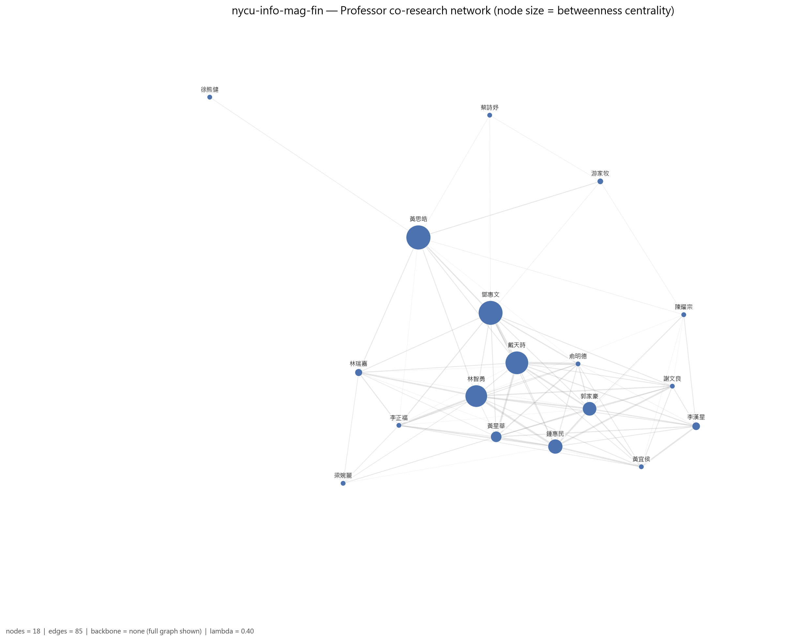

*圖：陽明交通大學資訊管理與財務金融學系 教授網路（節點大小 = betweenness）*  
*出處：`analysis/network-analysis/nycu-info-mag-fin/figures/08_professor_network_betweenness.png`*  
*建構方式：教授網路是二分網路的另一邊投影：兩位教授共享研究領域就相連，邊權 w = S_exp + λ·S_inf；S_exp 為共享領域的 IDF 加權和（IDF 以全體 662 位教授計算一次），S_inf 為共享 taxonomy 上層分類的推論相似度，λ = 0.4。社群以 Louvain（seed = 42，resolution 1.0）偵測，節點大小與 degree 成正比。此圖節點大小改為與 betweenness 成正比。*

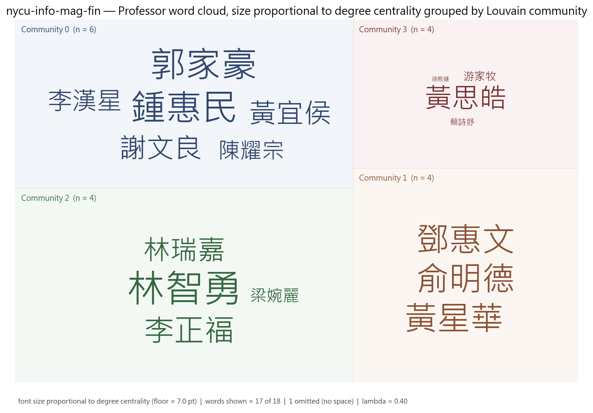

*圖：陽明交通大學資訊管理與財務金融學系 各集群教授 word cloud（字級 = degree）*  
*出處：`analysis/network-analysis/nycu-info-mag-fin/figures/27_professor_wordcloud_degree_by_community.png`*  
*建構方式：依 Louvain 集群分塊、同集群同色的教授姓名 word cloud，字級與 degree 成線性正比並設下限。*

另有 1 位教授雖有研究領域，但與其他教授沒有共享任何領域，孤立於最大連通元件之外，不屬於任何集群。

## 4. 結構穩健性檢驗

### 4.1 虛無模型檢定

| 統計量 | 觀測值 | 虛無平均 | 虛無標準差 | z-score | empirical p | p < 0.05 |
| --- | --- | --- | --- | --- | --- | --- |
| 領域網路密度 | 0.2072 | 0.2039 | 0.0049 | 0.67 | 0.665 | 不顯著 |
| 領域網路 modularity Q | 0.3624 | 0.3358 | 0.0344 | 0.77 | 0.430 | 不顯著 |
| 領域平均共現次數 | 1.0942 | 1.1124 | 0.0270 | -0.67 | 0.665 | 不顯著 |
| 教授網路 clustering 係數 | 0.6517 | 0.6319 | 0.0440 | 0.45 | 0.635 | 不顯著 |

*出處：`analysis/network-analysis/nycu-info-mag-fin/null_model_test.csv`*  
*建構方式：以保持二分結構與雙邊 degree 序列的 double edge swap（nswap = 10 × 邊數）產生 1,000 個隨機網路，比較觀測值與虛無分布，輸出 z-score 與雙尾 empirical p-value。 密度顯著偏低而 modularity、共現顯著偏高，代表領域共現集中在少數主題群，不是均勻分布。*

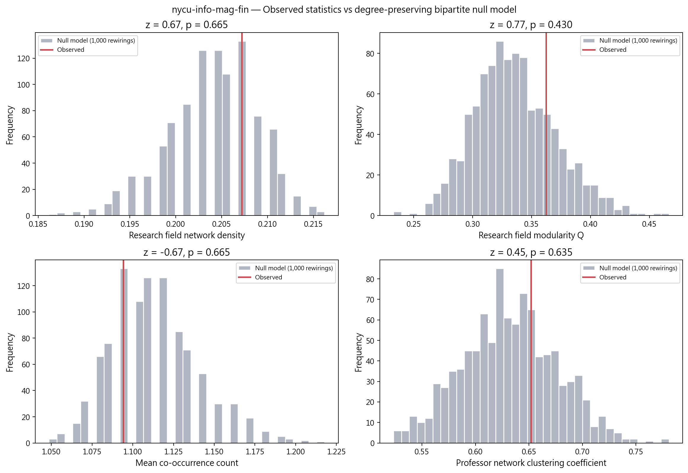

*圖：陽明交通大學資訊管理與財務金融學系 觀測值 vs 虛無模型分布*  
*出處：`analysis/network-analysis/nycu-info-mag-fin/figures/15_null_model_comparison.png`*  
*建構方式：以保持二分結構與雙邊 degree 序列的 double edge swap（nswap = 10 × 邊數）產生 1,000 個隨機網路，比較觀測值與虛無分布，輸出 z-score 與雙尾 empirical p-value。*

### 4.2 λ 敏感度

| λ | 邊數 | 密度 | Q | 集群數 | 密度相對 baseline | Q 下降 | 過度合併 |
| --- | --- | --- | --- | --- | --- | --- | --- |
| 0.0 | 68 | 0.444 | 0.150 | 4 | +0% | 0.000 | 否 |
| 0.3 | 85 | 0.556 | 0.142 | 4 | +25% | 0.008 | 否 |
| 0.4 | 85 | 0.556 | 0.140 | 4 | +25% | 0.010 | 否 |
| 0.5 | 85 | 0.556 | 0.138 | 4 | +25% | 0.012 | 否 |

*出處：`analysis/network-analysis/nycu-info-mag-fin/lambda_sensitivity.csv`*  
*建構方式：以 λ ∈ {0, 0.3, 0.4, 0.5} 各建一次教授網路，λ = 0 為 baseline；密度較 baseline 增加超過 50% 或 Q 下降超過 0.1 即標記為過度合併。*

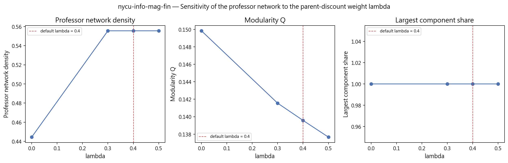

*圖：陽明交通大學資訊管理與財務金融學系 λ 敏感度*  
*出處：`analysis/network-analysis/nycu-info-mag-fin/figures/16_lambda_sensitivity.png`*  
*建構方式：以 λ ∈ {0, 0.3, 0.4, 0.5} 各建一次教授網路，λ = 0 為 baseline；密度較 baseline 增加超過 50% 或 Q 下降超過 0.1 即標記為過度合併。*

### 4.3 taxonomy L1 覆蓋護欄

| taxonomy L1 | 教授數 | 覆蓋率 | flag |
| --- | --- | --- | --- |
| Financial Engineering & Risk | 13 | 72.2% | too_broad |
| Asset Pricing & Financial Markets | 8 | 44.4% | ok |
| Corporate Finance & Governance | 7 | 38.9% | ok |
| AI & Machine Learning | 5 | 27.8% | ok |
| Economics & Policy | 3 | 16.7% | ok |
| Statistics & Statistical Methods | 3 | 16.7% | ok |
| Vision, Multimedia & Human-Centered Computing | 2 | 11.1% | ok |
| Applied Mathematics & Operations Research | 1 | 5.6% | ok |

*出處：`analysis/network-analysis/nycu-info-mag-fin/l1_coverage_guardrail.csv`（只列前 8 項）*  
*建構方式：計算每個 L1 分類涵蓋該單位多少比例的教授，超過 50% 標記 too_broad，代表此 L1 在本單位太寬，不能用來做 L1 roll-up 比較。*

## 5. 解讀與注意事項

- 完整率 67.9% 是 14 個系所中最低，缺漏集中在合聘與兼任名單。網路只反映 19 位有研究領域的教授，不是全系 28 人。
- L1 護欄標記 Financial Engineering & Risk 涵蓋超過 50% 教授。
- λ 敏感度未觸發過度合併，λ=0 與 λ=0.4 的社群數都是 4，集群結論穩健。
- 虛無模型四個統計量都不顯著，以 37 個領域、19 位教授的規模，領域共現與隨機差異不大；集群劃分應視為描述性結果。
- 研究領域網路的第 4 個社群只有 Algorithms、Computer Networks、Robotics 三個領域（來自蔡詩妤一人），屬個別教授的特殊主題。
- 博士畢業學校以台大最多（8 人），清大次之（2 人）。
- 研究領域來自官網自填內容，粒度與深度因人而異；網路密度與集群數反映填寫習慣的成分不可忽視，完整率不可解讀為系所或教授的品質排名。

## 附錄：本報告引用的資料與圖表清單

| 檔案 | 產生階段 / 程式 | 建構方式摘要 |
| --- | --- | --- |
| `analysis/data-collection/nycu-info-mag-fin/quality-report.json` | 資料蒐集 `scripts/data-collection/collect.py` | 爬取官網後統計 canonical 紀錄人數、職稱分類、中英配對率與欄位完整率 |
| `analysis/descriptive-stats-after-preprocessing/coverage_by_school.csv` | 預處理 `1_faculty_data_preprocessing.ipynb` | 標準化後各欄位有 canonical 值的教師比例與平均項目數 |
| `.../group_comparison/research_fields/fin-and-econ.csv`、`by_department/top_research_fields/nycu-info-mag-fin.png` | 預處理 `2_rf_and_phd_inst_comparison.ipynb` | 由 `scripts/data-preprocessing/2_rf_and_phd_inst_comparison.ipynb` 產生。研究領域為官網「主要研究領域」與「研究領域摘要」分別清洗、以雙語詞典標準化成英文 canonical 值後取聯集；計數為具有該領域的不重複教師人數，不做 Top-N 截斷。 |
| `.../group_comparison/phd_institutions/fin-and-econ.csv`、`by_department/top_phd_institutions/nycu-info-mag-fin.png` | 同上 | 同一 notebook。學歷先被 `1_faculty_data_preprocessing.ipynb` 解析成「學位、科系、學校」三部分，取學位為博士的項目，學校名稱以別名表對應為英文 canonical 值；計數為不重複教師人數。 |
| `analysis/network-analysis/nycu-info-mag-fin/network_metrics.json` | 網路分析 `2_build_network_data.ipynb` + `3_network_analysis.ipynb` | 由 `2_build_network_data.ipynb` 從 `faculty_standardized.json` 建立教授–研究領域二分網路：教授與研究領域各為一類節點，教授的標準化研究領域包含某領域即連一條邊。研究領域網路是二分網路的單邊投影：兩個領域若被同一位教授研究就相連，邊權為共同研究兩領域的教授人數。社群以 Louvain（seed = 42，resolution 1.0）偵測，指標以完整加權圖計算。教授網路是二分網路的另一邊投影：兩位教授共享研究領域就相連，邊權 w = S_exp + λ·S_inf；S_exp 為共享領域的 IDF 加權和（IDF 以全體 662 位教授計算一次），S_inf 為共享 taxonomy 上層分類的推論相似度，λ = 0.4。社群以 Louvain（seed = 42，resolution 1.0）偵測，節點大小與 degree 成正比。 |
| `analysis/network-analysis/nycu-info-mag-fin/keyword_centrality.csv`、`keyword_communities.csv` | `3_network_analysis.ipynb` | 研究領域網路的中心性與 Louvain 社群；taxonomy 來自 `1_build_taxonomy.ipynb` |
| `analysis/network-analysis/nycu-info-mag-fin/professor_centrality.csv`、`professor_communities.csv`、`prof_keyword_network.graphml` | `3_network_analysis.ipynb` | 教授網路的中心性與 Louvain 集群；graphml 為二分網路，本報告用它統計各集群成員的共同領域 |
| `analysis/network-analysis/nycu-info-mag-fin/null_model_test.csv` | `3_network_analysis.ipynb` | 以保持二分結構與雙邊 degree 序列的 double edge swap（nswap = 10 × 邊數）產生 1,000 個隨機網路，比較觀測值與虛無分布，輸出 z-score 與雙尾 empirical p-value。 |
| `analysis/network-analysis/nycu-info-mag-fin/lambda_sensitivity.csv` | `3_network_analysis.ipynb` | 以 λ ∈ {0, 0.3, 0.4, 0.5} 各建一次教授網路，λ = 0 為 baseline；密度較 baseline 增加超過 50% 或 Q 下降超過 0.1 即標記為過度合併。 |
| `analysis/network-analysis/nycu-info-mag-fin/l1_coverage_guardrail.csv` | `3_network_analysis.ipynb` | 每個 L1 涵蓋教授比例，> 50% 標記 too_broad |
| `analysis/network-analysis/nycu-info-mag-fin/figures/01, 05, 08, 09, 10, 13, 14, 15, 16, 27` | `3_network_analysis.ipynb` | 網路圖節點大小與 degree 或 betweenness 成正比、顏色依社群；邊數 > 400 時繪圖用 disparity filter backbone；word cloud 字級與中心性成線性正比 |

更完整的方法說明見 `docs/data-collection-report.md`、`docs/data-preprocessing-report.md`、`docs/network-analysis-report.md`。
