# 教授－研究領域 網路分析報告

產生時間：2026-09-10T09:39:25+08:00

## 研究問題

> **每個校系的教授研究哪些主題，以及教授和研究領域之間形成什麼樣的網路結構。**

在三個層級各回答一次：14 個系所、3 個組（`cs` / `ds` / `fin-and-econ`）、1 個全體，共 18 個分析單位。
組層級額外回答一個系所層級做不到的問題：**社群結構是被學校決定，還是被研究主題決定？**

## 主要發現

1. **結構不是隨機的。** 全體層級的領域網路 modularity Q = 0.383，相對 degree-preserving 虛無模型的 z = 36.0（empirical p = 0.002）；density 則顯著**低於**隨機（z = -20.3），代表研究領域的共現集中在少數幾個主題群，而不是均勻散布。
2. **社群由研究主題決定，不是由學校決定。** 4 個含多校的分析單位中，4 個的 Louvain 社群對 `parent_l1` 的 NMI 都高於對 `school_id` 的 NMI；school assortativity 全部接近 0（0.003 ~ 0.243）。
3. **偵測到的社群與人工 taxonomy 只是部分吻合。** 全體層級 NMI = 0.534、ARI = 0.276，代表資料驅動的主題群並不等同於事先編定的 L1 分類，taxonomy 只能當作對照基準，不能當作結論。
4. **結構差異不是資料完整度造成的。** coverage 與領域網路 density 的相關 r = -0.048，接近 0，因此系所之間的密度差異無法用覆蓋率高低解釋。
5. **λ 需要謹慎使用。** 25 個（單位 × λ）組合觸發過度合併護欄，集中在領域數少、本來就接近完全圖的財金系所；這些單位的結論應以 λ=0 的 baseline 為準。

## 分析範圍與方法

輸入為 `data/data-preprocessing/faculty_standardized.json`（741 筆紀錄），不重跑也不修改前段流程。有標準化研究領域者 662 筆、canonical 研究領域 170 個。

| 步驟 | 做法 |
| --- | --- |
| 研究領域階層 | 手工編定固定的三層 taxonomy：170 個 L3、46 個 L2、16 個 L1。parent **只作為節點屬性**，不注入為節點或邊 |
| 教授－教授邊權重 | `w(A,B) = S_exp + λ·S_inf`，IDF 以全體 662 筆計算一次跨單位共用，λ 預設 0.4，並跑 0 / 0.3 / 0.5 敏感度分析 |
| 領域－領域邊權重 | 共同研究該兩領域的教授人數（原始共現次數），另存 Jaccard 與 cosine |
| 跨校去重 | 系所層級不去重；組層級與全體層級以 `person_id` 去重，研究領域取聯集；人工覆核裁定（規則 0）優先於 email 與姓名的自動比對 |
| 社群偵測 | Louvain（`seed=42`，resolution 掃 0.7 / 1.0 / 1.3），回報 modularity Q；節點數 < 60 時另跑 Girvan–Newman 對照 |
| 虛無模型 | 保持二分結構與雙邊 degree 序列的 double edge swap，`nswap = 10 × |E|`，每單位 1,000 次 |
| 繪圖 | 指標一律以完整加權圖計算；backbone（disparity filter, α=0.05）只在邊數 > 400 時用於繪圖 |

所有跨單位比較一律使用密度、平均分支度、modularity 等正規化指標，且每張比較表併列 coverage 欄位。

## 全體層級結果

全體層級去重後 701 位教授，其中 623 位有研究領域進入網路，78 位因無研究領域被排除（coverage 88.9%）。

| 指標 | 數值 |
| --- | --- |
| 二分網路節點數 | 623 位教授 + 170 個研究領域 |
| 二分網路邊數 | 1834 |
| 二分網路 density | 0.0173 |
| 連通元件數 | 5 |
| 最大連通元件涵蓋 | 98.4% 節點、98.9% 教授 |
| 領域網路 | 164 節點、1276 邊、density 0.095、Q = 0.383、6 個社群 |
| 教授網路 | 616 節點、31823 邊、density 0.168、Q = 0.396、6 個社群 |
| 領域社群 vs taxonomy L1 | NMI = 0.534、ARI = 0.276 |
| degree 與 betweenness 相關 | r = 0.679（p = 1.64e-23） |

### 全體最常見研究領域

| research field | taxonomy L1 | professors |
| --- | --- | --- |
| Artificial Intelligence | AI & Machine Learning | 100 |
| Machine Learning | AI & Machine Learning | 85 |
| Multimedia Systems | Vision, Multimedia & Human-Centered Computing | 52 |
| Deep Learning | AI & Machine Learning | 51 |
| Computer Vision | Vision, Multimedia & Human-Centered Computing | 50 |
| Algorithms | Theory & Algorithms | 49 |
| Image Processing | Vision, Multimedia & Human-Centered Computing | 37 |
| Data Mining | Data, Databases & Knowledge Discovery | 36 |
| Information Security | Security, Privacy & Cryptography | 35 |
| Corporate Finance | Corporate Finance & Governance | 34 |
| Statistics | Statistics & Statistical Methods | 32 |
| Bioinformatics | Biomedical & Health Informatics | 31 |
| Computer Networks | Networks & Communications | 30 |
| Econometrics | Economics & Policy | 30 |
| Optimization | Applied Mathematics & Operations Research | 30 |

### 全體 degree centrality 前 15 名研究領域

| research field | taxonomy L1 | degree | degree centrality | betweenness | PageRank |
| --- | --- | --- | --- | --- | --- |
| Machine Learning | AI & Machine Learning | 77 | 0.472 | 0.360 | 0.042 |
| Artificial Intelligence | AI & Machine Learning | 73 | 0.448 | 0.491 | 0.044 |
| Deep Learning | AI & Machine Learning | 54 | 0.331 | 0.069 | 0.028 |
| Big Data Analytics | Data, Databases & Knowledge Discovery | 51 | 0.313 | 0.020 | 0.017 |
| Algorithms | Theory & Algorithms | 50 | 0.307 | 0.078 | 0.019 |
| Multimedia Systems | Vision, Multimedia & Human-Centered Computing | 49 | 0.301 | 0.034 | 0.020 |
| Data Mining | Data, Databases & Knowledge Discovery | 46 | 0.282 | 0.060 | 0.019 |
| Information Security | Security, Privacy & Cryptography | 46 | 0.282 | 0.065 | 0.017 |
| Optimization | Applied Mathematics & Operations Research | 45 | 0.276 | 0.052 | 0.015 |
| Internet of Things | Networks & Communications | 42 | 0.258 | 0.027 | 0.015 |
| Computer Vision | Vision, Multimedia & Human-Centered Computing | 42 | 0.258 | 0.106 | 0.025 |
| Statistics | Statistics & Statistical Methods | 41 | 0.252 | 0.123 | 0.017 |
| Financial Technology | Financial Engineering & Risk | 41 | 0.252 | 0.197 | 0.012 |
| Computer Networks | Networks & Communications | 37 | 0.227 | 0.000 | 0.012 |
| Image Processing | Vision, Multimedia & Human-Centered Computing | 33 | 0.202 | 0.005 | 0.018 |

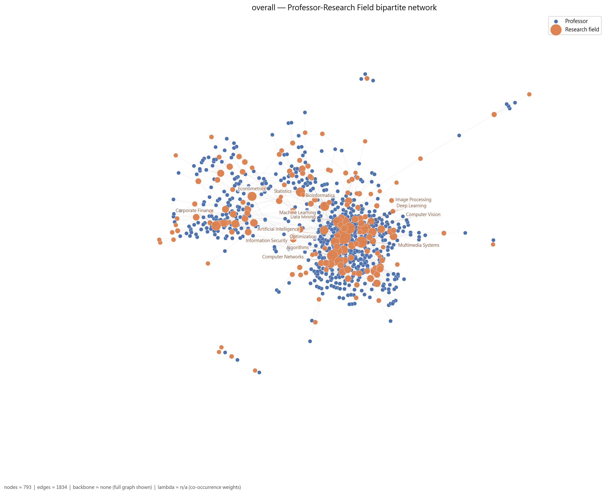

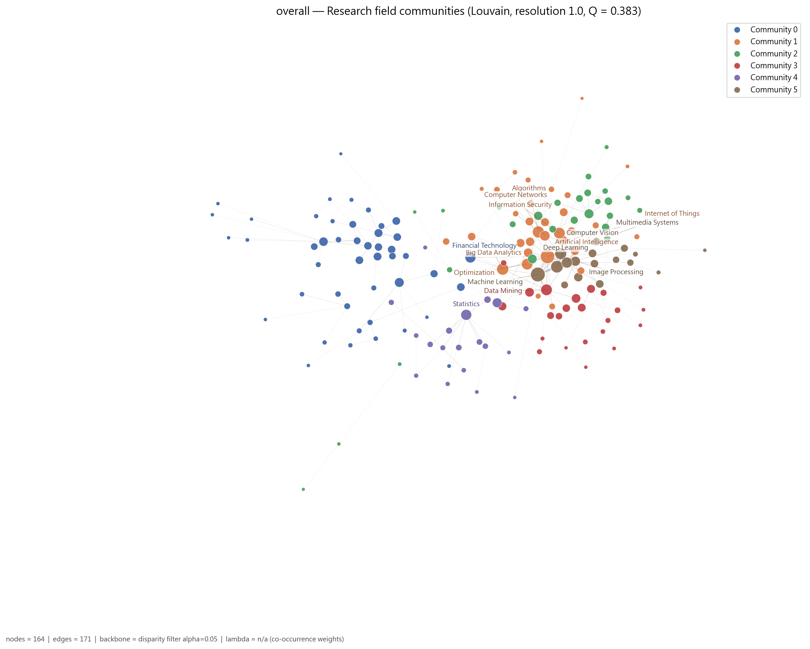

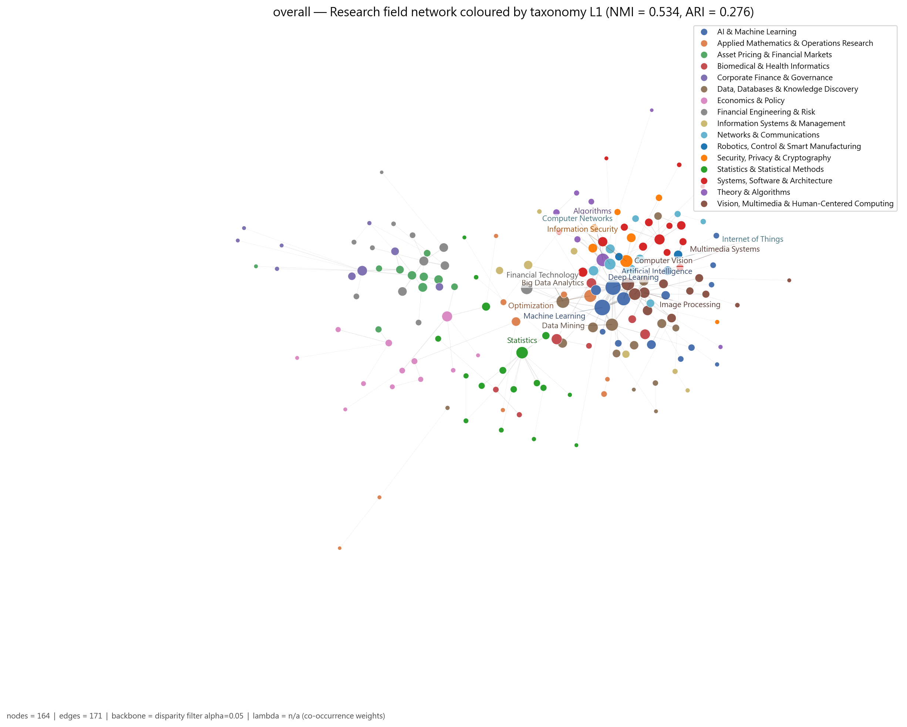

## 系所層級比較

所有欄位皆為正規化指標；`coverage_pct` 併列以避免把資料完整度誤讀為結構差異。

| school_id | group | 教授數 | coverage % | 領域數 | 領域網路 density | 領域網路 mean degree | 領域網路 Q | 領域社群數 | 教授網路 density | 教授網路 Q | 領域集中度 Gini |
| --- | --- | --- | --- | --- | --- | --- | --- | --- | --- | --- | --- |
| nccu-fin | fin-and-econ | 23 | 100.0 | 24 | 0.221 | 4.636 | 0.276 | 4 | 0.757 | 0.123 | 0.430 |
| nccu-mb | fin-and-econ | 18 | 81.8 | 23 | 0.240 | 4.316 | 0.289 | 4 | 0.408 | 0.226 | 0.348 |
| ncku-cs-ie | cs | 51 | 82.3 | 66 | 0.138 | 8.800 | 0.397 | 7 | 0.402 | 0.235 | 0.432 |
| ncku-stats-ds | ds | 39 | 83.0 | 44 | 0.179 | 7.682 | 0.466 | 3 | 0.466 | 0.171 | 0.442 |
| nthu-cs | cs | 76 | 93.8 | 65 | 0.111 | 6.857 | 0.422 | 6 | 0.224 | 0.439 | 0.444 |
| nthu-qf | fin-and-econ | 17 | 89.5 | 20 | 0.337 | 6.400 | 0.271 | 3 | 0.544 | 0.184 | 0.383 |
| ntu-comm-engin-ds-network | ds | 25 | 100.0 | 31 | 0.191 | 5.742 | 0.407 | 4 | 0.510 | 0.374 | 0.416 |
| ntu-cs-ie | cs | 88 | 97.8 | 74 | 0.113 | 7.710 | 0.385 | 6 | 0.287 | 0.318 | 0.445 |
| ntu-ds | ds | 59 | 85.5 | 63 | 0.144 | 7.080 | 0.371 | 5 | 0.388 | 0.222 | 0.452 |
| ntu-econ | fin-and-econ | 44 | 89.8 | 28 | 0.194 | 5.037 | 0.441 | 4 | 0.477 | 0.313 | 0.451 |
| ntu-fin | fin-and-econ | 32 | 74.4 | 33 | 0.131 | 4.182 | 0.325 | 7 | 0.472 | 0.152 | 0.452 |
| ntu-im | cs | 30 | 96.8 | 44 | 0.189 | 7.561 | 0.314 | 5 | 0.394 | 0.248 | 0.334 |
| nycu-cs | cs | 141 | 92.8 | 88 | 0.098 | 8.414 | 0.386 | 7 | 0.259 | 0.350 | 0.487 |
| nycu-info-mag-fin | fin-and-econ | 19 | 67.9 | 39 | 0.207 | 7.459 | 0.362 | 4 | 0.556 | 0.140 | 0.349 |

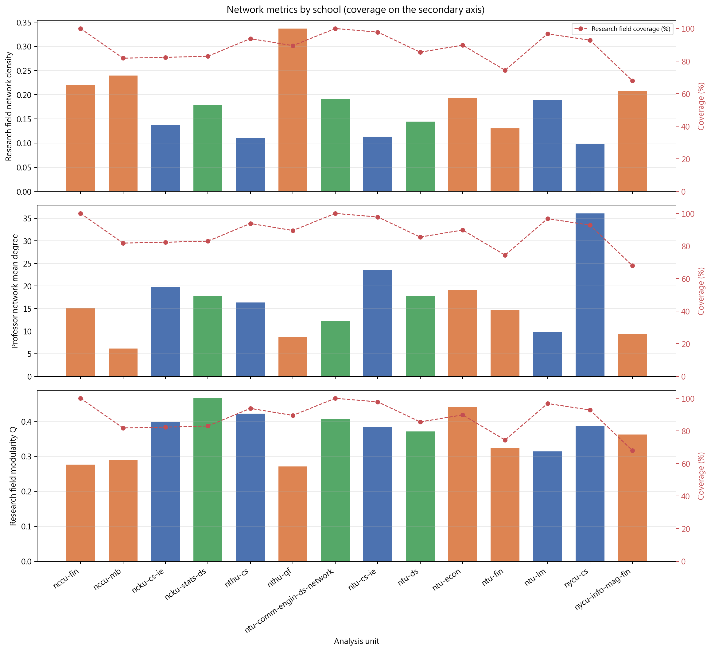

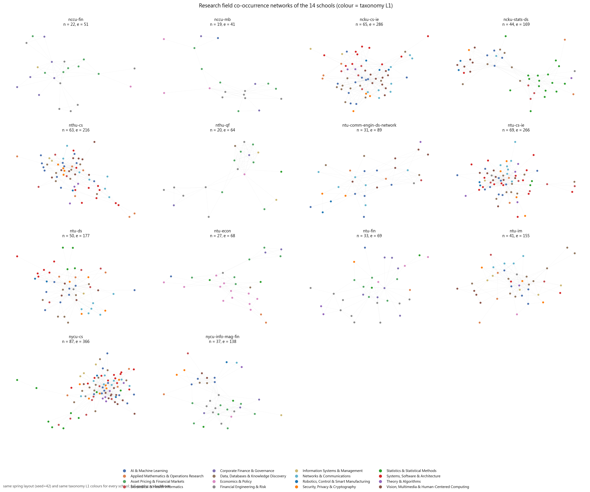

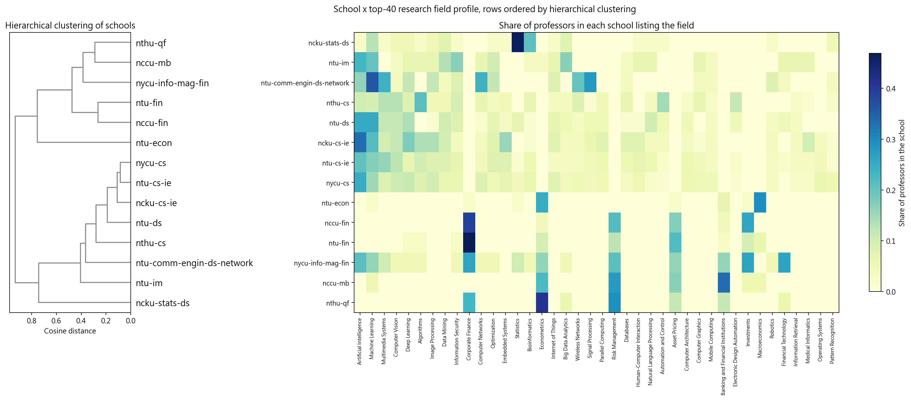

coverage 與 density 的相關為：領域網路 r = -0.048、教授網路 r = -0.087。
這張圖是驗證性圖表，用來檢查結構差異是否只是資料完整度造成。

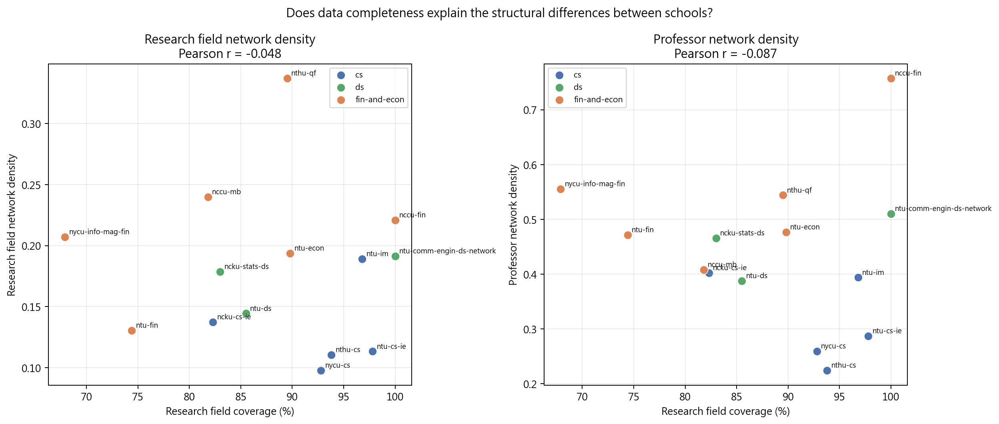

## 組層級結果與跨校橋接

| unit | 教授數 | coverage % | 領域數 | 領域網路 density | 領域網路 Q | 教授網路 density | 教授網路 Q | 跨校邊比例 | E-I index |
| --- | --- | --- | --- | --- | --- | --- | --- | --- | --- |
| fin-and-econ | 151 | 83.0 | 69 | 0.142 | 0.347 | 0.342 | 0.304 | 0.726 | 0.452 |
| ds | 114 | 87.0 | 86 | 0.124 | 0.397 | 0.274 | 0.414 | 0.373 | -0.254 |
| cs | 381 | 92.7 | 115 | 0.134 | 0.295 | 0.261 | 0.315 | 0.743 | 0.486 |
| overall | 623 | 88.9 | 170 | 0.095 | 0.383 | 0.168 | 0.396 | 0.785 | 0.569 |

E-I index 的絕對值會被「組內有幾個學校、各校多大」左右——學校愈多、規模愈平均，隨機情況下的跨校邊比例本來就愈高，因此必須與 school assortativity 併看。`ds` 只有 3 個系所且彼此重疊極深（組內 10 位跨校重複教授去重後成為單一節點），E-I index 為 -0.254（偏校內）；`cs`（5 個系所）與 `fin-and-econ`（6 個系所）則分別為 0.486 與 0.452。三者的 school assortativity 都接近 0，代表教授並不特別傾向連到同校的人。

### 社群結構是被學校決定，還是被研究主題決定？

| unit | coverage % | school assortativity | NMI vs school | ARI vs school | NMI vs 研究領域 L1 | ARI vs 研究領域 L1 |
| --- | --- | --- | --- | --- | --- | --- |
| fin-and-econ | 83.0 | 0.107 | 0.305 | 0.252 | 0.477 | 0.331 |
| ds | 87.0 | 0.243 | 0.311 | 0.268 | 0.629 | 0.487 |
| cs | 92.7 | 0.003 | 0.048 | 0.012 | 0.432 | 0.281 |
| overall | 88.9 | 0.069 | 0.329 | 0.130 | 0.551 | 0.298 |

以 Louvain 社群分別對照 `school_id` 分割與 `parent_l1` 分割的 NMI，逐組結論為：

- `fin-and-econ`：研究主題（NMI 0.477 > 學校 0.305）
- `ds`：研究主題（NMI 0.629 > 學校 0.311）
- `cs`：研究主題（NMI 0.432 > 學校 0.048）
- `overall`：研究主題（NMI 0.551 > 學校 0.329）

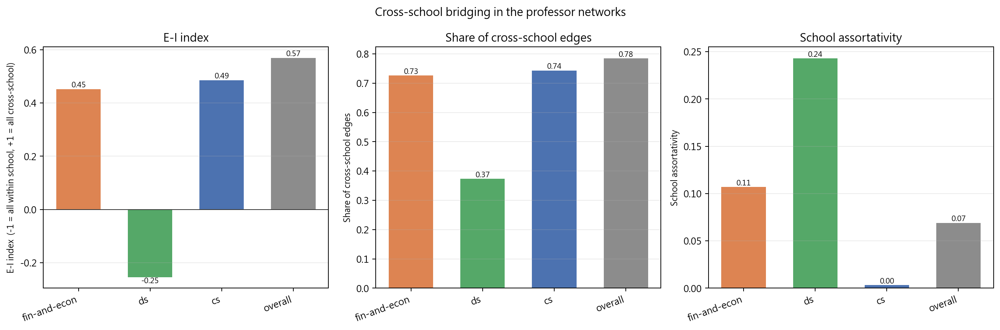

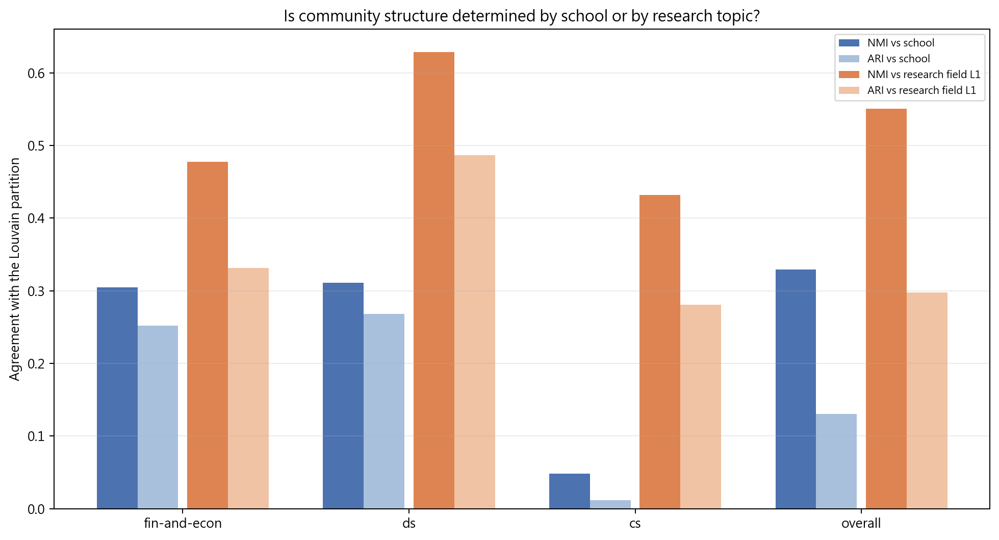

### 跨校 broker 教授

合聘教授（`n_appointments > 1`）必然是跨校節點，於下表單獨標記，避免與「研究主題造成的跨校連結」混淆。

| unit | 合聘教授數 | 跨校 broker 數 | 合聘佔 broker 比例 | 合聘平均 betweenness | 非合聘平均 betweenness |
| --- | --- | --- | --- | --- | --- |
| fin-and-econ | 2 | 147 | 0.0136 | 0.0252 | 0.0084 |
| ds | 9 | 102 | 0.0882 | 0.0371 | 0.0143 |
| cs | 5 | 379 | 0.0132 | 0.0042 | 0.0037 |
| overall | 37 | 616 | 0.0601 | 0.0085 | 0.0027 |

`fin-and-econ` 跨校 betweenness 前 5 名：劉鋼（nthu-qf）、林智勇（nycu-info-mag-fin）、蔡易達（ntu-fin）、和田健司（ntu-econ）、林士貴（nccu-mb）

`ds` 跨校 betweenness 前 5 名：鄭順林（ncku-stats-ds）、李政德（ncku-stats-ds）、馬瀰嘉（ncku-stats-ds）、林澤（ntu-comm-engin-ds-network | ntu-ds，合聘）、李濬屹（ntu-ds）

`cs` 跨校 betweenness 前 5 名：李濬屹（ntu-cs-ie）、連震杰（ncku-cs-ie）、謝孫源（ncku-cs-ie）、李端興（nthu-cs）、劉若慧（ntu-im）

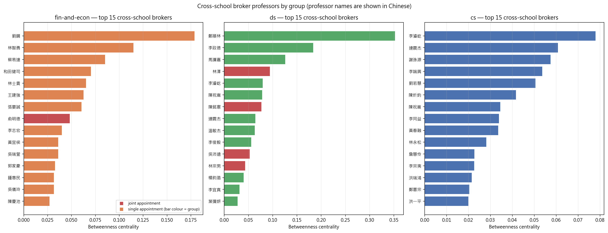

### 三組研究領域重疊

| group | 領域數 | 組內獨有 | 與其他組共享 |
| --- | --- | --- | --- |
| fin-and-econ | 69 | 41 | 28 |
| ds | 86 | 13 | 73 |
| cs | 115 | 38 | 77 |
| shared_by_all_three | 22 | 0 | 22 |

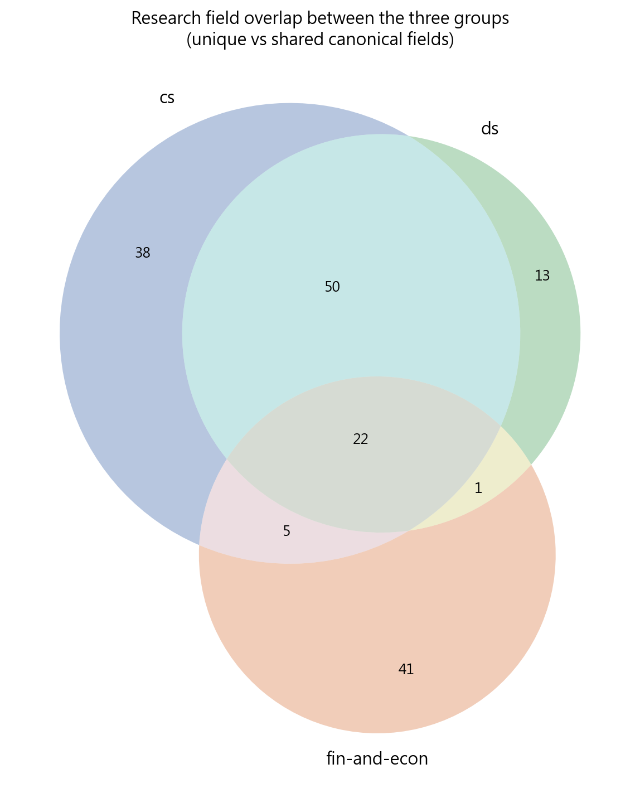

韋恩圖七個分區的領域數與最大的三個領域如下；**逐筆完整清單**見 `analysis/network-analysis/comparison/group_field_venn_partitions.csv`（含每個領域在三組各自的人數與 taxonomy L1 / L2）。

| 分區 | 領域數 | 三組人數合計 | 人數最多的三個領域 |
| --- | --- | --- | --- |
| cs only | 38 | 196 | Medical Informatics \| Operating Systems \| Distributed Systems |
| ds only | 13 | 38 | Statistical Computing \| Partial Differential Equations \| Reliability Analysis |
| fin-and-econ only | 41 | 321 | Corporate Finance \| Risk Management \| Asset Pricing |
| cs & ds | 50 | 606 | Data Mining \| Image Processing \| Embedded Systems |
| cs & fin-and-econ | 5 | 56 | Econometrics \| Entrepreneurship \| Theory of Computation |
| ds & fin-and-econ | 1 | 4 | Actuarial Science |
| cs & ds & fin-and-econ | 22 | 697 | Artificial Intelligence \| Machine Learning \| Multimedia Systems |

### 人為分組是否有資料支持

以各系所的研究領域比例向量做餘弦相似度階層分群，檢驗資料驅動的分群是否重現 cs / ds / fin-and-econ。

把樹狀圖切成 3 群後，與人為分組的一致度為 NMI = 0.705、ARI = 0.531。資料最先分開的是 `fin-and-econ` 與其他兩組；`cs` 與 `ds` 在研究領域組成上彼此接近，並沒有被資料切成兩群，代表 `ds` 系所的研究主題輪廓與 `cs` 系所高度重疊——這與 §三組研究領域重疊 的結果一致（`ds` 的 86 個領域中只有 13 個是該組獨有）。

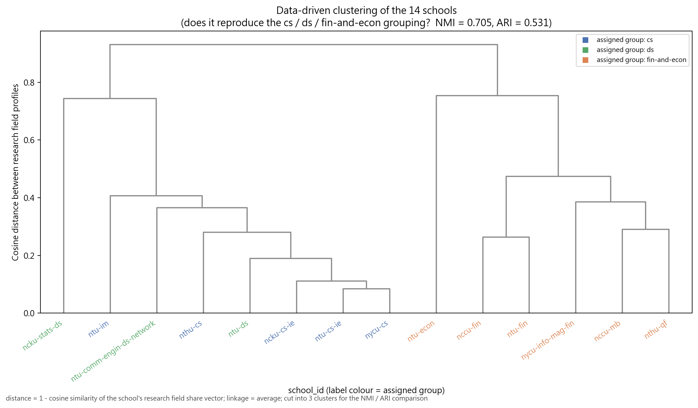

## 虛無模型檢定

以保持二分結構與雙邊 degree 序列的 double edge swap 產生 1,000 個隨機網路，對比觀測值與虛無分布，輸出 z-score 與 empirical p-value。

全體層級結果：

| metric | 觀測值 | 虛無平均 | 虛無標準差 | z-score | empirical p |
| --- | --- | --- | --- | --- | --- |
| keyword_density | 0.0955 | 0.1396 | 0.0022 | -20.2822 | 0.0020 |
| keyword_modularity_q | 0.3782 | 0.1469 | 0.0064 | 35.9667 | 0.0020 |
| keyword_mean_cooccurrence | 2.0282 | 1.4016 | 0.0163 | 38.4890 | 0.0020 |
| professor_clustering | 0.7009 | 0.6349 | 0.0045 | 14.8343 | 0.0020 |

18 個單位中，各統計量達到 p < 0.05 的比例：

| metric | 顯著單位比例 |
| --- | --- |
| keyword_density | 61.1% |
| keyword_modularity_q | 72.2% |
| keyword_mean_cooccurrence | 55.6% |
| professor_clustering | 50.0% |

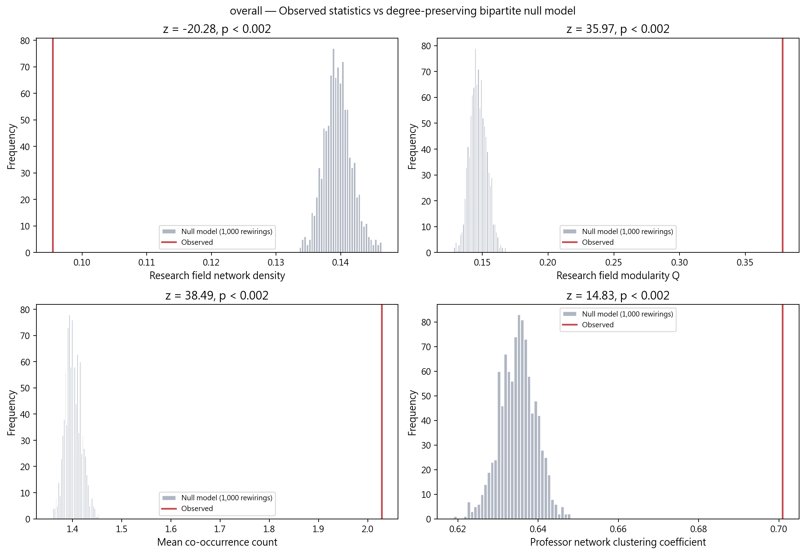

## Louvain 與 Girvan–Newman 的對照

節點數 < 60 的領域網路另跑 Girvan–Newman 作為對照（取前 12 層中 modularity 最高者）。兩者在每一個可比較的單位上，Louvain 的 Q 都不低於 GN，且不需要事先指定社群數：

| unit | 領域節點數 | Louvain Q | Louvain 社群數 | Girvan-Newman Q | GN 社群數 |
| --- | --- | --- | --- | --- | --- |
| nccu-fin | 22 | 0.276 | 4 | 0.182 | 5 |
| nccu-mb | 19 | 0.289 | 4 | 0.224 | 7 |
| ncku-stats-ds | 44 | 0.466 | 3 | 0.440 | 10 |
| nthu-qf | 20 | 0.271 | 3 | 0.254 | 5 |
| ntu-comm-engin-ds-network | 31 | 0.407 | 4 | 0.360 | 5 |
| ntu-ds | 50 | 0.371 | 5 | 0.286 | 12 |
| ntu-econ | 27 | 0.441 | 4 | 0.387 | 4 |
| ntu-fin | 33 | 0.325 | 7 | 0.284 | 4 |
| ntu-im | 41 | 0.314 | 5 | 0.197 | 12 |
| nycu-info-mag-fin | 37 | 0.362 | 4 | 0.346 | 2 |

10 個單位可比較，Louvain 的 Q 全部 ≥ GN（平均高出 0.056）。節點數 ≥ 60 的單位未跑 GN，因為其複雜度為 O(m²n)。

## λ 敏感度與護欄

λ ∈ {0, 0.3, 0.4, 0.5} 各跑一次。λ=0 為 baseline（純 IDF 加權投影）。若某 λ 使 density 相對 baseline 增加超過 50%，或 modularity Q 下降超過 0.1，即標示為過度合併：共 25 個（單位 × λ）組合被標記。

| unit | λ | density | Q | density 相對 baseline 變化 | Q 相對 baseline 下降 |
| --- | --- | --- | --- | --- | --- |
| nccu-fin | 0.3 | 0.757 | 0.142 | 0.691 | 0.105 |
| nccu-fin | 0.4 | 0.757 | 0.123 | 0.691 | 0.124 |
| nccu-fin | 0.5 | 0.757 | 0.129 | 0.691 | 0.118 |
| fin-and-econ | 0.3 | 0.342 | 0.315 | 0.658 | 0.058 |
| fin-and-econ | 0.4 | 0.342 | 0.304 | 0.658 | 0.070 |
| fin-and-econ | 0.5 | 0.342 | 0.292 | 0.658 | 0.082 |
| ntu-econ | 0.3 | 0.477 | 0.327 | 0.616 | 0.064 |
| ntu-econ | 0.4 | 0.477 | 0.313 | 0.616 | 0.078 |
| ntu-econ | 0.5 | 0.477 | 0.300 | 0.616 | 0.091 |
| ntu-cs-ie | 0.3 | 0.287 | 0.324 | 0.570 | 0.049 |

**L1 過寬護欄**：任一 `parent_l1` 在該單位覆蓋率 > 50% 即標記 `too_broad`，不得用於該單位的 L1 roll-up 視角。

| unit | too_broad 的 parent_l1 |
| --- | --- |
| nccu-fin | Corporate Finance & Governance / Asset Pricing & Financial Markets |
| nccu-mb | Financial Engineering & Risk |
| ncku-cs-ie | AI & Machine Learning |
| ncku-stats-ds | Statistics & Statistical Methods |
| nthu-qf | Financial Engineering & Risk |
| ntu-comm-engin-ds-network | Vision, Multimedia & Human-Centered Computing |
| ntu-ds | AI & Machine Learning |
| ntu-econ | Economics & Policy |
| ntu-fin | Asset Pricing & Financial Markets / Corporate Finance & Governance |
| nycu-info-mag-fin | Financial Engineering & Risk |

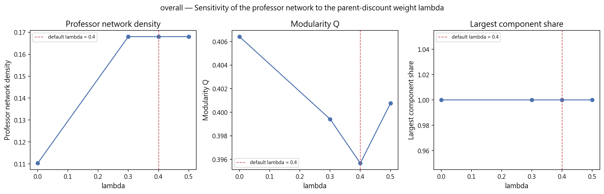

## 輸出檔案

### 程式

```
scripts/network-analysis/current-version/
  1_build_taxonomy.ipynb
  2_build_network_data.ipynb
  3_network_analysis.ipynb
  4_group_and_cross_comparison.ipynb
```

### 資料 `data/network-analysis/`

- `research_taxonomy.csv`：170 個領域的三層階層（固定資產）
- `keyword_idf.csv`：全體 IDF 權重
- `person_identity_map.csv`：跨校去重對照與待覆核清單
- `shared_contact_emails.csv`：被排除於身分比對的系所共用信箱
- `manual_identity_decisions.csv`：同名案例的人工覆核裁定（去重規則 0）
- `analysis/network-analysis/comparison/group_field_venn_partitions.csv`：韋恩圖七個分區的逐筆研究領域清單
- `units_manifest.json`：18 個分析單位的節點數、排除人數與 coverage
- `by-school/<school_id>/`、`by-group/<group>/`、`overall/`：各單位的 `professor_nodes.csv`、`keyword_nodes.csv`、`prof_keyword_edges.csv`（組層級另有 `professor_nodes_nodedup.csv` 供 robustness check）

### 分析 `analysis/network-analysis/`

每個分析單位一個目錄，含三份 GraphML、中心性與社群 CSV、`network_metrics.json`、`null_model_test.csv`、`lambda_sensitivity.csv`、`l1_coverage_guardrail.csv` 與 `figures/`；組層級與全體層級另有 `cross_school_bridging.csv`。

`figures/` 的 01~20 為網路圖與診斷圖；**21~28 為 word cloud**：研究領域與教授各兩張（字級分別與 degree centrality、betweenness centrality 成正比），再各一組依 Louvain 社群分塊、同社群同色的版本。字級為線性正比並設下限（betweenness 有大量 0 值），caption 註明下限與未能排入的字數。

圖檔共 **474** 張，全部位於 `analysis/network-analysis/` 之下，`data/` 內無任何圖檔。圖中所有文字一律英文，唯一例外是教授姓名。

另有 `analysis/network-analysis/by-figures/`：把 18 個單位的圖依**圖號**重新編排（28 個目錄、462 個檔案，檔名為單位名稱），方便同一張圖跨單位並排比較；目錄清單見 `by_figures_index.csv`。此目錄每次執行都重建，與 `<unit>/figures/` 保持同步；因為內容與 `<unit>/figures/` 完全重複（約 116 MB），不納入版本控制，重跑第 4 本 notebook 即可產生。

## 限制與注意事項

- 研究領域來自各校官網自填內容，深度與粒度本就不一致。網路密度差異可能反映資料填寫習慣，而非真實研究結構差異。
- 覆蓋率差距達 32.1 個百分點（67.9% ~ 100.0%）。覆蓋率不可解讀為系所或教授的品質排名。
- `ntu-cs-ie` 與 `ntu-ds` 的學歷欄位為空，因此 PhD institution 相關屬性在這兩系所缺席。
- Taxonomy 的 L1/L2 劃分為研究者判斷，不同劃分會影響 λ 項與社群對齊檢驗。`research_taxonomy.csv` 納入版本控管以確保可稽核與可重現。
- λ 引入的推論連結是研究設計選擇，不是資料本身。所有主要結論須同時檢視 λ=0 的 baseline。
- 有 13 位進入網路的教授沒有中文姓名（`ncku-stats-ds` 7 位、`nthu-cs` 2 位、`ntu-econ` 4 位），這些人在圖中顯示英文姓名。

### 人工覆核裁定（去重規則 0）

自動規則只看得到 email 與姓名字串：同一位教授在兩校使用不同網域的信箱時，規則 3 會保守地拆成兩個人。這些案例已逐筆人工確認，裁定寫入 Stage 2 的 `MANUAL_SAME_PERSON` / `MANUAL_DIFFERENT_PERSON`（共 5 組確認為同一人、1 組確認為不同人），優先於所有自動規則：

| 裁定 | 教授 | school_id |
| --- | --- | --- |
| same_person | 李家岩 Chia-Yen Lee | ncku-cs-ie \| ntu-im |
| same_person | 連震杰 Jenn-Jier James Lien | ncku-cs-ie \| ncku-stats-ds |
| same_person | 林桂傑 Kwei-Jay Lin | nthu-cs \| ntu-cs-ie |
| same_person | 俞明德 Min-Teh Yu | nthu-qf \| nycu-info-mag-fin |
| same_person | 李琳山 Lin-Shan Lee | ntu-comm-engin-ds-network \| ntu-cs-ie |
| different_person | 陳耀宗 Yaw-Chung Chen / Yao-Tsung Chen | nycu-cs \| nycu-info-mag-fin |

套用後，全體層級的跨校重複教授為 37 位、77 筆紀錄。

### 仍待人工覆核

> 本報告與資料集中的 email 一律以不可逆 token（`<hex>@redacted.invalid`）呈現；同一個原始信箱固定對應同一個 token，比對邏輯不受影響。詳見 [LICENSE-data](../LICENSE-data) 第 3 節。

其餘 4 筆紀錄仍標記為 `name_collision_kept_separate`（同名、但 `name_en` 與 email 皆不相容），目前一律視為不同人：

| professor_name | name_en | school_id | email |
| --- | --- | --- | --- |
| 資訊系 | Yu-Li Huang | ncku-cs-ie | e0700b287d6c80c4@redacted.invalid |
| 資訊系 | dept. CSIE | ncku-cs-ie | （無） |
| 黃敬群 | dept. CSIE | ncku-cs-ie | 5180beb7123a6bf2@redacted.invalid |
| 黃敬群 | Ching-Chun Huang | nycu-cs | （無） |

`資訊系` 兩筆是系所網頁把欄位標題當成姓名抓進來的雜訊紀錄，兩筆都沒有研究領域，不進入任何網路。`黃敬群` 兩筆的英文姓名完全不同（NCKU 這筆的 `name_en` 被官網抓成一組 email，即 `5180beb7123a6bf2@redacted.invalid`、研究 Operating Systems / Embedded Systems；NYCU 為 Ching-Chun Huang、研究 Machine Learning / Medical Imaging），依證據判定為兩位不同教授。若後續確認有誤，更新 Stage 2 的裁定表後重跑 Stage 2~4 即可。

### 被排除於身分比對的系所共用信箱

下列 7 個信箱在同一個 `school_id` 內重複出現，屬於系辦或聯絡窗口信箱，不是個人識別碼，已排除於 email 比對之外：

| email | 紀錄數 | school_id |
| --- | --- | --- |
| 1a9bfd52a6de752e@redacted.invalid | 62 | ncku-cs-ie |
| 95f6910acde21198@redacted.invalid | 43 | ntu-fin |
| 2432aaca30fd1524@redacted.invalid | 2 | ntu-econ |
| 0c8553022a7a2824@redacted.invalid | 3 | ntu-econ |
| 4ef3a5beaca61a4a@redacted.invalid | 2 | ntu-econ |
| 1e8884c0a1d211bf@redacted.invalid | 3 | ntu-econ |
| 5c6bfd6e236480af@redacted.invalid | 31 | ntu-im |

## 重現方式

```powershell
python -m jupyter nbconvert --to notebook --execute --inplace --ExecutePreprocessor.timeout=1800 scripts/network-analysis/current-version/1_build_taxonomy.ipynb
python -m jupyter nbconvert --to notebook --execute --inplace --ExecutePreprocessor.timeout=1800 scripts/network-analysis/current-version/2_build_network_data.ipynb
python -m jupyter nbconvert --to notebook --execute --inplace --ExecutePreprocessor.timeout=3600 scripts/network-analysis/current-version/3_network_analysis.ipynb
python -m jupyter nbconvert --to notebook --execute --inplace --ExecutePreprocessor.timeout=1800 scripts/network-analysis/current-version/4_group_and_cross_comparison.ipynb
```

Stage 3 的虛無模型檢定（18 單位 × 1,000 次隨機化）為主要耗時來源，逾時設定較長。
