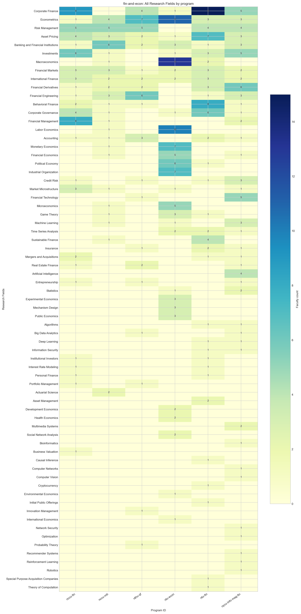
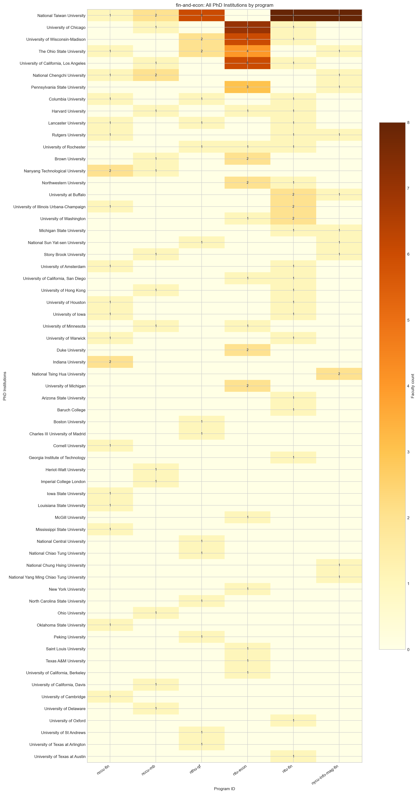
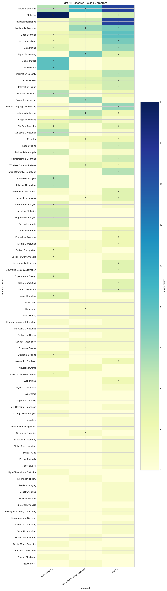
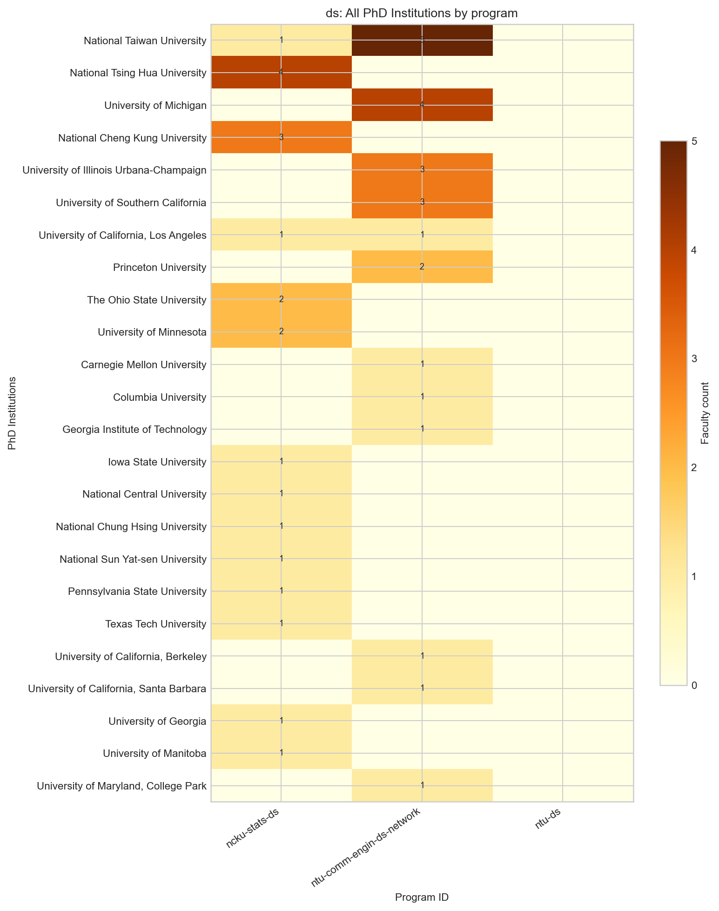
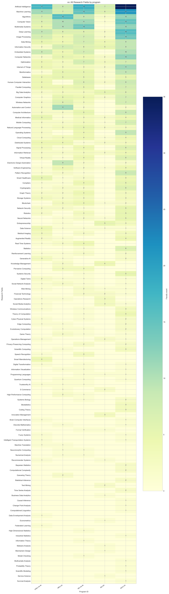
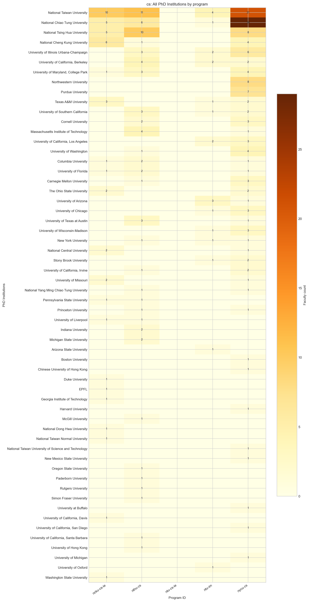

# 各校系 Research Field 與 PhD Institution 分析比較報告

產生時間：2026-09-09T18:36:23+08:00

## 分析範圍與方法

本報告涵蓋 14 個校系、741 位教師。Research field 採主要研究領域與研究領域摘要分別清洗、標準化後的英文 canonical 聯集；PhD institution 同樣採預處理後的英文 canonical 值。計數單位為具有該項目的不重複教師人數。

分組圖與 CSV 均保留組內觀察到的全部類別，未套用 Top-N 截斷。熱門項目表為便於閱讀只顯示前 10 或 15 名；完整數值請查閱 group comparison CSV。

## 全體校系概況

| school_id | faculty_count | research_coverage_pct | unique_research_fields | phd_coverage_pct | unique_phd_institutions |
| --- | --- | --- | --- | --- | --- |
| nccu-fin | 23 | 100.0 | 24 | 91.3 | 19 |
| nccu-mb | 22 | 81.8 | 23 | 77.3 | 15 |
| ncku-cs-ie | 62 | 82.3 | 66 | 64.5 | 20 |
| ncku-stats-ds | 47 | 83.0 | 44 | 40.4 | 14 |
| nthu-cs | 81 | 93.8 | 65 | 88.9 | 30 |
| nthu-qf | 19 | 89.5 | 20 | 94.7 | 15 |
| ntu-comm-engin-ds-network | 25 | 100.0 | 31 | 96.0 | 12 |
| ntu-cs-ie | 90 | 97.8 | 74 | 0.0 | 0 |
| ntu-ds | 69 | 85.5 | 63 | 0.0 | 0 |
| ntu-econ | 49 | 89.8 | 28 | 89.8 | 19 |
| ntu-fin | 43 | 74.4 | 33 | 81.4 | 25 |
| ntu-im | 31 | 96.8 | 44 | 71.0 | 14 |
| nycu-cs | 152 | 92.8 | 88 | 88.8 | 38 |
| nycu-info-mag-fin | 28 | 67.9 | 39 | 67.9 | 12 |

### 全體最常見 Research Fields

| research_interest_en | faculty_count |
| --- | --- |
| Artificial Intelligence | 109 |
| Machine Learning | 94 |
| Multimedia Systems | 57 |
| Deep Learning | 54 |
| Computer Vision | 54 |
| Algorithms | 49 |
| Image Processing | 40 |
| Information Security | 39 |
| Data Mining | 39 |
| Corporate Finance | 34 |
| Optimization | 33 |
| Computer Networks | 33 |
| Statistics | 32 |
| Embedded Systems | 32 |
| Bioinformatics | 31 |

### 全體最常見 PhD Institutions

| institution_en | faculty_count |
| --- | --- |
| National Taiwan University | 77 |
| National Chiao Tung University | 42 |
| National Tsing Hua University | 29 |
| University of Illinois Urbana-Champaign | 17 |
| University of California, Los Angeles | 15 |
| National Cheng Kung University | 14 |
| The Ohio State University | 14 |
| University of Wisconsin-Madison | 13 |
| University of Chicago | 13 |
| Northwestern University | 11 |
| University of California, Berkeley | 10 |
| University of Maryland, College Park | 9 |
| University of Southern California | 9 |
| Columbia University | 8 |
| University of Washington | 8 |

## 分組比較

### fin-and-econ 組

成員：`nccu-fin`、`nccu-mb`、`nthu-qf`、`ntu-econ`、`ntu-fin`、`nycu-info-mag-fin`

| school_id | faculty_count | research_coverage_pct | unique_research_fields | phd_coverage_pct | unique_phd_institutions |
| --- | --- | --- | --- | --- | --- |
| nccu-fin | 23 | 100.0 | 24 | 91.3 | 19 |
| nccu-mb | 22 | 81.8 | 23 | 77.3 | 15 |
| nthu-qf | 19 | 89.5 | 20 | 94.7 | 15 |
| ntu-econ | 49 | 89.8 | 28 | 89.8 | 19 |
| ntu-fin | 43 | 74.4 | 33 | 81.4 | 25 |
| nycu-info-mag-fin | 28 | 67.9 | 39 | 67.9 | 12 |

#### 組內熱門 Research Fields

| research_interest_en | faculty_count |
| --- | --- |
| Corporate Finance | 34 |
| Econometrics | 29 |
| Risk Management | 23 |
| Asset Pricing | 20 |
| Banking and Financial Institutions | 16 |
| Investments | 16 |
| Macroeconomics | 16 |
| Financial Derivatives | 14 |
| Financial Engineering | 14 |
| Financial Markets | 14 |

#### 至少兩個校系共有的 Research Fields

| research_interest_en | department_count | faculty_count |
| --- | --- | --- |
| Econometrics | 6 | 29 |
| Asset Pricing | 6 | 20 |
| Banking and Financial Institutions | 6 | 16 |
| Financial Markets | 6 | 14 |
| International Finance | 6 | 14 |
| Corporate Finance | 5 | 34 |
| Risk Management | 5 | 23 |
| Investments | 5 | 16 |
| Financial Derivatives | 5 | 14 |
| Financial Engineering | 5 | 14 |

#### 組內熱門 PhD Institutions

| institution_en | faculty_count |
| --- | --- |
| National Taiwan University | 25 |
| University of Chicago | 9 |
| University of Wisconsin-Madison | 9 |
| The Ohio State University | 8 |
| University of California, Los Angeles | 8 |
| National Chengchi University | 4 |
| Pennsylvania State University | 4 |
| Brown University | 3 |
| Columbia University | 3 |
| Harvard University | 3 |

#### 至少兩個校系共有的 PhD Institutions

| institution_en | department_count | faculty_count |
| --- | --- | --- |
| National Taiwan University | 5 | 25 |
| The Ohio State University | 4 | 8 |
| University of Chicago | 3 | 9 |
| University of Wisconsin-Madison | 3 | 9 |
| University of California, Los Angeles | 3 | 8 |
| National Chengchi University | 3 | 4 |
| Columbia University | 3 | 3 |
| Harvard University | 3 | 3 |
| Lancaster University | 3 | 3 |
| Rutgers University | 3 | 3 |

### ds 組

成員：`ncku-stats-ds`、`ntu-comm-engin-ds-network`、`ntu-ds`

| school_id | faculty_count | research_coverage_pct | unique_research_fields | phd_coverage_pct | unique_phd_institutions |
| --- | --- | --- | --- | --- | --- |
| ncku-stats-ds | 47 | 83.0 | 44 | 40.4 | 14 |
| ntu-comm-engin-ds-network | 25 | 100.0 | 31 | 96.0 | 12 |
| ntu-ds | 69 | 85.5 | 63 | 0.0 | 0 |

#### 組內熱門 Research Fields

| research_interest_en | faculty_count |
| --- | --- |
| Machine Learning | 29 |
| Statistics | 22 |
| Artificial Intelligence | 20 |
| Multimedia Systems | 14 |
| Deep Learning | 13 |
| Computer Vision | 10 |
| Data Mining | 10 |
| Signal Processing | 10 |
| Bioinformatics | 9 |
| Biostatistics | 9 |

#### 至少兩個校系共有的 Research Fields

| research_interest_en | department_count | faculty_count |
| --- | --- | --- |
| Machine Learning | 3 | 29 |
| Artificial Intelligence | 3 | 20 |
| Multimedia Systems | 3 | 14 |
| Deep Learning | 3 | 13 |
| Computer Vision | 3 | 10 |
| Data Mining | 3 | 10 |
| Information Security | 3 | 8 |
| Optimization | 3 | 8 |
| Internet of Things | 3 | 7 |
| Image Processing | 3 | 6 |

#### 組內熱門 PhD Institutions

| institution_en | faculty_count |
| --- | --- |
| National Taiwan University | 6 |
| National Tsing Hua University | 4 |
| University of Michigan | 4 |
| National Cheng Kung University | 3 |
| University of Illinois Urbana-Champaign | 3 |
| University of Southern California | 3 |
| Princeton University | 2 |
| The Ohio State University | 2 |
| University of California, Los Angeles | 2 |
| University of Minnesota | 2 |

#### 至少兩個校系共有的 PhD Institutions

| institution_en | department_count | faculty_count |
| --- | --- | --- |
| National Taiwan University | 2 | 6 |
| University of California, Los Angeles | 2 | 2 |

### cs 組

成員：`ncku-cs-ie`、`nthu-cs`、`ntu-cs-ie`、`ntu-im`、`nycu-cs`

| school_id | faculty_count | research_coverage_pct | unique_research_fields | phd_coverage_pct | unique_phd_institutions |
| --- | --- | --- | --- | --- | --- |
| ncku-cs-ie | 62 | 82.3 | 66 | 64.5 | 20 |
| nthu-cs | 81 | 93.8 | 65 | 88.9 | 30 |
| ntu-cs-ie | 90 | 97.8 | 74 | 0.0 | 0 |
| ntu-im | 31 | 96.8 | 44 | 71.0 | 14 |
| nycu-cs | 152 | 92.8 | 88 | 88.8 | 38 |

#### 組內熱門 Research Fields

| research_interest_en | faculty_count |
| --- | --- |
| Artificial Intelligence | 85 |
| Machine Learning | 60 |
| Algorithms | 46 |
| Computer Vision | 43 |
| Multimedia Systems | 41 |
| Deep Learning | 39 |
| Image Processing | 34 |
| Data Mining | 29 |
| Embedded Systems | 29 |
| Information Security | 29 |

#### 至少兩個校系共有的 Research Fields

| research_interest_en | department_count | faculty_count |
| --- | --- | --- |
| Artificial Intelligence | 5 | 85 |
| Machine Learning | 5 | 60 |
| Algorithms | 5 | 46 |
| Computer Vision | 5 | 43 |
| Deep Learning | 5 | 39 |
| Image Processing | 5 | 34 |
| Data Mining | 5 | 29 |
| Information Security | 5 | 29 |
| Computer Networks | 5 | 25 |
| Optimization | 5 | 24 |

#### 組內熱門 PhD Institutions

| institution_en | faculty_count |
| --- | --- |
| National Taiwan University | 46 |
| National Chiao Tung University | 41 |
| National Tsing Hua University | 23 |
| National Cheng Kung University | 11 |
| University of Illinois Urbana-Champaign | 11 |
| Northwestern University | 8 |
| University of California, Berkeley | 8 |
| University of Maryland, College Park | 8 |
| Purdue University | 7 |
| Texas A&M University | 6 |

#### 至少兩個校系共有的 PhD Institutions

| institution_en | department_count | faculty_count |
| --- | --- | --- |
| National Taiwan University | 4 | 46 |
| National Chiao Tung University | 4 | 41 |
| National Tsing Hua University | 3 | 23 |
| National Cheng Kung University | 3 | 11 |
| University of Illinois Urbana-Champaign | 3 | 11 |
| University of California, Berkeley | 3 | 8 |
| University of Maryland, College Park | 3 | 8 |
| Texas A&M University | 3 | 6 |
| University of Southern California | 3 | 6 |
| Columbia University | 3 | 4 |

## 各校系分析

### nccu-fin

共 23 位教師；research field 覆蓋率為 100.0%，PhD institution 覆蓋率為 91.3%。最常見 research field 為 `Corporate Finance`；最常見 PhD institution 為 `Indiana University`。

#### Research Fields（前 10 名）

| research_interest_en | faculty_count |
| --- | --- |
| Corporate Finance | 9 |
| Financial Management | 8 |
| Investments | 6 |
| Risk Management | 5 |
| Asset Pricing | 4 |
| Corporate Governance | 4 |
| Financial Markets | 3 |
| International Finance | 3 |
| Market Microstructure | 3 |
| Behavioral Finance | 2 |

#### PhD Institutions（前 10 名）

| institution_en | faculty_count |
| --- | --- |
| Indiana University | 2 |
| Nanyang Technological University | 2 |
| Columbia University | 1 |
| Cornell University | 1 |
| Iowa State University | 1 |
| Lancaster University | 1 |
| Louisiana State University | 1 |
| Mississippi State University | 1 |
| National Chengchi University | 1 |
| National Taiwan University | 1 |

### nccu-mb

共 22 位教師；research field 覆蓋率為 81.8%，PhD institution 覆蓋率為 77.3%。最常見 research field 為 `Banking and Financial Institutions`；最常見 PhD institution 為 `National Chengchi University`。

#### Research Fields（前 10 名）

| research_interest_en | faculty_count |
| --- | --- |
| Banking and Financial Institutions | 6 |
| Risk Management | 5 |
| Econometrics | 4 |
| Asset Pricing | 3 |
| Financial Engineering | 3 |
| Financial Markets | 3 |
| Actuarial Science | 2 |
| Financial Derivatives | 2 |
| International Finance | 2 |
| Accounting | 1 |

#### PhD Institutions（前 10 名）

| institution_en | faculty_count |
| --- | --- |
| National Chengchi University | 2 |
| National Taiwan University | 2 |
| Brown University | 1 |
| Harvard University | 1 |
| Heriot-Watt University | 1 |
| Imperial College London | 1 |
| Nanyang Technological University | 1 |
| Ohio University | 1 |
| Stony Brook University | 1 |
| University of California, Davis | 1 |

### ncku-cs-ie

共 62 位教師；research field 覆蓋率為 82.3%，PhD institution 覆蓋率為 64.5%。最常見 research field 為 `Artificial Intelligence`；最常見 PhD institution 為 `National Taiwan University`。

#### Research Fields（前 10 名）

| research_interest_en | faculty_count |
| --- | --- |
| Artificial Intelligence | 17 |
| Machine Learning | 11 |
| Deep Learning | 9 |
| Embedded Systems | 8 |
| Algorithms | 7 |
| Image Processing | 7 |
| Computer Vision | 6 |
| Data Mining | 5 |
| Medical Informatics | 5 |
| Multimedia Systems | 5 |

#### PhD Institutions（前 10 名）

| institution_en | faculty_count |
| --- | --- |
| National Taiwan University | 10 |
| National Cheng Kung University | 6 |
| National Chiao Tung University | 5 |
| National Tsing Hua University | 5 |
| Texas A&M University | 3 |
| National Central University | 2 |
| The Ohio State University | 2 |
| University of Missouri | 2 |
| Columbia University | 1 |
| Duke University | 1 |

### ncku-stats-ds

共 47 位教師；research field 覆蓋率為 83.0%，PhD institution 覆蓋率為 40.4%。最常見 research field 為 `Statistics`；最常見 PhD institution 為 `National Tsing Hua University`。

#### Research Fields（前 10 名）

| research_interest_en | faculty_count |
| --- | --- |
| Statistics | 18 |
| Bioinformatics | 8 |
| Biostatistics | 8 |
| Bayesian Statistics | 5 |
| Machine Learning | 5 |
| Reliability Analysis | 5 |
| Statistical Computing | 5 |
| Statistical Consulting | 5 |
| Industrial Statistics | 4 |
| Multivariate Analysis | 4 |

#### PhD Institutions（前 10 名）

| institution_en | faculty_count |
| --- | --- |
| National Tsing Hua University | 4 |
| National Cheng Kung University | 3 |
| The Ohio State University | 2 |
| University of Minnesota | 2 |
| Iowa State University | 1 |
| National Central University | 1 |
| National Chung Hsing University | 1 |
| National Sun Yat-sen University | 1 |
| National Taiwan University | 1 |
| Pennsylvania State University | 1 |

### nthu-cs

共 81 位教師；research field 覆蓋率為 93.8%，PhD institution 覆蓋率為 88.9%。最常見 research field 為 `Algorithms`；最常見 PhD institution 為 `National Taiwan University`。

#### Research Fields（前 10 名）

| research_interest_en | faculty_count |
| --- | --- |
| Algorithms | 16 |
| Automation and Control | 11 |
| Computer Vision | 10 |
| Multimedia Systems | 10 |
| Electronic Design Automation | 9 |
| Artificial Intelligence | 8 |
| Information Security | 7 |
| Machine Learning | 7 |
| Deep Learning | 6 |
| Wireless Networks | 6 |

#### PhD Institutions（前 10 名）

| institution_en | faculty_count |
| --- | --- |
| National Taiwan University | 11 |
| National Tsing Hua University | 10 |
| National Chiao Tung University | 6 |
| Massachusetts Institute of Technology | 4 |
| University of California, Berkeley | 4 |
| University of Illinois Urbana-Champaign | 3 |
| University of Maryland, College Park | 3 |
| University of Southern California | 3 |
| University of Texas at Austin | 3 |
| Columbia University | 2 |

### nthu-qf

共 19 位教師；research field 覆蓋率為 89.5%，PhD institution 覆蓋率為 94.7%。最常見 research field 為 `Econometrics`；最常見 PhD institution 為 `National Taiwan University`。

#### Research Fields（前 10 名）

| research_interest_en | faculty_count |
| --- | --- |
| Econometrics | 7 |
| Financial Engineering | 6 |
| Risk Management | 5 |
| Corporate Finance | 4 |
| Accounting | 3 |
| Asset Pricing | 2 |
| Banking and Financial Institutions | 2 |
| Financial Derivatives | 2 |
| International Finance | 2 |
| Real Estate Finance | 2 |

#### PhD Institutions（前 10 名）

| institution_en | faculty_count |
| --- | --- |
| National Taiwan University | 6 |
| The Ohio State University | 2 |
| University of Wisconsin-Madison | 2 |
| Boston University | 1 |
| Charles III University of Madrid | 1 |
| Columbia University | 1 |
| Lancaster University | 1 |
| National Central University | 1 |
| National Chiao Tung University | 1 |
| National Sun Yat-sen University | 1 |

### ntu-comm-engin-ds-network

共 25 位教師；research field 覆蓋率為 100.0%，PhD institution 覆蓋率為 96.0%。最常見 research field 為 `Machine Learning`；最常見 PhD institution 為 `National Taiwan University`。

#### Research Fields（前 10 名）

| research_interest_en | faculty_count |
| --- | --- |
| Machine Learning | 9 |
| Signal Processing | 7 |
| Computer Networks | 6 |
| Multimedia Systems | 6 |
| Wireless Networks | 5 |
| Artificial Intelligence | 4 |
| Deep Learning | 3 |
| Image Processing | 3 |
| Optimization | 3 |
| Wireless Communications | 3 |

#### PhD Institutions（前 10 名）

| institution_en | faculty_count |
| --- | --- |
| National Taiwan University | 5 |
| University of Michigan | 4 |
| University of Illinois Urbana-Champaign | 3 |
| University of Southern California | 3 |
| Princeton University | 2 |
| Carnegie Mellon University | 1 |
| Columbia University | 1 |
| Georgia Institute of Technology | 1 |
| University of California, Berkeley | 1 |
| University of California, Los Angeles | 1 |

### ntu-cs-ie

共 90 位教師；research field 覆蓋率為 97.8%，PhD institution 覆蓋率為 0.0%。最常見 research field 為 `Artificial Intelligence`；最常見 PhD institution 為 `無可用資料`。

#### Research Fields（前 10 名）

| research_interest_en | faculty_count |
| --- | --- |
| Artificial Intelligence | 18 |
| Machine Learning | 15 |
| Multimedia Systems | 14 |
| Computer Vision | 11 |
| Algorithms | 9 |
| Data Mining | 7 |
| Embedded Systems | 7 |
| Image Processing | 7 |
| Optimization | 7 |
| Deep Learning | 6 |

#### PhD Institutions（前 10 名）

_無可用資料。_

### ntu-ds

共 69 位教師；research field 覆蓋率為 85.5%，PhD institution 覆蓋率為 0.0%。最常見 research field 為 `Artificial Intelligence`；最常見 PhD institution 為 `無可用資料`。

#### Research Fields（前 10 名）

| research_interest_en | faculty_count |
| --- | --- |
| Artificial Intelligence | 15 |
| Machine Learning | 15 |
| Deep Learning | 8 |
| Computer Vision | 7 |
| Multimedia Systems | 7 |
| Data Mining | 6 |
| Natural Language Processing | 6 |
| Information Security | 5 |
| Partial Differential Equations | 5 |
| Data Science | 4 |

#### PhD Institutions（前 10 名）

_無可用資料。_

### ntu-econ

共 49 位教師；research field 覆蓋率為 89.8%，PhD institution 覆蓋率為 89.8%。最常見 research field 為 `Macroeconomics`；最常見 PhD institution 為 `University of Chicago`。

#### Research Fields（前 10 名）

| research_interest_en | faculty_count |
| --- | --- |
| Macroeconomics | 13 |
| Econometrics | 11 |
| Labor Economics | 10 |
| Industrial Organization | 7 |
| Monetary Economics | 7 |
| Political Economy | 6 |
| Financial Economics | 5 |
| Microeconomics | 5 |
| Banking and Financial Institutions | 3 |
| Experimental Economics | 3 |

#### PhD Institutions（前 10 名）

| institution_en | faculty_count |
| --- | --- |
| University of Chicago | 7 |
| University of California, Los Angeles | 6 |
| University of Wisconsin-Madison | 6 |
| The Ohio State University | 4 |
| Pennsylvania State University | 3 |
| Brown University | 2 |
| Duke University | 2 |
| Northwestern University | 2 |
| University of Michigan | 2 |
| Harvard University | 1 |

### ntu-fin

共 43 位教師；research field 覆蓋率為 74.4%，PhD institution 覆蓋率為 81.4%。最常見 research field 為 `Corporate Finance`；最常見 PhD institution 為 `National Taiwan University`。

#### Research Fields（前 10 名）

| research_interest_en | faculty_count |
| --- | --- |
| Corporate Finance | 15 |
| Behavioral Finance | 8 |
| Asset Pricing | 7 |
| Corporate Governance | 6 |
| Risk Management | 4 |
| Sustainable Finance | 4 |
| Econometrics | 3 |
| Financial Derivatives | 3 |
| Financial Markets | 3 |
| International Finance | 3 |

#### PhD Institutions（前 10 名）

| institution_en | faculty_count |
| --- | --- |
| National Taiwan University | 8 |
| University at Buffalo | 2 |
| University of Illinois Urbana-Champaign | 2 |
| University of Washington | 2 |
| Arizona State University | 1 |
| Baruch College | 1 |
| Columbia University | 1 |
| Georgia Institute of Technology | 1 |
| Harvard University | 1 |
| Lancaster University | 1 |

### ntu-im

共 31 位教師；research field 覆蓋率為 96.8%，PhD institution 覆蓋率為 71.0%。最常見 research field 為 `Artificial Intelligence`；最常見 PhD institution 為 `National Taiwan University`。

#### Research Fields（前 10 名）

| research_interest_en | faculty_count |
| --- | --- |
| Artificial Intelligence | 7 |
| Machine Learning | 6 |
| Big Data Analytics | 5 |
| Entrepreneurship | 5 |
| Information Security | 5 |
| Data Mining | 4 |
| Knowledge Management | 4 |
| Innovation Management | 3 |
| Operations Research | 3 |
| Optimization | 3 |

#### PhD Institutions（前 10 名）

| institution_en | faculty_count |
| --- | --- |
| National Taiwan University | 4 |
| University of Arizona | 3 |
| University of California, Berkeley | 2 |
| University of California, Los Angeles | 2 |
| University of Illinois Urbana-Champaign | 2 |
| Arizona State University | 1 |
| National Chiao Tung University | 1 |
| New York University | 1 |
| Stony Brook University | 1 |
| Texas A&M University | 1 |

### nycu-cs

共 152 位教師；research field 覆蓋率為 92.8%，PhD institution 覆蓋率為 88.8%。最常見 research field 為 `Artificial Intelligence`；最常見 PhD institution 為 `National Chiao Tung University`。

#### Research Fields（前 10 名）

| research_interest_en | faculty_count |
| --- | --- |
| Artificial Intelligence | 35 |
| Machine Learning | 21 |
| Deep Learning | 16 |
| Computer Vision | 15 |
| Image Processing | 14 |
| Algorithms | 12 |
| Computer Networks | 12 |
| Multimedia Systems | 12 |
| Internet of Things | 11 |
| Embedded Systems | 10 |

#### PhD Institutions（前 10 名）

| institution_en | faculty_count |
| --- | --- |
| National Chiao Tung University | 29 |
| National Taiwan University | 21 |
| National Tsing Hua University | 8 |
| Northwestern University | 8 |
| Purdue University | 7 |
| University of Illinois Urbana-Champaign | 6 |
| National Cheng Kung University | 4 |
| University of Maryland, College Park | 4 |
| University of Washington | 4 |
| Carnegie Mellon University | 3 |

### nycu-info-mag-fin

共 28 位教師；research field 覆蓋率為 67.9%，PhD institution 覆蓋率為 67.9%。最常見 research field 為 `Financial Derivatives`；最常見 PhD institution 為 `National Taiwan University`。

#### Research Fields（前 10 名）

| research_interest_en | faculty_count |
| --- | --- |
| Financial Derivatives | 6 |
| Corporate Finance | 5 |
| Financial Technology | 5 |
| Investments | 5 |
| Artificial Intelligence | 4 |
| Risk Management | 4 |
| Asset Pricing | 3 |
| Banking and Financial Institutions | 3 |
| Credit Risk | 3 |
| Econometrics | 3 |

#### PhD Institutions（前 10 名）

| institution_en | faculty_count |
| --- | --- |
| National Taiwan University | 8 |
| National Tsing Hua University | 2 |
| Michigan State University | 1 |
| National Chengchi University | 1 |
| National Chung Hsing University | 1 |
| National Sun Yat-sen University | 1 |
| National Yang Ming Chiao Tung University | 1 |
| Pennsylvania State University | 1 |
| Rutgers University | 1 |
| Stony Brook University | 1 |

## 解讀限制

- 同一位教師可有多個 research fields，因此類別人數不可直接加總為教師總數。
- 主要研究領域與研究領域摘要分開保留來源、最後才合併 canonical 值；摘要中的防詐聲明等非研究文字不列入統計。
- PhD institution 僅計入成功辨識且標準化的博士學歷；缺值代表來源缺漏或無法可靠解析，不代表教師沒有博士學位。
- 各校系師資人數與網站資料完整度不同，絕對人數適合描述組成，不宜直接解讀為校系排名。
- 熱圖呈現全部類別；大型圖檔可能較長，CSV 是精確比較與後續分析的主要依據。
